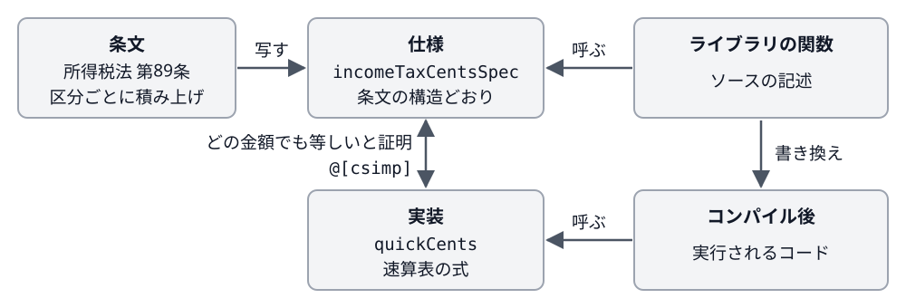

Title: Leanで書く証明付きの日付と税計算
Date: 2026-11-03 04:36


控訴期間の末日や所得税の額を求める手順は、条文を読めば決まります。
それでも、年末年始に当たる末日の繰り下げや、税率の区分の境目のように、手で計算すると間違えやすいところがあります。
計算をプログラムに書いた場合も、条文どおりに計算しているかを確かめるには手間がかかります。

[lean-ritsuryo](https://github.com/conao3/lean-ritsuryo)は、日本の法令が定める期間と税額の計算を、プログラムと証明を書いて検査できる言語であるLean 4で書いたライブラリとCLIです。
ライブラリの関数には、関数が条文どおりに計算することを示す証明を付けており、税率表の写し間違いや繰り下げの不足があればビルドの時点でエラーになります。
CLIもこれらの関数を呼んで計算します。
ライセンスはApache-2.0です。

期間と日付の計算では、民法の期間計算、祝日の判定、控訴期間などの期限を扱います。
税の計算では、所得税、相続税、消費税、延滞税、利子税、加算税の税額と、国税の端数処理を扱います。

以下の出力はどれも、CLIであるv0.5.0の `ritsuryo` で実行した結果です。

<div class="github-card" data-repo="conao3/lean-ritsuryo"><a href="https://github.com/conao3/lean-ritsuryo"><span class="github-card-name"><svg class="github-card-mark" viewBox="0 0 16 16" aria-hidden="true"><path d="M6.766 11.328c-2.063-.25-3.516-1.734-3.516-3.656 0-.781.281-1.625.75-2.188-.203-.515-.172-1.609.063-2.062.625-.078 1.468.25 1.968.703.594-.187 1.219-.281 1.985-.281.765 0 1.39.094 1.953.265.484-.437 1.344-.765 1.969-.687.218.422.25 1.515.046 2.047.5.593.766 1.39.766 2.203 0 1.922-1.453 3.375-3.547 3.64.531.344.89 1.094.89 1.954v1.625c0 .468.391.734.86.547C13.781 14.359 16 11.53 16 8.03 16 3.61 12.406 0 7.984 0 3.563 0 0 3.61 0 8.031a7.88 7.88 0 0 0 5.172 7.422c.422.156.828-.125.828-.547v-1.25c-.219.094-.5.156-.75.156-1.031 0-1.64-.562-2.078-1.609-.172-.422-.36-.672-.719-.719-.187-.015-.25-.093-.25-.187 0-.188.313-.328.625-.328.453 0 .844.281 1.25.86.313.452.64.655 1.031.655s.641-.14 1-.5c.266-.265.47-.5.657-.656"/></svg><span>conao3/<strong>lean-ritsuryo</strong></span></span><span class="github-card-description">Japanese statutory period computations (民法 期間計算, 年齢計算, 祝日) in Lean 4 with proofs on the shipped functions, and the ritsuryo CLI</span><span class="github-card-footer"><span class="github-card-language"><span class="github-card-language-color"></span>Lean</span><span class="github-card-star"><svg viewBox="0 0 16 16" aria-hidden="true"><path d="M8 .25a.75.75 0 0 1 .673.418l1.882 3.815 4.21.612a.75.75 0 0 1 .416 1.279l-3.046 2.97.719 4.192a.751.751 0 0 1-1.088.791L8 12.347l-3.766 1.98a.75.75 0 0 1-1.088-.79l.72-4.194L.818 6.374a.75.75 0 0 1 .416-1.28l4.21-.611L7.327.668A.75.75 0 0 1 8 .25Z"/></svg><span>Star</span><span class="github-card-star-count" hidden></span></span></span></a></div>


# 使ってみる

CLIの引数はAWS CLIと同じ文法で、対象と操作のサブコマンドに続けてオプションを並べて書きます。
どのコマンドもJSONを出力し、次のキーを含みます。

-   計算の結果を入れる `Result`
-   計算の途中の値を入れる `Steps`
-   根拠の条文を入れる `Basis`
-   計算の前提にした条文の読み方を入れる `Assumptions`


## 控訴期間

次の例では、2026-12-15に判決の送達を受けたときの控訴期間を計算します。
控訴期間は2週間なので本来の末日は2026-12-29ですが、この日は年末年始に当たります。
そのため、民事訴訟法 第95条第3項により末日は2027-01-04に繰り下がります。

```console
$ ritsuryo deadline compute-appeal-deadline --served-date 2026-12-15 \
    | jq '{Result: .Result, RolledOver: [.Steps.RolledOverDays[].Date]}'
{
  "Result": {
    "Deadline": "2027-01-04",
    "Period": "控訴期間",
    "Invariable": true
  },
  "RolledOver": [
    "2026-12-29",
    "2026-12-30",
    "2026-12-31",
    "2027-01-01",
    "2027-01-02",
    "2027-01-03"
  ]
}
```

上のコマンドでjqがまとめた `RolledOver` には、途中の値から取り出した、繰り下げのときに飛ばした日が並びます。
また、祝日の判定には内閣府の祝日CSVを使っており、コマンドは出力の `Data` にそのCSVの取得元とSHA-256のハッシュ値を書きます。


## 所得税

2026年分で課税総所得金額が7,000,000円のとき、所得税は974,000円になります。
国税庁の速算表は、課税される所得金額に税率を掛けて控除額を引く式で税額を求めます。
この金額の区分では7,000,000 × 23% − 636,000となり、出力の税額は速算表で求めた額と同じです。

```console
$ ritsuryo income-tax compute-tax --tax-year 2026 --taxable-income 7000000 | jq .Result
{
  "IncomeTax": 974000,
  "ReconstructionTax": 20454,
  "DefenseTax": 0,
  "Total": 994454,
  "Payable": 994400
}
```

2027年分からは税率が変わり、復興特別所得税が1.1%、防衛特別所得税が1%になります。
同じ課税総所得金額に `--tax-year 2027` を渡すと、復興特別所得税を表す `ReconstructionTax` が10714円、防衛特別所得税を表す `DefenseTax` が9740円になります。


# 条文を写して書く

lean-ritsuryoでは、計算を条文の構造どおりの定義として書いています。
以下ではこの定義を仕様と呼びます。
Leanで書いた定義は関数として実行できますが、条文が計算の手順ではなく結果の条件だけを定めているときや、条文どおりの手順では計算が遅いときは、仕様をそのまま実行には使えません。
仕様が実行できる関数かどうかと、そのまま実行して十分な速さが出るかどうかで、書き方は次の3通りに分かれます。


## 仕様をそのまま実行するとき

民事訴訟法 第95条第3項は、期間の末日が休日に当たるとき、期間はその翌日に満了すると定めます。
ここでいう休日には、日曜日、土曜日、祝日法の休日、1月2日、1月3日、12月29日から31日までの日が並びます。
ある日がこれらのどれかに当たるかを判定する仕様は、条文の列挙をそのまま並べた関数です。

```lean
def isHolidaySpec (national : Date → Bool) (d : Date) : Bool :=
  HolidayClass.holds national d .sunday || HolidayClass.holds national d .saturday ||
    HolidayClass.holds national d .nationalHoliday || HolidayClass.holds national d .newYear ||
    HolidayClass.holds national d .yearEnd
```

この仕様の関数は与えられた日付に対して条件を順に調べるだけで速く終わるので、繰り下げを計算する関数はこの仕様の関数をそのまま呼んでいます。
この場合は、仕様とは別に実装の関数を書く必要がありません。


## 仕様の実行が遅く、速い実装を書くとき

仕様の関数をそのまま実行すると遅いときは、速く計算できる実装の関数を別に書き、実装が仕様と一致することを証明します。
ライブラリから仕様と実装のどちらの関数を呼ぶかは、この一致がすべての入力で成り立つか、条件付きで成り立つかで分かれます。


### 実装がすべての入力で仕様と一致するとき

所得税法 第89条は、課税総所得金額を表の区分に分けてそれぞれに税率を掛け、合計した額を所得税の額と定めます。
この条文を写した仕様が `incomeTaxCentsSpec` で、税率表の区分を1つずつたどって税額を積み上げます。
入力の課税総所得金額は円を単位とし、関数が返す税額と式の中の控除額は百分の一円を1とする整数で表しています。

```lean
def table : List Bracket := [
  ⟨some 1950000, 5⟩, ⟨some 3300000, 10⟩, ⟨some 6950000, 20⟩, ⟨some 9000000, 23⟩,
  ⟨some 18000000, 33⟩, ⟨some 40000000, 40⟩, ⟨none, 45⟩]

def incomeTaxCentsSpec (x : Nat) : Nat :=
  progressiveCents table 0 x
```

一方、国税庁の速算表のように金額に税率を掛けて控除額を引く実装にすれば、区分をたどらずに1本の式で同じ税額を出せます。

```lean
def quickCents (x : Nat) : Nat :=
  if x ≤ 1950000 then 5 * x
  else if x ≤ 3300000 then 10 * x - 9750000
  else if x ≤ 6950000 then 20 * x - 42750000
  else if x ≤ 9000000 then 23 * x - 63600000
  else if x ≤ 18000000 then 33 * x - 153600000
  else if x ≤ 40000000 then 40 * x - 279600000
  else 45 * x - 479600000
```

そこで、仕様と速算表の実装がどの金額でも等しいことを証明し、コンパイル時に呼び出しを置き換えるための `@[csimp]` をその定理に付けます。

```lean
@[csimp]
theorem incomeTaxCentsSpec_eq_quickCents : @incomeTaxCentsSpec = @quickCents := by
  funext x
  simp only [incomeTaxCentsSpec, table, progressiveCents, quickCents]
  repeat' split
  all_goals omega
```

`@[csimp]` の付いた等式の定理があると、Leanのコンパイラは左辺の関数を呼ぶ箇所を右辺の関数を呼ぶように書き換えます。
そのため、ライブラリの税額を計算する関数は、ソースでは仕様の `incomeTaxCentsSpec` を呼んでいても、実行時には速算表の実装を呼びます。
相続税の税率表でも、同じように仕様と速算表の実装を書いて一致の定理にこの属性を付けています。



関数の呼び出しが書き換えられたことは、コンパイラが出力する中間表現であるIRで確かめられます。
確かめるために、 `incomeTaxCentsSpec x` を返すだけの関数 `probeIncome` を書いてIRを出力させました。

```console
def probeIncome (x_1 : @& tobj) : tobj :=
  let x_2 : tobj := Ritsuryo.Tax.Income.quickCents x_1;
```

IRの本体では、仕様の関数ではなく速算表の実装の関数が呼ばれています。
コンパイラは仕様を呼ぶ関数をコンパイルするときにその呼び出しを書き換えるので、 `@[csimp]` の定理はソースの中で仕様を呼ぶ関数より前に書いておきます。


### 実装が条件付きで仕様と一致するとき

民法 第143条は、週、月、年で定めた期間を暦に従って計算し、最後の週、月、年の中で起算日に応じる日である応当日の前日に満了すると定めます。
この条文を写した仕様は応当日を次のように求めます。

```lean
def correspondingDaySpec (start : Date) : Length → Option Date
  | .days n => some (start.addDaysNaive n)
  | .weeks n => some (weekCorrespondingSpec start n)
  | len =>
    let ym := lastMonthSpec start len
    if start.day ≤ ym.daysInMonth then some ⟨ym.year, ym.month, start.day⟩ else none
```

この仕様の関数は、日の期間では `addDaysNaive` で翌日を `n` 回たどり、週の期間では `weekCorrespondingSpec` で翌日をたどりながら起算日と同じ曜日の日を探します。
月と年の期間でも、 `lastMonthSpec` が年月を1か月ずつ進めて応当日のある最後の月を求めます。
どの期間でも、計算の回数が期間の日数か月数に比例して増えます。

一方、実装の関数は、日付をある基準日からの日数である通算日に直して計算します。

```lean
def correspondingDays (start : Date) : Length → Option Int
  | .days n => some (start.toDays + n)
  | .weeks n => some (start.toDays + 7 * n)
  | len =>
    let ym := lastMonth start len
    if start.day ≤ ym.daysInMonth then some (toDays ⟨ym.year, ym.month, start.day⟩) else none
```

翌日をたどる仕様に対し、この実装は日と週の期間では通算日に `n` か `7 * n` を足すだけで応当日を求めます。
月と年の期間でも、 `lastMonth` が年と月から求めた月の通し番号に `n` を足して、応当日のある最後の月を一度の足し算で求めます。

ライブラリの期間を計算する関数 `compute` はこの実装を使い、lean-ritsuryoではその結果が仕様と一致することをID付きの定理であるPER-1で証明しています。

```lean
theorem per1_compute_eq_spec (event : Date) (h : event.Valid) (startAtMidnight : Bool)
    (len : Length) :
    (compute event startAtMidnight len).start = Civil.startDateSpec event startAtMidnight ∧
      (compute event startAtMidnight len).corresponding =
        Civil.correspondingDaySpec (Civil.startDateSpec event startAtMidnight) len ∧
      (compute event startAtMidnight len).expiry = Civil.expirySpec event startAtMidnight len
```

仮定の `h : event.Valid` は、出来事の日 `event` が実在する日付であることを表します。
PER-1が一致を保証するのはこの仮定が成り立つときだけで、 `@[csimp]` はこのような仮定の付いた等式の定理には使えません。
そのため、ライブラリの関数からは実装を直接呼んでいます。
`@[csimp]` を使うには、実在する日付だけを表す型を作り、関数の引数をその型にする必要があります。


## 仕様が手順ではなく結果の条件を定めるとき

民法 第142条などの繰り下げの規定は、末日が休日なら「その翌日」に満了すると書いています。
翌日も休日のときについては書いていないので、lean-ritsuryoは休日でない最初の日まで繰り下げると読んでいます。
この読み方が定めているのは、計算の手順ではなく結果が満たすべき条件です。
このように仕様が結果の条件であって実行できる関数ではないときは、仕様の関数は書かずに、繰り下げを計算する実装の関数を1つ書いています。
実装は通算日を1日ずつ進め、休日でない日が見つかったところで止まります。

```lean
def rolloverDays (isHoliday : Int → Bool) : Nat → Int → Option Int
  | 0, _ => none
  | fuel + 1, z => if isHoliday z then rolloverDays isHoliday fuel (z + 1) else some z
```

`fuel` は調べる日数の上限で、上限までに休日でない日がなければ `none` を返します。
lean-ritsuryoは、この実装の結果が次の2つの条件を満たすことを定理ROL-1で証明しています。

-   繰り下げた日はもとの日以後で休日でない
-   もとの日から繰り下げた日の前日まではすべて休日である

ここまで見てきた書き方のうち、lean-ritsuryoの定理の多くは、実装の1つの関数が満たす条件を述べる形をとっています。
たとえば、繰り下げのほかにも次のような性質を定理として証明しています。

-   期間の末日は起算点についても長さについても単調であり、起算点を後ろにずらすか期間を長くしたときに末日が前に戻らない
-   所得税は課税所得が増えると減らず、課税所得から所得税を引いた額も減らない
-   消費税の端数処理を品目ごとにしたときと合計でしたときの税額の差は、品目の数から1を引いた値に相当する円以下である
-   民法 第900条の法定相続分の合計は1になる

ライブラリ全体の定理にはTAX-1のようなIDを付けており、そのような定理は全部で35個あります。
祝日については、祝日法 第2条と第3条から導いた日が内閣府のCSVに載っているすべての年の記録と一致することを、Leanのカーネルで確かめています。
ただし、法律が日付を直接定めていない春分の日と秋分の日だけは例外としてCSVから日付を取っています。
定理の証明はすべて `lake build` のときにLeanが検査します。
どの証明も `sorry` 、 `admit` 、 `native_decide` を使っていません。


# Leanで防げる誤り

テストは、あらかじめ選んだ入力について計算の結果を確かめます。
これに対し、定理はすべての入力について性質を述べており、Leanは `lake build` のたびにその証明を検査します。
そのため、テストに選んだ入力では計算の結果がずれないような誤りであっても、ビルドの時点でエラーになります。


## 税率表の写し間違い

試しに速算表の控除額を1つ写し間違えたことにして、695万円超900万円以下の区分の636,000円を636,500円に変え、百分の一円を単位とするコードの値を書き換えてみました。

```lean
else if x ≤ 9000000 then 23 * x - 63650000
```

すると、仕様と速算表の式が等しいという証明が通らず、Leanがエラーを出します。

```console
$ lake env lean typo.lean
typo.lean:16:12: error: omega could not prove the goal:
```

この定理の証明は金額を税率表の7つの区分で場合分けし、区分ごとに2つの式が等しいことを `omega` で示します。
この手続きは、整数の1次式の等式と不等式を判定するLeanの機能です。
検査で証明できずに残ったのは、695万円超900万円以下の区分だけでした。
この区分では条文どおりの積み上げが `23 * x - 63600000` になり、写し間違えた `23 * x - 63650000` とはどの金額でも500円ずれるので、等式が成り立ちません。

700万円を例に使うテストでもこの誤りは見つかりますが、4,000万円を超える区分の誤りは、その金額を例に入れないテストでは見つかりません。
一方、証明の検査では、7つの区分のどれに誤りがあってもLeanがその区分でエラーを出します。

これに対し、区分の境目の `x ≤ 6950000` を `x < 6950000` に変えても、証明は通りました。
ちょうど6,950,000円のときは、20%の区分の式でも23%の区分の式でも税額が962,500円になるため、境目の不等号を変える前と後でどの金額に対しても税額が変わらないからです。


## 繰り下げを1日で止める誤り

条文の「その翌日」という言葉を文字どおり受け取り、繰り下げの実装を1日だけ進める関数にすると、翌日も休日のときにその休日が期間の末日になってしまいます。
次のコードでは、この関数が返した日が民事訴訟法 第95条第3項の休日に当たることをLeanのカーネルで確かめています。
具体的には、2026-12-29を1日だけ繰り下げた2026-12-30も休日と判定されます。

```lean
def court : Date → Bool := RolloverRule.civilProcedure95.isHoliday Holiday.isHoliday

def rolloverOnce (H : Date → Bool) (d : Date) : Date :=
  if H d then Date.ofDays (d.toDays + 1) else d

example : court (rolloverOnce court ⟨2026, 12, 29⟩) = true := by decide +kernel
```

この関数はROL-1の1つ目の条件である「繰り下げた日が休日でないこと」を満たさないので、この関数に対してROL-1と同じ定理を証明しようとしても通りません。
反対に、休日なら必ず2日進めるような繰り下げすぎる関数も、2つ目の条件である「繰り下げた日の前日までがすべて休日であること」を満たさないので証明できません。


## 月末をまたぐ期間

2025-01-31から始まる期間では、最初の1か月は2025-02-28に満了し、そこから続く1か月は2025-03-31に満了します。
一方、同じ日から始まる2か月の期間は2025-03-30に満了します。
そのため、1か月の計算を2回くり返して2か月の期間を求める実装にすると、この例で仕様の末日と1日ずれるため、その実装に対してはPER-1を証明できません。


## 防げない誤り

一方で、Leanが確かめるのは、実装が仕様と一致することと、実装が定理に書いた性質を満たすことだけです。
仕様そのものが条文を読み違えていれば、実装も読み違えたとおりに計算し、証明もそのまま通るので、条文の読み違えはLeanだけでは防げません。

この誤りを減らすため、lean-ritsuryoでは仕様を条文の構造どおりに書き、人が条文と並べて読み比べられるようにしています。
また、前提にした条文の読み方をリポジトリの `docs/interpretation.md` に書き出し、計算の結果を国税庁のタックスアンサーに載っている計算例と照らし合わせています。


# 実行時間とバイナリの大きさ

x86\_64-linux向けのリリースの `ritsuryo` は3.4 MBの実行ファイル1つで、動かすのにほかに必要なのはCライブラリだけです。
1回の実行は約6 msで終わります。

Leanで書いたプログラムは、モジュールの読み込み方によってはコンパイラ自体がリンクされてバイナリが140 MBになります。
lean-ritsuryoでも、関数に根拠の条文を記録するために独自の属性を使っており、この属性を定義するモジュールは `Lean` をimportしています。
このモジュールを通常のimportで読み込むと、実行ファイルに `Lean` 全体がリンクされてしまいます。
そこでlean-ritsuryoはこのモジュールを `meta import` で読み込み、独自の属性をコンパイルのときだけ使うようにしてバイナリを小さく保っています。


# 入手

[GitHubのリリース](https://github.com/conao3/lean-ritsuryo/releases)に、x86\_64-linux、aarch64-linux、aarch64-darwinのアーカイブがあります。

```sh
curl -sSfL https://github.com/conao3/lean-ritsuryo/releases/download/v0.5.0/ritsuryo-x86_64-linux.tar.gz | tar -xz
./ritsuryo --version
# ritsuryo 0.5.0
```

Nixを使う場合は `nix run github:conao3/lean-ritsuryo -- help` で実行できます。

リポジトリは<https://github.com/conao3/lean-ritsuryo>です。
条文の読み方の違いや計算の誤りに気づいたら、Issueで教えてください。

