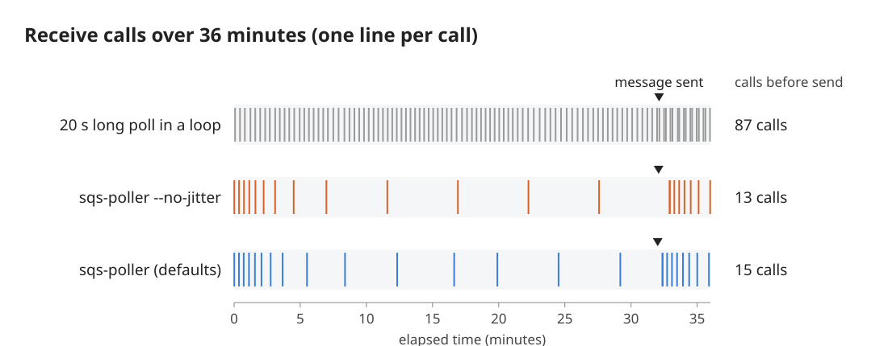

Title: sqs-poller: an SQS poller in Rust that cuts idle receives from 4,320 to about 350 a day
Date: 2026-11-28 00:09
Updated: 2026-11-28 00:09
Draft: true
Lang: en
Original: /blog/2026/e4766e
Tags: rust aws sqs release rust-sqs-poller


I built `sqs-poller`, an Amazon SQS poller in Rust that applies exponential backoff while the queue is empty and drops back to the shortest interval when a message arrives.
A 20 second long poll in a loop makes 4,320 receive calls a day, even for one empty queue.

`sqs-poller` sleeps after each empty receive, for 1 second at first and doubling up to 300 seconds, so at the defaults it makes about 350 receive calls a day.

The repository is [conao3/rust-sqs-poller](https://github.com/conao3/rust-sqs-poller), under the Apache-2.0 license.
Version 0.1.1 of `sqs-poller` is on crates.io, and you can use it as a CLI or as a Rust library.

<div class="github-card" data-repo="conao3/rust-sqs-poller"><a href="https://github.com/conao3/rust-sqs-poller"><span class="github-card-name"><svg class="github-card-mark" viewBox="0 0 16 16" aria-hidden="true"><path d="M6.766 11.328c-2.063-.25-3.516-1.734-3.516-3.656 0-.781.281-1.625.75-2.188-.203-.515-.172-1.609.063-2.062.625-.078 1.468.25 1.968.703.594-.187 1.219-.281 1.985-.281.765 0 1.39.094 1.953.265.484-.437 1.344-.765 1.969-.687.218.422.25 1.515.046 2.047.5.593.766 1.39.766 2.203 0 1.922-1.453 3.375-3.547 3.64.531.344.89 1.094.89 1.954v1.625c0 .468.391.734.86.547C13.781 14.359 16 11.53 16 8.03 16 3.61 12.406 0 7.984 0 3.563 0 0 3.61 0 8.031a7.88 7.88 0 0 0 5.172 7.422c.422.156.828-.125.828-.547v-1.25c-.219.094-.5.156-.75.156-1.031 0-1.64-.562-2.078-1.609-.172-.422-.36-.672-.719-.719-.187-.015-.25-.093-.25-.187 0-.188.313-.328.625-.328.453 0 .844.281 1.25.86.313.452.64.655 1.031.655s.641-.14 1-.5c.266-.265.47-.5.657-.656"/></svg><span>conao3/<strong>rust-sqs-poller</strong></span></span><span class="github-card-description">An SQS poller that backs off exponentially while the queue is empty and resets the moment a message arrives</span><span class="github-card-footer"><span class="github-card-language"><span class="github-card-language-color" style="background-color: #dea584"></span>Rust</span><span class="github-card-star"><svg viewBox="0 0 16 16" aria-hidden="true"><path d="M8 .25a.75.75 0 0 1 .673.418l1.882 3.815 4.21.612a.75.75 0 0 1 .416 1.279l-3.046 2.97.719 4.192a.751.751 0 0 1-1.088.791L8 12.347l-3.766 1.98a.75.75 0 0 1-1.088-.79l.72-4.194L.818 6.374a.75.75 0 0 1 .416-1.28l4.21-.611L7.327.668A.75.75 0 0 1 8 .25Z"/></svg><span>Star</span><span class="github-card-star-count" hidden></span></span></span></a></div>


# Usage

Install it with Cargo and start it with the queue URL.

```console
$ cargo install sqs-poller
$ sqs-poller --queue-url https://sqs.ap-northeast-1.amazonaws.com/123456789012/jobs
```

It hands each message, one at a time, to the one sink you pick with a startup option.
`sqs-poller` deletes a message from the queue only when the sink accepts it, and leaves the rest in the queue.

-   Standard output (default): writes each message as one line of JSON.
-   `--endpoint <URL>` : POSTs the message body, with the message ID in the `x-sqs-message-id` header. A 2xx response deletes the message.
-   `--command <command>` : runs the command once per message, with the body on standard input and the ID in the `SQS_MESSAGE_ID` environment variable. Exit status 0 deletes the message.

With `--endpoint`, your app gets each message as an HTTP POST, the way the [SQS daemon](https://docs.aws.amazon.com/elasticbeanstalk/latest/dg/using-features-managing-env-tiers.html#worker-daemon) in an Elastic Beanstalk worker environment delivers it.

A message left in the queue becomes receivable again when its visibility timeout expires, and moves to the dead-letter queue once its receive count passes the limit in the queue's redrive policy.
`sqs-poller` leaves rejected messages in the queue and does nothing else to them, so your current dead-letter queue setup keeps working.

`sqs-poller` reads AWS credentials and the region from environment variables, `~/.aws/config` or an IAM role, in the standard order of the AWS SDK, and `--region` and `--profile` override them.
Ctrl-C or SIGTERM stops it, and it writes the run's counters, such as the number of received messages, to standard error.


## Trying it on a local SQS-compatible server

[ElasticMQ](https://github.com/softwaremill/elasticmq) runs the SQS API on your own machine, so you can try `sqs-poller` without an AWS account.
ElasticMQ is in nixpkgs, and I started it with `nix run`.

```console
$ nix run nixpkgs#elasticmq-server-bin
```

In another terminal, set dummy credentials and `AWS_ENDPOINT_URL`, then create a queue and send two messages with the AWS CLI.
AWS CLI v2 and the AWS SDK for Rust both read the `AWS_ENDPOINT_URL` environment variable, so `sqs-poller` connects to ElasticMQ too.

```sh
export AWS_ACCESS_KEY_ID=x AWS_SECRET_ACCESS_KEY=x AWS_REGION=us-east-1
export AWS_ENDPOINT_URL=http://localhost:9324
aws sqs create-queue --queue-name jobs
Q=http://localhost:9324/000000000000/jobs
aws sqs send-message --queue-url $Q --message-body '{"job":"resize","id":1}'
aws sqs send-message --queue-url $Q --message-body '{"job":"resize","id":2}'
```

Start `sqs-poller` and it writes the two messages as JSON lines; stop it with Ctrl-C and it prints the counters.

```console
$ sqs-poller --queue-url $Q
{"messageId":"f3af975d-70e5-4648-801e-e2b67d5641e3","body":"{\"job\":\"resize\",\"id\":1}","attributes":{}}
{"messageId":"5c9d1371-6322-4831-823f-fd1e7bfb0fb9","body":"{\"job\":\"resize\",\"id\":2}","attributes":{}}
^Csqs-poller: stopped. received 2, deleted 2, failed 0, empty polls 0, receive errors 0
```

Pass `--command` a script that exits with status 1 only when the body contains `fail`, and you can watch a failed message stay in the queue.

```sh
#!/bin/sh
body=$(cat)
echo "$(date +%T) $SQS_MESSAGE_ID $body"
case "$body" in
  *fail*) exit 1 ;;
esac
```

I saved the script as `handle.sh`, sent two messages, `ok` and `fail`, and started the poller.
ElasticMQ gives a queue a 30 second visibility timeout by default, so `fail` came back 30 seconds later.

```console
$ sqs-poller --queue-url $Q --command ./handle.sh
13:32:01 e6db8330-d606-4199-87c6-23c3b1ee1395 ok
13:32:02 1623e4ee-9dcd-4875-8e9b-e5b1565b23ba fail
sqs-poller: handler failed: command exited with exit status: 1
13:32:32 1623e4ee-9dcd-4875-8e9b-e5b1565b23ba fail
sqs-poller: handler failed: command exited with exit status: 1
^Csqs-poller: stopped. received 3, deleted 1, failed 2, empty polls 1, receive errors 0
```


# How the sleep between polls grows

`sqs-poller` repeats these steps.

1.  Receive from the queue with a long poll of up to 20 seconds.
2.  If messages arrive, hand them to the sink one at a time and receive again at once.
3.  If the receive comes back empty, sleep for the current delay and double it. The delay goes 1, 2, 4 seconds and stops growing at 300 seconds.
4.  When a message arrives, the delay drops back to 1 second.

By default it uses equal jitter, which picks the second half of each sleep at random, so a 300 second delay becomes a sleep of 150 to 300 seconds.
Several `sqs-poller` processes on one queue then wake up at different times, and `--no-jitter` makes each sleep the full delay.

To see the real intervals, I created three queues in ElasticMQ and watched each one a different way for 36 minutes.
The baseline is a consumer that runs the AWS CLI's `aws sqs receive-message --wait-time-seconds 20` in a shell loop.

An HTTP proxy between each consumer and ElasticMQ logged the time of every receive call, and at the 32 minute mark I sent one message to each of the three queues.



<table border="2" cellspacing="0" cellpadding="6" rules="groups" frame="hsides">


<colgroup>
<col  class="org-left" />

<col  class="org-right" />
</colgroup>
<thead>
<tr>
<th scope="col" class="org-left">Consumer</th>
<th scope="col" class="org-right">Receive calls in the 32 minutes before the send</th>
</tr>
</thead>
<tbody>
<tr>
<td class="org-left">20 s long poll in a loop</td>
<td class="org-right">87</td>
</tr>

<tr>
<td class="org-left"><code>sqs-poller --no-jitter</code></td>
<td class="org-right">13</td>
</tr>

<tr>
<td class="org-left"><code>sqs-poller</code> (defaults)</td>
<td class="org-right">15</td>
</tr>
</tbody>
</table>

With `--no-jitter`, the sleep after each receive grew 1, 2, 4 seconds up to 256 seconds and then hit the 300 second cap, and from then on, with the 20 second long poll, it made one receive call every 320 seconds.
From sending the message to receiving it took 50 seconds with `--no-jitter` and 22 seconds at the defaults.

After the message, the delay dropped back to 1 second and grew again through 1, 2, 4 seconds.
The AWS CLI loop does not delete the message, so after the send it kept receiving the same message every 30 seconds, once per visibility timeout.


# Receive calls and cost

Once the delay reaches 300 seconds, `--no-jitter` makes one call every 320 seconds, a 20 second long poll plus a 300 second sleep, which comes to 270 receive calls a day.
At the defaults the sleep falls between 150 and 300 seconds, 225 on average, so it comes to about 350 a day.

A 20 second long poll in a loop makes 4,320 receive calls a day, so `sqs-poller` cuts the count by about 92% at the defaults and about 94% with `--no-jitter`.

SQS bills by the [number of requests](https://aws.amazon.com/sqs/pricing/), and a receive that returns no message counts as one request.
[Long polling](https://docs.aws.amazon.com/AWSSimpleQueueService/latest/SQSDeveloperGuide/sqs-short-and-long-polling.html#sqs-long-polling) cuts down empty responses, but its wait tops out at 20 seconds, so watching an empty queue nonstop still costs 4,320 receive calls a day.

At the time of writing, standard queue requests in us-east-1 cost $0.40 per million, and the first million each month are free.
One consumer on a 20 second long poll makes 129,600 receive calls in 30 days, which fits in the free tier, and costs $0.05 a month even with the free tier used up.

The gap in money grows with the number of queues and consumers: watching 100 queues with one consumer each comes to 12.96 million calls in 30 days, or $4.78 a month after the free million.
At the defaults of `sqs-poller` the same 100 queues take about 1.06 million calls, around $0.02 a month.

In exchange, `sqs-poller` picks up a message that arrives during a sleep only when the sleep ends, and in the measurement above that delay was 50 and 22 seconds.
At the 300 second cap a message can wait up to 5 minutes, so lower `--max-interval-secs` for a queue you need to handle right away.

`sqs-poller` receives without sleeping as long as messages keep arriving, so a busy queue drains at the same speed.


# Using it as a Rust library

`sqs-poller` also works as a Rust library: pass `run` a config, an SQS client, a function that takes each message, and a `CancellationToken` to stop it.
`run` deletes a message when the function returns `Ok(())`, and leaves it in the queue when the function returns `Err`.

```toml
[dependencies]
sqs-poller = "0.1"
aws-config = "1"
aws-sdk-sqs = "1"
tokio = { version = "1", features = ["macros", "rt-multi-thread", "signal"] }
tokio-util = "0.7"
```

```rust
use sqs_poller::{run, Config};
use tokio_util::sync::CancellationToken;

#[tokio::main]
async fn main() {
    let aws = aws_config::load_defaults(aws_config::BehaviorVersion::latest()).await;
    let client = aws_sdk_sqs::Client::new(&aws);
    let config = Config::new("http://localhost:9324/000000000000/jobs");

    let shutdown = CancellationToken::new();
    let trigger = shutdown.clone();
    tokio::spawn(async move {
        tokio::signal::ctrl_c().await.unwrap();
        trigger.cancel();
    });

    let stats = run(config, client, |message| async move {
        let body = message.body.unwrap_or_default();
        if body.contains("\"fail\"") {
            return Err(format!("cannot handle {body}").into());
        }
        println!("handled {body}");
        Ok(())
    }, shutdown).await;
    println!("{stats:?}");
}
```

I purged the `jobs` queue, sent `{"job":"resize","id":1}` and `{"job":"fail"}` to it, ran the program and stopped it with Ctrl-C, and it printed the counters that `run` returned.

```console
$ cargo run -q --release
handled {"job":"resize","id":1}
^CStats { received: 2, deleted: 1, failed: 1, empty_polls: 1, receive_errors: 0 }
```

`run` calls the function for one message at a time, in receive order.
Receive, delete and handler errors go to the callback you set in `Config::on_error`, and after a receive error `run` grows the delay as it does after an empty receive and tries again.

If you only want the sleep math, use the `Backoff` type by itself in your own receive loop.


# Wrapping up

If you run consumers that watch queues that sit empty most of the time, try swapping them for `sqs-poller`.

