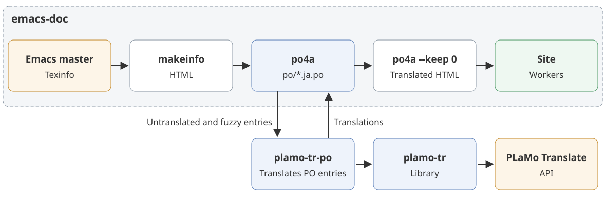
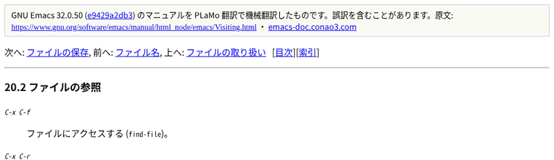

Title: plamo-tr, plamo-tr-po, and emacs-doc: translating the Emacs manuals into Japanese with PLaMo Translate
Date: 2026-11-27 23:22
Updated: 2026-11-27 23:22
Draft: true
Lang: en
Original: /blog/2026/29c4d6
Tags: emacs rust cli llm translation gettext release rust-plamo-tr rust-plamo-tr-po emacs-doc


I wrote `plamo-tr`, a CLI for PLaMo Translate, and `plamo-tr-po`, which fills gettext PO files with PLaMo Translate, and used the two to publish the GNU Emacs manuals machine-translated into Japanese at <https://emacs-doc.conao3.com>.

`plamo-tr` translates text, `plamo-tr-po` translates the entries of a PO file through `plamo-tr`, and emacs-doc turns the Emacs manuals into PO files and builds the translated HTML from them.
With the work split this way, I only send the changed paragraphs back to PLaMo Translate when the Emacs manuals change.

The repositories are [conao3/rust-plamo-tr](https://github.com/conao3/rust-plamo-tr), [conao3/rust-plamo-tr-po](https://github.com/conao3/rust-plamo-tr-po), and [conao3/emacs-doc](https://github.com/conao3/emacs-doc), and both CLIs are under the Apache-2.0 license.
emacs-doc distributes the manuals and their translations under the GFDL 1.3 or later, the license of the original manuals, and its scripts and configuration under Apache-2.0.

I wrote all three on my own, and they're unofficial: none of them is affiliated with Preferred Networks or the Free Software Foundation.



<div class="github-card" data-repo="conao3/rust-plamo-tr"><a href="https://github.com/conao3/rust-plamo-tr"><span class="github-card-name"><svg class="github-card-mark" viewBox="0 0 16 16" aria-hidden="true"><path d="M6.766 11.328c-2.063-.25-3.516-1.734-3.516-3.656 0-.781.281-1.625.75-2.188-.203-.515-.172-1.609.063-2.062.625-.078 1.468.25 1.968.703.594-.187 1.219-.281 1.985-.281.765 0 1.39.094 1.953.265.484-.437 1.344-.765 1.969-.687.218.422.25 1.515.046 2.047.5.593.766 1.39.766 2.203 0 1.922-1.453 3.375-3.547 3.64.531.344.89 1.094.89 1.954v1.625c0 .468.391.734.86.547C13.781 14.359 16 11.53 16 8.03 16 3.61 12.406 0 7.984 0 3.563 0 0 3.61 0 8.031a7.88 7.88 0 0 0 5.172 7.422c.422.156.828-.125.828-.547v-1.25c-.219.094-.5.156-.75.156-1.031 0-1.64-.562-2.078-1.609-.172-.422-.36-.672-.719-.719-.187-.015-.25-.093-.25-.187 0-.188.313-.328.625-.328.453 0 .844.281 1.25.86.313.452.64.655 1.031.655s.641-.14 1-.5c.266-.265.47-.5.657-.656"/></svg><span>conao3/<strong>rust-plamo-tr</strong></span></span><span class="github-card-description">Translate text from the command line with PLaMo Translate (unofficial)</span><span class="github-card-footer"><span class="github-card-language"><span class="github-card-language-color" style="background-color: #dea584"></span>Rust</span><span class="github-card-star"><svg viewBox="0 0 16 16" aria-hidden="true"><path d="M8 .25a.75.75 0 0 1 .673.418l1.882 3.815 4.21.612a.75.75 0 0 1 .416 1.279l-3.046 2.97.719 4.192a.751.751 0 0 1-1.088.791L8 12.347l-3.766 1.98a.75.75 0 0 1-1.088-.79l.72-4.194L.818 6.374a.75.75 0 0 1 .416-1.28l4.21-.611L7.327.668A.75.75 0 0 1 8 .25Z"/></svg><span>Star</span><span class="github-card-star-count" hidden></span></span></span></a></div>

<div class="github-card" data-repo="conao3/rust-plamo-tr-po"><a href="https://github.com/conao3/rust-plamo-tr-po"><span class="github-card-name"><svg class="github-card-mark" viewBox="0 0 16 16" aria-hidden="true"><path d="M6.766 11.328c-2.063-.25-3.516-1.734-3.516-3.656 0-.781.281-1.625.75-2.188-.203-.515-.172-1.609.063-2.062.625-.078 1.468.25 1.968.703.594-.187 1.219-.281 1.985-.281.765 0 1.39.094 1.953.265.484-.437 1.344-.765 1.969-.687.218.422.25 1.515.046 2.047.5.593.766 1.39.766 2.203 0 1.922-1.453 3.375-3.547 3.64.531.344.89 1.094.89 1.954v1.625c0 .468.391.734.86.547C13.781 14.359 16 11.53 16 8.03 16 3.61 12.406 0 7.984 0 3.563 0 0 3.61 0 8.031a7.88 7.88 0 0 0 5.172 7.422c.422.156.828-.125.828-.547v-1.25c-.219.094-.5.156-.75.156-1.031 0-1.64-.562-2.078-1.609-.172-.422-.36-.672-.719-.719-.187-.015-.25-.093-.25-.187 0-.188.313-.328.625-.328.453 0 .844.281 1.25.86.313.452.64.655 1.031.655s.641-.14 1-.5c.266-.265.47-.5.657-.656"/></svg><span>conao3/<strong>rust-plamo-tr-po</strong></span></span><span class="github-card-description">Translate gettext PO files with PLaMo Translate (unofficial)</span><span class="github-card-footer"><span class="github-card-language"><span class="github-card-language-color" style="background-color: #dea584"></span>Rust</span><span class="github-card-star"><svg viewBox="0 0 16 16" aria-hidden="true"><path d="M8 .25a.75.75 0 0 1 .673.418l1.882 3.815 4.21.612a.75.75 0 0 1 .416 1.279l-3.046 2.97.719 4.192a.751.751 0 0 1-1.088.791L8 12.347l-3.766 1.98a.75.75 0 0 1-1.088-.79l.72-4.194L.818 6.374a.75.75 0 0 1 .416-1.28l4.21-.611L7.327.668A.75.75 0 0 1 8 .25Z"/></svg><span>Star</span><span class="github-card-star-count" hidden></span></span></span></a></div>

<div class="github-card" data-repo="conao3/emacs-doc"><a href="https://github.com/conao3/emacs-doc"><span class="github-card-name"><svg class="github-card-mark" viewBox="0 0 16 16" aria-hidden="true"><path d="M6.766 11.328c-2.063-.25-3.516-1.734-3.516-3.656 0-.781.281-1.625.75-2.188-.203-.515-.172-1.609.063-2.062.625-.078 1.468.25 1.968.703.594-.187 1.219-.281 1.985-.281.765 0 1.39.094 1.953.265.484-.437 1.344-.765 1.969-.687.218.422.25 1.515.046 2.047.5.593.766 1.39.766 2.203 0 1.922-1.453 3.375-3.547 3.64.531.344.89 1.094.89 1.954v1.625c0 .468.391.734.86.547C13.781 14.359 16 11.53 16 8.03 16 3.61 12.406 0 7.984 0 3.563 0 0 3.61 0 8.031a7.88 7.88 0 0 0 5.172 7.422c.422.156.828-.125.828-.547v-1.25c-.219.094-.5.156-.75.156-1.031 0-1.64-.562-2.078-1.609-.172-.422-.36-.672-.719-.719-.187-.015-.25-.093-.25-.187 0-.188.313-.328.625-.328.453 0 .844.281 1.25.86.313.452.64.655 1.031.655s.641-.14 1-.5c.266-.265.47-.5.657-.656"/></svg><span>conao3/<strong>emacs-doc</strong></span></span><span class="github-card-description">Japanese machine translation of the GNU Emacs manuals with PLaMo Translate, served at emacs-doc.conao3.com</span><span class="github-card-footer"><span class="github-card-language"><span class="github-card-language-color" style="background-color: #89e051"></span>Shell</span><span class="github-card-star"><svg viewBox="0 0 16 16" aria-hidden="true"><path d="M8 .25a.75.75 0 0 1 .673.418l1.882 3.815 4.21.612a.75.75 0 0 1 .416 1.279l-3.046 2.97.719 4.192a.751.751 0 0 1-1.088.791L8 12.347l-3.766 1.98a.75.75 0 0 1-1.088-.79l.72-4.194L.818 6.374a.75.75 0 0 1 .416-1.28l4.21-.611L7.327.668A.75.75 0 0 1 8 .25Z"/></svg><span>Star</span><span class="github-card-star-count" hidden></span></span></span></a></div>


# plamo-tr, a CLI for PLaMo Translate

`plamo-tr` calls the same API as the browser extension of [PLaMo Translate](https://translate.preferredai.jp/) and prints the translation as JSON.
With Nix, you can run it without installing it.

```console
$ nix run github:conao3/rust-plamo-tr -- text translate-text \
    --text "Emacs is the extensible, customizable, self-documenting real-time display editor."
{
  "TranslatedText": "Emacsは、拡張可能でカスタマイズでき、自己文書化されたリアルタイム表示エディタです。",
  "SourceLanguageCode": null,
  "TargetLanguageCode": "ja"
}
```

If you don't give a target language, `plamo-tr` translates Japanese into English and any other language into Japanese.
To read standard input, pass `--text file:///dev/stdin`, and to get only the translation, pipe the JSON to `jq`.

```console
$ echo "Emacsのマニュアルを日本語で読めるようにしました。" \
    | plamo-tr text translate-text --text file:///dev/stdin | jq -r .TranslatedText
I've made the Emacs manual available in Japanese.
```

`plamo-tr` signs in with a refresh token that you copy out of a browser signed in to the PLaMo Translate web app, and the [Login section of the README](https://github.com/conao3/rust-plamo-tr#login) shows how to copy it and where to save it.
Your translations count toward the browser extension quota of your plan.

The command line has the same shape as [plamo-tr-local](../../../../../../../../../../blog/2026/c5f673), which runs PLaMo 3 Translate on your own machine: both take named parameters after `text translate-text`.

`plamo-tr` also builds as a Rust library, and I built `plamo-tr-po` on it.
Its [Translator::translate\_batch](https://github.com/conao3/rust-plamo-tr/blob/a8ebe3f2235743c4845ab9a38b7c17db5ffecd0e/src/api.rs#L199-L207) sends several texts in one request, keeps their HTML tags, and renews the ID token while a long job runs.


# plamo-tr-po, a translator for PO files

A gettext PO file lists entries, each a pair of an original `msgid` and a translated `msgstr`, and when the original changes, `msgmerge` flags the entry `fuzzy` so you know it needs a new translation.
`plamo-tr-po` sends the untranslated entries and the `fuzzy` entries it machine-translated earlier to PLaMo Translate, and writes the translations back into the PO file in place.

To try it, I made `sample.ja.po` with two paragraphs modeled on the Emacs manual and one code block, all with an empty `msgstr`, and ran `plamo-tr-po` on it.

```console
$ export PLAMO_AUTH_FILE=~/.config/plamo-tr/auth.json
$ plamo-tr-po po-file translate-po-files --source-language en --format html \
    --skip-context "<(pre|style|script)>" --po-files sample.ja.po
2 distinct msgids in 2 entries to translate; 1 entries skipped by --skip-context; 0 fuzzy entries with a human translation left as is
{
  "PoFiles": [
    "sample.ja.po"
  ],
  "DryRun": false,
  "PendingMsgidCount": 2,
  "PendingEntryCount": 2,
  "SkippedEntryCount": 1,
  "HumanFuzzyEntryCount": 0,
  "TranslatedMsgidCount": 2,
  "RejectedMsgidCount": 0
}
```

Here are the three entries of `sample.ja.po` after the run.

```po
# Machine-translated by PLaMo Translate.
#. type: Content of: <html><body><p>
#: build/html/emacs/Visiting.html
msgid "To visit a file, type <kbd class=\"kbd\">C-x C-f</kbd> (<code class=\"code\">find-file</code>)."
msgstr "ファイルにアクセスするには、<kbd class=\"kbd\">C-x C-f</kbd> (<code class=\"code\">find-file</code>) と入力してください。"

# Machine-translated by PLaMo Translate.
#. type: Content of: <html><body><p>
#: build/html/emacs/Saving.html
msgid "<kbd class=\"kbd\">C-x C-s</kbd> saves the buffer in its file."
msgstr "<kbd class=\"kbd\">C-x C-s</kbd> はバッファをファイルに保存します。"

#. type: Content of: <html><body><pre>
#: build/html/emacs/Visiting.html
#, no-wrap
msgid "C-x C-f test.emacs <kbd class=\"key\">RET</kbd>\n"
msgstr ""
```

Each translated entry gets the comment `# Machine-translated by PLaMo Translate.`, and the contents of `<kbd>` and `<code>` stay in English.
With `--format html`, `plamo-tr-po` [replaces](https://github.com/conao3/rust-plamo-tr-po/blob/39b432a186ba1fdd7e71a57cc50a7017fcb9690e/src/protect.rs#L1-L6) elements such as `code` and `kbd` with strings of the form `<x-N/>` before it sends the text, and puts them back when the translation returns.

If a translation changes any [other tags](https://github.com/conao3/rust-plamo-tr-po/blob/39b432a186ba1fdd7e71a57cc50a7017fcb9690e/src/main.rs#L170-L183) of the original, `plamo-tr-po` drops it and [retries that entry alone](https://github.com/conao3/rust-plamo-tr-po/blob/39b432a186ba1fdd7e71a57cc50a7017fcb9690e/src/main.rs#L215-L251), and if the tags still change, it leaves the entry untranslated.
It skipped the third entry, which came from `<pre>`, because its `#.` comment matched the `--skip-context` regular expression.


# Changed originals and hand-corrected translations

Of the `fuzzy` entries, `plamo-tr-po` retranslates only the ones with the comment `# Machine-translated by PLaMo Translate.`.
A `fuzzy` entry without that comment holds a translation someone wrote by hand, so `plamo-tr-po` leaves it for a person to review.

The following `update.ja.po` has two entries whose originals changed: the first holds a machine translation, and the second holds a hand-written one.
The `#|` lines hold the previous originals, which `msgmerge --previous` keeps.

```po
# Machine-translated by PLaMo Translate.
#. type: Content of: <html><body><p>
#: build/html/emacs/Saving.html
#, fuzzy
#| msgid "<kbd class=\"kbd\">C-x C-s</kbd> saves the buffer."
msgid "<kbd class=\"kbd\">C-x C-s</kbd> saves the buffer in its file."
msgstr "<kbd class=\"kbd\">C-x C-s</kbd> はバッファを保存します。"

#. type: Content of: <html><body><p>
#: build/html/emacs/Saving.html
#, fuzzy
#| msgid "<kbd class=\"kbd\">C-x s</kbd> saves any buffers."
msgid "<kbd class=\"kbd\">C-x s</kbd> saves any or all modified buffers."
msgstr "<kbd class=\"kbd\">C-x s</kbd> でバッファを保存します。"
```

```console
$ plamo-tr-po po-file translate-po-files --source-language en --format html \
    --po-files update.ja.po > /dev/null
1 distinct msgids in 1 entries to translate; 0 entries skipped by --skip-context; 1 fuzzy entries with a human translation left as is
```

`plamo-tr-po` retranslated only the first entry and removed its `fuzzy` flag and previous original.
The hand-written second entry is still `fuzzy`.

```po
# Machine-translated by PLaMo Translate.
#. type: Content of: <html><body><p>
#: build/html/emacs/Saving.html
msgid "<kbd class=\"kbd\">C-x C-s</kbd> saves the buffer in its file."
msgstr "<kbd class=\"kbd\">C-x C-s</kbd> はバッファをファイルに保存します。"

#. type: Content of: <html><body><p>
#: build/html/emacs/Saving.html
#, fuzzy
#| msgid "<kbd class=\"kbd\">C-x s</kbd> saves any buffers."
msgid "<kbd class=\"kbd\">C-x s</kbd> saves any or all modified buffers."
msgstr "<kbd class=\"kbd\">C-x s</kbd> でバッファを保存します。"
```

After you correct a machine translation by hand, delete the comment line of that entry, and `plamo-tr-po` won't overwrite your translation.


# emacs-doc, the Emacs manuals in Japanese

emacs-doc translates the manuals on the master branch of [Emacs](https://github.com/emacs-mirror/emacs) into Japanese and serves them at <https://emacs-doc.conao3.com>.
It covers three manuals: the GNU Emacs Manual, the GNU Emacs Lisp Reference Manual, and An Introduction to Programming in Emacs Lisp.

Every page says that it's a machine translation and links to the original page on gnu.org.



emacs-doc handles the manuals with [po4a](https://po4a.org/), a tool that extracts the paragraphs of a document into a PO file and rebuilds the translated document from it.
You build the site by running these targets of the [Makefile](https://github.com/conao3/emacs-doc/blob/da1a253c2b1dab2da36c89ba6f46893cfa52c582/Makefile) in order:

1.  `make fetch-latest` checks out the `doc` directory of the Emacs master branch and writes its commit to `EMACS_REVISION`.
2.  `make html` runs `makeinfo --html` to build each manual twice: one page per node, and the whole manual on one page.
3.  `make pot` has po4a extract the paragraphs of the HTML into `po/<manual>.ja.po` and merges it with the previous PO file through `msgmerge --previous`. A paragraph whose original changed becomes `fuzzy`, and a new paragraph is untranslated.
4.  `make translate` runs `plamo-tr-po` on the untranslated entries and the machine-translated `fuzzy` entries.
5.  `make site` has po4a write the translated HTML with `--keep 0` and adds the link to the original to each page. A paragraph without a translation shows in English.

At the time of this post, emacs-doc translates the manuals of Emacs [e9429a2db3](https://github.com/emacs-mirror/emacs/commit/e9429a2db33d5ef8c1195956d80639a1ae490435), and `make stats` counts these entries:

```console
$ make -s stats
emacs: 38083 translated messages, 4 fuzzy translations, 491 untranslated messages.
elisp: 52191 translated messages, 6 fuzzy translations, 2377 untranslated messages.
eintr: 6808 translated messages, 1 fuzzy translation, 784 untranslated messages.
```

Of the untranslated entries, 445 in emacs, 2,278 in elisp, and 769 in eintr are code that po4a extracted from `<pre>` and similar elements, and `--skip-context` keeps them out of the translation.
That leaves 46 untranslated entries in emacs, 99 in elisp, and 15 in eintr.

I start the GitHub Actions [workflow](https://github.com/conao3/emacs-doc/blob/da1a253c2b1dab2da36c89ba6f46893cfa52c582/.github/workflows/update.yml) `Update` by hand, and it pulls in the Emacs master branch, merges the PO files, and rebuilds the site.
New paragraphs and paragraphs whose original changed show in English until you run `make translate` locally, push the PO files, and start `Update` again.

Cloudflare Workers Builds deploys the site on every push to master, so the repository holds no Cloudflare API token.
I described how that works in [Deploying GitHub Actions builds to Cloudflare Workers without an API token in GitHub](../../../../../../../../../../blog/2026/881c64).


# Wrapping up

With `plamo-tr` translating text, `plamo-tr-po` translating the entries of PO files, and emacs-doc moving between the manuals and the PO files, I only send the changed paragraphs to PLaMo Translate when the Emacs master branch moves on.
`plamo-tr-po` leaves entries that you corrected by hand alone, so you can replace the machine translations with human ones a few at a time.

