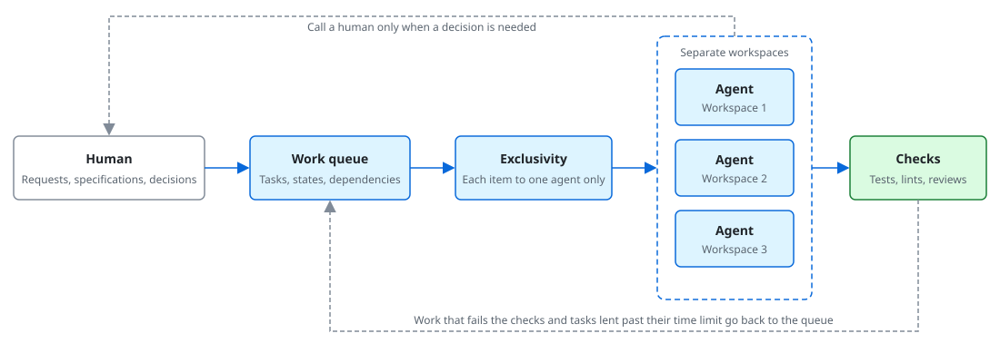

Title: AI software factories: how far parallel coding agents have come
Date: 2026-11-27 19:50
Updated: 2026-11-27 19:50
Lang: en
Original: /blog/2026/bab1ba
Tags: ai-agent history vercel-board


More and more people call it a "software factory" when many coding agents run in parallel and PRs get merged with almost no human looking at them.

<div class="tweet-card"><a href="https://x.com/happy_ryo/status/2123942567746375930"><span class="tweet-card-header"><span class="tweet-card-author"><strong>いわまりょう</strong><span>@happy_ryo</span></span><svg class="tweet-card-logo" viewBox="0 0 24 24" aria-hidden="true"><path d="M18.244 2.25h3.308l-7.227 8.26 8.502 11.24H16.17l-5.214-6.817L4.99 21.75H1.68l7.73-8.835L1.254 2.25H8.08l4.713 6.231zm-1.161 17.52h1.833L7.084 4.126H5.117z"/></svg></span><span class="tweet-card-text">Orcaとかを使わずに、自前でコーディングエージェントを用いたソフトウェアファクトリーを実装していて、こんな感じの作りにしている。一番気を掛けているのは、窓口になるエージェント1体以外は人間が見なくて良いこと。OSSとして公開してる。</span><span class="tweet-card-media" data-count="3"></span><time class="tweet-card-time" datetime="2026-11-20T19:52:23-0500">2026-11-20 19:52</time></a></div>

After reading this post I wanted to build one myself, so I looked into how these setups came about and how far they work today.

Many of the cases used a similar setup.
In their reports the human work moved from writing code to preparing specifications and checks, but the people who ran the setups published all the numbers on results themselves, and outside checks of those numbers are still rare.

The second half of the post moves to a different context and shows that people used the words "software factory" in 1968 too.


# 2023 to 2025: from one agent to many in parallel

The idea of having agents with separate roles develop software goes back to 2023, right after LLMs arrived, and the [MetaGPT](https://arxiv.org/abs/2308.00352) paper called its setup, which gives standard procedures to agents with roles, an "assembly line paradigm".

In [SWE-bench](https://arxiv.org/abs/2310.06770), a benchmark from the same year, the best model solved 1.96% of real GitHub issues.
Cognition announced [Devin](https://cognition.com/blog/introducing-devin) in March 2024 and reported that the rate reached 13.86% on a random 25% of the dataset.

In February 2025 Anthropic released [Claude Code](https://www.anthropic.com/news/claude-3-7-sonnet) as a research preview.
You can hand it a large task from the terminal, and later in this post Ralph and Anthropic's experiment use Claude Code, while OpenAI's two posts use Codex.

In May 2025 Cursor's [background agent](https://cursor.com/changelog/0-50), OpenAI's [Codex](https://openai.com/index/introducing-codex/), GitHub Copilot's [coding agent](https://github.blog/news-insights/product-news/github-copilot-meet-the-new-coding-agent/) and the public beta of Google's [Jules](https://blog.google/technology/google-labs/jules/) all came out within one week.
Each of them takes a task, works on it in a remote environment and returns a PR or a diff, and the Codex announcement says it can "work on many tasks in parallel".

At that point products let one person run many agents at the same time.

Two months later Geoffrey Huntley wrote [Ralph](https://ghuntley.com/ralph/), the shortest form of running one agent in a loop without stopping.

```bash
while :; do cat PROMPT.md | claude-code ; done
```

The agent reads the same prompt again and again and does one piece of work each time, and you feed test and build failures back to it to fix.
Later [OpenAI](https://openai.com/index/harness-engineering/) and [Anthropic](https://www.anthropic.com/engineering/building-c-compiler) each compared their own loops to Ralph in their posts.

In the same month METR published an [experiment](https://metr.org/blog/2025-07-10-early-2025-ai-experienced-os-dev-study/) where experienced open source developers took 19% longer with AI, while they felt 20% faster.
Keep that gap between the felt speedup and the measured result in mind when you read the numbers later in this post.


# January and February 2026: two kinds of posts

In January and February 2026, two kinds of posts came out: posts that called development with agents a "factory", and posts that reported their setups and results in detail without calling them factories.


## Posts that call it a factory

In January Steve Yegge released [Gas Town](https://yegge.ai/gastown).
Yegge had released [Beads](https://github.com/gastownhall/beads), a tool for tracking work, in October 2025, and he built Gas Town with it.

In Gas Town a mayor coordinates the whole, a watcher checks the work of the workers, and a merger merges it in order, and Yegge later called it "the first-ever software factory".

In the same January Dan Shapiro sorted ways of using AI into levels 0 to 5 in a [post](https://www.danshapiro.com/blog/2026/01/the-five-levels-from-spicy-autocomplete-to-the-software-factory/), and called the last level, a black box that takes a specification and puts out software, the "Dark Factory".
The term comes from manufacturing, for a factory that needs no lights because it needs no people, and Shapiro wrote that he took the name from FANUC's factory where only robots work.

In February StrongDM announced that it runs at that level, and its [Software Factory page](https://factory.strongdm.ai/) lists these two rules.

> Code must not be written by humans
> 
> Code must not be reviewed by humans

According to Simon Willison's [write-up](https://simonwillison.net/2026/Feb/7/software-factory/), humans do not read the code, and instead they prepare validation scenarios hidden from the agents and check the behavior against copies of external services such as Okta and Slack.
StrongDM gives a cost guideline: if you are not spending $1,000 on tokens per engineer per day, you have room to improve.


## Reports on setups and results

In the same two months three reports came out that do not use the word factory.

In January Cursor published a [report](https://cursor.com/blog/scaling-agents) on long-running autonomous coding.
Cursor first tried a setup where all agents had equal standing and competed for locks, and wrote that 20 agents ran only as fast as 2 or 3.

A setup without a hierarchy did not work either, and in the end Cursor split the agents into planners, workers and a judge and had them build a browser from scratch.
Cursor also added an integrator to check quality, but removed it because the work piled up there.

In February Anthropic published its [C compiler experiment](https://www.anthropic.com/engineering/building-c-compiler).

With no orchestrator, 16 Claude agents divided the work through lock files in a git repository.
They ran about 2,000 sessions, spent $20,000 on the API, and produced a 100,000-line compiler that can build the Linux kernel.

In the [harness engineering](https://openai.com/index/harness-engineering/) post OpenAI published the same February, three engineers reported merging about 1,500 PRs with Codex alone, under the motto "Humans steer. Agents execute."
Humans set the direction of the dependencies between layers, and lints and structural tests that Codex wrote enforce that direction.

The post also says human QA could not keep up with the rate at which the code grew.


# Where humans talk and where the work queues up

In its [post on Symphony](https://openai.com/index/open-source-codex-orchestration-symphony/) in April 2026, OpenAI wrote that after harness engineering the next limit was how many sessions a human can watch.
One engineer could watch 3 to 5 sessions without strain, but beyond that the cost of switching lowered their productivity.

People had been building tools to reduce the load of watching many sessions since 2025, before the word factory appeared.
I think of them in two groups: tools that decide where the work queues up, and tools that decide where humans talk.


## Where the work queues up

[Vibe Kanban](https://github.com/BloopAI/vibe-kanban) came out in June 2025, and Beads, mentioned above, in October.
Vibe Kanban plans work as issues on a kanban board and hands them to agents, and Beads records the work of agents.

In my view, [Symphony](https://github.com/openai/symphony), whose repository OpenAI opened in March 2026, made the approach of managing work as issues widely known.
OpenAI published its own operation along with the specification, so anyone could now try what a few people had been using.

> For every open task, guarantee that an agent is running in its own workspace.

Symphony watches the issues in Linear, prepares one workspace for each open task, and keeps an agent running in it.
In place of a human watching the sessions, the state of the issue shows how the work is going.


## Where humans talk

[OpenClaw](https://github.com/openclaw/openclaw), whose repository dates from November 2025, is a personal assistant whose use is not limited to coding.
You keep it running on your own machine and talk to it from the chat apps you already use, such as Discord and Slack.

At the time of writing it has more than 390,000 stars on GitHub, over twice as many as the Claude Code repository.

In OpenClaw a resident process called the Gateway connects the chats, the sessions and the tools.
The [scheduler](https://docs.openclaw.ai/automation/cron-jobs) starts the agent at set times, and a [sub-agent](https://docs.openclaw.ai/tools/subagents) runs in the background and returns its result to the caller.

Even when agents start in the background and move the work forward, a human talks to one agent, the same as the "front desk" in the post at the top.


## Combining the two

I see [Vercel Board](https://vercel.com/blog/introducing-vercel-board), which Vercel released in November 2026, as a tool that combines the place where the work queues up and the place where humans talk.
Board is a message board that agents and humans share, a thread there is both a conversation and a task, and the board lends each task to one agent at a time with a time limit.


# Where things stand

In many of the cases, the setup queues the work, assigns each item to one agent only, gives each agent its own workspace, and checks the results by machine.



In some cases, as with Symphony, a human accepts the work after it passes the checks.

<table border="2" cellspacing="0" cellpadding="6" rules="groups" frame="hsides">


<colgroup>
<col  class="org-left" />

<col  class="org-left" />

<col  class="org-left" />

<col  class="org-left" />
</colgroup>
<thead>
<tr>
<th scope="col" class="org-left">Case</th>
<th scope="col" class="org-left">Work queue</th>
<th scope="col" class="org-left">Exclusivity and workspace</th>
<th scope="col" class="org-left">Checkpoints and checks</th>
</tr>
</thead>
<tbody>
<tr>
<td class="org-left">Cursor's experiment</td>
<td class="org-left">Tasks that planners create</td>
<td class="org-left">Each worker takes one task at a time</td>
<td class="org-left">A judge decides each cycle whether to continue</td>
</tr>

<tr>
<td class="org-left">Anthropic's C compiler</td>
<td class="org-left">Each agent picks the next problem to fix</td>
<td class="org-left">Lock files in git and a clone per container</td>
<td class="org-left">The test suite and comparison with GCC</td>
</tr>

<tr>
<td class="org-left">Symphony</td>
<td class="org-left">Linear issues</td>
<td class="org-left">A workspace per issue</td>
<td class="org-left">A human accepts the work with the CI results attached</td>
</tr>

<tr>
<td class="org-left">Vercel Board</td>
<td class="org-left">Tasks on the board</td>
<td class="org-left">Lending with a time limit</td>
<td class="org-left">Review tasks that open once the fix is done</td>
</tr>
</tbody>
</table>

In the reports from OpenAI, StrongDM and Anthropic, the work of writing code moved to the agents, and humans prepare the specifications, the checks and the environment.

In a [talk](https://ai.engineer/code/2026/talks/lauren-tan), Lauren Tan recommended that when an agent repeats the same mistake, you prevent it with types, lints or tests instead of adding more warnings to the instructions.
She also reported about 11,000 PRs a month with about 0.5% of them sent back.

The numbers that show what these factories achieve all come from the people who run them.
Vercel says the v0 factory it rebuilt on Board merges more than 50% of its PRs, but gives neither the denominator, the period, nor the share of PRs sent back.

In a [follow-up](https://metr.org/blog/2026-02-24-uplift-update/) in February 2026, METR wrote that the data from its new experiment cannot give a reliable measure of the current effect of AI.
More developers declined to take part because they did not want to work without AI, which biased the estimate of the speedup from AI downward.


# The "software factory" of 1968

The present use of "factory" comes from the lights-out factories of manufacturing, and the documents from StrongDM and Vercel say nothing about the early history of software development.
The words "software factory" themselves are 58 years old, though, and Addy Osmani also wrote in [Software Factories, Light and Dark](https://addyosmani.com/blog/software-factories/) that the term goes back to Bob Bemer in 1968.

I found no source saying that today's factories came from the factories of that time, but what people tried under the same words caught my interest, so I describe it here.
The [report](https://web.archive.org/web/2016/http://homepages.cs.ncl.ac.uk/brian.randell/NATO/nato1968.PDF) of the 1968 NATO Software Engineering Conference quotes a working paper by Bemer, then at General Electric, as follows.

> By utilizing the machine-controlled production environment, or software factory. Program construction, checkout and usage are done entirely within this environment using the tools it contains. Ideally it should be impossible to produce programs exterior to this environment.

The factory Bemer meant is an environment that a machine controls, where people write and check programs entirely inside it.

The next year, in 1969, Hitachi made its software department independent from its Kanagawa Works.
Hitachi's [company history](https://www.hitachi.co.jp/Div/soft/history.html) (in Japanese) calls it "the world's first business site dedicated to software", and Toshiba, NEC and Fujitsu went the same way in the 1970s.

In the United States, System Development Corporation set up a software factory of about 200 people around 1975, and stopped using it within a few years.
According to a 1991 [draft paper](https://www.gregorystrachta.com/resources/Touchstones/swp-3268-23661042.pdf) by Michael Cusumano of MIT, the managers of the projects for each customer wanted to build the software themselves rather than hand the specifications to the factory, and the projects could not reuse each other's tools.

For Toshiba's Fuchu Works, the results remain as numbers.
According to the same draft, the share of delivered lines that reused existing code rose from 13% in 1979 to 48% in 1985, and Toshiba named reuse as the main reason its productivity and quality went up.

Around the same time, in 1986, Fred Brooks wrote in [No Silver Bullet](https://www.cs.unc.edu/techreports/86-020.pdf):

> There is no single development, in either technology or management technique, which by itself promises even one order of magnitude improvement in productivity, in reliability, in simplicity.

His point is that the hard part of software lies in specification, design and testing, so making code easier to write does not change the order of magnitude of the improvement.

In 2004 Microsoft tried to put tools into Visual Studio under the name [Software Factories](https://learn.microsoft.com/en-us/archive/blogs/askburton/moving-to-software-factories-2), which assemble applications from domain-specific languages and templates.
The post argues that other industries raised their capacity by moving from craftsmanship to manufacturing that combines parts, an idea close to Toshiba's reuse.

The post also admits that the words software factory call up images of automatons without creativity and cause debate.
The [page](https://learn.microsoft.com/en-us/previous-versions/msp-n-p/ff648577(v=pandp.10)) that describes the tools carries a notice that its content went out of date in November 2011.

The factories of that time organized people and procedures, while today's factories build systems that run agents, but when I compared them I found three similarities.

The workspace Symphony prepares for each task, and the hook in the figure of the post at the top that "stops operations that break the rules before they run", follow an idea close to Bemer's "it should be impossible to produce programs exterior to this environment".

Toshiba named reuse rather than writing faster as the reason for its results, and OpenAI put weight on lints and structural tests in its post.
Both spent their effort on writing less code and on checking the code they wrote.

Even now that agents write the code, humans still handle the specifications and checks that Brooks called hard, and StrongDM's scenarios look to me like the result of humans spending time on those checks.


# The setup I built at home

I also run Vercel Board on a desktop that stays on all the time, and share it with my laptop over a Tailscale network.

I talk to only one thread, the one with the orchestrator agent.
The orchestrator splits the work into units that a worker can finish in one turn and registers them as tasks on Board.

The management server on the desktop takes the tasks that are ready to start and starts a worker agent on the PC that the task's label names.
One PC takes up to 5 tasks at a time, and when a worker's turn ends, the management server writes the result to the state of the task and notifies the orchestrator.

The configuration and the code are in [agent-board.nix](https://github.com/conao3/nixos-configuration/blob/master/home-manager/features/agent-board.nix) and [agent-board-server.py](https://github.com/conao3/nixos-configuration/blob/master/pkgs/agent-board-server.py).
I wrote only the management server, about 500 lines of Python, and left queuing the tasks, keeping one task from going to several workers, and recording the results to Board.

When I reply in the thread of a task, the same worker continues the work, and if the worker is in the middle of a turn, it receives the reply within that turn.
I can move the work forward by writing a request in the browser and replying.

In the planning stage, when the direction changed every few minutes, talking to an agent directly went faster.
Work that I can cut out after the direction settles suits the factory.

The results depend on whether I can prepare the specification before handing over the work and a way to check what comes back.
Next I plan to try preparing the checks first and then cutting out the tasks.

