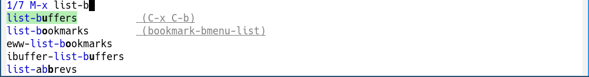
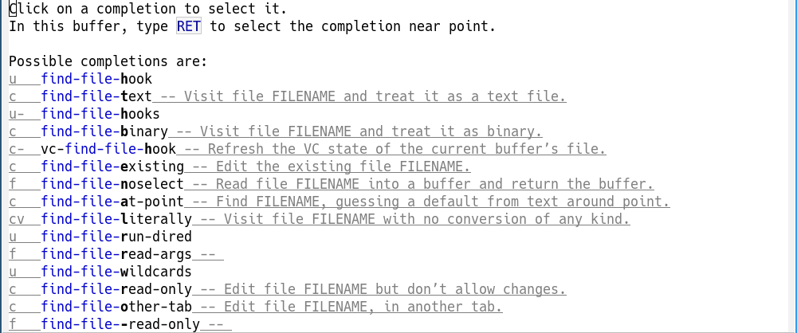
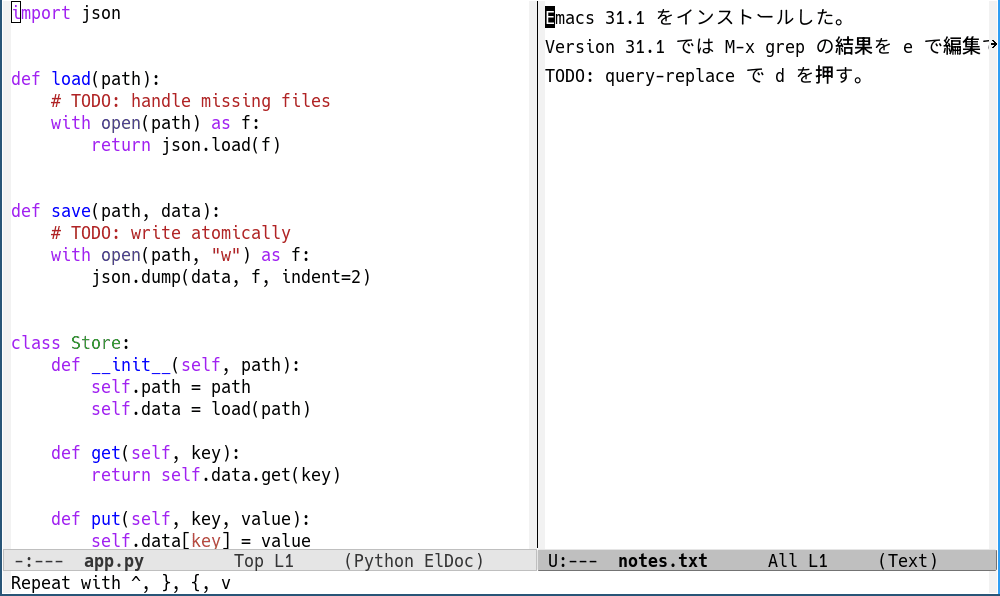
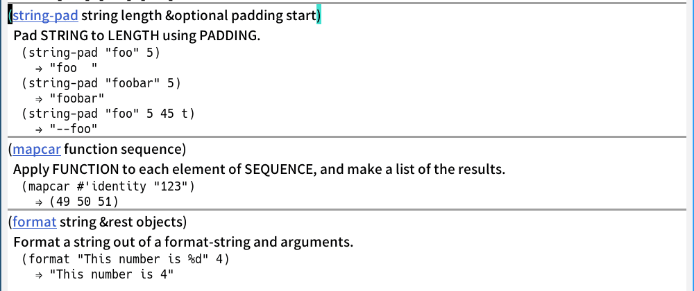
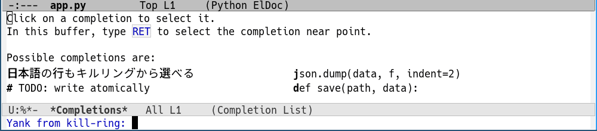
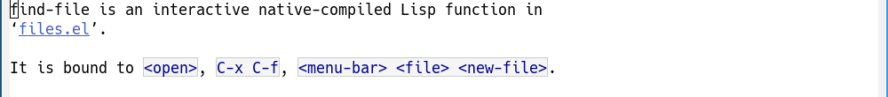
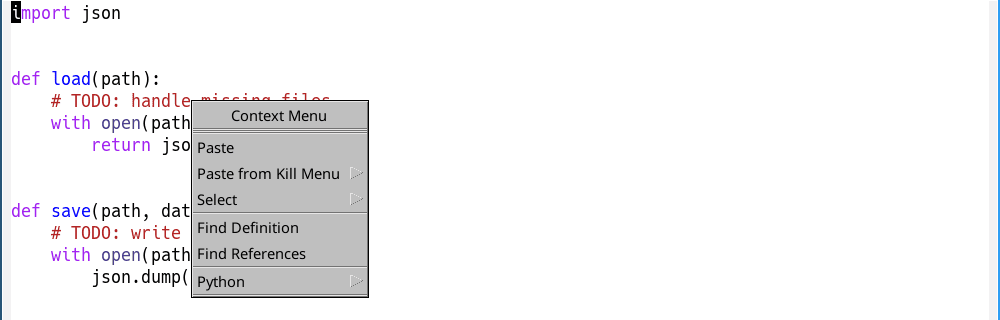

Title: Seven fun new features in Emacs 28, shown in screenshots
Date: 2026-11-27 22:55
Updated: 2026-11-27 22:55
Draft: true
Lang: en
Original: /blog/2026/664e4a
Tags: emacs release-notes


I picked seven new features from the Emacs 28 NEWS that you notice the moment you use them, and this post shows each one in a screenshot of Emacs 28.2.
Most of them make plain `emacs -Q` easier to drive, such as `fido-vertical-mode`, which lists minibuffer completions vertically, and `repeat-mode`, which lets you type `C-x o o o`.

The NEWS lives in [etc/NEWS.28](https://github.com/emacs-mirror/emacs/blob/emacs-31.1/etc/NEWS.28) and runs to 3,981 lines.
I took every screenshot in Emacs 28.2 started with `emacs -Q`, and I include the code for each feature that needs a setting.


# List minibuffer completions vertically

With [fido-vertical-mode](https://github.com/emacs-mirror/emacs/blob/emacs-31.1/etc/NEWS.28#L1587) on, minibuffer completion candidates appear in a vertical list under your input.
It matches candidates that contain the typed characters in order, so `list-b` also finds `list-abbrevs`.

```emacs-lisp
(fido-vertical-mode 1)
```



The `1/7` at the start says the first of seven candidates is selected.
As `(C-x C-b)` next to `list-buffers` shows, [M-x completion shows key bindings](https://github.com/emacs-mirror/emacs/blob/emacs-31.1/etc/NEWS.28#L218), so you pick up the keys of the commands you use often.


# Add the kind and the first doc line to completions

Set [completions-detailed](https://github.com/emacs-mirror/emacs/blob/emacs-31.1/etc/NEWS.28#L224) to `t`, and the completion list of commands such as `C-h o` shows the kind of each candidate and the first line of its documentation.

```emacs-lisp
(setq completions-detailed t)
```



The screenshot shows the list for `C-h o find-file- TAB`.
The `c`, `f` and `u` on the left mark commands, functions and user options, so you can compare `find-file-text` with `find-file-literally` without opening their documentation.


# Repeat a key without its prefix

With [repeat-mode](https://github.com/emacs-mirror/emacs/blob/emacs-31.1/etc/NEWS.28#L2818) on, you can type `C-x o o` instead of `C-x o C-x o`, and `C-x u u` instead of `C-x u C-x u`.

```emacs-lisp
(repeat-mode 1)
```



Here I split the frame into two windows and typed `C-x { { { {`, which narrowed the right window four times.
`Repeat with ^, }, {, v` in the echo area lists the keys you can keep pressing, and any other key ends the repetition.


# Browse functions by topic, with examples and results

[shortdoc](https://github.com/emacs-mirror/emacs/blob/emacs-31.1/etc/NEWS.28#L236) is a cheat sheet that lists functions by topic, such as strings or lists, each with examples and their results.
Open it with `M-x shortdoc-display-group` and a topic, or with the button in a `*Help*` buffer.



The screenshot shows the `string` group, where `(string-pad "foo" 5)` is listed with its result `"foo  "`.
When you cannot remember the name of a function, you can find it from what you want to do.


# Pick from the kill ring and paste

Press `M-y` when the previous command was not a yank, and you can [choose an earlier kill in the minibuffer with completion](https://github.com/emacs-mirror/emacs/blob/emacs-31.1/etc/NEWS.28#L953).



I put four strings into the kill ring and typed `M-y TAB`, and the `*Completions*` buffer lists all four.


# Compile Emacs Lisp to native code

When Emacs is built with libgccjit, it can [compile Emacs Lisp to native code](https://github.com/emacs-mirror/emacs/blob/emacs-31.1/etc/NEWS.28#L65).
The Lisp code of Emacs itself becomes native code, and packages are compiled in the background after they are loaded.



`C-h f find-file` says `native-compiled Lisp function`, so this Emacs runs the native code of `find-file`.
`(native-comp-available-p)` tells you whether your Emacs supports it.


# Open a context menu with a right click

With [context-menu-mode](https://github.com/emacs-mirror/emacs/blob/emacs-31.1/etc/NEWS.28#L242) on, a right click in a buffer opens a menu that fits the place you clicked.

```emacs-lisp
(context-menu-mode 1)
```



In a Python file, the menu has `Find Definition`, `Find References` and a `Python` submenu in addition to pasting and selecting.


# Other changes worth a look

-   [Emoji support](https://github.com/emacs-mirror/emacs/blob/emacs-31.1/etc/NEWS.28#L176) has improved, and emoji sequences such as skin tones and flags display as one glyph.
-   The themes [modus-operandi and modus-vivendi](https://github.com/emacs-mirror/emacs/blob/emacs-31.1/etc/NEWS.28#L2843) are now part of Emacs.

