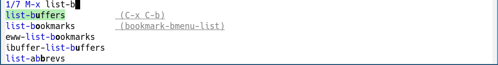
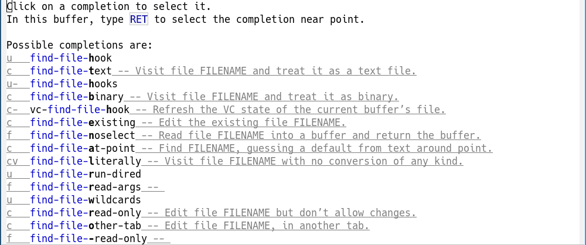
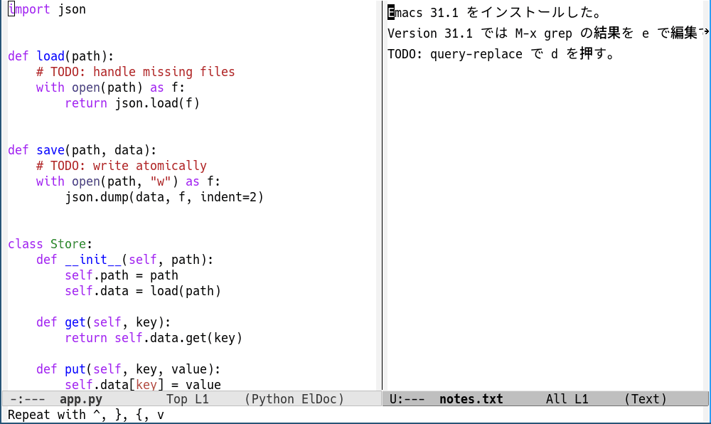
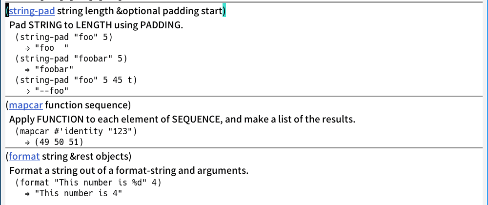
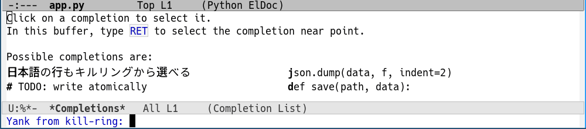
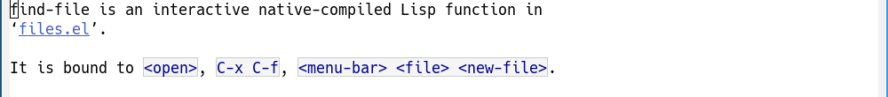
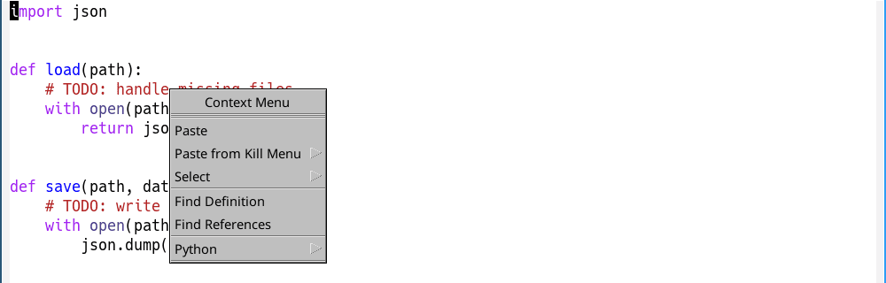

Title: Emacs 28の新機能から、動かして楽しいものを7つ画面つきで紹介する
Date: 2026-11-27 22:55
Updated: 2026-11-27 22:55
Tags: emacs release-notes


Emacs 28のNEWSから動かしてすぐに違いが分かる新機能を7つ選び、Emacs 28.2の実際の画面と一緒に紹介します。
ミニバッファの補完が縦に並ぶ `fido-vertical-mode` や `C-x o o o` のように同じキーを押し続けられる `repeat-mode` のように、 `emacs -Q` のままでも操作が楽になるものを中心にしました。

NEWSは [etc/NEWS.28](https://github.com/emacs-mirror/emacs/blob/emacs-31.1/etc/NEWS.28) にあり、3,981行あります。
画面はすべて `emacs -Q` で起動したEmacs 28.2で撮っていて、設定が要るものはその式を添えています。


# ミニバッファの補完を縦に並べる

[fido-vertical-mode](https://github.com/emacs-mirror/emacs/blob/emacs-31.1/etc/NEWS.28#L1587) を有効にすると、ミニバッファの補完の候補が入力の下に縦に並びます。
打った文字を順に含む候補を拾うので、 `list-b` で `list-abbrevs` も候補に入ります。

```emacs-lisp
(fido-vertical-mode 1)
```



先頭の `1/7` は7つの候補の1つ目を選んでいることを示しています。
`list-buffers` の横の `(C-x C-b)` のように [M-x の補完にはキーバインドが出る](https://github.com/emacs-mirror/emacs/blob/emacs-31.1/etc/NEWS.28#L218) のでよく使うコマンドのキーをここで覚えられます。


# 補完の候補に、種類と説明の1行目を添える

[completions-detailed](https://github.com/emacs-mirror/emacs/blob/emacs-31.1/etc/NEWS.28#L224) を `t` にすると、 `C-h o` のようなコマンドの補完の一覧に候補の種類と説明の1行目が出ます。

```emacs-lisp
(setq completions-detailed t)
```



画面は `C-h o find-file- TAB` の一覧です。
左の `c` と `f` と `u` はそれぞれコマンドと関数とユーザーオプションを表しているので、 `find-file-text` や `find-file-literally` の違いを説明を開かずに一覧で比べられます。


# 同じキーを、プレフィックスなしで押し続ける

[repeat-mode](https://github.com/emacs-mirror/emacs/blob/emacs-31.1/etc/NEWS.28#L2818) を有効にすると、 `C-x o C-x o` を `C-x o o` と、 `C-x u C-x u` を `C-x u u` と打てます。

```emacs-lisp
(repeat-mode 1)
```



画面は左右に分けたウィンドウで `C-x { { { {` と打って、右のウィンドウを4回狭めたところです。
エコーエリアの `Repeat with ^, }, {, v` は続けて押せるキーを示していて、ほかのキーを押すと元に戻ります。


# 関数の早見表を、例と結果つきで見る

[shortdoc](https://github.com/emacs-mirror/emacs/blob/emacs-31.1/etc/NEWS.28#L236) は文字列やリストのような分類ごとに関数と使い方の例と結果を並べた早見表で、 `M-x shortdoc-display-group` で分類を選ぶか `*Help*` バッファのボタンから開きます。



画面は `string` の分類です。
`(string-pad "foo" 5)` が `"foo  "` になるように例と結果が並んでいるので、名前を思い出せない関数をやりたいことの分類から探せます。


# キルリングから選んで貼る

貼り付けの直後でないときに `M-y` を押すと [キルリングの中身をミニバッファで補完しながら選べます](https://github.com/emacs-mirror/emacs/blob/emacs-31.1/etc/NEWS.28#L953) 。



画面は4つの文字列をキルリングに入れてから `M-y TAB` と打ったところで、 `*Completions*` バッファに4つの文字列が並んでいます。


# Emacs Lispをネイティブコードにコンパイルする

`--with-native-compilation` を付けてビルドすると、libgccjitを使ってEmacs Lispを [ネイティブコードにコンパイルできます](https://github.com/emacs-mirror/emacs/blob/emacs-31.1/etc/NEWS.28#L65)。
Emacs本体のLispもネイティブコードになり、パッケージも読み込んだときに裏でコンパイルされます。



`C-h f find-file` の説明には `native-compiled Lisp function` と出ていて、このEmacsではネイティブコードの `find-file` が動いています。
使えるかどうかは `(native-comp-available-p)` で確かめられます。


# 右クリックでメニューを出す

[context-menu-mode](https://github.com/emacs-mirror/emacs/blob/emacs-31.1/etc/NEWS.28#L242) を有効にすると、バッファの中で右クリックしたときにクリックした場所に合わせたメニューが出ます。

```emacs-lisp
(context-menu-mode 1)
```



Pythonのファイルでは貼り付けや選択に加えて `Find Definition` と `Find References` と `Python` のメニューが出ています。


# ほかに目についたもの

-   [絵文字の表示](https://github.com/emacs-mirror/emacs/blob/emacs-31.1/etc/NEWS.28#L176) が改善されて、肌の色や国旗のような絵文字の組み合わせも1文字として表示されます。
-   [modus-operandi と modus-vivendi](https://github.com/emacs-mirror/emacs/blob/emacs-31.1/etc/NEWS.28#L2843) のテーマが入りました。


# Emacs 27から開発版までの新機能

Emacs 27から開発版までのNEWSを、1つの版ごとに同じ形で紹介しています。

-   [Emacs開発版の新機能から、動かして楽しいものを画面つきで紹介する](https://s.conao3.com/blog/2026/d711ab)
-   [Emacs 31の新機能から、動かして楽しいものを7つ画面つきで紹介する](https://s.conao3.com/blog/2026/a0c17f)
-   [Emacs 30の新機能から、動かして楽しいものを7つ画面つきで紹介する](https://s.conao3.com/blog/2026/771a69)
-   [Emacs 29の新機能から、動かして楽しいものを7つ画面つきで紹介する](https://s.conao3.com/blog/2026/43487f)
-   [Emacs 27の新機能から、動かして楽しいものを7つ画面つきで紹介する](https://s.conao3.com/blog/2026/92689a)

