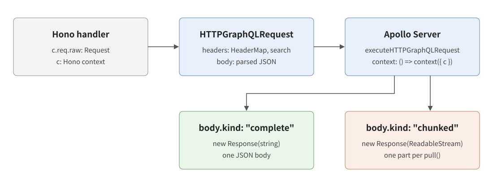

Title: apollo-server-integration-hono: run Apollo Server 5 on Hono and stream @defer responses as each part is ready
Date: 2026-11-27 23:42
Updated: 2026-11-27 23:42
Draft: true
Lang: en
Original: /blog/2026/963012
Tags: typescript graphql hono release ts-apollo-server-integration-hono


I built apollo-server-integration-hono, a library that runs an Apollo Server 5 GraphQL API inside a Hono app.
One function, `startServerAndCreateHonoHandler`, turns an `ApolloServer` into a Hono handler.

For a query with `@defer`, Apollo Server returns a `multipart/mixed` response in parts, and the handler streams each part as soon as Apollo Server produces it.

The repository is [conao3/ts-apollo-server-integration-hono](https://github.com/conao3/ts-apollo-server-integration-hono), under the Apache-2.0 license, and the package is on npm as [@conao3/apollo-server-integration-hono](https://www.npmjs.com/package/@conao3/apollo-server-integration-hono).
This post uses 0.1.3 and [b3a486e](https://github.com/conao3/ts-apollo-server-integration-hono/tree/b3a486e68f2a2c3f05fdf099d50799a4f9fb709f) on master at the time of writing, and I ran everything with Apollo Server 5.5.2, Hono 4.13.23 and Node.js 26.13.1.

The whole package is the 112 lines of [src/index.ts](https://github.com/conao3/ts-apollo-server-integration-hono/blob/b3a486e68f2a2c3f05fdf099d50799a4f9fb709f/src/index.ts).
It converts the request Hono receives into the shape Apollo Server expects, and wraps the body Apollo Server returns in a Web standard `Response`.

I wrote it with Web standard APIs and two dependencies, `@apollo/server` and `hono`, so that it runs on the runtimes Hono supports.

<div class="github-card" data-repo="conao3/ts-apollo-server-integration-hono"><a href="https://github.com/conao3/ts-apollo-server-integration-hono"><span class="github-card-name"><svg class="github-card-mark" viewBox="0 0 16 16" aria-hidden="true"><path d="M6.766 11.328c-2.063-.25-3.516-1.734-3.516-3.656 0-.781.281-1.625.75-2.188-.203-.515-.172-1.609.063-2.062.625-.078 1.468.25 1.968.703.594-.187 1.219-.281 1.985-.281.765 0 1.39.094 1.953.265.484-.437 1.344-.765 1.969-.687.218.422.25 1.515.046 2.047.5.593.766 1.39.766 2.203 0 1.922-1.453 3.375-3.547 3.64.531.344.89 1.094.89 1.954v1.625c0 .468.391.734.86.547C13.781 14.359 16 11.53 16 8.03 16 3.61 12.406 0 7.984 0 3.563 0 0 3.61 0 8.031a7.88 7.88 0 0 0 5.172 7.422c.422.156.828-.125.828-.547v-1.25c-.219.094-.5.156-.75.156-1.031 0-1.64-.562-2.078-1.609-.172-.422-.36-.672-.719-.719-.187-.015-.25-.093-.25-.187 0-.188.313-.328.625-.328.453 0 .844.281 1.25.86.313.452.64.655 1.031.655s.641-.14 1-.5c.266-.265.47-.5.657-.656"/></svg><span>conao3/<strong>ts-apollo-server-integration-hono</strong></span></span><span class="github-card-description">Apollo Server integration for Hono</span><span class="github-card-footer"><span class="github-card-language"><span class="github-card-language-color" style="background-color: #3178c6"></span>TypeScript</span><span class="github-card-star"><svg viewBox="0 0 16 16" aria-hidden="true"><path d="M8 .25a.75.75 0 0 1 .673.418l1.882 3.815 4.21.612a.75.75 0 0 1 .416 1.279l-3.046 2.97.719 4.192a.751.751 0 0 1-1.088.791L8 12.347l-3.766 1.98a.75.75 0 0 1-1.088-.79l.72-4.194L.818 6.374a.75.75 0 0 1 .416-1.28l4.21-.611L7.327.668A.75.75 0 0 1 8 .25Z"/></svg><span>Star</span><span class="github-card-star-count" hidden></span></span></span></a></div>


# Add it to a Hono app

In an empty directory, install the package together with Apollo Server and Hono.
pnpm 12 ends `pnpm add` with an error until you decide whether dependencies may run their build scripts, so turn off the script of `@apollo/protobufjs` in `pnpm-workspace.yaml` first.

```yaml
allowBuilds:
  "@apollo/protobufjs": false
```

```shell
pnpm add @conao3/apollo-server-integration-hono @apollo/server graphql@16 hono @hono/node-server
```

In the following `server.mts`, Hono middleware reads a user name from the `x-user` header, and the GraphQL resolver returns it.

The `context` function receives the Hono context as its argument `c`.
Type that argument as `HonoContextFunctionArgument<AppEnv>`, and `c.get("user")` returns a value of the type declared in the `Env` of your app.

```typescript
import { ApolloServer } from "@apollo/server"
import { startServerAndCreateHonoHandler } from "@conao3/apollo-server-integration-hono"
import type { HonoContextFunctionArgument } from "@conao3/apollo-server-integration-hono"
import { serve } from "@hono/node-server"
import { Hono } from "hono"

type AppEnv = { Variables: { user: string } }
type GraphQLContext = { user: string }

const server = new ApolloServer<GraphQLContext>({
  typeDefs: `#graphql
    type Query {
      hello: String!
      user: String!
    }
  `,
  resolvers: {
    Query: {
      hello: () => "world",
      user: (_parent, _args, context) => context.user,
    },
  },
})

const app = new Hono<AppEnv>()
app.use(async (c, next) => {
  c.set("user", c.req.header("x-user") ?? "anonymous")
  await next()
})
app.post(
  "/api/graphql",
  startServerAndCreateHonoHandler(server, {
    context: async ({ c }: HonoContextFunctionArgument<AppEnv>) => ({ user: c.get("user") }),
  }),
)

serve({ fetch: app.fetch, port: 4000 })
```

Start the server with `node server.mts` and query it with `curl`; `user` changes only when you send `x-user`.

```shell
$ curl -s http://localhost:4000/api/graphql \
    -H 'content-type: application/json' \
    -d '{"query":"{ hello user }"}'
{"data":{"hello":"world","user":"anonymous"}}

$ curl -s http://localhost:4000/api/graphql \
    -H 'content-type: application/json' \
    -H 'x-user: alice' \
    -d '{"query":"{ hello user }"}'
{"data":{"hello":"world","user":"alice"}}
```

`startServerAndCreateHonoHandler` starts Apollo Server in the background, so call `startServerAndCreateHonoHandler` once at startup and don't call `server.start()` yourself.
Headers that middleware such as `hono/cors` sets on the Hono context stay on the GraphQL response.


# Stream @defer responses

`@defer` is a GraphQL directive that lets the server send part of the result later.

The [Apollo Server docs](https://www.apollographql.com/docs/apollo-server/workflow/requests#incremental-delivery-experimental) say that Apollo Server 5 sends the deferred part later only when the graphql package is exactly `17.0.0-alpha.9`, so switch graphql to that version.

```shell
pnpm add graphql@17.0.0-alpha.9
```

The following `defer.mts` is a server with a `hello` field with no delay, a `slow` field that takes 2 seconds, and a `@defer` declaration in its schema.

```typescript
import { ApolloServer } from "@apollo/server"
import { startServerAndCreateHonoHandler } from "@conao3/apollo-server-integration-hono"
import { serve } from "@hono/node-server"
import { Hono } from "hono"

const sleep = (ms: number) => new Promise((resolve) => setTimeout(resolve, ms))

const server = new ApolloServer({
  typeDefs: `#graphql
    directive @defer(if: Boolean! = true, label: String) on FRAGMENT_SPREAD | INLINE_FRAGMENT

    type Query {
      hello: String!
      slow: String!
    }
  `,
  resolvers: {
    Query: {
      hello: () => "world",
      slow: async () => {
        await sleep(2000)
        return "done"
      },
    },
  },
})

const app = new Hono()
app.post("/api/graphql", startServerAndCreateHonoHandler(server))

serve({ fetch: app.fetch, port: 4000 })
```

The following `defer.sh` puts the seconds between sending the query and receiving each JSON part at the start of the line.
It sends one query without `@defer` and one with it, both with the same `accept` header.

```bash
query() {
  start=$(date +%s%N)
  curl -sN http://localhost:4000/api/graphql \
    -H 'content-type: application/json' \
    -H 'accept: multipart/mixed; incrementalSpec=v0.2, application/json' \
    -d "{\"query\":\"$1\"}" |
    grep --line-buffered '^{' |
    while IFS= read -r line; do
      echo "$(( ($(date +%s%N) - start) / 1000000000 ))s ${line%$'\r'}"
    done
}
query '{ hello slow }'
query '{ hello ... @defer { slow } }'
```

Start the server with `node defer.mts` and run `bash defer.sh`:

```shell
$ bash defer.sh
2s {"data":{"hello":"world","slow":"done"}}
0s {"data":{"hello":"world"},"pending":[{"id":"0","path":[]}],"hasNext":true}
2s {"hasNext":false,"incremental":[{"data":{"slow":"done"},"id":"0"}],"completed":[{"id":"0"}]}
```

Without `@defer`, the response waits for `slow` and arrives as one JSON document after 2 seconds.
With `@defer`, `hello` arrives at 0 seconds and `slow` follows as `incremental` at 2 seconds, so apollo-server-integration-hono sends each part of the response as soon as Apollo Server produces it.


# What the handler does between Hono and Apollo Server

Apollo Server takes requests and returns responses in the framework-agnostic shapes `HTTPGraphQLRequest` and `HTTPGraphQLResponse`.

An integration package converts between these shapes and the shapes of its framework, and the Apollo Server guide on [building integrations](https://www.apollographql.com/docs/apollo-server/integrations/building-integrations) follows the same steps.



On the request side, the handler copies the headers of `c.req.raw` into a `HeaderMap`, reads the query string and the body, and passes them to `executeHTTPGraphQLRequest`.

The handler reads a body with a JSON `content-type` with `JSON.parse` and answers malformed JSON with 400.
It passes `c` to the `context` function, so your resolvers can read the values that Hono middleware set.

On the response side, the handler looks at the kind of body Apollo Server returns.
When `body.kind` is `"complete"`, it puts the string into the `Response`, and when it is `"chunked"`, it wraps the async iterator of the body in a `ReadableStream`.

```typescript
const encoder = new TextEncoder()
const iterator = body.asyncIterator[Symbol.asyncIterator]()
return new ReadableStream<Uint8Array>({
  async pull(controller) {
    const { done, value } = await iterator.next()
    if (done) {
      controller.close()
    } else {
      controller.enqueue(encoder.encode(value))
    }
  },
  async cancel() {
    await iterator.return?.()
  },
})
```

The stream calls `pull` each time the reader asks for the next part, and `pull` takes one part from the iterator and enqueues it.
That is why the `hello` part in the previous section arrived without waiting for `slow` to resolve.

When the client disconnects in the middle, `cancel` calls `return` on the iterator.


# Apollo Server integration test suite

Apollo Server publishes [@apollo/server-integration-testsuite](https://github.com/apollographql/apollo-server/tree/main/packages/integration-testsuite), a test suite for integration packages.
apollo-server-integration-hono runs it on Jest in [test/integration/integration.test.ts](https://github.com/conao3/ts-apollo-server-integration-hono/blob/b3a486e68f2a2c3f05fdf099d50799a4f9fb709f/test/integration/integration.test.ts).

With graphql 16, the version CI uses, 246 of the 270 tests pass, and the suite skips the 24 `@defer` and `@stream` tests that need graphql 17.

    Tests:       24 skipped, 246 passed, 270 total

To run those 24 tests, add `graphql: 17.0.0-alpha.9` to `overrides` in the `pnpm-workspace.yaml` of the repository and install `@yaacovcr/transform`, which the tests of the legacy `@defer` format load.
Then set the environment variable `INCREMENTAL_DELIVERY_TESTS_ENABLED`.

```shell
pnpm add -D @yaacovcr/transform
INCREMENTAL_DELIVERY_TESTS_ENABLED=1 pnpm exec jest --testTimeout=30000
```

    Test Suites: 1 passed, 1 total
    Tests:       270 passed, 270 total

With these settings, all 270 tests pass, including the `@defer` and `@stream` tests.
The Vitest tests in `test/unit/` cover the behavior specific to Hono: the context `c`, headers from middleware, GET queries, and 400 for malformed JSON.

