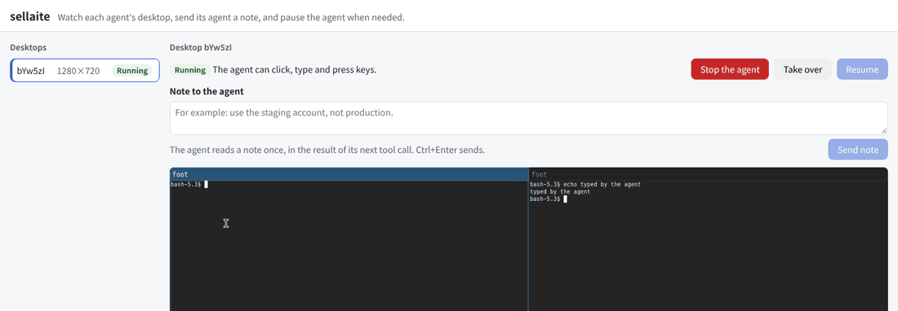
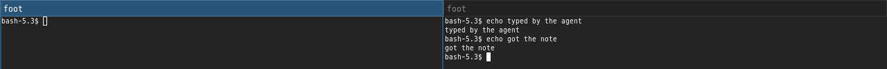

Title: AIエージェントが人のカーソルとフォーカスを奪わずにLinuxのGUIを操作できるsellaiteを作った
Date: 2026-11-27 23:08
Updated: 2026-11-27 23:08
Draft: true
Tags: rust ai-agent claude-code mcp computer-use wayland release rust-sellaite


AIエージェントのComputer Useを、Linuxの上でエージェント専用のデスクトップとカーソルで動かすMCPサーバー、sellaiteを作りました。
Claude CodeやCodexがMCPでクリックとキー入力をしても、動くのはエージェントのカーソルとフォーカスだけで、人のカーソルとフォーカスは動きません。

人のデスクトップでComputer Useのエージェントを動かすと、エージェントと人が同じカーソルとフォーカスを取り合うので、エージェントが動いている間は人がマウスとキーボードを使えません。
sellaiteはエージェントごとに画面を持たないheadlessのswayを立てて、その中にエージェント用と人用で別のカーソルとフォーカスを用意しています。

人はエージェントのデスクトップをブラウザのダッシュボードで見られて、動いている途中にメモで指示を足したり、止めて自分で操作を代わったりできます。

リポジトリは [conao3/rust-sellaite](https://github.com/conao3/rust-sellaite) で、ライセンスはApache-2.0です。
この記事の結果はsellaite 0.1.3で動かしたものです。

<div class="github-card" data-repo="conao3/rust-sellaite"><a href="https://github.com/conao3/rust-sellaite"><span class="github-card-name"><svg class="github-card-mark" viewBox="0 0 16 16" aria-hidden="true"><path d="M6.766 11.328c-2.063-.25-3.516-1.734-3.516-3.656 0-.781.281-1.625.75-2.188-.203-.515-.172-1.609.063-2.062.625-.078 1.468.25 1.968.703.594-.187 1.219-.281 1.985-.281.765 0 1.39.094 1.953.265.484-.437 1.344-.765 1.969-.687.218.422.25 1.515.046 2.047.5.593.766 1.39.766 2.203 0 1.922-1.453 3.375-3.547 3.64.531.344.89 1.094.89 1.954v1.625c0 .468.391.734.86.547C13.781 14.359 16 11.53 16 8.03 16 3.61 12.406 0 7.984 0 3.563 0 0 3.61 0 8.031a7.88 7.88 0 0 0 5.172 7.422c.422.156.828-.125.828-.547v-1.25c-.219.094-.5.156-.75.156-1.031 0-1.64-.562-2.078-1.609-.172-.422-.36-.672-.719-.719-.187-.015-.25-.093-.25-.187 0-.188.313-.328.625-.328.453 0 .844.281 1.25.86.313.452.64.655 1.031.655s.641-.14 1-.5c.266-.265.47-.5.657-.656"/></svg><span>conao3/<strong>rust-sellaite</strong></span></span><span class="github-card-description">Give an AI computer-use agent its own Linux desktop and its own cursor, so it never takes over yours</span><span class="github-card-footer"><span class="github-card-language"><span class="github-card-language-color" style="background-color: #dea584"></span>Rust</span><span class="github-card-star"><svg viewBox="0 0 16 16" aria-hidden="true"><path d="M8 .25a.75.75 0 0 1 .673.418l1.882 3.815 4.21.612a.75.75 0 0 1 .416 1.279l-3.046 2.97.719 4.192a.751.751 0 0 1-1.088.791L8 12.347l-3.766 1.98a.75.75 0 0 1-1.088-.79l.72-4.194L.818 6.374a.75.75 0 0 1 .416-1.28l4.21-.611L7.327.668A.75.75 0 0 1 8 .25Z"/></svg><span>Star</span><span class="github-card-star-count" hidden></span></span></span></a></div>


# 入れ方とClaude Codeへの登録

Nixが使えるLinuxでは、次のコマンドで入ります。

```sh
nix profile install github:conao3/rust-sellaite
```

パッケージにはデスクトップに使うswayと画面を撮るgrim、ダッシュボードに画面を配るwayvncが入っていて、エージェントに開かせるアプリは別に入れておく必要があります。
この記事では端末のfootを開かせます。

Claude Codeにはstdioで話すMCPサーバーとして登録し、ダッシュボードは別のプロセスで起動します。

```sh
claude mcp add sellaite -- sellaite mcp serve-mcp
sellaite dashboard start-dashboard
```

ダッシュボードは `127.0.0.1:8730` で待ち受けて、アクセス用のトークンの付いたURLを出力します。
そのURLをブラウザで開くとトークンがCookieに替わり、以後はダッシュボードを見られます。

MCPのツールにはデスクトップを立てる `start_desktop` と止める `stop_desktop` 、アプリを開く `launch` 、画面を撮る `screenshot` 、入力の `click` と `type` と `key` があり、待つための `wait` と `wait_for_stable_screen` もあります。
アプリは `launch` で開くので、エージェントに渡すツールはsellaiteのものだけで足ります。


# エージェントのシートと人のシート

シートはWaylandで1人分の入力をまとめた単位で、カーソル1本とキーボードのフォーカス1つを持ちます。
swayは [sway-input(5)](https://man.archlinux.org/man/sway-input.5#SEAT_CONFIGURATION) のとおりシートを複数持てるので、シートごとにカーソルとフォーカスが別になります。

sellaiteの `start_desktop` は人のシート `seat0` とエージェントのシート `agent` を持つswayを立てます。
sellaiteは [`agent` のシートに作った仮想のポインターとキーボード](https://github.com/conao3/rust-sellaite/blob/v0.1.3/src/input.rs#L160-L161) からエージェントのクリックとキー入力を送るので、 `agent` のカーソルとフォーカスだけが動きます。

シェルのツールを外したClaude Codeに、端末を2つ開いて右の端末に入力するよう頼んでみました。

```sh
cat > sellaite.json <<'EOF'
{"mcpServers": {"sellaite": {"command": "sellaite", "args": ["mcp", "serve-mcp"]}}}
EOF
claude -p "Start a desktop. Launch foot with the arguments --app-id left bash --norc --noprofile and wait for its window. \
Then launch foot with the arguments --app-id right bash --norc --noprofile and wait for its window. \
Take a screenshot, click the middle of the right window, type 'echo typed by the agent', press Return and take a screenshot. \
Then wait 30000 ms, take a screenshot, and stop the desktop. \
Notes that sellaite delivers from the dashboard come from me; follow them." \
  --mcp-config sellaite.json --strict-mcp-config \
  --allowedTools 'mcp__sellaite__*' --disallowedTools Bash
```

エージェントが30秒待っている間に、デスクトップのswayに `swaymsg` で窓の一覧とシートごとのフォーカスを尋ねました。
デスクトップのIDは `sellaite desktop list-desktops` で分かり、swayのソケットはそのIDの `/tmp/sel.<ID>` にあります。

```sh
sock=$(echo /tmp/sel.bYw5zI/sway-ipc.*.sock)
swaymsg -s "$sock" -t get_tree | jq -r '.. | select(.app_id?) | "\(.id) \(.app_id)"'
swaymsg -s "$sock" -t get_seats | jq -r '.[] | "\(.name) \(.focus)"'
```

```text
5 left
6 right
agent 6
seat0 5
```

上の2行が窓のIDとapp-idで、下の2行がシートごとにフォーカスのある窓のIDです。
エージェントが右の端末をクリックして入力したあとも、人のシート `seat0` のフォーカスは左の端末に残っていました。

新しい窓が開くと、swayはその窓にフォーカスを移します。
人のシートにフォーカスがあったときは `launch` が窓を開いたあとにそのフォーカスを戻すので、エージェントがアプリを開いても人が入力している窓は変わりません。


# ダッシュボードで見守る

ダッシュボードは動いているデスクトップの一覧と選んだデスクトップの画面を出します。
上の実行の途中で開いたダッシュボードが次の画像です。



デスクトップのwayvncが人のシートにつながって画面を配り、ブラウザのnoVNCがその画面を描いています。
右の端末にはエージェントが入力していますが、タイトルが選択中の色になっているのは人のシートのフォーカスがある左の端末です。

画面は最初は見るだけで、ボタンで次のことができます。

-   Stop the agentを押すとエージェントが一時停止して、 `screenshot` と `wait` は動きますが、 `launch` と `click` と `type` と `key` はエラーを返します。
-   Resumeを押すと、人のシートの入力が1秒止んだあとにエージェントが再開します。
-   Take overを押すとエージェントが一時停止して、そのタブから画面を操作できます。
-   Give backで入力を返すとエージェントが再開し、sellaiteは操作の前に画面を撮り直すようエージェントに伝えます。

一時停止の間はツールが `the user paused the agent` で始まるエラーを返すので、エージェントは止められたことが分かります。


# 動いている途中にメモを送る

ダッシュボードのNote to the agentの欄か `sellaite desktop create-note` で、動いているエージェントにメモを送れます。
上の実行では、エージェントが30秒待っている間に次のメモを送りました。

```sh
sellaite desktop create-note --desktop-id bYw5zI \
  --text "Before you stop the desktop, also type 'echo got the note' in the same window, press Return and take a screenshot."
```

```text
{"Height":720,"Id":"bYw5zI","Paused":false,"PausedReason":null,"PendingApproval":null,"PendingNotes":1,"Pid":2716012,"ResumePending":false,"TakingOver":false,"UserSeatIdle":true,"Width":1280}
```

メモはエージェントの次のツール呼び出しに1回だけ付くので、 `wait` の結果に次のテキストが加わりました。

```text
[sellaite] Note from the user (sent from the sellaite dashboard while you were working; shown once):
Before you stop the desktop, also type 'echo got the note' in the same window, press Return and take a screenshot.
```

エージェントはこれを読んで、デスクトップを止める前に右の端末に `echo got the note` を入力しました。
次の画像はエージェントが最後に撮った画面の上の部分です。



ツールの結果の中の指示を信用しないモデルもあるので、sellaiteが届けるメモは自分からのものだと上の例の最後の文のように依頼文に書いておきます。


# 送信や購入の前の承認

エージェントは `click` と `type` の `intent` で、送信や購入やパスワードの入力のような操作だと申告できます。
申告のあった操作は止まり、ダッシュボードに押す対象のアプリと窓と名前が枠付きで出ます。

sellaiteは人がApproveとEditとRejectから選ぶまで最大60秒待ちます。
Editを選ぶと、同じ対象の中で押す座標か入力する文字列を直してから実行させられます。

押す対象はAT-SPI2というLinuxのアクセシビリティのAPIで調べるので、アプリがアクセシビリティの情報を出していることが前提です。
エージェントが申告しなかった操作と `key` のショートカット、ブラウザがリダイレクトした先は承認の対象に入りません。


# 専用のデスクトップでもOSの権限は同じ

エージェントのデスクトップはMCPサーバーを動かすユーザーの権限で動くので、 `launch` で開いたアプリはそのユーザーのファイルとソケットを読み書きできます。
分かれているのは入力のシートだけなので、信用しきれないエージェントには専用のLinuxユーザーかコンテナを用意して、その中でsellaiteを動かします。

