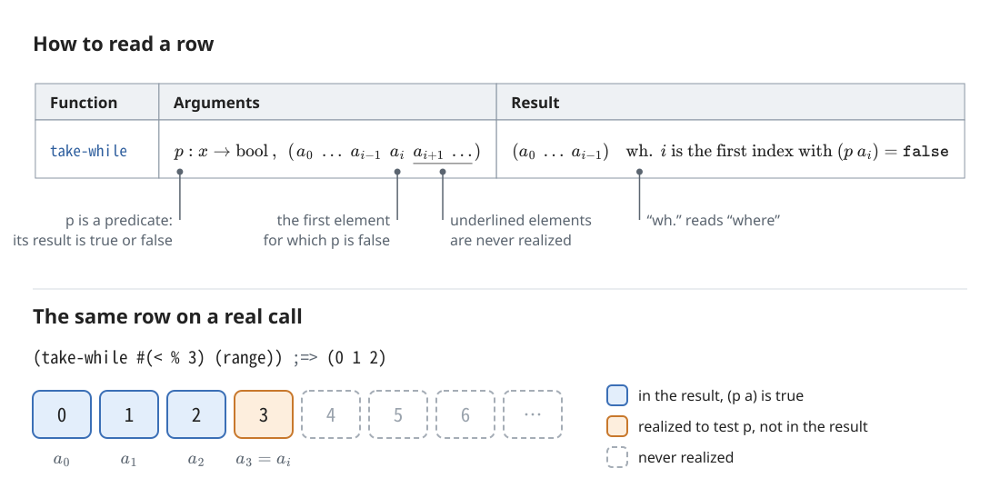

Title: clojure.coreの関数を数式で表したClojureのチートシート
Date: 2026-11-27 20:55
Updated: 2026-11-27 20:55
Draft: true
Original: /blog/2026/315a71
Tags: clojure standard-library

Clojureの `clojure.core` のうちseqとコレクションと関数を扱う163個の関数を、1つずつ小さな式で書いたチートシートを作りました。
記法はDaniel Keepさんの [Rust Iterator Cheat Sheet](https://danielkeep.github.io/itercheat_baked.html) (CC BY-SA 4.0) から借りてClojureの構文に移し、seqとベクターとマップとセットをClojureのリテラルで、関数の呼び出しをリストで書いています。
表の内容はClojure 1.12.7のものです。
表を書き出す [スクリプト](https://github.com/conao3/blog-stasis-src/blob/master/bin/315a71-clojure-cheatsheet.clj) は各行と、その関数をClojureで動かす333個の検査を並べて持っていて、検査がすべて通ったときだけ表を作ります。

# 記法の読み方

図で `take-while` の行を読み、続けて同じ行を `(take-while #(< % 3) (range))` でたどります。

-   はseqです。
    とは入力のseqで、添字で要素を1つ選びます。
-   はリスト、はベクター、はマップ、はセットで、Clojureのソースと同じ書き方です。
    `peek` と `pop` のリストの行には本物のリストが要り、 `map` の結果のようなseqを渡すと `peek` と `pop` は例外を投げます。
-   はClojureのソースと同じ書き方で、をで呼ぶことを表します。
-   ととは新しい値を計算する関数で、は `sort-by` が受け取るようなキーの関数です。
-   とは述語です。
    述語の結果はでもでもなければとみなします。
-   は `compare` や `>` のような比較関数です。
-   はが引数を2つ取ることを表し、とは返す値の種類を表します。
    はreduceする関数の累積値で、はその最初の値です。
-   は `(map inc)` のようなトランスデューサーです。
-   とは位置を表し、 `range` では始まりと終わりの値を表します。
    は渡す個数、は刻み幅、とは入力のseqの長さです。
-   はマップ、はキー、とは値、は既定値です。
-   は関数で、 `(fn [x] (f x))` と同じです。
    は任意の個数の引数を取ります。
-   のように上付きの!を付けたものはtransientです。
-   は位置の置換です。
    図のwh.と表の「ただし」の後には値の定義や条件が続き、ほかの文字は引数に出てくる値か、その行が「ただし」の後で定義する値です。
-   下線を引いた要素は関数を呼んで結果のseqをすべて消費しても実体化しません。
    下線の位置はチャンク化されていない遅延seqで測っていて、 `(take-while p a)` は止まる場所を知るためにを見る必要があるのでより後の要素にだけ下線を引いています。
    ベクターと有限の `range` から作るチャンク化されたseqでは、 `map` や `filter` のような多くの遅延の関数が結果を32個ずつ計算します。
-   遅延の列に印のある関数は遅延seqを返し、要素を求められたときに計算します。
-   xfの列に印のある関数は、 `(map inc)` のようにコレクションを渡さずに呼ぶと [トランスデューサー](https://clojure.org/reference/transducers) を返します。
-   関数の名前は [clojure.core API reference](https://clojure.github.io/clojure/clojure.core-api.html) のその関数の項へリンクしています。

# 関数の分け方

Clojureの [公式のチートシート](https://clojure.org/api/cheatsheet) は「Seq in, Seq out」の関数を「Get shorter」「Get longer」「Head-items」「Tail-items」「'Change'」のような見出しで分けています。
2つの見出しに入っている関数もあり、たとえば `filter` は「Get shorter」と「'Change'」にあります。

私は結果の要素と入力の要素の関係で関数を分けたので、どの関数も1回だけ出てきます。

-   選ぶ関数の結果は入力の要素を入力の順に持ちます。
-   変換する関数の結果は、が入力の要素から計算した値を持ちます。
-   つなぐ関数の結果はseqに要素を足すか、複数のseqや入れ子のコレクションを1つのseqにつなげたものです。
-   並べ替える関数の結果は同じ要素を別の順に並べたものです。
-   分ける関数の結果は入力の要素を組に分けて持ちます。
-   まとめる関数の結果は1つの値です。
-   集める関数の結果はベクター、セット、マップ、 `into` に渡したコレクションのどれかです。

Rich Hickeyさんは2008年の [メーリングリストのスレッド](https://groups.google.com/g/clojure/c/iyyNyWs53dc) で、 `clojure.core` の引数の順を次のように説明しました。

> Sequence functions take their sources last and collection functions take their primary operand (collection) first.

上の分類の関数のほとんどは引用のsequence functionsに当たるので、seqを最後に取って `->>` で使えます。
`nth` と `nthrest` と `nthnext` はseqを最初に取り、 `max-key` と `min-key` はseqの代わりに値を取ります。

ベクターやマップやセットを読んだり更新したりする関数はコレクションを最初に取り、 `->` で使えます。
その後に、コレクションを作る関数、値がどの種類のコレクションかを調べる関数、transientを扱う関数、値を比べる関数が続きます。

# seqを作る

これらの関数は何もないところや1つの値やコレクションからseqを作ります。
トランスデューサーを渡さないと `sequence` は引数をseqにするだけなので、ベクターからはチャンク化されたseqができ、遅延seqはそのまま返ります。

<table>
<thead><tr><th>関数</th><th>引数</th><th>結果</th><th>遅延</th><th>xf</th></tr></thead>
<tbody>
<tr><td rowspan="2"><a href="https://clojure.github.io/clojure/clojure.core-api.html#clojure.core/seq"><code style="white-space: nowrap">seq</code></a></td><td></td><td></td><td rowspan="2"></td><td rowspan="2"></td></tr>
<tr><td></td><td></td></tr>
<tr><td rowspan="3"><a href="https://clojure.github.io/clojure/clojure.core-api.html#clojure.core/sequence"><code style="white-space: nowrap">sequence</code></a></td><td></td><td></td><td></td><td rowspan="3"></td></tr>
<tr><td></td><td></td><td></td></tr>
<tr><td>, </td><td></td><td>✓</td></tr>
<tr><td><a href="https://clojure.github.io/clojure/clojure.core-api.html#clojure.core/list*"><code style="white-space: nowrap">list*</code></a></td><td>, , </td><td></td><td></td><td></td></tr>
<tr><td rowspan="2"><a href="https://clojure.github.io/clojure/clojure.core-api.html#clojure.core/re-seq"><code style="white-space: nowrap">re-seq</code></a></td><td>, </td><td></td><td rowspan="2">✓</td><td rowspan="2"></td></tr>
<tr><td>, </td><td></td></tr>
<tr><td rowspan="3"><a href="https://clojure.github.io/clojure/clojure.core-api.html#clojure.core/subseq"><code style="white-space: nowrap">subseq</code></a></td><td>, , </td><td></td><td></td><td rowspan="3"></td></tr>
<tr><td>, , </td><td></td><td>✓</td></tr>
<tr><td>, , , , </td><td></td><td>✓</td></tr>
<tr><td rowspan="3"><a href="https://clojure.github.io/clojure/clojure.core-api.html#clojure.core/rsubseq"><code style="white-space: nowrap">rsubseq</code></a></td><td>, , </td><td></td><td></td><td rowspan="3"></td></tr>
<tr><td>, , </td><td></td><td>✓</td></tr>
<tr><td>, , , , </td><td></td><td>✓</td></tr>
<tr><td rowspan="4"><a href="https://clojure.github.io/clojure/clojure.core-api.html#clojure.core/range"><code style="white-space: nowrap">range</code></a></td><td></td><td></td><td rowspan="4">✓</td><td rowspan="4"></td></tr>
<tr><td></td><td></td></tr>
<tr><td>, </td><td></td></tr>
<tr><td>, , </td><td></td></tr>
<tr><td rowspan="2"><a href="https://clojure.github.io/clojure/clojure.core-api.html#clojure.core/repeat"><code style="white-space: nowrap">repeat</code></a></td><td></td><td></td><td rowspan="2">✓</td><td rowspan="2"></td></tr>
<tr><td>, </td><td></td></tr>
<tr><td rowspan="2"><a href="https://clojure.github.io/clojure/clojure.core-api.html#clojure.core/repeatedly"><code style="white-space: nowrap">repeatedly</code></a></td><td></td><td></td><td rowspan="2">✓</td><td rowspan="2"></td></tr>
<tr><td>, </td><td></td></tr>
<tr><td><a href="https://clojure.github.io/clojure/clojure.core-api.html#clojure.core/iterate"><code style="white-space: nowrap">iterate</code></a></td><td>, </td><td></td><td>✓</td><td></td></tr>
<tr><td rowspan="2"><a href="https://clojure.github.io/clojure/clojure.core-api.html#clojure.core/keys"><code style="white-space: nowrap">keys</code></a></td><td></td><td></td><td rowspan="2"></td><td rowspan="2"></td></tr>
<tr><td></td><td></td></tr>
<tr><td rowspan="2"><a href="https://clojure.github.io/clojure/clojure.core-api.html#clojure.core/vals"><code style="white-space: nowrap">vals</code></a></td><td></td><td></td><td rowspan="2"></td><td rowspan="2"></td></tr>
<tr><td></td><td></td></tr>
<tr><td rowspan="2"><a href="https://clojure.github.io/clojure/clojure.core-api.html#clojure.core/rseq"><code style="white-space: nowrap">rseq</code></a></td><td></td><td></td><td rowspan="2"></td><td rowspan="2"></td></tr>
<tr><td></td><td></td></tr>
</tbody>
</table>

# 位置で選ぶ

これらの関数は個数を数えて要素を残したり捨てたりします。
`rest` は何も残らないと空のseqを返し、 `next` はを返します。
`next` は残りがあるかを知るために、要素をもう1つ実体化する必要があります。

<table>
<thead><tr><th>関数</th><th>引数</th><th>結果</th><th>遅延</th><th>xf</th></tr></thead>
<tbody>
<tr><td><a href="https://clojure.github.io/clojure/clojure.core-api.html#clojure.core/take"><code style="white-space: nowrap">take</code></a></td><td>, </td><td></td><td>✓</td><td>✓</td></tr>
<tr><td><a href="https://clojure.github.io/clojure/clojure.core-api.html#clojure.core/drop"><code style="white-space: nowrap">drop</code></a></td><td>, </td><td></td><td>✓</td><td>✓</td></tr>
<tr><td rowspan="2"><a href="https://clojure.github.io/clojure/clojure.core-api.html#clojure.core/take-last"><code style="white-space: nowrap">take-last</code></a></td><td>, </td><td></td><td rowspan="2"></td><td rowspan="2"></td></tr>
<tr><td>, </td><td></td></tr>
<tr><td rowspan="2"><a href="https://clojure.github.io/clojure/clojure.core-api.html#clojure.core/drop-last"><code style="white-space: nowrap">drop-last</code></a></td><td></td><td></td><td rowspan="2">✓</td><td rowspan="2"></td></tr>
<tr><td>, </td><td></td></tr>
<tr><td rowspan="2"><a href="https://clojure.github.io/clojure/clojure.core-api.html#clojure.core/butlast"><code style="white-space: nowrap">butlast</code></a></td><td></td><td></td><td rowspan="2"></td><td rowspan="2"></td></tr>
<tr><td></td><td></td></tr>
<tr><td rowspan="3"><a href="https://clojure.github.io/clojure/clojure.core-api.html#clojure.core/rest"><code style="white-space: nowrap">rest</code></a></td><td></td><td></td><td rowspan="3"></td><td rowspan="3"></td></tr>
<tr><td></td><td></td></tr>
<tr><td></td><td></td></tr>
<tr><td rowspan="3"><a href="https://clojure.github.io/clojure/clojure.core-api.html#clojure.core/next"><code style="white-space: nowrap">next</code></a></td><td></td><td></td><td rowspan="3"></td><td rowspan="3"></td></tr>
<tr><td></td><td></td></tr>
<tr><td></td><td></td></tr>
<tr><td rowspan="2"><a href="https://clojure.github.io/clojure/clojure.core-api.html#clojure.core/nnext"><code style="white-space: nowrap">nnext</code></a></td><td></td><td></td><td rowspan="2"></td><td rowspan="2"></td></tr>
<tr><td></td><td></td></tr>
<tr><td rowspan="2"><a href="https://clojure.github.io/clojure/clojure.core-api.html#clojure.core/nfirst"><code style="white-space: nowrap">nfirst</code></a></td><td></td><td></td><td rowspan="2"></td><td rowspan="2"></td></tr>
<tr><td></td><td></td></tr>
<tr><td rowspan="2"><a href="https://clojure.github.io/clojure/clojure.core-api.html#clojure.core/nthrest"><code style="white-space: nowrap">nthrest</code></a></td><td>, </td><td></td><td rowspan="2"></td><td rowspan="2"></td></tr>
<tr><td>, </td><td></td></tr>
<tr><td rowspan="2"><a href="https://clojure.github.io/clojure/clojure.core-api.html#clojure.core/nthnext"><code style="white-space: nowrap">nthnext</code></a></td><td>, </td><td></td><td rowspan="2"></td><td rowspan="2"></td></tr>
<tr><td>, </td><td></td></tr>
<tr><td><a href="https://clojure.github.io/clojure/clojure.core-api.html#clojure.core/take-nth"><code style="white-space: nowrap">take-nth</code></a></td><td>, </td><td></td><td>✓</td><td>✓</td></tr>
</tbody>
</table>

# 述語で選ぶ

これらの関数は要素を1つずつ調べるか前の要素と比べて、残すか捨てるかを決めます。

<table>
<thead><tr><th>関数</th><th>引数</th><th>結果</th><th>遅延</th><th>xf</th></tr></thead>
<tbody>
<tr><td><a href="https://clojure.github.io/clojure/clojure.core-api.html#clojure.core/filter"><code style="white-space: nowrap">filter</code></a></td><td>, </td><td></td><td>✓</td><td>✓</td></tr>
<tr><td><a href="https://clojure.github.io/clojure/clojure.core-api.html#clojure.core/remove"><code style="white-space: nowrap">remove</code></a></td><td>, </td><td></td><td>✓</td><td>✓</td></tr>
<tr><td><a href="https://clojure.github.io/clojure/clojure.core-api.html#clojure.core/filterv"><code style="white-space: nowrap">filterv</code></a></td><td>, </td><td></td><td></td><td></td></tr>
<tr><td><a href="https://clojure.github.io/clojure/clojure.core-api.html#clojure.core/take-while"><code style="white-space: nowrap">take-while</code></a></td><td>, </td><td></td><td>✓</td><td>✓</td></tr>
<tr><td><a href="https://clojure.github.io/clojure/clojure.core-api.html#clojure.core/drop-while"><code style="white-space: nowrap">drop-while</code></a></td><td>, </td><td></td><td>✓</td><td>✓</td></tr>
<tr><td><a href="https://clojure.github.io/clojure/clojure.core-api.html#clojure.core/distinct"><code style="white-space: nowrap">distinct</code></a></td><td></td><td></td><td>✓</td><td>✓</td></tr>
<tr><td><a href="https://clojure.github.io/clojure/clojure.core-api.html#clojure.core/dedupe"><code style="white-space: nowrap">dedupe</code></a></td><td></td><td></td><td>✓</td><td>✓</td></tr>
<tr><td><a href="https://clojure.github.io/clojure/clojure.core-api.html#clojure.core/random-sample"><code style="white-space: nowrap">random-sample</code></a></td><td>, </td><td></td><td>✓</td><td>✓</td></tr>
</tbody>
</table>

# 変換する

これらの関数は入力の要素から新しい要素を計算します。
入力のseqが2つ以上あるとき、 `map` は一番短いseqの終わりで止まります。

<table>
<thead><tr><th>関数</th><th>引数</th><th>結果</th><th>遅延</th><th>xf</th></tr></thead>
<tbody>
<tr><td rowspan="2"><a href="https://clojure.github.io/clojure/clojure.core-api.html#clojure.core/map"><code style="white-space: nowrap">map</code></a></td><td>, </td><td></td><td rowspan="2">✓</td><td rowspan="2">✓</td></tr>
<tr><td>, , </td><td></td></tr>
<tr><td><a href="https://clojure.github.io/clojure/clojure.core-api.html#clojure.core/mapv"><code style="white-space: nowrap">mapv</code></a></td><td>, </td><td></td><td></td><td></td></tr>
<tr><td><a href="https://clojure.github.io/clojure/clojure.core-api.html#clojure.core/pmap"><code style="white-space: nowrap">pmap</code></a></td><td>, </td><td></td><td>✓</td><td></td></tr>
<tr><td><a href="https://clojure.github.io/clojure/clojure.core-api.html#clojure.core/map-indexed"><code style="white-space: nowrap">map-indexed</code></a></td><td>, </td><td></td><td>✓</td><td>✓</td></tr>
<tr><td><a href="https://clojure.github.io/clojure/clojure.core-api.html#clojure.core/keep"><code style="white-space: nowrap">keep</code></a></td><td>, </td><td></td><td>✓</td><td>✓</td></tr>
<tr><td><a href="https://clojure.github.io/clojure/clojure.core-api.html#clojure.core/keep-indexed"><code style="white-space: nowrap">keep-indexed</code></a></td><td>, </td><td></td><td>✓</td><td>✓</td></tr>
<tr><td><a href="https://clojure.github.io/clojure/clojure.core-api.html#clojure.core/mapcat"><code style="white-space: nowrap">mapcat</code></a></td><td>, </td><td></td><td>✓</td><td>✓</td></tr>
<tr><td rowspan="2"><a href="https://clojure.github.io/clojure/clojure.core-api.html#clojure.core/replace"><code style="white-space: nowrap">replace</code></a></td><td>, </td><td></td><td>✓</td><td rowspan="2">✓</td></tr>
<tr><td>, </td><td></td><td></td></tr>
<tr><td rowspan="2"><a href="https://clojure.github.io/clojure/clojure.core-api.html#clojure.core/reductions"><code style="white-space: nowrap">reductions</code></a></td><td>, </td><td></td><td rowspan="2">✓</td><td rowspan="2"></td></tr>
<tr><td>, , </td><td></td></tr>
</tbody>
</table>

# つなぐ

`interleave` は一番短いseqの終わりで止まります。
`flatten` はベクターやリストのような入れ子のシーケンシャルなコレクションを、その要素で置き換えます。

<table>
<thead><tr><th>関数</th><th>引数</th><th>結果</th><th>遅延</th><th>xf</th></tr></thead>
<tbody>
<tr><td><a href="https://clojure.github.io/clojure/clojure.core-api.html#clojure.core/cons"><code style="white-space: nowrap">cons</code></a></td><td>, </td><td></td><td></td><td></td></tr>
<tr><td><a href="https://clojure.github.io/clojure/clojure.core-api.html#clojure.core/concat"><code style="white-space: nowrap">concat</code></a></td><td>, , </td><td></td><td>✓</td><td></td></tr>
<tr><td><a href="https://clojure.github.io/clojure/clojure.core-api.html#clojure.core/interleave"><code style="white-space: nowrap">interleave</code></a></td><td>, </td><td></td><td>✓</td><td></td></tr>
<tr><td><a href="https://clojure.github.io/clojure/clojure.core-api.html#clojure.core/interpose"><code style="white-space: nowrap">interpose</code></a></td><td>, </td><td></td><td>✓</td><td>✓</td></tr>
<tr><td><a href="https://clojure.github.io/clojure/clojure.core-api.html#clojure.core/cycle"><code style="white-space: nowrap">cycle</code></a></td><td></td><td></td><td>✓</td><td></td></tr>
<tr><td><a href="https://clojure.github.io/clojure/clojure.core-api.html#clojure.core/flatten"><code style="white-space: nowrap">flatten</code></a></td><td></td><td></td><td>✓</td><td></td></tr>
</tbody>
</table>

# 並べ替える

`sort` と `sort-by` は安定なので、等しい要素は入力の順を保ちます。

<table>
<thead><tr><th>関数</th><th>引数</th><th>結果</th><th>遅延</th><th>xf</th></tr></thead>
<tbody>
<tr><td><a href="https://clojure.github.io/clojure/clojure.core-api.html#clojure.core/reverse"><code style="white-space: nowrap">reverse</code></a></td><td></td><td></td><td></td><td></td></tr>
<tr><td rowspan="2"><a href="https://clojure.github.io/clojure/clojure.core-api.html#clojure.core/sort"><code style="white-space: nowrap">sort</code></a></td><td></td><td></td><td rowspan="2"></td><td rowspan="2"></td></tr>
<tr><td>, </td><td></td></tr>
<tr><td rowspan="2"><a href="https://clojure.github.io/clojure/clojure.core-api.html#clojure.core/sort-by"><code style="white-space: nowrap">sort-by</code></a></td><td>, </td><td></td><td rowspan="2"></td><td rowspan="2"></td></tr>
<tr><td>, , </td><td></td></tr>
<tr><td><a href="https://clojure.github.io/clojure/clojure.core-api.html#clojure.core/shuffle"><code style="white-space: nowrap">shuffle</code></a></td><td></td><td></td><td></td><td></td></tr>
</tbody>
</table>

# 分ける

`partition` で始まる関数は組のseqを返し、 `split-at` と `split-with` と `splitv-at` は2つの部分のベクターを返します。

<table>
<thead><tr><th>関数</th><th>引数</th><th>結果</th><th>遅延</th><th>xf</th></tr></thead>
<tbody>
<tr><td rowspan="2"><a href="https://clojure.github.io/clojure/clojure.core-api.html#clojure.core/partition"><code style="white-space: nowrap">partition</code></a></td><td>, </td><td></td><td rowspan="2">✓</td><td rowspan="2"></td></tr>
<tr><td>, , </td><td></td></tr>
<tr><td><a href="https://clojure.github.io/clojure/clojure.core-api.html#clojure.core/partition-all"><code style="white-space: nowrap">partition-all</code></a></td><td>, </td><td></td><td>✓</td><td>✓</td></tr>
<tr><td><a href="https://clojure.github.io/clojure/clojure.core-api.html#clojure.core/partition-by"><code style="white-space: nowrap">partition-by</code></a></td><td>, </td><td></td><td>✓</td><td>✓</td></tr>
<tr><td><a href="https://clojure.github.io/clojure/clojure.core-api.html#clojure.core/split-at"><code style="white-space: nowrap">split-at</code></a></td><td>, </td><td></td><td></td><td></td></tr>
<tr><td><a href="https://clojure.github.io/clojure/clojure.core-api.html#clojure.core/split-with"><code style="white-space: nowrap">split-with</code></a></td><td>, </td><td></td><td></td><td></td></tr>
<tr><td><a href="https://clojure.github.io/clojure/clojure.core-api.html#clojure.core/partitionv"><code style="white-space: nowrap">partitionv</code></a></td><td>, </td><td></td><td>✓</td><td></td></tr>
<tr><td><a href="https://clojure.github.io/clojure/clojure.core-api.html#clojure.core/partitionv-all"><code style="white-space: nowrap">partitionv-all</code></a></td><td>, </td><td></td><td>✓</td><td>✓</td></tr>
<tr><td><a href="https://clojure.github.io/clojure/clojure.core-api.html#clojure.core/splitv-at"><code style="white-space: nowrap">splitv-at</code></a></td><td>, </td><td></td><td></td><td></td></tr>
</tbody>
</table>

# 1つの値にまとめる

これらの関数はseqを消費して1つの値を返します。
`some` と `every?` と `not-every?` と `not-any?` は、答えが決まった最初の要素で止まります。

`transduce` は最後にを引数1つで呼び、 `completing` は2引数の関数にそのアリティを足します。

<table>
<thead><tr><th>関数</th><th>引数</th><th>結果</th><th>遅延</th><th>xf</th></tr></thead>
<tbody>
<tr><td rowspan="5"><a href="https://clojure.github.io/clojure/clojure.core-api.html#clojure.core/reduce"><code style="white-space: nowrap">reduce</code></a></td><td>, </td><td></td><td rowspan="5"></td><td rowspan="5"></td></tr>
<tr><td>, </td><td></td></tr>
<tr><td>, </td><td></td></tr>
<tr><td>, , </td><td></td></tr>
<tr><td>, , </td><td></td></tr>
<tr><td><a href="https://clojure.github.io/clojure/clojure.core-api.html#clojure.core/reduce-kv"><code style="white-space: nowrap">reduce-kv</code></a></td><td>, , </td><td></td><td></td><td></td></tr>
<tr><td><a href="https://clojure.github.io/clojure/clojure.core-api.html#clojure.core/transduce"><code style="white-space: nowrap">transduce</code></a></td><td>, , , </td><td></td><td></td><td></td></tr>
<tr><td rowspan="2"><a href="https://clojure.github.io/clojure/clojure.core-api.html#clojure.core/count"><code style="white-space: nowrap">count</code></a></td><td></td><td></td><td rowspan="2"></td><td rowspan="2"></td></tr>
<tr><td></td><td></td></tr>
<tr><td rowspan="2"><a href="https://clojure.github.io/clojure/clojure.core-api.html#clojure.core/first"><code style="white-space: nowrap">first</code></a></td><td></td><td></td><td rowspan="2"></td><td rowspan="2"></td></tr>
<tr><td></td><td></td></tr>
<tr><td rowspan="2"><a href="https://clojure.github.io/clojure/clojure.core-api.html#clojure.core/second"><code style="white-space: nowrap">second</code></a></td><td></td><td></td><td rowspan="2"></td><td rowspan="2"></td></tr>
<tr><td></td><td></td></tr>
<tr><td rowspan="2"><a href="https://clojure.github.io/clojure/clojure.core-api.html#clojure.core/fnext"><code style="white-space: nowrap">fnext</code></a></td><td></td><td></td><td rowspan="2"></td><td rowspan="2"></td></tr>
<tr><td></td><td></td></tr>
<tr><td rowspan="2"><a href="https://clojure.github.io/clojure/clojure.core-api.html#clojure.core/when-first"><code style="white-space: nowrap">when-first</code></a></td><td>, </td><td></td><td rowspan="2"></td><td rowspan="2"></td></tr>
<tr><td>, </td><td></td></tr>
<tr><td rowspan="2"><a href="https://clojure.github.io/clojure/clojure.core-api.html#clojure.core/last"><code style="white-space: nowrap">last</code></a></td><td></td><td></td><td rowspan="2"></td><td rowspan="2"></td></tr>
<tr><td></td><td></td></tr>
<tr><td rowspan="3"><a href="https://clojure.github.io/clojure/clojure.core-api.html#clojure.core/nth"><code style="white-space: nowrap">nth</code></a></td><td>, </td><td></td><td rowspan="3"></td><td rowspan="3"></td></tr>
<tr><td>, </td><td></td></tr>
<tr><td>, , </td><td></td></tr>
<tr><td><a href="https://clojure.github.io/clojure/clojure.core-api.html#clojure.core/ffirst"><code style="white-space: nowrap">ffirst</code></a></td><td></td><td></td><td></td><td></td></tr>
<tr><td><a href="https://clojure.github.io/clojure/clojure.core-api.html#clojure.core/rand-nth"><code style="white-space: nowrap">rand-nth</code></a></td><td></td><td></td><td></td><td></td></tr>
<tr><td><a href="https://clojure.github.io/clojure/clojure.core-api.html#clojure.core/some"><code style="white-space: nowrap">some</code></a></td><td>, </td><td></td><td></td><td></td></tr>
<tr><td><a href="https://clojure.github.io/clojure/clojure.core-api.html#clojure.core/every?"><code style="white-space: nowrap">every?</code></a></td><td>, </td><td></td><td></td><td></td></tr>
<tr><td><a href="https://clojure.github.io/clojure/clojure.core-api.html#clojure.core/not-every?"><code style="white-space: nowrap">not-every?</code></a></td><td>, </td><td></td><td></td><td></td></tr>
<tr><td><a href="https://clojure.github.io/clojure/clojure.core-api.html#clojure.core/not-any?"><code style="white-space: nowrap">not-any?</code></a></td><td>, </td><td></td><td></td><td></td></tr>
<tr><td rowspan="2"><a href="https://clojure.github.io/clojure/clojure.core-api.html#clojure.core/empty?"><code style="white-space: nowrap">empty?</code></a></td><td></td><td></td><td rowspan="2"></td><td rowspan="2"></td></tr>
<tr><td></td><td></td></tr>
<tr><td rowspan="2"><a href="https://clojure.github.io/clojure/clojure.core-api.html#clojure.core/not-empty"><code style="white-space: nowrap">not-empty</code></a></td><td></td><td></td><td rowspan="2"></td><td rowspan="2"></td></tr>
<tr><td></td><td></td></tr>
<tr><td><a href="https://clojure.github.io/clojure/clojure.core-api.html#clojure.core/distinct?"><code style="white-space: nowrap">distinct?</code></a></td><td>, , </td><td></td><td></td><td></td></tr>
<tr><td><a href="https://clojure.github.io/clojure/clojure.core-api.html#clojure.core/max-key"><code style="white-space: nowrap">max-key</code></a></td><td>, , , </td><td></td><td></td><td></td></tr>
<tr><td><a href="https://clojure.github.io/clojure/clojure.core-api.html#clojure.core/min-key"><code style="white-space: nowrap">min-key</code></a></td><td>, , , </td><td></td><td></td><td></td></tr>
</tbody>
</table>

# コレクションに集める

結果はseqの要素を持つベクター、セット、マップのどれかになります。
`into` は渡したコレクションにseqの要素を足します。

<table>
<thead><tr><th>関数</th><th>引数</th><th>結果</th><th>遅延</th><th>xf</th></tr></thead>
<tbody>
<tr><td rowspan="4"><a href="https://clojure.github.io/clojure/clojure.core-api.html#clojure.core/into"><code style="white-space: nowrap">into</code></a></td><td>, </td><td></td><td rowspan="4"></td><td rowspan="4"></td></tr>
<tr><td>, </td><td></td></tr>
<tr><td>, </td><td></td></tr>
<tr><td>, , </td><td></td></tr>
<tr><td><a href="https://clojure.github.io/clojure/clojure.core-api.html#clojure.core/vec"><code style="white-space: nowrap">vec</code></a></td><td></td><td></td><td></td><td></td></tr>
<tr><td><a href="https://clojure.github.io/clojure/clojure.core-api.html#clojure.core/set"><code style="white-space: nowrap">set</code></a></td><td></td><td></td><td></td><td></td></tr>
<tr><td><a href="https://clojure.github.io/clojure/clojure.core-api.html#clojure.core/zipmap"><code style="white-space: nowrap">zipmap</code></a></td><td>, </td><td></td><td></td><td></td></tr>
<tr><td><a href="https://clojure.github.io/clojure/clojure.core-api.html#clojure.core/frequencies"><code style="white-space: nowrap">frequencies</code></a></td><td></td><td></td><td></td><td></td></tr>
<tr><td><a href="https://clojure.github.io/clojure/clojure.core-api.html#clojure.core/group-by"><code style="white-space: nowrap">group-by</code></a></td><td>, </td><td></td><td></td><td></td></tr>
</tbody>
</table>

# コレクション

これらの関数はコレクションを最初に取ります。
`conj` はベクターには末尾に、リストには先頭に足します。

`assoc` と `dissoc` と `conj` と `merge` と `empty` はソート済みマップのような最初の引数の型を保ちます。
`select-keys` と `update-keys` と `update-vals` は普通のマップを返します。

<table>
<thead><tr><th>関数</th><th>引数</th><th>結果</th><th>遅延</th><th>xf</th></tr></thead>
<tbody>
<tr><td rowspan="5"><a href="https://clojure.github.io/clojure/clojure.core-api.html#clojure.core/conj"><code style="white-space: nowrap">conj</code></a></td><td>, </td><td></td><td rowspan="5"></td><td rowspan="5"></td></tr>
<tr><td>, </td><td></td></tr>
<tr><td>, </td><td></td></tr>
<tr><td>, </td><td></td></tr>
<tr><td>, </td><td></td></tr>
<tr><td><a href="https://clojure.github.io/clojure/clojure.core-api.html#clojure.core/disj"><code style="white-space: nowrap">disj</code></a></td><td>, </td><td></td><td></td><td></td></tr>
<tr><td rowspan="2"><a href="https://clojure.github.io/clojure/clojure.core-api.html#clojure.core/assoc"><code style="white-space: nowrap">assoc</code></a></td><td>, , </td><td></td><td rowspan="2"></td><td rowspan="2"></td></tr>
<tr><td>, , </td><td></td></tr>
<tr><td><a href="https://clojure.github.io/clojure/clojure.core-api.html#clojure.core/dissoc"><code style="white-space: nowrap">dissoc</code></a></td><td>, </td><td></td><td></td><td></td></tr>
<tr><td rowspan="4"><a href="https://clojure.github.io/clojure/clojure.core-api.html#clojure.core/get"><code style="white-space: nowrap">get</code></a></td><td>, </td><td></td><td rowspan="4"></td><td rowspan="4"></td></tr>
<tr><td>, </td><td></td></tr>
<tr><td>, , </td><td></td></tr>
<tr><td>, </td><td></td></tr>
<tr><td><a href="https://clojure.github.io/clojure/clojure.core-api.html#clojure.core/get-in"><code style="white-space: nowrap">get-in</code></a></td><td>, </td><td></td><td></td><td></td></tr>
<tr><td><a href="https://clojure.github.io/clojure/clojure.core-api.html#clojure.core/assoc-in"><code style="white-space: nowrap">assoc-in</code></a></td><td>, , </td><td></td><td></td><td></td></tr>
<tr><td rowspan="2"><a href="https://clojure.github.io/clojure/clojure.core-api.html#clojure.core/update"><code style="white-space: nowrap">update</code></a></td><td>, , </td><td></td><td rowspan="2"></td><td rowspan="2"></td></tr>
<tr><td>, , , , </td><td></td></tr>
<tr><td><a href="https://clojure.github.io/clojure/clojure.core-api.html#clojure.core/update-in"><code style="white-space: nowrap">update-in</code></a></td><td>, , </td><td></td><td></td><td></td></tr>
<tr><td><a href="https://clojure.github.io/clojure/clojure.core-api.html#clojure.core/update-keys"><code style="white-space: nowrap">update-keys</code></a></td><td>, </td><td></td><td></td><td></td></tr>
<tr><td><a href="https://clojure.github.io/clojure/clojure.core-api.html#clojure.core/update-vals"><code style="white-space: nowrap">update-vals</code></a></td><td>, </td><td></td><td></td><td></td></tr>
<tr><td><a href="https://clojure.github.io/clojure/clojure.core-api.html#clojure.core/merge"><code style="white-space: nowrap">merge</code></a></td><td>, , </td><td></td><td></td><td></td></tr>
<tr><td><a href="https://clojure.github.io/clojure/clojure.core-api.html#clojure.core/merge-with"><code style="white-space: nowrap">merge-with</code></a></td><td>, , </td><td></td><td></td><td></td></tr>
<tr><td><a href="https://clojure.github.io/clojure/clojure.core-api.html#clojure.core/select-keys"><code style="white-space: nowrap">select-keys</code></a></td><td>, </td><td></td><td></td><td></td></tr>
<tr><td rowspan="2"><a href="https://clojure.github.io/clojure/clojure.core-api.html#clojure.core/contains?"><code style="white-space: nowrap">contains?</code></a></td><td>, </td><td></td><td rowspan="2"></td><td rowspan="2"></td></tr>
<tr><td>, </td><td></td></tr>
<tr><td rowspan="2"><a href="https://clojure.github.io/clojure/clojure.core-api.html#clojure.core/find"><code style="white-space: nowrap">find</code></a></td><td>, </td><td></td><td rowspan="2"></td><td rowspan="2"></td></tr>
<tr><td>, </td><td></td></tr>
<tr><td><a href="https://clojure.github.io/clojure/clojure.core-api.html#clojure.core/key"><code style="white-space: nowrap">key</code></a></td><td></td><td></td><td></td><td></td></tr>
<tr><td><a href="https://clojure.github.io/clojure/clojure.core-api.html#clojure.core/val"><code style="white-space: nowrap">val</code></a></td><td></td><td></td><td></td><td></td></tr>
<tr><td rowspan="3"><a href="https://clojure.github.io/clojure/clojure.core-api.html#clojure.core/peek"><code style="white-space: nowrap">peek</code></a></td><td></td><td></td><td rowspan="3"></td><td rowspan="3"></td></tr>
<tr><td></td><td></td></tr>
<tr><td></td><td></td></tr>
<tr><td rowspan="4"><a href="https://clojure.github.io/clojure/clojure.core-api.html#clojure.core/pop"><code style="white-space: nowrap">pop</code></a></td><td></td><td></td><td rowspan="4"></td><td rowspan="4"></td></tr>
<tr><td></td><td></td></tr>
<tr><td></td><td></td></tr>
<tr><td></td><td></td></tr>
<tr><td rowspan="2"><a href="https://clojure.github.io/clojure/clojure.core-api.html#clojure.core/subvec"><code style="white-space: nowrap">subvec</code></a></td><td>, , </td><td></td><td rowspan="2"></td><td rowspan="2"></td></tr>
<tr><td>, </td><td></td></tr>
<tr><td rowspan="2"><a href="https://clojure.github.io/clojure/clojure.core-api.html#clojure.core/empty"><code style="white-space: nowrap">empty</code></a></td><td></td><td></td><td rowspan="2"></td><td rowspan="2"></td></tr>
<tr><td></td><td></td></tr>
</tbody>
</table>

# コレクションを作る

これらの関数は渡した値からコレクションを作ります。
`array-map` はキーを渡した順に保ちますが、8個より多いエントリーを持つ `array-map` にさらにキーを `assoc` するとハッシュマップになります。
ソート済みのマップとセットはキーを `compare` か渡した比較関数の順に保ちます。

<table>
<thead><tr><th>関数</th><th>引数</th><th>結果</th><th>遅延</th><th>xf</th></tr></thead>
<tbody>
<tr><td><a href="https://clojure.github.io/clojure/clojure.core-api.html#clojure.core/list"><code style="white-space: nowrap">list</code></a></td><td>, , </td><td></td><td></td><td></td></tr>
<tr><td><a href="https://clojure.github.io/clojure/clojure.core-api.html#clojure.core/vector"><code style="white-space: nowrap">vector</code></a></td><td>, , </td><td></td><td></td><td></td></tr>
<tr><td><a href="https://clojure.github.io/clojure/clojure.core-api.html#clojure.core/vector-of"><code style="white-space: nowrap">vector-of</code></a></td><td>, , </td><td></td><td></td><td></td></tr>
<tr><td><a href="https://clojure.github.io/clojure/clojure.core-api.html#clojure.core/hash-map"><code style="white-space: nowrap">hash-map</code></a></td><td>, , , , </td><td></td><td></td><td></td></tr>
<tr><td><a href="https://clojure.github.io/clojure/clojure.core-api.html#clojure.core/array-map"><code style="white-space: nowrap">array-map</code></a></td><td>, , , , </td><td></td><td></td><td></td></tr>
<tr><td><a href="https://clojure.github.io/clojure/clojure.core-api.html#clojure.core/sorted-map"><code style="white-space: nowrap">sorted-map</code></a></td><td>, , , , </td><td></td><td></td><td></td></tr>
<tr><td><a href="https://clojure.github.io/clojure/clojure.core-api.html#clojure.core/sorted-map-by"><code style="white-space: nowrap">sorted-map-by</code></a></td><td>, , , , , </td><td></td><td></td><td></td></tr>
<tr><td><a href="https://clojure.github.io/clojure/clojure.core-api.html#clojure.core/hash-set"><code style="white-space: nowrap">hash-set</code></a></td><td>, , </td><td></td><td></td><td></td></tr>
<tr><td><a href="https://clojure.github.io/clojure/clojure.core-api.html#clojure.core/sorted-set"><code style="white-space: nowrap">sorted-set</code></a></td><td>, , </td><td></td><td></td><td></td></tr>
<tr><td><a href="https://clojure.github.io/clojure/clojure.core-api.html#clojure.core/sorted-set-by"><code style="white-space: nowrap">sorted-set-by</code></a></td><td>, , , </td><td></td><td></td><td></td></tr>
</tbody>
</table>

# コレクションの述語

どの述語も、値がどの種類のコレクションかを答えます。
Clojureのマップのエントリーはキーと値のベクターなので、 `vector?` と `sequential?` と `indexed?` はそれに対してtrueを返します。

<table>
<thead><tr><th>関数</th><th>引数</th><th>結果</th><th>遅延</th><th>xf</th></tr></thead>
<tbody>
<tr><td><a href="https://clojure.github.io/clojure/clojure.core-api.html#clojure.core/coll?"><code style="white-space: nowrap">coll?</code></a></td><td></td><td></td><td></td><td></td></tr>
<tr><td><a href="https://clojure.github.io/clojure/clojure.core-api.html#clojure.core/seq?"><code style="white-space: nowrap">seq?</code></a></td><td></td><td></td><td></td><td></td></tr>
<tr><td><a href="https://clojure.github.io/clojure/clojure.core-api.html#clojure.core/seqable?"><code style="white-space: nowrap">seqable?</code></a></td><td></td><td></td><td></td><td></td></tr>
<tr><td><a href="https://clojure.github.io/clojure/clojure.core-api.html#clojure.core/sequential?"><code style="white-space: nowrap">sequential?</code></a></td><td></td><td></td><td></td><td></td></tr>
<tr><td><a href="https://clojure.github.io/clojure/clojure.core-api.html#clojure.core/associative?"><code style="white-space: nowrap">associative?</code></a></td><td></td><td></td><td></td><td></td></tr>
<tr><td><a href="https://clojure.github.io/clojure/clojure.core-api.html#clojure.core/counted?"><code style="white-space: nowrap">counted?</code></a></td><td></td><td></td><td></td><td></td></tr>
<tr><td><a href="https://clojure.github.io/clojure/clojure.core-api.html#clojure.core/reversible?"><code style="white-space: nowrap">reversible?</code></a></td><td></td><td></td><td></td><td></td></tr>
<tr><td><a href="https://clojure.github.io/clojure/clojure.core-api.html#clojure.core/sorted?"><code style="white-space: nowrap">sorted?</code></a></td><td></td><td></td><td></td><td></td></tr>
<tr><td><a href="https://clojure.github.io/clojure/clojure.core-api.html#clojure.core/indexed?"><code style="white-space: nowrap">indexed?</code></a></td><td></td><td></td><td></td><td></td></tr>
<tr><td><a href="https://clojure.github.io/clojure/clojure.core-api.html#clojure.core/list?"><code style="white-space: nowrap">list?</code></a></td><td></td><td></td><td></td><td></td></tr>
<tr><td><a href="https://clojure.github.io/clojure/clojure.core-api.html#clojure.core/vector?"><code style="white-space: nowrap">vector?</code></a></td><td></td><td></td><td></td><td></td></tr>
<tr><td><a href="https://clojure.github.io/clojure/clojure.core-api.html#clojure.core/map?"><code style="white-space: nowrap">map?</code></a></td><td></td><td></td><td></td><td></td></tr>
<tr><td><a href="https://clojure.github.io/clojure/clojure.core-api.html#clojure.core/set?"><code style="white-space: nowrap">set?</code></a></td><td></td><td></td><td></td><td></td></tr>
<tr><td><a href="https://clojure.github.io/clojure/clojure.core-api.html#clojure.core/map-entry?"><code style="white-space: nowrap">map-entry?</code></a></td><td></td><td></td><td></td><td></td></tr>
</tbody>
</table>

# transient

ベクターとハッシュマップとハッシュセットには [transient](https://clojure.org/reference/transients) があり、定数時間で作って `!` で終わる関数で変更してから、永続コレクションに戻せます。
`!` で終わる関数はどれも更新したtransientを返すので、次の変更にはその戻り値を使います。

ソート済みのコレクションとリストのtransientは作れません。

<table>
<thead><tr><th>関数</th><th>引数</th><th>結果</th><th>遅延</th><th>xf</th></tr></thead>
<tbody>
<tr><td rowspan="3"><a href="https://clojure.github.io/clojure/clojure.core-api.html#clojure.core/transient"><code style="white-space: nowrap">transient</code></a></td><td></td><td></td><td rowspan="3"></td><td rowspan="3"></td></tr>
<tr><td></td><td></td></tr>
<tr><td></td><td></td></tr>
<tr><td><a href="https://clojure.github.io/clojure/clojure.core-api.html#clojure.core/persistent!"><code style="white-space: nowrap">persistent!</code></a></td><td></td><td></td><td></td><td></td></tr>
<tr><td><a href="https://clojure.github.io/clojure/clojure.core-api.html#clojure.core/conj!"><code style="white-space: nowrap">conj!</code></a></td><td>, </td><td></td><td></td><td></td></tr>
<tr><td rowspan="2"><a href="https://clojure.github.io/clojure/clojure.core-api.html#clojure.core/assoc!"><code style="white-space: nowrap">assoc!</code></a></td><td>, , </td><td></td><td rowspan="2"></td><td rowspan="2"></td></tr>
<tr><td>, , </td><td></td></tr>
<tr><td><a href="https://clojure.github.io/clojure/clojure.core-api.html#clojure.core/dissoc!"><code style="white-space: nowrap">dissoc!</code></a></td><td>, </td><td></td><td></td><td></td></tr>
<tr><td><a href="https://clojure.github.io/clojure/clojure.core-api.html#clojure.core/disj!"><code style="white-space: nowrap">disj!</code></a></td><td>, </td><td></td><td></td><td></td></tr>
<tr><td><a href="https://clojure.github.io/clojure/clojure.core-api.html#clojure.core/pop!"><code style="white-space: nowrap">pop!</code></a></td><td></td><td></td><td></td><td></td></tr>
</tbody>
</table>

# 値の比較と判定

`=` は値を比べるので同じ要素を持つベクターとリストは等しくなり、オブジェクトそのものを比べるときは `identical?` を使います。
整数と浮動小数点数は互いに `=` にならないので `(= 1 1.0)` はfalseで、 `(== 1 1.0)` は数として比べます。

`compare` は `sort` とソート済みのコレクションの既定の順です。
数は型をまたいで値の順に並べるので、 `(compare 1 1.0)` は0になります。

ベクターはまず長さで、次に要素ごとに並べます。
リストとセットとマップは `Comparable` を実装していないので、 `compare` に渡すと例外を投げます。

<table>
<thead><tr><th>関数</th><th>引数</th><th>結果</th><th>遅延</th><th>xf</th></tr></thead>
<tbody>
<tr><td><a href="https://clojure.github.io/clojure/clojure.core-api.html#clojure.core/="><code style="white-space: nowrap">=</code></a></td><td>, , </td><td></td><td></td><td></td></tr>
<tr><td><a href="https://clojure.github.io/clojure/clojure.core-api.html#clojure.core/not="><code style="white-space: nowrap">not=</code></a></td><td>, , </td><td></td><td></td><td></td></tr>
<tr><td><a href="https://clojure.github.io/clojure/clojure.core-api.html#clojure.core/identical?"><code style="white-space: nowrap">identical?</code></a></td><td>, </td><td></td><td></td><td></td></tr>
<tr><td><a href="https://clojure.github.io/clojure/clojure.core-api.html#clojure.core/compare"><code style="white-space: nowrap">compare</code></a></td><td>, </td><td></td><td></td><td></td></tr>
<tr><td rowspan="2"><a href="https://clojure.github.io/clojure/clojure.core-api.html#clojure.core/nil?"><code style="white-space: nowrap">nil?</code></a></td><td></td><td></td><td rowspan="2"></td><td rowspan="2"></td></tr>
<tr><td></td><td></td></tr>
<tr><td rowspan="2"><a href="https://clojure.github.io/clojure/clojure.core-api.html#clojure.core/some?"><code style="white-space: nowrap">some?</code></a></td><td></td><td></td><td rowspan="2"></td><td rowspan="2"></td></tr>
<tr><td></td><td></td></tr>
<tr><td rowspan="2"><a href="https://clojure.github.io/clojure/clojure.core-api.html#clojure.core/true?"><code style="white-space: nowrap">true?</code></a></td><td></td><td></td><td rowspan="2"></td><td rowspan="2"></td></tr>
<tr><td></td><td></td></tr>
<tr><td rowspan="2"><a href="https://clojure.github.io/clojure/clojure.core-api.html#clojure.core/false?"><code style="white-space: nowrap">false?</code></a></td><td></td><td></td><td rowspan="2"></td><td rowspan="2"></td></tr>
<tr><td></td><td></td></tr>
<tr><td rowspan="2"><a href="https://clojure.github.io/clojure/clojure.core-api.html#clojure.core/not"><code style="white-space: nowrap">not</code></a></td><td></td><td></td><td rowspan="2"></td><td rowspan="2"></td></tr>
<tr><td></td><td></td></tr>
<tr><td><a href="https://clojure.github.io/clojure/clojure.core-api.html#clojure.core/instance?"><code style="white-space: nowrap">instance?</code></a></td><td>, </td><td></td><td></td><td></td></tr>
<tr><td><a href="https://clojure.github.io/clojure/clojure.core-api.html#clojure.core/record?"><code style="white-space: nowrap">record?</code></a></td><td></td><td></td><td></td><td></td></tr>
</tbody>
</table>

# 関数

この節では関数を作るものや、関数を呼んだり包んだりするものを扱います。

<table>
<thead><tr><th>関数</th><th>引数</th><th>結果</th><th>遅延</th><th>xf</th></tr></thead>
<tbody>
<tr><td><a href="https://clojure.github.io/clojure/clojure.core-api.html#clojure.core/identity"><code style="white-space: nowrap">identity</code></a></td><td></td><td></td><td></td><td></td></tr>
<tr><td><a href="https://clojure.github.io/clojure/clojure.core-api.html#clojure.core/constantly"><code style="white-space: nowrap">constantly</code></a></td><td></td><td></td><td></td><td></td></tr>
<tr><td rowspan="2"><a href="https://clojure.github.io/clojure/clojure.core-api.html#clojure.core/comp"><code style="white-space: nowrap">comp</code></a></td><td>, , </td><td></td><td rowspan="2"></td><td rowspan="2"></td></tr>
<tr><td></td><td></td></tr>
<tr><td><a href="https://clojure.github.io/clojure/clojure.core-api.html#clojure.core/partial"><code style="white-space: nowrap">partial</code></a></td><td>, , </td><td></td><td></td><td></td></tr>
<tr><td><a href="https://clojure.github.io/clojure/clojure.core-api.html#clojure.core/apply"><code style="white-space: nowrap">apply</code></a></td><td>, , , </td><td></td><td></td><td></td></tr>
<tr><td><a href="https://clojure.github.io/clojure/clojure.core-api.html#clojure.core/complement"><code style="white-space: nowrap">complement</code></a></td><td></td><td></td><td></td><td></td></tr>
<tr><td><a href="https://clojure.github.io/clojure/clojure.core-api.html#clojure.core/juxt"><code style="white-space: nowrap">juxt</code></a></td><td>, , </td><td></td><td></td><td></td></tr>
<tr><td><a href="https://clojure.github.io/clojure/clojure.core-api.html#clojure.core/fnil"><code style="white-space: nowrap">fnil</code></a></td><td>, </td><td></td><td></td><td></td></tr>
<tr><td><a href="https://clojure.github.io/clojure/clojure.core-api.html#clojure.core/every-pred"><code style="white-space: nowrap">every-pred</code></a></td><td>, , </td><td></td><td></td><td></td></tr>
<tr><td><a href="https://clojure.github.io/clojure/clojure.core-api.html#clojure.core/some-fn"><code style="white-space: nowrap">some-fn</code></a></td><td>, , </td><td></td><td></td><td></td></tr>
<tr><td><a href="https://clojure.github.io/clojure/clojure.core-api.html#clojure.core/trampoline"><code style="white-space: nowrap">trampoline</code></a></td><td>, , </td><td></td><td></td><td></td></tr>
<tr><td><a href="https://clojure.github.io/clojure/clojure.core-api.html#clojure.core/memoize"><code style="white-space: nowrap">memoize</code></a></td><td></td><td></td><td></td><td></td></tr>
</tbody>
</table>

# 式を書かなかった関連の関数

これらの関数はClojureがseqを実体化する時を決めるか、副作用を起こすか、トランスデューサーを書くのを助けるので、言葉で説明します。

<table border="2" cellspacing="0" cellpadding="6" rules="groups" frame="hsides">

<colgroup>
<col  class="org-left" />

<col  class="org-left" />
</colgroup>
<thead>
<tr>
<th scope="col" class="org-left">関数</th>
<th scope="col" class="org-left">説明</th>
</tr>
</thead>
<tbody>
<tr>
<td class="org-left"><code>doall</code></td>
<td class="org-left">遅延seqを実体化して返します。</td>
</tr>

<tr>
<td class="org-left"><code>dorun</code></td>
<td class="org-left">遅延seqを副作用のために実体化し、 <code>nil</code> を返します。</td>
</tr>

<tr>
<td class="org-left"><code>run!</code></td>
<td class="org-left">副作用のために各要素で関数を呼び、 <code>nil</code> を返します。</td>
</tr>

<tr>
<td class="org-left"><code>doseq</code></td>
<td class="org-left"><code>for</code> と同じ束縛で、要素ごとに本体を実行するマクロです。</td>
</tr>

<tr>
<td class="org-left"><code>for</code></td>
<td class="org-left">遅延seqを返すリスト内包表記のマクロです。</td>
</tr>

<tr>
<td class="org-left"><code>realized?</code></td>
<td class="org-left">遅延seq、delay、future、promiseが値をもう持っているかを答えます。</td>
</tr>

<tr>
<td class="org-left"><code>lazy-seq</code></td>
<td class="org-left">seqを返す本体から遅延seqを作るマクロです。</td>
</tr>

<tr>
<td class="org-left"><code>lazy-cat</code></td>
<td class="org-left">各コレクションの式を必要になったときだけ評価する、マクロ版の <code>concat</code> です。</td>
</tr>

<tr>
<td class="org-left"><code>iteration</code></td>
<td class="org-left">APIのページを取ってくるようなステップ関数を繰り返し呼んで、seqableでreducibleな値を作ります。</td>
</tr>

<tr>
<td class="org-left"><code>tree-seq</code></td>
<td class="org-left">木を深さ優先でたどり、ノードを遅延seqで返します。</td>
</tr>

<tr>
<td class="org-left"><code>eduction</code></td>
<td class="org-left">コレクションをreduceするか反復するたびに、トランスデューサーを適用します。</td>
</tr>

<tr>
<td class="org-left"><code>cat</code></td>
<td class="org-left">受け取ったコレクションを連結するトランスデューサーです。</td>
</tr>

<tr>
<td class="org-left"><code>halt-when</code></td>
<td class="org-left">述語を満たす最初の入力でreduceを止めるトランスデューサーを返します。</td>
</tr>

<tr>
<td class="org-left"><code>completing</code></td>
<td class="org-left"><code>transduce</code> で使えるように、reduceする関数に完了のアリティを足します。</td>
</tr>

<tr>
<td class="org-left"><code>reduced</code></td>
<td class="org-left">値を包んで、 <code>reduce</code> が止まってその値を返すようにします。</td>
</tr>

<tr>
<td class="org-left"><code>bounded-count</code></td>
<td class="org-left">seqの要素を数え、指定した数に達したら止まります。</td>
</tr>

<tr>
<td class="org-left"><code>reduced?</code></td>
<td class="org-left">値が <code>reduced</code> で包まれているかを答えます。</td>
</tr>

<tr>
<td class="org-left"><code>unreduced</code></td>
<td class="org-left"><code>reduced</code> の包みから値を取り出し、ほかの値はそのまま返します。</td>
</tr>

<tr>
<td class="org-left"><code>ensure-reduced</code></td>
<td class="org-left">値がまだ包まれていなければ <code>reduced</code> で包みます。</td>
</tr>

<tr>
<td class="org-left"><code>seque</code></td>
<td class="org-left">別のseqを裏で実体化するキュー付きのseqを作り、消費する側より最大n個先まで進みます。</td>
</tr>

<tr>
<td class="org-left"><code>iterator-seq</code></td>
<td class="org-left"><code>java.util.Iterator</code> からseqを作ります。</td>
</tr>

<tr>
<td class="org-left"><code>enumeration-seq</code></td>
<td class="org-left"><code>java.util.Enumeration</code> からseqを作ります。</td>
</tr>

<tr>
<td class="org-left"><code>line-seq</code></td>
<td class="org-left"><code>java.io.BufferedReader</code> から読んだ行の遅延seqを作ります。</td>
</tr>

<tr>
<td class="org-left"><code>file-seq</code></td>
<td class="org-left">ディレクトリの木をたどり、その <code>java.io.File</code> のオブジェクトを遅延seqで返します。</td>
</tr>

<tr>
<td class="org-left"><code>xml-seq</code></td>
<td class="org-left"><code>clojure.xml/parse</code> で読んだ木をたどり、要素とテキストのノードを遅延seqで返します。</td>
</tr>

<tr>
<td class="org-left"><code>resultset-seq</code></td>
<td class="org-left"><code>java.sql.ResultSet</code> の行からマップの遅延seqを作ります。</td>
</tr>

<tr>
<td class="org-left"><code>to-array</code></td>
<td class="org-left">コレクションをJavaの <code>Object[]</code> に写します。</td>
</tr>

<tr>
<td class="org-left"><code>to-array-2d</code></td>
<td class="org-left">コレクションのコレクションをJavaの <code>Object[][]</code> に写します。</td>
</tr>

<tr>
<td class="org-left"><code>into-array</code></td>
<td class="org-left">seqを、指定した要素の型か最初の要素の型のJavaの配列に写します。</td>
</tr>

<tr>
<td class="org-left"><code>deref</code></td>
<td class="org-left">atom、delay、future、promiseのような参照の値を読み、 <code>@x</code> はその略記です。</td>
</tr>

<tr>
<td class="org-left"><code>bean</code></td>
<td class="org-left">JavaオブジェクトのJavaBeanのプロパティから、読み取り専用のマップのビューを作ります。</td>
</tr>
</tbody>
</table>

数と文字列と並行処理と名前空間、制御のためのマクロ、そのほかのJava相互運用といった残りの `clojure.core` の部分は省きました。

