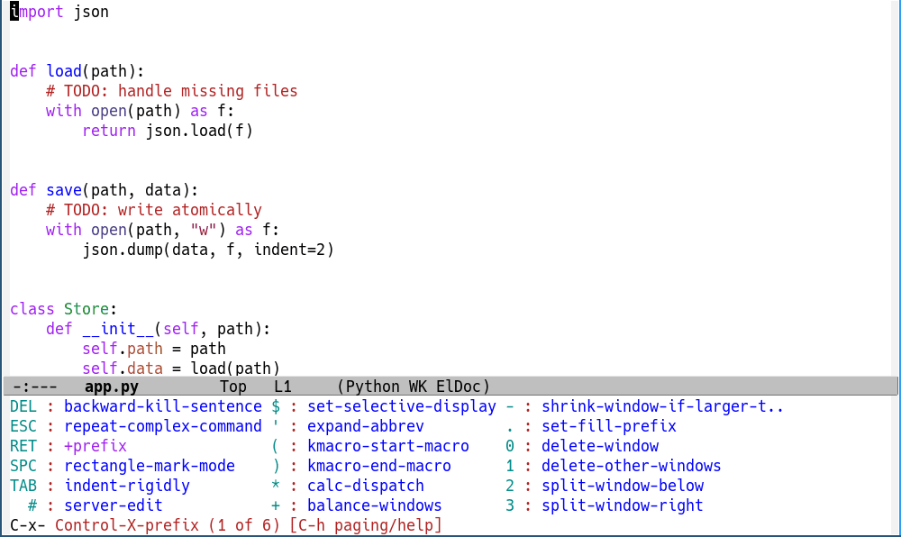
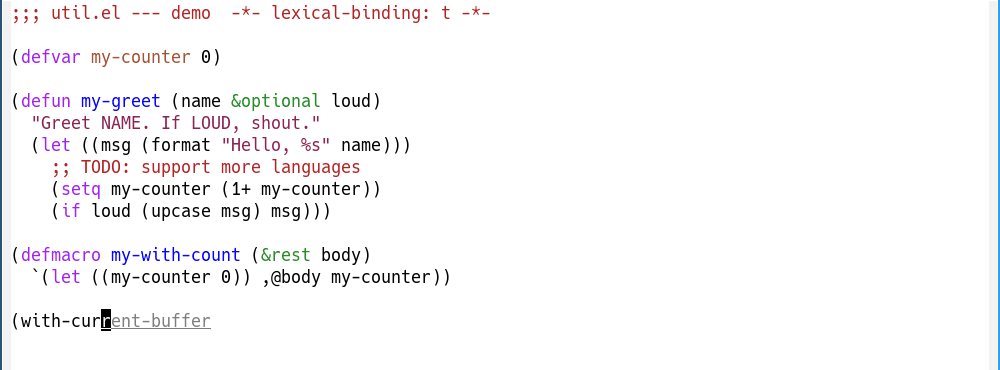
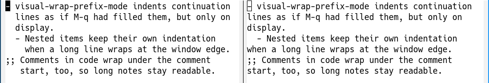
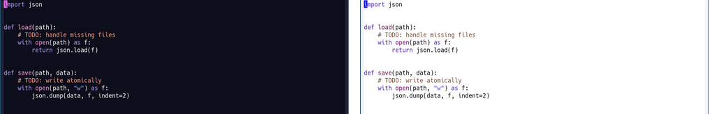
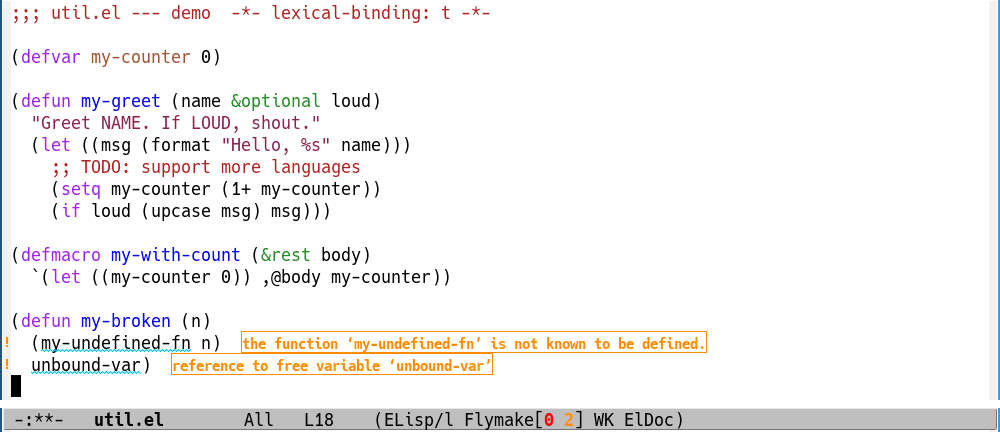
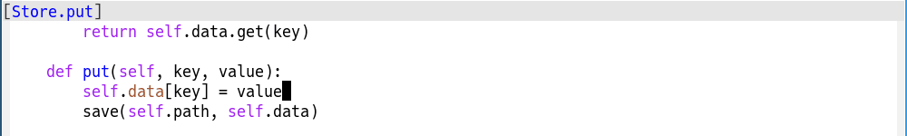
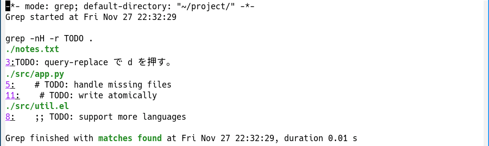

Title: Emacs 30の新機能から、動かして楽しいものを7つ画面つきで紹介する
Date: 2026-11-27 22:40
Updated: 2026-11-27 22:40
Tags: emacs release-notes


Emacs 30のNEWSから動かしてすぐに違いが分かる新機能を7つ選び、Emacs 30.2の実際の画面と一緒に紹介します。
本体に入ったwhich-keyや、コードを打つと補完の候補が薄く出る `completion-preview-mode` のように、パッケージを入れずに手に入るものを中心にしました。

NEWSは [etc/NEWS.30](https://github.com/emacs-mirror/emacs/blob/emacs-31.1/etc/NEWS.30) にあり、2,859行あります。
画面はすべて `emacs -Q` で起動したEmacs 30.2で撮っていて、設定が要るものはその式を添えています。


# which-keyで、続けて押せるキーの一覧を出す

GNU ELPAにあった [which-key](https://github.com/emacs-mirror/emacs/blob/emacs-31.1/etc/NEWS.30#L1927) が本体に入り、 `which-key-mode` を有効にして `C-x` のようなプレフィックスキーを押してから少し待つと、続けて押せるキーとコマンドの一覧がミニバッファに広がります。

```emacs-lisp
(which-key-mode 1)
```



`C-x` の後に押せるキーは画面に入りきらないので6ページに分かれます。
`C-h` を押すとページを送る操作の案内が出ます。

キーバインドを覚えきれていないコマンドも、プレフィックスキーを押して待てば名前から探せます。


# 打つそばに、補完の候補を薄い字で出す

[completion-preview-mode](https://github.com/emacs-mirror/emacs/blob/emacs-31.1/etc/NEWS.30#L1935) を有効にすると、シンボルを打つにつれて補完の候補がカーソルの後ろに薄い字で出ます。
TABで候補を確定でき、 `M-i` で候補に共通する部分までを補完します。

```emacs-lisp
(global-completion-preview-mode 1)
```



シンボルを3文字以上打つと候補が出ます。
画面はEmacs Lispのバッファで `(with-cur` まで打ったところで、続きの `rent-buffer` が薄い字で出ています。


# 折り返した行を、 `M-q` で整えたように字下げして見せる

GNU ELPAのadaptive-wrapを本体に入れた [visual-wrap-prefix-mode](https://github.com/emacs-mirror/emacs/blob/emacs-31.1/etc/NEWS.30#L607) は、ウィンドウの端で折り返した行を前の行の字下げに合わせて表示します。
`M-q` と違ってバッファの文字は変えず、表示だけを整えます。

```emacs-lisp
(add-hook 'text-mode-hook #'visual-line-mode)
(add-hook 'text-mode-hook #'visual-wrap-prefix-mode)
```



左が `visual-wrap-prefix-mode` を有効にしたバッファで、右が同じ文字の無効のバッファです。
左では箇条書きの続きが記号の後ろにそろい、コメントの続きもコメントの開始の後ろにそろっています。


# Modusのテーマが8つになる

Emacs 28から入っている明るい `modus-operandi` と暗い `modus-vivendi` に [6つのテーマが加わりました](https://github.com/emacs-mirror/emacs/blob/emacs-31.1/etc/NEWS.30#L1968)。
読みやすさを優先した `-tinted` に加えて、赤と緑の区別がつきにくい人に向けた `-deuteranopia` と青と黄色の区別がつきにくい人に向けた `-tritanopia` が明暗それぞれにあります。

```emacs-lisp
(load-theme 'modus-vivendi-tinted t)
```



左が `modus-vivendi-tinted` で、右が `modus-operandi-deuteranopia` です。
8つのテーマはどれも `load-theme` で切り替えられます。


# Flymakeの指摘を行末に出す

[flymake-show-diagnostics-at-end-of-line](https://github.com/emacs-mirror/emacs/blob/emacs-31.1/etc/NEWS.30#L1477) を `t` にすると、その行の末尾にFlymakeの指摘が枠付きで出ます。
マウスを当てたり別のバッファを開いたりせずに、指摘の文をその場で読めます。

```emacs-lisp
(setopt flymake-show-diagnostics-at-end-of-line t)
```



Emacs Lispのファイルに未定義の関数と変数を使う `my-broken` を書いて `flymake-mode` を有効にした画面では、バイトコンパイルの警告が2行の末尾に出て、モードラインにも警告の数の2が出ています。

Emacs 30ではEmacs Lispのバックエンドが [trusted-content](https://github.com/emacs-mirror/emacs/blob/emacs-31.1/etc/NEWS.30#L194) に入っているファイルでだけ動きます。
試すときは `(setopt trusted-content '("~/project/"))` のように信頼するディレクトリを指定します。


# 今いる関数の名前をヘッダー行に出す

[which-func-display](https://github.com/emacs-mirror/emacs/blob/emacs-31.1/etc/NEWS.30#L1208) を `header` にすると、ポイントのある関数の名前を `which-function-mode` がウィンドウの上端のヘッダー行に出します。
既定の `mode` ではモードラインに出していて、 `mode-and-header` にすると両方に出ます。

```emacs-lisp
(setopt which-func-display 'header)
(which-function-mode 1)
```



Pythonのクラス `Store` のメソッド `put` の中にポイントがあり、 `class Store:` の行が画面の外にあってもヘッダー行に `Store.put` と出ています。
長いメソッドの中でスクロールしても、どの関数の中にいるかをヘッダー行で確かめられます。


# grepの結果をファイルごとにまとめる

[grep-use-headings](https://github.com/emacs-mirror/emacs/blob/emacs-31.1/etc/NEWS.30#L864) を `t` にすると、 `M-x grep` の結果をファイルごとにまとめて、ファイル名の見出しの下に一致した行を並べます。
`git grep` や `rg` の `--heading` と同じ見た目です。

```emacs-lisp
(setopt grep-use-headings t)
```



緑のファイル名の下に行番号と一致した行が並ぶので、同じファイルに一致が多いときにファイル名の繰り返しが消えて読みやすくなります。


# ほかに目についたもの

-   [ネイティブコンパイル](https://github.com/emacs-mirror/emacs/blob/emacs-31.1/etc/NEWS.30#L25) は、libgccjitがあれば `configure` が既定で有効にします。
-   [replace-regexp-as-diff](https://github.com/emacs-mirror/emacs/blob/emacs-31.1/etc/NEWS.30#L641) は、正規表現の置換の結果をdiffで見せて、見たあとでパッチとして当てられます。
-   [kill-ring-deindent-mode](https://github.com/emacs-mirror/emacs/blob/emacs-31.1/etc/NEWS.30#L620) を有効にすると、字下げされたコードをコピーしたときに、先頭の字下げを外してキルリングに入れます。
-   [mode-line-format-right-align](https://github.com/emacs-mirror/emacs/blob/emacs-31.1/etc/NEWS.30#L233) より後ろに置いたモードラインの項目は、右に寄せて表示されます。


# Emacs 27から31までの新機能

Emacs 27から31までのNEWSを、1つの版ごとに同じ形で紹介しています。

-   [Emacs 31の新機能から、動かして楽しいものを7つ画面つきで紹介する](https://s.conao3.com/blog/2026/a0c17f)
-   [Emacs 29の新機能から、動かして楽しいものを7つ画面つきで紹介する](https://s.conao3.com/blog/2026/43487f)
-   [Emacs 28の新機能から、動かして楽しいものを7つ画面つきで紹介する](https://s.conao3.com/blog/2026/664e4a)
-   [Emacs 27の新機能から、動かして楽しいものを7つ画面つきで紹介する](https://s.conao3.com/blog/2026/92689a)

