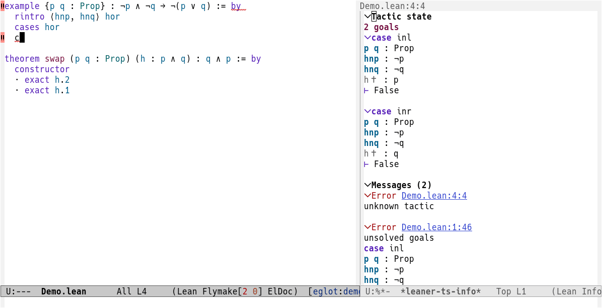
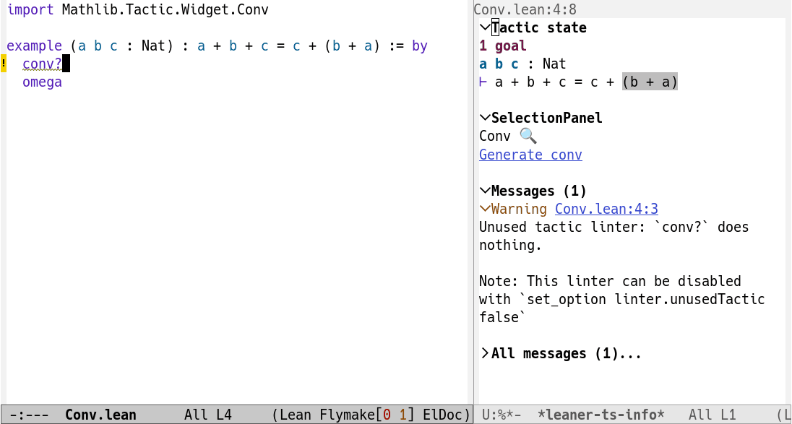

Title: leaner-ts-mode: the VS Code Lean 4 infoview in Emacs
Date: 2026-11-28 01:40
Updated: 2026-11-28 01:40
Lang: en
Original: /blog/2026/15007e
Tags: emacs emacs-lisp lean lsp mathlib tree-sitter release leaner-ts-mode-el


I wrote leaner-ts-mode, an Emacs major mode for Lean 4 that shows the same infoview as the VS Code extension in an Emacs buffer.
It draws goals, messages, the types of subexpressions, traces and widgets such as `conv?` and `rw??` with Emacs text and images, without running JavaScript.

The repository is [conao3/leaner-ts-mode.el](https://github.com/conao3/leaner-ts-mode.el) and the license is [GPL-3.0](https://github.com/conao3/leaner-ts-mode.el/blob/1965c77/LICENSE).
For this post I used commit [1965c77](https://github.com/conao3/leaner-ts-mode.el/commit/1965c77) on master with Emacs 31.1 and Lean 4.35.0.

<div class="github-card" data-repo="conao3/leaner-ts-mode.el"><a href="https://github.com/conao3/leaner-ts-mode.el"><span class="github-card-name"><svg class="github-card-mark" viewBox="0 0 16 16" aria-hidden="true"><path d="M6.766 11.328c-2.063-.25-3.516-1.734-3.516-3.656 0-.781.281-1.625.75-2.188-.203-.515-.172-1.609.063-2.062.625-.078 1.468.25 1.968.703.594-.187 1.219-.281 1.985-.281.765 0 1.39.094 1.953.265.484-.437 1.344-.765 1.969-.687.218.422.25 1.515.046 2.047.5.593.766 1.39.766 2.203 0 1.922-1.453 3.375-3.547 3.64.531.344.89 1.094.89 1.954v1.625c0 .468.391.734.86.547C13.781 14.359 16 11.53 16 8.03 16 3.61 12.406 0 7.984 0 3.563 0 0 3.61 0 8.031a7.88 7.88 0 0 0 5.172 7.422c.422.156.828-.125.828-.547v-1.25c-.219.094-.5.156-.75.156-1.031 0-1.64-.562-2.078-1.609-.172-.422-.36-.672-.719-.719-.187-.015-.25-.093-.25-.187 0-.188.313-.328.625-.328.453 0 .844.281 1.25.86.313.452.64.655 1.031.655s.641-.14 1-.5c.266-.265.47-.5.657-.656"/></svg><span>conao3/<strong>leaner-ts-mode.el</strong></span></span><span class="github-card-description">Lean 4 major mode using tree-sitter</span><span class="github-card-footer"><span class="github-card-language"><span class="github-card-language-color" style="background-color: #c065db"></span>Emacs Lisp</span><span class="github-card-star"><svg viewBox="0 0 16 16" aria-hidden="true"><path d="M8 .25a.75.75 0 0 1 .673.418l1.882 3.815 4.21.612a.75.75 0 0 1 .416 1.279l-3.046 2.97.719 4.192a.751.751 0 0 1-1.088.791L8 12.347l-3.766 1.98a.75.75 0 0 1-1.088-.79l.72-4.194L.818 6.374a.75.75 0 0 1 .416-1.28l4.21-.611L7.327.668A.75.75 0 0 1 8 .25Z"/></svg><span>Star</span><span class="github-card-star-count" hidden></span></span></span></a></div>


# What leaner-ts-mode does



The Lean file is on the left and the infoview is on the right.
The infoview shows the proof state and the messages at the cursor, and you read it to decide which tactic to write next.

leaner-ts-mode splits the infoview into the same parts as the [infoview of the VS Code extension](https://github.com/leanprover/vscode-lean4/blob/9ac77ca57bf7b7ee5907269142a5bef979aa15bf/vscode-lean4/manual/manual.md#L259-L372), and it also does the following.

-   Highlight with tree-sitter, indent, move between declarations, and use Imenu and Outline.
-   Type symbols with abbreviations such as `\alpha`.
-   Connect to the Lean language server through Eglot or `lsp-mode`.


# Install leaner-ts-mode

leaner-ts-mode runs on Emacs 30.1 or later and parses Lean with the tree-sitter grammar [tree-sitter-lean-flat](https://github.com/lua-vr/tree-sitter-lean-flat).
After you install it, a `.lean` file opens in leaner-ts-mode, and before the first use you run `M-x leaner-ts-install-grammar`, which builds and installs the grammar with Git and a C compiler.

If you use Eglot, write the following with leaf and Eglot starts the language server when you open a Lean file.

```emacs-lisp
(leaf leaner-ts-mode
  :vc (:url "https://github.com/conao3/leaner-ts-mode.el")
  :hook (leaner-ts-mode-hook . leaner-ts-eglot-ensure))
```

On Emacs 30, install Eglot 1.20 or later from GNU ELPA.

If you use `lsp-mode`, set both the start on opening a file and the start from `C-c C-g` to `leaner-ts-lsp-mode-ensure`.

```emacs-lisp
(leaf leaner-ts-mode
  :vc (:url "https://github.com/conao3/leaner-ts-mode.el")
  :custom ((leaner-ts-infoview-start-function . #'leaner-ts-lsp-mode-ensure))
  :hook (leaner-ts-mode-hook . leaner-ts-lsp-mode-ensure))
```

I installed leaf from MELPA into Emacs 31.1 with an empty `user-emacs-directory` and evaluated each form.
In both cases `M-x leaner-ts-install-grammar` installed the grammar, and opening a Lean file started leaner-ts-mode and connected to the language server.

To start the language server by hand, use `C-c C-e` for Eglot or `M-x leaner-ts-lsp-mode-ensure` for `lsp-mode`.
`C-c C-g` opens the infoview.


# Read goals and messages in the infoview

Tactic state shows the number of goals and a `case` heading for each goal, followed by its hypotheses and the proposition after `⊢`.
Expected type shows the type expected inside a term, and Messages shows the errors and warnings on the cursor line.

All messages lists the messages of the whole file, nearest to the cursor first.
You can fold the headings with Outline, and they stay folded when the view refreshes.

Put the cursor on a term in a hypothesis or a proposition and leaner-ts-mode highlights the whole subexpression and shows the expression, its type and its documentation in ElDoc, such as `And p q : Prop`, and `RET` jumps to the definition of the term.
A button such as `Demo.lean:4:4` in the heading of a message jumps to the place in the source where Lean reported it.

The suggestions from `exact?` and `simp?` come with an `[apply]` button, which replaces the original tactic with the suggestion.

Press `s` on a message with a trace to search it, and leaner-ts-mode colors the matches and opens the traces that contain them.


# Build the next tactic with a widget



A widget is a view that Lean code adds to the infoview.
Mathlib has widgets that build the next tactic from a subexpression you select in the goal, and the image shows `conv?` with Mathlib v4.35.0 for Lean 4.35.0.

Put the cursor on `(b + a)` in the goal and press `m` to select it, and the panel shows a `Generate conv` link.
Clicking the link replaces `conv?` with the following tactic and selects `skip`.

```lean4
conv =>
  enter [2, 2]
  skip
```

With `rw??`, selecting a subexpression lists rewrite candidates, and clicking one inserts a tactic such as `rw [Nat.add_comm a b]`.

You can also select a subexpression with `S-mouse-1`, and `U` clears the selection.

The infoview also draws the HTML from `#html`, and GUI Emacs shows SVG as images.


# How leaner-ts-mode draws widgets without JavaScript

The VS Code infoview is a web page, so it loads the JavaScript of a widget and runs it.
leaner-ts-mode runs no JavaScript: it sends the requests that a widget makes to the Lean language server from Emacs Lisp and draws the HTML that comes back.

The contents of the infoview arrive over the RPC of the Lean language server: `$/lean/rpc/connect` opens a session and `$/lean/rpc/call` calls functions such as `Lean.Widget.getInteractiveGoals`.
Lean lists the functions in [ProtocolOverview.lean](https://github.com/leanprover/lean4/blob/v4.35.0/src/Lean/Server/ProtocolOverview.lean#L422-L511), and `Lean.Widget.getWidgets` returns the widgets to show at the cursor.

Mathlib builds its [conv? widget](https://github.com/leanprover-community/mathlib4/blob/v4.35.0/Mathlib/Tactic/Widget/Conv.lean#L263-L272) with [mk\_rpc\_widget%](https://github.com/leanprover-community/ProofWidgets4/blob/df72b022e558978a1c50264cfc4d7fec86fa8e04/ProofWidgets/Component/OfRpcMethod.lean#L63-L90) of ProofWidgets, which writes the name of a Lean RPC function into a JavaScript template.
leaner-ts-mode fetches that JavaScript with `Lean.Widget.getWidgetSource`, finds the function name in it and calls the function with the selected subexpressions.

The function returns a tree of ProofWidgets HTML, and leaner-ts-mode draws paragraphs, lists and bold text as text, SVG as images, and links that edit the source as buttons.


# Use the same infoview with Eglot or lsp-mode

The infoview depends on neither Eglot nor `lsp-mode`, so you get the same infoview with either client.

