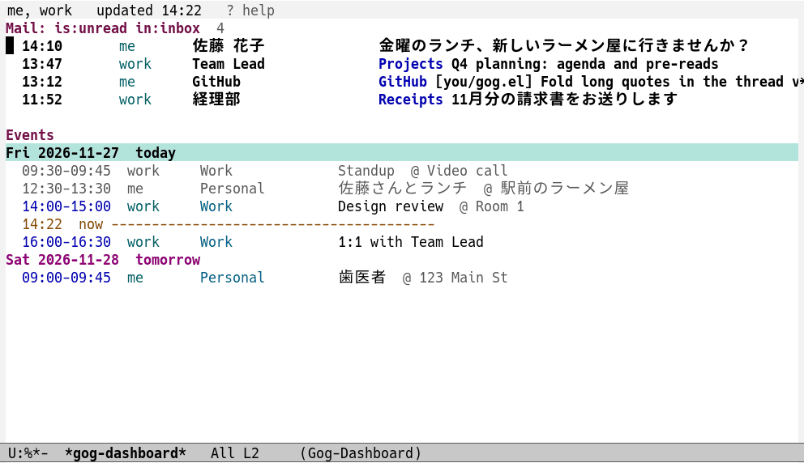
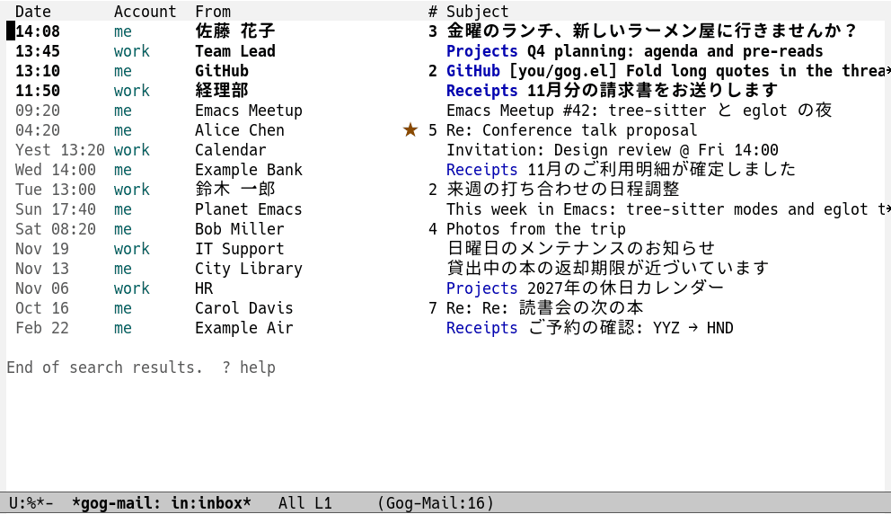
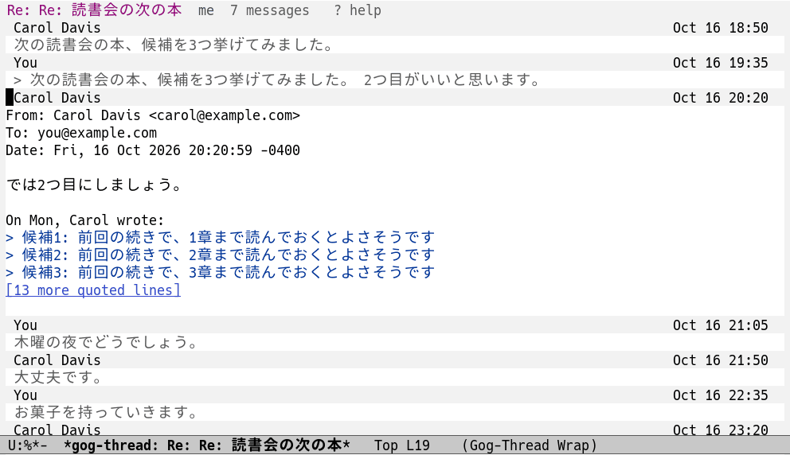
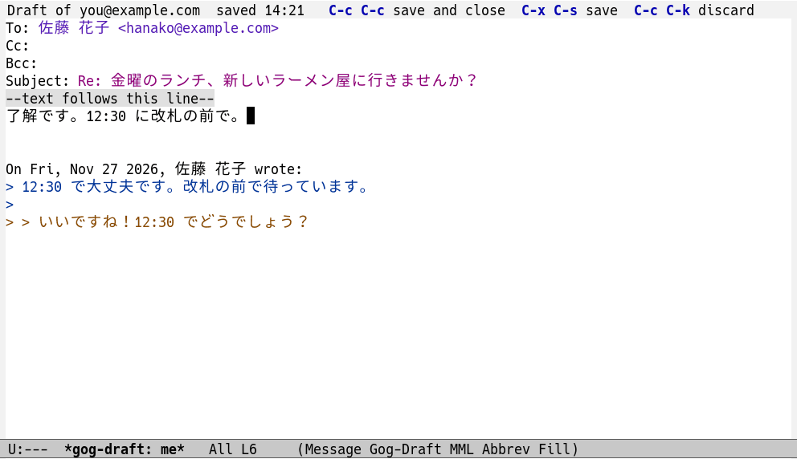
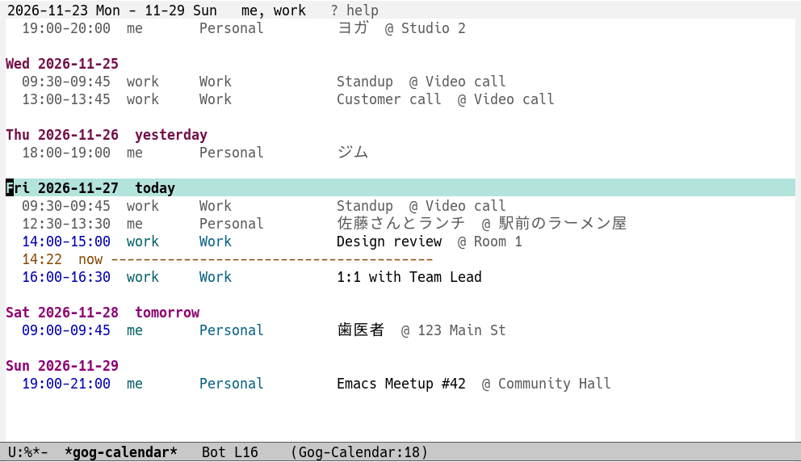

Title: EmacsでGmailとGoogleカレンダーを複数アカウントまとめて読めるgog.elを作った
Date: 2026-11-28 00:44
Updated: 2026-11-28 00:44
Draft: true
Tags: emacs emacs-lisp gmail google-calendar gogcli vow-el release gog-el


EmacsからGmailとGoogleカレンダーを読んでメールを整理し、返信を書いてGmailの下書きに保存できるgog.elというパッケージを作りました。
Googleのサービスをコマンドラインで扱う [gog](https://github.com/openclaw/gogcli) を内部で呼ぶので、gogで認可した複数のGoogleアカウントのメールと予定を1つのバッファにまとめて表示できます。

リポジトリは [conao3/gog.el](https://github.com/conao3/gog.el) で、ライセンスは [GPL-3.0](https://github.com/conao3/gog.el/blob/b5bc9ed/LICENSE) です。
この記事ではmasterの [b5bc9ed](https://github.com/conao3/gog.el/commit/b5bc9ed) とgog v0.48.1を使いました。

<div class="github-card" data-repo="conao3/gog.el"><a href="https://github.com/conao3/gog.el"><span class="github-card-name"><svg class="github-card-mark" viewBox="0 0 16 16" aria-hidden="true"><path d="M6.766 11.328c-2.063-.25-3.516-1.734-3.516-3.656 0-.781.281-1.625.75-2.188-.203-.515-.172-1.609.063-2.062.625-.078 1.468.25 1.968.703.594-.187 1.219-.281 1.985-.281.765 0 1.39.094 1.953.265.484-.437 1.344-.765 1.969-.687.218.422.25 1.515.046 2.047.5.593.766 1.39.766 2.203 0 1.922-1.453 3.375-3.547 3.64.531.344.89 1.094.89 1.954v1.625c0 .468.391.734.86.547C13.781 14.359 16 11.53 16 8.03 16 3.61 12.406 0 7.984 0 3.563 0 0 3.61 0 8.031a7.88 7.88 0 0 0 5.172 7.422c.422.156.828-.125.828-.547v-1.25c-.219.094-.5.156-.75.156-1.031 0-1.64-.562-2.078-1.609-.172-.422-.36-.672-.719-.719-.187-.015-.25-.093-.25-.187 0-.188.313-.328.625-.328.453 0 .844.281 1.25.86.313.452.64.655 1.031.655s.641-.14 1-.5c.266-.265.47-.5.657-.656"/></svg><span>conao3/<strong>gog.el</strong></span></span><span class="github-card-description">Gmail and Google Calendar in Emacs through the gog CLI</span><span class="github-card-footer"><span class="github-card-language"><span class="github-card-language-color" style="background-color: #c065db"></span>Emacs Lisp</span><span class="github-card-star"><svg viewBox="0 0 16 16" aria-hidden="true"><path d="M8 .25a.75.75 0 0 1 .673.418l1.882 3.815 4.21.612a.75.75 0 0 1 .416 1.279l-3.046 2.97.719 4.192a.751.751 0 0 1-1.088.791L8 12.347l-3.766 1.98a.75.75 0 0 1-1.088-.79l.72-4.194L.818 6.374a.75.75 0 0 1 .416-1.28l4.21-.611L7.327.668A.75.75 0 0 1 8 .25Z"/></svg><span>Star</span><span class="github-card-star-count" hidden></span></span></span></a></div>


# gog.elでできること



`M-x gog-dashboard` を開くと、どのアカウントの未読のメールも1つの一覧に並び、その下に今日と明日の予定が出ます。
画像はgogの代わりにテストデータを返すスクリプトを使って撮りました。
`me` と `work` はgogでアカウントに付けた別名です。

-   複数のアカウントの受信トレイを1つの一覧で見る。
-   スレッドを開いて読み、アーカイブしたり既読にしたりラベルを付け外ししたりする。
-   `message-mode` で返信や新しいメールを書いて、Gmailの下書きに保存する。
-   Googleカレンダーの予定を1週間分並べ、作成と変更と削除をする。


# gogでGoogleアカウントを認可する

gogはGmailやGoogleカレンダーやDriveのAPIをコマンドラインから呼ぶツールです。
`--json` を付けると結果をJSONで出します。

gog.elは操作のたびに `gog --json --no-input` を非同期に起動して、出てきたJSONを読んでバッファに描いています。

gogを使うには、Google CloudでデスクトップアプリのOAuthクライアントを作り、そのJSONをgogに登録してから、アカウントごとに認可します。

```sh
gog auth credentials ~/Downloads/client_secret.json
gog auth add you@example.com --services gmail,calendar
```

OAuthクライアントの作り方とgogの使い方は [gogcli: Gmail and Calendar from the Terminal](https://deva.conao3.com/gogcli/) にまとめています。
gog.elは `gog auth list` に出てくるすべてのアカウントのメールと予定を読み込むので、2つ目のアカウントも `gog auth add` で足すだけで一覧に入ります。


# gog.elを入れる

gog.elはEmacs 31.1と、私が作った非同期処理のライブラリの [vow](https://s.conao3.com/blog/2026/7d9eba) を使います。
leafなら次の式で入ります。

```emacs-lisp
(leaf vow
  :vc (:url "https://github.com/conao3/vow.el"))

(leaf gog
  :vc (:url "https://github.com/conao3/gog.el"))
```

空の `user-emacs-directory` を使うEmacs 31.1にMELPAからleafを入れてこの2つの式を評価し、 `gog-mail` を読み込めることを確かめました。


# 複数アカウントのGmailを1つの一覧で見る



`M-x gog-mail` でGmailの検索語を入れると、アカウントごとに `gog gmail search` を並べて走らせ、結果を日付の新しい順に混ぜて並べます。
スレッドごとにAccountの列へアカウント名が出るので、仕事と個人のメールを同じ一覧で見分けられます。

未読のスレッドは太字になり、スターの付いたスレッドには `★` が付きます。
ラベルは件名の前に出していて、 `INBOX` のように毎回付くラベルは出しません。

一覧の上では `a` でアーカイブ、 `u` で未読と既読の切り替え、 `*` でスター、 `+` と `-` でラベルの付け外し、 `d` でゴミ箱に移せます。
アーカイブしたスレッドは一覧から消さずに薄く表示して、カーソルを次のスレッドに進めます。


# スレッドを読む



スレッドを開くと、メッセージごとに差出人と日時の見出しが並びます。
読み終えたメッセージは見出しとGmailの要約の1行に畳み、最後のメッセージと未読のメッセージだけを開いています。

本文は `gog gmail raw` でメッセージをそのまま取り出し、Gnusと同じ `mm-decode` で読んでいます。
HTMLのメールは `shr` で描きますが、外部の画像は `i` を押すまで読み込みません。

引用の行は深さで色を分け、8行を超える引用は最初の3行を残して畳んでボタンにしています。

`SPC` を押していくと画面を送り、メッセージの終わりに来ると次のメッセージに進みます。
スレッドの終わりに来ると一覧の次のスレッドに進みます。


# 返信をGmailの下書きに保存する



スレッドの上で `r` を押すと、宛先と件名と引用を入れた `message-mode` のバッファが開きます。
引用の1行目は `message-citation-line-format` の形で作るので、Gnusで設定している書式がそのまま使えます。

`C-c C-c` で `gog gmail drafts create` を呼んでGmailの下書きに保存し、バッファを閉じます。
`C-x C-s` ではバッファを残したまま保存して、2度目からは同じ下書きを `gog gmail drafts update` で書き換えます。

メールはGmailの画面で下書きを見返してから送りたいので、gog.elにはメールを送る機能を作っていません。
gogにも `gog config no-send set <アカウント>` でアカウントごとに送信を止める設定があり、私は両方のアカウントで送信を止めています。


# Googleカレンダーの予定を並べる



`M-x gog-calendar` は、どのアカウントのどのカレンダーの予定も1週間分を日ごとに並べます。
今日の見出しには色を付けて、今の時刻の位置に線を引き、終わった予定は薄く表示しています。

`f` と `b` で週を進めて戻し、 `.` で今日に、 `j` で好きな日付に移ります。
予定の上で `RET` を押すと場所や参加者や説明を出し、 `c` と `e` と `d` で予定を作成と変更と削除できます。

どの画面でも `?` でキーの一覧が出て、キーとカスタマイズできる変数は [README](https://github.com/conao3/gog.el/blob/b5bc9ed/README.org) にまとめています。

