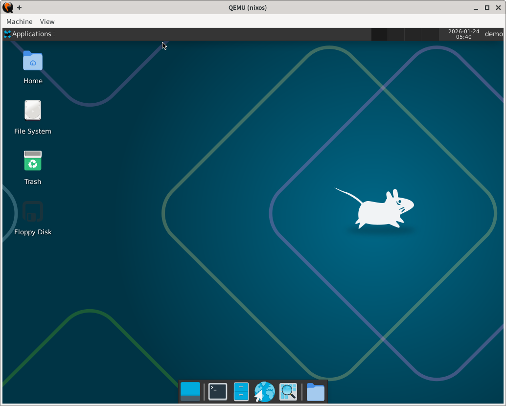
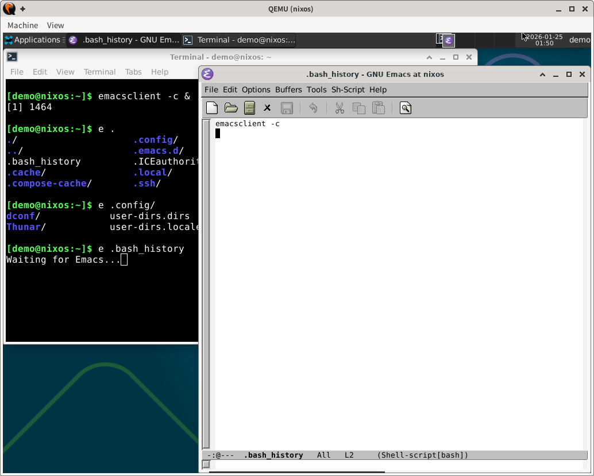

Title: emacsclient on NixOS: run Emacs as a server with services.emacs
Date: 2026-11-27 19:03
Updated: 2026-11-27 19:03
Draft: true
Lang: en
Original: /blog/2026/26583e
Tags: emacs nix tutorial


As an Emacs user, you sometimes want to edit a file from the shell in the Emacs instance that is already running, and emacsclient lets you do that.
This post sets up emacsclient on NixOS with services.emacs.

You keep Emacs running as a server, and emacsclient connects to it as a client and opens the file at once.

ref: [nixpkgs/nixos/modules/services/editors/emacs.md at master / NixOS/nixpkgs / GitHub](https://github.com/NixOS/nixpkgs/blob/master/nixos/modules/services/editors/emacs.md)


# How emacsclient works

Emacs supports a server/client model.
Started the usual way, Emacs runs as a standalone process, but in server mode it stays resident in the background.

The emacsclient command then connects to the running Emacs server and opens files in a new frame or buffer.


# Test environment

So that you can try this without NixOS, I set up a Nix flake that boots a NixOS VM on QEMU.
If you already use NixOS, add the settings to your own `configuration.nix` instead.

The VM has a minimal Xfce desktop, which is enough to try the server and client features of Emacs.

flake.nix

```nix
{
  inputs.nixpkgs.url = "github:nixos/nixpkgs/nixos-unstable";

  outputs = { self, nixpkgs }: {
    nixosConfigurations.minimal-vm = nixpkgs.lib.nixosSystem {
      system = "x86_64-linux";
      modules = [ ./configuration.nix ];
    };

    packages.x86_64-linux.default = self.nixosConfigurations.minimal-vm.config.system.build.vm;
  };
}
```

configuration.nix

```nix
{ modulesPath, pkgs, ... }: {
  imports = [ (modulesPath + "/virtualisation/qemu-vm.nix") ];

  system.stateVersion = "24.11";

  users.users.demo = {
    isNormalUser = true;
    extraGroups = [ "wheel" ];
    initialPassword = "demo";
  };

  services.xserver.enable = true;
  services.xserver.desktopManager.xfce.enable = true;
  services.xserver.desktopManager.xfce.enableScreensaver = false;

  environment.systemPackages = with pkgs; [ git ];
}
```

With these two files in place, this command boots the VM.

```shell
QEMU_OPTS="-m 8192 -smp 4" nix run
```



From here on, you make your changes in configuration.nix.


# Configuration

Enabling `services.emacs` starts the Emacs server when the user logs in.

configuration.nix

```nix
{
  services.emacs = {
    enable = true;
    defaultEditor = true;
  };
}
```

With this setting, emacsclient starts together with the OS.

Setting `defaultEditor` as well points `EDITOR` at emacsclient, so programs that use `EDITOR` open files in emacsclient without any setup of their own.

The option only sets an environment variable, so if you let `e` run `EDITOR`, `e something.txt` opens the file.

```nix
{
  environment.shellAliases = {
    e = "$EDITOR";
  };
}
```


## services.emacs options

`services.emacs` has a few more useful options.


### package

This option selects the Emacs package to use.
The default is `pkgs.emacs`, and you can also set emacs-nox, emacs-pgtk, or an Emacs package you customized yourself.

```nix
{
  services.emacs = {
    enable = true;
    package = pkgs.emacs-pgtk;
  };
}
```


# Usage


## After boot

emacsclient starts when the OS boots, so you can open a new frame right away.
Earlier you made `e` an alias for `$EDITOR`, so running `e` alone opens a new frame.
Add `&` so the command doesn't block the shell.

```shell
e &
```

You can also run `emacsclient -c` yourself.

```shell
emacsclient -c &
```




## Opening a file

In the same way, `e something.txt` opens a file.
To give control back to the shell, press `C-x #` and tell Emacs you have finished editing.

```shell
e something.txt
```


## Main emacsclient options


### -c (`--create-frame`)

Creates a new frame and opens the file in it.

```shell
e -c file.txt
```


### -t (`--tty`)

Opens Emacs inside the terminal.

```shell
e -t file.txt
```


### -n (`--no-wait`)

Gives control back to the shell as soon as the file opens.
By default emacsclient waits until you finish editing, and with this option it opens the file in the background.

```shell
e -n file.txt
```


## Checking the server status

Use `systemctl` to check that the Emacs server is running.

```shell
systemctl --user status emacs
```

To restart the server by hand:

```shell
systemctl --user restart emacs
```


## Troubleshooting


### The server doesn't start

Check the log first.

```shell
journalctl --user -u emacs
```

In most cases, an error in your Emacs init file (init.el) causes this.
Start Emacs the usual way, fix the configuration, and then restart the server.


### Several servers are running

If several Emacs servers end up running for some reason, these commands stop all of them.

```shell
systemctl --user stop emacs
pkill -u $USER emacs
```

Then start the server again.

```shell
systemctl --user start emacs
```


### Sharing the clipboard

To use text you copied in the QEMU VM on the host as well, use the GTK backend of QEMU.

Add `-display gtk` to QEMU\_OPTS when you boot the VM:

```shell
QEMU_OPTS="-m 8192 -smp 4 -display gtk" nix run
```

Text you copy inside the VM then shows up in the clipboard of the host.


### tips

It's fun to look at what this configuration sets up.

Check the systemd unit file:

```shell
systemctl --user cat emacs
```

Check the value of the EDITOR environment variable:

```shell
$ echo $EDITOR
emacseditor

$ which $EDITOR
/run/current-system/sw/bin/emacseditor

$ cat $(which $EDITOR)
#!/nix/store/lw117lsr8d585xs63kx5k233impyrq7q-bash-5.3p3/bin/bash
if [ -z "$1" ]; then
  exec /nix/store/3gh804i02baai4yvn4vz99hs4ncvxjdd-emacs-30.2/bin/emacsclient --create-frame --alternate-editor /nix/store/3gh804i02baai4yvn4vz99hs4ncvxjdd-emacs-30.2/bin/emacs
else
  exec /nix/store/3gh804i02baai4yvn4vz99hs4ncvxjdd-emacs-30.2/bin/emacsclient --alternate-editor /nix/store/3gh804i02baai4yvn4vz99hs4ncvxjdd-emacs-30.2/bin/emacs "$@"
fi
```

You can see that `EDITOR` runs `emacseditor`, a small shell script that wraps `emacsclient`.


# Summary

With `services.emacs` on NixOS, setting up emacsclient takes little effort.
If you have wanted to use emacsclient but couldn't get the setup to work, give this a try.

