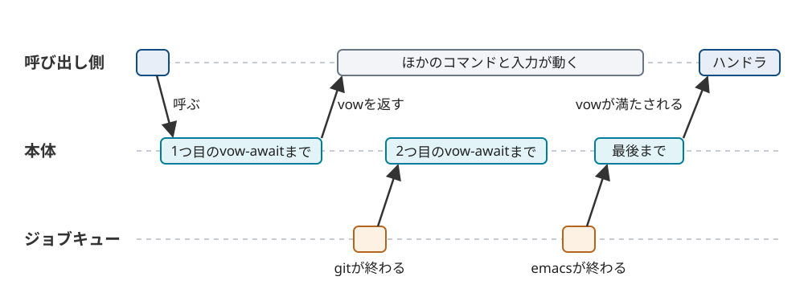

Title: Emacs LispでJavaScriptと同じasync/awaitを書けるvowを作った
Date: 2026-11-27 14:47
Updated: 2026-11-27 14:47
Draft: true
Tags: emacs emacs-lisp async macro release vow-el


JavaScriptのPromiseとasync/awaitをEmacs Lispに写したvowを作りました。
Emacs Lispの非同期処理をコールバックの入れ子にせず上から下へ書けて、 `vow-await` で待つ間もEmacsは止まりません。

待った処理の失敗は `condition-case` でそのまま捕まえられます。

Emacsに同梱されているgenerator.elの上に作ったvowは、関数を `vow-await` の位置で止め、待っているvowが決まったらタイマーから続きを動かします。
async/awaitで書いた関数はEdebugでステップ実行でき、待つたびに止まった位置から実行が続きます。

リポジトリは [conao3/vow.el](https://github.com/conao3/vow.el) で、ライセンスは [GPL-3.0](https://github.com/conao3/vow.el/blob/ba78fdd/LICENSE) です。
Emacs 31.1以降で動き、この記事ではmasterの [ba78fdd](https://github.com/conao3/vow.el/commit/ba78fdd) とEmacs 31.1を使いました。

<div class="github-card" data-repo="conao3/vow.el"><a href="https://github.com/conao3/vow.el"><span class="github-card-name"><svg class="github-card-mark" viewBox="0 0 16 16" aria-hidden="true"><path d="M6.766 11.328c-2.063-.25-3.516-1.734-3.516-3.656 0-.781.281-1.625.75-2.188-.203-.515-.172-1.609.063-2.062.625-.078 1.468.25 1.968.703.594-.187 1.219-.281 1.985-.281.765 0 1.39.094 1.953.265.484-.437 1.344-.765 1.969-.687.218.422.25 1.515.046 2.047.5.593.766 1.39.766 2.203 0 1.922-1.453 3.375-3.547 3.64.531.344.89 1.094.89 1.954v1.625c0 .468.391.734.86.547C13.781 14.359 16 11.53 16 8.03 16 3.61 12.406 0 7.984 0 3.563 0 0 3.61 0 8.031a7.88 7.88 0 0 0 5.172 7.422c.422.156.828-.125.828-.547v-1.25c-.219.094-.5.156-.75.156-1.031 0-1.64-.562-2.078-1.609-.172-.422-.36-.672-.719-.719-.187-.015-.25-.093-.25-.187 0-.188.313-.328.625-.328.453 0 .844.281 1.25.86.313.452.64.655 1.031.655s.641-.14 1-.5c.266-.265.47-.5.657-.656"/></svg><span>conao3/<strong>vow.el</strong></span></span><span class="github-card-description">Promises/A+ and async/await for Emacs Lisp</span><span class="github-card-footer"><span class="github-card-language"><span class="github-card-language-color" style="background-color: #c065db"></span>Emacs Lisp</span><span class="github-card-star"><svg viewBox="0 0 16 16" aria-hidden="true"><path d="M8 .25a.75.75 0 0 1 .673.418l1.882 3.815 4.21.612a.75.75 0 0 1 .416 1.279l-3.046 2.97.719 4.192a.751.751 0 0 1-1.088.791L8 12.347l-3.766 1.98a.75.75 0 0 1-1.088-.79l.72-4.194L.818 6.374a.75.75 0 0 1 .416-1.28l4.21-.611L7.327.668A.75.75 0 0 1 8 .25Z"/></svg><span>Star</span><span class="github-card-star-count" hidden></span></span></span></a></div>


# vowでできること

-   [Promises/A+](https://promisesaplus.com) に従うPromiseをvowとして作り、 `vow-then` でつなぐ。
-   `vow-defun` で定義した関数の中で `vow-await` を使い、vowが決まるのを待つ。
-   `vow-all` や `vow-race` で複数のvowをまとめて待つ。
-   `vow-using` でバッファやプロセスを束縛し、本体が終わったら後始末をする。
-   async/awaitで書いた関数をEdebugでステップ実行する。


# Emacs Lispでasync/awaitを書く

vowは `package-vc-install` でGitHubから入れます。

```emacs-lisp
(package-vc-install "https://github.com/conao3/vow.el")
```

外部のコマンドの出力を待つ例を書いてみます。
`my-command-output` は `vow-new` でvowを作り、プロセスが終わったら出力で満たして、失敗したらエラーで棄却します。

```emacs-lisp
;;; vow-example.el --- vow example  -*- lexical-binding: t; -*-
(require 'vow)

(defun my-command-output (program &rest args)
  "Return a vow for the output of PROGRAM run with ARGS."
  (vow-new
   (lambda (resolve reject)
     (let ((buffer (generate-new-buffer " *my-command*")))
       (make-process
        :name program
        :buffer buffer
        :command (cons program args)
        :sentinel
        (lambda (process _event)
          (unless (process-live-p process)
            (let ((output (with-current-buffer buffer
                            (string-trim (buffer-string))))
                  (code (process-exit-status process)))
              (kill-buffer buffer)
              (if (zerop code)
                  (funcall resolve output)
                (funcall reject
                         (list 'error (format "%s exited with %d"
                                              program code))))))))))))

(vow-defun my-versions ()
  (let ((git (vow-await (my-command-output "git" "--version")))
        (emacs (vow-await (my-command-output "emacs" "--version"))))
    (format "%s / %s" git (car (split-string emacs "\n")))))

(vow-defun my-status ()
  (condition-case err
      (vow-await (my-command-output "git" "no-such-command"))
    (error (format "failed: %S" err))))

(message "%s" (vow-wait (my-versions)))
(message "%s" (vow-wait (my-status)))
```

`my-versions` はgitとemacsのバージョンを順に待って、1つの文字列にします。
`my-status` は失敗するコマンドを待つので、vowが棄却されたときのエラーが `vow-await` の位置で起き、 `condition-case` がそれを捕まえます。

`vow-defun` で定義した関数は呼ぶとすぐにvowを返すので、バッチで動かすときは `vow-wait` でvowが決まるまで待って値を受け取ります。

```sh
$ emacs --batch -Q -L vow.el -l vow-example.el
git version 2.56.0 / GNU Emacs 31.1
failed: (error "git exited with 1")
```

2つのコマンドを同時に動かすときは `vow-all` で待ちます。

```emacs-lisp
(vow-defun my-versions-at-once ()
  (pcase-let ((`(,git ,emacs)
               (vow-await (vow-all (list (my-command-output "git" "--version")
                                         (my-command-output "emacs" "--version"))))))
    (format "%s / %s" git (car (split-string emacs "\n")))))
```


# vow-awaitで止まって再開する仕組み



`vow-defun` は本体をgeneratorの関数 `iter-lambda` に変え、 `vow-await` を `iter-yield` に変えます。
generator.elは本体を継続渡しの形に書き換えるので、本体は `iter-yield` の位置で止まり、あとからその位置から続けられます。

`my-versions` を呼ぶと、本体は1つ目の `vow-await` まで動いて止まり、呼び出し側には本体の結果を表すvowが返ります。

gitのプロセスが終わって待っていたvowが満たされると、続きを動かすジョブがジョブキューに入ります。
ジョブキューは `run-at-time` のタイマーから動いて、本体を次の `vow-await` まで進めます。

続きを動かすときは待っていたvowの値を返す関数を本体に渡し、本体はその関数を呼んだ値を `vow-await` の値にします。
vowが棄却されていれば同じ位置でエラーが起きるので、 `condition-case` と `unwind-protect` が普段どおりに働きます。

generator.elは入れ子のlambdaの中までは書き換えないので、 `mapcar` に渡す関数の中では `vow-await` を使えません。
この位置の `vow-await` はマクロを展開するときにエラーになるので、ループの中で待つときは `dolist` や `cl-loop` を使います。


# 待つ間のバッファと後始末

本体は止まったときのカレントバッファで再開します。
`with-current-buffer` と `save-excursion` も `vow-await` をまたいで使えて、待っている間にそのバッファが削除されると `vow-await` が `vow-buffer-killed` のエラーを起こします。

`vow-using` はJavaScriptの `await using` に当たり、束縛したバッファやプロセスを本体が終わったときに逆順で後始末します。
本体がエラーで終わったときも後始末をして、後始末でもエラーが起きたら2つのエラーを `vow-suppressed` にまとめます。
`my-open` と `my-close` は接続を開閉する関数です。

```emacs-lisp
(vow-defun my-download (url)
  (vow-using ((buffer (generate-new-buffer " *download*"))
              (conn (my-open url) #'my-close))
    (vow-await (my-read conn buffer))
    (with-current-buffer buffer (buffer-string))))
```


# Edebugでステップ実行する

`vow-defun` の定義にカーソルを置いて `C-u C-M-x` を押すと、普段の関数と同じようにEdebugで計装できて、ステップ実行が `vow-await` に来るとEdebugから一度抜け、待っていたvowが決まると止まった位置からステップ実行が続きます。

Edebugの実行モードは再開した後も引き継がれるので、 `g` や `c` で動かせば `vow-await` をまたいで次のブレークポイントまで進みます。
捕まえていないエラーでは、それを起こした式でEdebugが止まります。

generator.elが本体のローカル変数の名前を書き換えるので、Edebugの `e` で読めるローカル変数は最初の `vow-await` より前のものだけです。
再開した後の変数の値は、ステップ実行中にEdebugが表示する式の値で確かめます。


# JavaScriptとの対応

vowはECMAScript 2027までのPromiseとasync関数の機能と、stage 3のAwait Dictionaryの提案を写しています。
おもな対応は次のとおりです。

<table border="2" cellspacing="0" cellpadding="6" rules="groups" frame="hsides">


<colgroup>
<col  class="org-left" />

<col  class="org-right" />

<col  class="org-left" />
</colgroup>
<thead>
<tr>
<th scope="col" class="org-left">ECMAScript</th>
<th scope="col" class="org-right">Edition</th>
<th scope="col" class="org-left">vow</th>
</tr>
</thead>
<tbody>
<tr>
<td class="org-left"><code>new Promise(executor)</code></td>
<td class="org-right">2015</td>
<td class="org-left"><code>vow-new</code></td>
</tr>

<tr>
<td class="org-left"><code>async function</code>, <code>await</code></td>
<td class="org-right">2017</td>
<td class="org-left"><code>vow-defun</code>, <code>vow-await</code></td>
</tr>

<tr>
<td class="org-left"><code>Promise.allSettled</code></td>
<td class="org-right">2020</td>
<td class="org-left"><code>vow-all-settled</code></td>
</tr>

<tr>
<td class="org-left"><code>Promise.any</code></td>
<td class="org-right">2021</td>
<td class="org-left"><code>vow-any</code></td>
</tr>

<tr>
<td class="org-left"><code>Promise.withResolvers</code></td>
<td class="org-right">2024</td>
<td class="org-left"><code>vow-with-resolvers</code></td>
</tr>

<tr>
<td class="org-left"><code>Promise.try</code></td>
<td class="org-right">2025</td>
<td class="org-left"><code>vow-try</code></td>
</tr>

<tr>
<td class="org-left"><code>Array.fromAsync</code></td>
<td class="org-right">2026</td>
<td class="org-left"><code>vow-from-async</code></td>
</tr>

<tr>
<td class="org-left"><code>await using</code></td>
<td class="org-right">2027</td>
<td class="org-left"><code>vow-using</code></td>
</tr>

<tr>
<td class="org-left"><code>Promise.allKeyed</code></td>
<td class="org-right">stage 3</td>
<td class="org-left"><code>vow-all-keyed</code></td>
</tr>
</tbody>
</table>

すべての対応は [READMEの「ECMAScript correspondence」](https://github.com/conao3/vow.el/blob/ba78fdd/README.org#ecmascript-correspondence) に載せています。


# おわりに

`vow-await` で待つ処理は本体の中で上から順に読めて、エラーも `condition-case` で受けられます。
プロセスやタイマーを待つときに、vowを使ってみてください。

