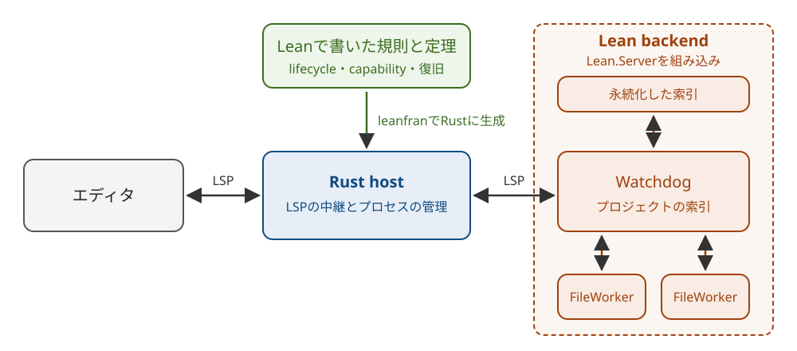
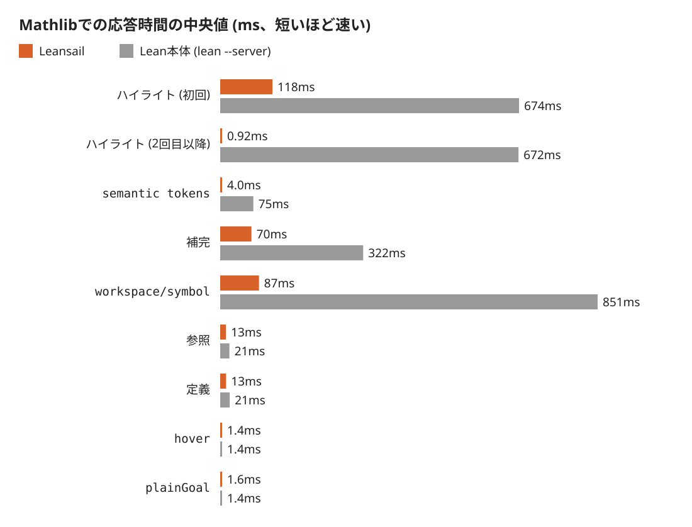

Title: Leansail: a Lean 4 language server with the same responses as Lean's own and up to 730 times the speed
Date: 2026-11-27 19:28
Updated: 2026-11-27 19:28
Draft: true
Lang: en
Original: /blog/2026/060bea
Tags: lean rust lsp mathlib performance formal-verification release rust-leansail lean-leanfran rust-lsp-touchstone


I wrote Leansail, a language server for Lean 4.
It embeds `Lean.Server`, the language server that ships with Lean, and changes only the parts that I measured as slow on Mathlib.
I compared its responses with those of Lean's own server on the 59 kinds of messages that server handles and on 8 kinds of requests to 3 Mathlib files, and the contents matched.

Highlighting showed the largest gap: when you put the cursor on an identifier, the editor highlights its other occurrences with the LSP [textDocument/documentHighlight](https://microsoft.github.io/language-server-protocol/specifications/lsp/3.17/specification/#textDocument_documentHighlight) request.
Lean's server [rebuilds the document's reference index on every one of these requests](https://github.com/leanprover/lean4/blob/v4.35.0/src/Lean/Server/FileWorker/RequestHandling.lean#L270), which took 672 ms per request on a 78 KB Mathlib file, and Leansail reuses the index it built for the same document version, so from the second request it answers in 0.92 ms, about 730 times faster.

The first highlight also got 5.7 times faster, completion 4.6 times, and `workspace/symbol` 9.7 times.
All the changes are in the Lean parts, and the Rust parts only relay messages to and from the editor and run rules proved in Lean.

The repository is [conao3/rust-leansail](https://github.com/conao3/rust-leansail), under the Apache-2.0 license.
I wrote this post from results with Lean 4.35.0 and Leansail 0.1.0.

<div class="github-card" data-repo="conao3/rust-leansail"><a href="https://github.com/conao3/rust-leansail"><span class="github-card-name"><svg class="github-card-mark" viewBox="0 0 16 16" aria-hidden="true"><path d="M6.766 11.328c-2.063-.25-3.516-1.734-3.516-3.656 0-.781.281-1.625.75-2.188-.203-.515-.172-1.609.063-2.062.625-.078 1.468.25 1.968.703.594-.187 1.219-.281 1.985-.281.765 0 1.39.094 1.953.265.484-.437 1.344-.765 1.969-.687.218.422.25 1.515.046 2.047.5.593.766 1.39.766 2.203 0 1.922-1.453 3.375-3.547 3.64.531.344.89 1.094.89 1.954v1.625c0 .468.391.734.86.547C13.781 14.359 16 11.53 16 8.03 16 3.61 12.406 0 7.984 0 3.563 0 0 3.61 0 8.031a7.88 7.88 0 0 0 5.172 7.422c.422.156.828-.125.828-.547v-1.25c-.219.094-.5.156-.75.156-1.031 0-1.64-.562-2.078-1.609-.172-.422-.36-.672-.719-.719-.187-.015-.25-.093-.25-.187 0-.188.313-.328.625-.328.453 0 .844.281 1.25.86.313.452.64.655 1.031.655s.641-.14 1-.5c.266-.265.47-.5.657-.656"/></svg><span>conao3/<strong>rust-leansail</strong></span></span><span class="github-card-description">A Lean language server with a Rust host and Lean-verified lifecycle rules</span><span class="github-card-footer"><span class="github-card-language"><span class="github-card-language-color" style="background-color: #dea584"></span>Rust</span><span class="github-card-star"><svg viewBox="0 0 16 16" aria-hidden="true"><path d="M8 .25a.75.75 0 0 1 .673.418l1.882 3.815 4.21.612a.75.75 0 0 1 .416 1.279l-3.046 2.97.719 4.192a.751.751 0 0 1-1.088.791L8 12.347l-3.766 1.98a.75.75 0 0 1-1.088-.79l.72-4.194L.818 6.374a.75.75 0 0 1 .416-1.28l4.21-.611L7.327.668A.75.75 0 0 1 8 .25Z"/></svg><span>Star</span><span class="github-card-star-count" hidden></span></span></span></a></div>


# Architecture

Leansail runs as two processes: a host written in Rust and a backend written in Lean.



The host speaks LSP with the editor and relays the messages it receives to the backend.
The backend is an executable that embeds [Lean.Server](https://github.com/leanprover/lean4/tree/master/src/Lean/Server), and as in Lean's own server, the Watchdog holds the index of the whole project and starts a FileWorker for each open file to process it.

Hover, the goal view, widgets, and the other features of Lean's language server use Lean's own implementation as it is.

The host decides one thing itself: whether it may relay a message.
I wrote those rules in Lean, proved them, and turned them into Rust functions with [leanfran](https://s.conao3.com/blog/2026/21ebbd), and they decide how the host handles requests that arrive before or after initialization or after shutdown, how it stops requests for features the client hasn't declared support for, and how it restarts a FileWorker that crashed.


# How to use Leansail

Run the following command at the root of a Lean 4.35.0 project to start a language server that talks over standard input and output.
The Nix package includes the backend and the matching Lean.

```shell
nix run github:conao3/rust-leansail -- server run-server
```

With `leansail` on your PATH, set up Eglot in Emacs like this.
In a project with dependencies, change the command to `lake env leansail server run-server`.

```emacs-lisp
(require 'eglot)
(define-derived-mode leansail-lean-mode prog-mode "Lean")
(add-to-list 'auto-mode-alist '("\\.lean\\'" . leansail-lean-mode))
(add-to-list 'eglot-server-programs
             '(leansail-lean-mode . ("leansail" "server" "run-server")))
(add-hook 'leansail-lean-mode-hook #'eglot-ensure)
(add-hook 'kill-emacs-hook #'eglot-shutdown-all)
```

The [README](https://github.com/conao3/rust-leansail#editor-setup) has the Neovim setup and the command that shows the goal.


# How I check that Leansail returns the same responses as Lean's own server

A faster server is no use if its responses change, so I built tests that start `lean --server` from the same Lean 4.35.0 next to Leansail and compare the results of the same operations.

-   The tests compare responses for the 59 kinds of messages that Lean's server handles: 34 requests, 10 client notifications, 3 server requests, 2 server notifications, and 10 widget calls. The count and order of the notifications that arrive during processing change from run to run, so the tests compare the final state.
-   They check that a request cancelled during an edit gets the `-32800` [error](https://microsoft.github.io/language-server-protocol/specifications/lsp/3.17/specification/#errorCodes) and a request that an edit made stale gets `-32801`.
-   They kill the FileWorker process and check that the next request brings it back with the same content.
-   They start Eglot in Emacs and the built-in LSP client in Neovim headless, and compare diagnostics, hover, jump to definition, completion, the goal view, and closing and reopening a file with Lean's own server.

I check that the traffic follows the specification with [lsp-touchstone](https://s.conao3.com/blog/2026/45f8b5), which I wrote earlier.
The first run showed that the backend from Lean's server sent requests such as [workspace/semanticTokens/refresh](https://microsoft.github.io/language-server-protocol/specifications/lsp/3.17/specification/#semanticTokens_refreshRequest), which the client hadn't declared support for, so in Leansail the host doesn't forward this request to the client and answers the backend with `null` instead.

CI runs all of these tests.


# The rules written in Lean

The rule for whether the host passes a server request to the client, given what the client declared, [looks like this](https://github.com/conao3/rust-leansail/blob/67d191376c7025d718c3c0f902d05056a184cc60/src/capabilities.rs#L8-L40), with the definition of `refreshCapability` and the other theorems left out.

```lean
inductive Decision where
  | forward | acknowledge | unsupported
  deriving DecidableEq, Repr

def decide (method : String) (declared registrationsAllowed : Bool) : Decision :=
  if method == "client/registerCapability" then
    if registrationsAllowed then .forward else .unsupported
  else
    match refreshCapability method with
    | some _ => if declared then .forward else .acknowledge
    | none => .forward

theorem refresh_requires_support (declared registrationsAllowed : Bool) :
    (decide "workspace/semanticTokens/refresh" declared registrationsAllowed = .forward ↔ declared = true) ∧
    (decide "workspace/inlayHint/refresh" declared registrationsAllowed = .forward ↔ declared = true) ∧
    (decide "workspace/codeLens/refresh" declared registrationsAllowed = .forward ↔ declared = true) ∧
    (decide "workspace/inlineValue/refresh" declared registrationsAllowed = .forward ↔ declared = true) ∧
    (decide "workspace/diagnostic/refresh" declared registrationsAllowed = .forward ↔ declared = true) ∧
    (decide "workspace/foldingRange/refresh" declared registrationsAllowed = .forward ↔ declared = true) := by
  cases declared <;> simp [decide, refreshCapability]
```

`refresh_requires_support` states that the host passes a refresh request to the client only when the client has declared support for it.
This code sits inside `leanfran::lean!` in the Rust source, Lean checks the proofs at build time, and leanfran turns the code into Rust functions.

The lifecycle, the checks for cancelled and stale requests, and FileWorker restarts follow the same pattern, with 29 theorems in total.
Three of them are propositions with no variables, which check the result for fixed inputs.
The host reads the JSON, takes out whether the client declared the feature, and relays the message according to the result of this function.


# What I found by measuring on Mathlib

For the measurements, I opened and edited 3 files from Mathlib v4.35.0.
The largest is the 78 KB `IntegralEqImproper.lean`, and the other two are `FiniteDimension.lean` and `Mathlib/Tactic.lean`, which imports 397 files.

On a 6-core machine, I kept only runs with low load from other processes, 5 runs for each condition.

I first used perf to see where the language server spends its time: FileWorker took 78.7% of the CPU time, Watchdog 17.7%, and the Rust host 0.15%.
FileWorker spends most of its time checking proofs and inferring type class instances, and a faster relay in Rust would save almost nothing, so I looked for the parts where the language server does its own computation and fixed those.

The chart and table below show medians on `IntegralEqImproper.lean`, measured by running Lean's own server and Leansail in turn within the same measurement run.



<table border="2" cellspacing="0" cellpadding="6" rules="groups" frame="hsides">


<colgroup>
<col  class="org-left" />

<col  class="org-left" />

<col  class="org-left" />

<col  class="org-right" />
</colgroup>
<thead>
<tr>
<th scope="col" class="org-left">Operation</th>
<th scope="col" class="org-left">Lean's server</th>
<th scope="col" class="org-left">Leansail</th>
<th scope="col" class="org-right">Ratio</th>
</tr>
</thead>
<tbody>
<tr>
<td class="org-left">Highlight (first)</td>
<td class="org-left">674 ms</td>
<td class="org-left">118 ms</td>
<td class="org-right">5.7x</td>
</tr>

<tr>
<td class="org-left">Highlight (second and later)</td>
<td class="org-left">672 ms</td>
<td class="org-left">0.92 ms</td>
<td class="org-right">730x</td>
</tr>

<tr>
<td class="org-left">Semantic tokens (second and later)</td>
<td class="org-left">75 ms</td>
<td class="org-left">4.0 ms</td>
<td class="org-right">19x</td>
</tr>

<tr>
<td class="org-left">Completion (second and later)</td>
<td class="org-left">322 ms</td>
<td class="org-left">70 ms</td>
<td class="org-right">4.6x</td>
</tr>

<tr>
<td class="org-left"><code>workspace/symbol</code></td>
<td class="org-left">851 ms</td>
<td class="org-left">87 ms</td>
<td class="org-right">9.7x</td>
</tr>

<tr>
<td class="org-left">References</td>
<td class="org-left">21 ms</td>
<td class="org-left">13 ms</td>
<td class="org-right">1.6x</td>
</tr>

<tr>
<td class="org-left">Definition</td>
<td class="org-left">21 ms</td>
<td class="org-left">13 ms</td>
<td class="org-right">1.6x</td>
</tr>

<tr>
<td class="org-left">Hover</td>
<td class="org-left">1.36 ms</td>
<td class="org-left">1.44 ms</td>
<td class="org-right">0.94x</td>
</tr>

<tr>
<td class="org-left"><code>plainGoal</code></td>
<td class="org-left">1.45 ms</td>
<td class="org-left">1.57 ms</td>
<td class="org-right">0.92x</td>
</tr>

<tr>
<td class="org-left">Preparing the project index</td>
<td class="org-left">21.4 s</td>
<td class="org-left">5.5 s</td>
<td class="org-right">3.9x</td>
</tr>

<tr>
<td class="org-left">Memory right after processing 3 files</td>
<td class="org-left">3596 MiB</td>
<td class="org-left">2526 MiB</td>
<td class="org-right">1.4x</td>
</tr>
</tbody>
</table>

Hover and `plainGoal` are about 0.1 ms slower than in Lean's own server, and the memory figure is the sum of PSS over all processes.

-   For highlighting, Lean's server [rebuilt the array of imported module names for each identifier](https://github.com/leanprover/lean4/blob/v4.35.0/src/Lean/Server/References.lean#L234-L237). Leansail looks the names up without building the array and reuses the index it built for the same document version.
-   For semantic tokens, Leansail reuses the response it built for the same document version.
-   For completion, Leansail reuses the candidates it found among the imported constants while the namespace and the `open` declarations stay the same.
-   For `workspace/symbol` and the index, Lean's server built the index from about 12,000 `.ilean` files from Mathlib and Lean every time, and Leansail saves that index and loads it on the next start.

Lean theorems show that the highlight index built without the array equals the index from Lean's own server, and that the results Leansail reuses for completion and `workspace/symbol` equal the results computed each time.
The theorems don't cover reusing the highlight index and the semantic tokens response for the same document version, or loading the saved index, and I check those parts by comparing responses with Lean's own server.
The response contents matched Lean's own server for all 8 kinds of requests on all 3 files.

From opening a file to the first diagnostic, Lean's own server took 6.9 seconds and Leansail 7.0 seconds, almost the same, and that time goes to Lake setup, imports, and processing the file, all outside the language server.

None of my measurements found an operation that would run faster in Rust.
I also considered moving FileWorker management to Rust, but when I measured with 3 files processed at once, the gain was small, so I dropped the idea.

The measurement conditions, the full tables, and the steps to reproduce them are in [docs/mathlib-benchmark.md](https://github.com/conao3/rust-leansail/blob/master/docs/mathlib-benchmark.md).

