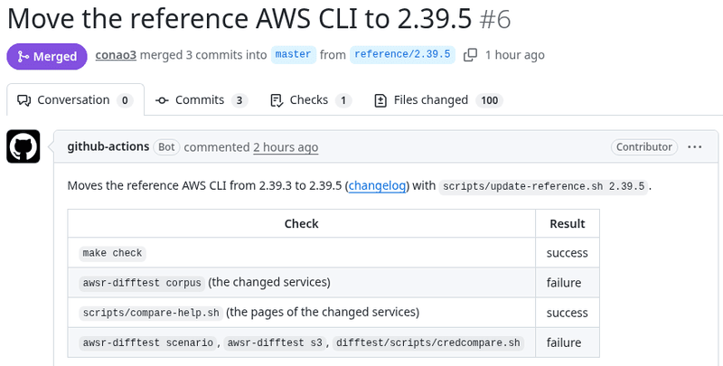
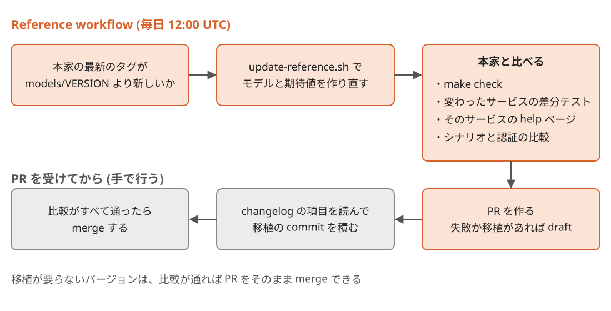

Title: awsrを本家AWS CLIの新しいバージョンに毎日追従させる
Date: 2026-11-06 04:27


[前の記事](https://s.conao3.com/blog/2026/f681b9)で紹介した `awsr` は、AWS CLI v2とバイト単位で同じ出力を返すRust製のCLIです。
同じ出力を返し続けるには、本家の新しいバージョンが出るたびに、 `awsr` が合わせるバージョンも上げる必要があります。
本家は2026-09-30から2026-11-05までの36日間に[20回リリース](https://github.com/aws/aws-cli/tags)していて、平日はほぼ毎日新しいバージョンが出ます。
そこで、本家の新しいバージョンに追従するworkflowをGitHub Actionsで毎日動かすようにしました。
新しいバージョンが出ると、このworkflowは `awsr` が合わせるバージョンを上げ、モデルが変わったサービスに絞って本家と出力を比べたPRを作ります。
本家のコードの変更で出力に差が出たものは、そのPRの中でRustへ移植します。

<div class="github-card" data-repo="conao3/rust-awscli"><a href="https://github.com/conao3/rust-awscli"><span class="github-card-name"><svg class="github-card-mark" viewBox="0 0 16 16" aria-hidden="true"><path d="M6.766 11.328c-2.063-.25-3.516-1.734-3.516-3.656 0-.781.281-1.625.75-2.188-.203-.515-.172-1.609.063-2.062.625-.078 1.468.25 1.968.703.594-.187 1.219-.281 1.985-.281.765 0 1.39.094 1.953.265.484-.437 1.344-.765 1.969-.687.218.422.25 1.515.046 2.047.5.593.766 1.39.766 2.203 0 1.922-1.453 3.375-3.547 3.64.531.344.89 1.094.89 1.954v1.625c0 .468.391.734.86.547C13.781 14.359 16 11.53 16 8.03 16 3.61 12.406 0 7.984 0 3.563 0 0 3.61 0 8.031a7.88 7.88 0 0 0 5.172 7.422c.422.156.828-.125.828-.547v-1.25c-.219.094-.5.156-.75.156-1.031 0-1.64-.562-2.078-1.609-.172-.422-.36-.672-.719-.719-.187-.015-.25-.093-.25-.187 0-.188.313-.328.625-.328.453 0 .844.281 1.25.86.313.452.64.655 1.031.655s.641-.14 1-.5c.266-.265.47-.5.657-.656"/></svg><span>conao3/<strong>rust-awscli</strong></span></span><span class="github-card-description">A fast, output-compatible Rust reimplementation of the AWS CLI v2</span><span class="github-card-footer"><span class="github-card-language"><span class="github-card-language-color" style="background-color: #dea584"></span>Rust</span><span class="github-card-star"><svg viewBox="0 0 16 16" aria-hidden="true"><path d="M8 .25a.75.75 0 0 1 .673.418l1.882 3.815 4.21.612a.75.75 0 0 1 .416 1.279l-3.046 2.97.719 4.192a.751.751 0 0 1-1.088.791L8 12.347l-3.766 1.98a.75.75 0 0 1-1.088-.79l.72-4.194L.818 6.374a.75.75 0 0 1 .416-1.28l4.21-.611L7.327.668A.75.75 0 0 1 8 .25Z"/></svg><span>Star</span><span class="github-card-star-count" hidden></span></span></span></a></div>

次の画像は、2.39.5が出たときに[workflowが作ったPR](https://github.com/conao3/rust-awscli/pull/6)の画面です。
コードの変更を移植する前に `awsr` と本家の出力を比べた結果が表に並んでいます。




# バージョンを上げると変わるもの

`awsr` は本家の決まった1つのバージョンに合わせて作っていて、その番号を `models/VERSION` に書いています。
`flake.nix` では、 `models/VERSION` と同じバージョンの本家のソースと、公式のLinux向けインストーラをnixで取り込みます。
本家のバージョンを上げると、次の3つが変わります。

-   botocoreのモデル: `awsr` がバイナリに埋め込むサービスと操作の定義です。
-   テストの期待値: コマンドの表、引数の表から計算したハッシュ、helpの文書、waiterの説明という4つの期待値で、本家のモデルとソースから作っています。
-   本家のコードの変更: モデルだけでは決まらない独自の処理を持つコマンドや認証の処理に対する変更で、本家の[changelog](https://github.com/aws/aws-cli/blob/2.39.5/CHANGELOG.rst)では `enhancement` や `bugfix` など `api-change` 以外の項目にあたります。

このうちモデルとテストの期待値は本家からスクリプトで機械的に作れますが、コードの変更はRustへ移植する必要があります。


# バージョンを上げるスクリプト

モデルとテストの期待値は、[`scripts/update-reference.sh`](https://github.com/conao3/rust-awscli/blob/master/scripts/update-reference.sh)を実行して更新します。

```console
$ scripts/update-reference.sh 2.39.5
```

このスクリプトは次の順に処理を進めます。

1.  `nix-prefetch-url` で本家のソースとインストーラのハッシュを取り、 `flake.nix` のバージョンとハッシュを書き換える。
2.  新しいバージョンのdevShellに入り、 `scripts/vendor-models.sh` でモデルを取り込み直して、モデルを保持する3つのデータcrateのバージョンも本家にそろえる。
3.  コマンドの表、引数の表のハッシュ、helpの文書、waiterの説明という4つのテストの期待値を、本家のソースから作り直す。
4.  `nix fmt` で整形する。

手順3でテストの期待値を作るスクリプトについては、更新前の2.39.3のソースに対して動かし、commit済みの期待値と同じ中身が出力されることを確かめてから使っています。


# 毎日回すworkflow

[`Reference` のworkflow](https://github.com/conao3/rust-awscli/blob/master/.github/workflows/reference.yml)は毎日12:00 UTCに本家の最新のタグを調べます。
`models/VERSION` より新しいバージョンがあれば、上のスクリプトでバージョンを上げてから、次の4つの検査を実行します。

-   `make check` : fmt、clippy、テストを実行する。
-   [差分テスト](https://github.com/conao3/rust-awscli/tree/master/difftest): モデルが変わったサービスの全操作を `awsr` と本家の両方で動かし、出力とリクエストを比べる。
-   helpの比較: モデルが変わったサービスについて、 `awsr` と本家のhelpページをバイト単位で比べる。
-   シナリオと認証の比較: 手で書いたシナリオ、 `s3` コマンドのシナリオ、 `configure` や `sso login` などの認証のコマンドを動かし、 `awsr` と本家の結果を比べる。

検査が終わると、 `reference/<バージョン>` のブランチをpushし、結果の表を載せたPRを作ります。
PRの本文には、Rustへの移植が必要かを確認するため、本家のchangelogから `api-change` 以外の項目も抜き出して並べます。
4つの検査が1つでも失敗するか、changelogに `api-change` 以外の項目があれば、PRをdraftにします。




# 変わったサービスだけを比べる

すべてのサービスの全操作に対して差分テストを回すと、操作と引数の組み合わせは23万件を超えます。
本家の実行結果を保存したキャッシュがない状態では、この全件の差分テストに手元の14コアのPCで約100分かかりました。
公開リポジトリで使うGitHub Actionsの `ubuntu-latest` は4コアなので、全件を毎日回すのは現実的ではありません。

そこで、毎日の比較はモデルが変わったサービスに絞ります。
2.39.3から2.39.5への更新では34サービスのモデルが変わり、その全操作の組み合わせは48,504件でした。
2.39.5に上げたときのworkflowの[run](https://github.com/conao3/rust-awscli/actions/runs/42182624705)は、全体で約71分かかりました。
内訳は、releaseビルドを含む差分テストが約44分、4,189ページあるhelpの比較が約18分です。


# 2.39.5で移植したもの

2.39.3から2.39.5に上げたPRは[conao3/rust-awscli#6](https://github.com/conao3/rust-awscli/pull/6)です。
2.39.4と2.39.5の[changelog](https://github.com/aws/aws-cli/blob/2.39.5/CHANGELOG.rst)には、 `api-change` 以外の項目が9つありました。
そのうち `awsr` に移植したのは次の4つです。

-   Bearer認証のトークンをHTTPS以外のendpointへ送らない。
-   `s3 cp` 、 `s3 mv` 、 `s3 sync` で、手元からS3への転送に `--tags` を付けられる。
-   転送が `PreconditionFailed` で失敗したとき、 `--no-overwrite` を付けた転送だけを、すでにあるファイルをskipしたものとして扱う。
-   `deploy install` が書く設定ファイルの権限を600にする。

残りの5つは、CRTの転送クライアントとWindowsでの `aws update` に関する項目です。
`awsr` は転送クライアントのうちCRTではなくclassicだけを実装しており、 `update` のコマンドもまだ実装していないので、この5つは移植の対象になりません。

Bearer認証の変更による出力の違いは、2.39.5で増えた `account-access-runtime` のサービスの差分テストで見つかりました。
このサービスでは24件の組み合わせで出力が一致しませんでした。
本家は `Bearer authorization requires an HTTPS endpoint.` で止まるのに対し、移植前の `awsr` はそのままリクエストを送っていたためです。
この変更を先にmasterへ入れると、2.39.3に合わせているmasterで本家と比べたときに、こんどはBearer認証を使う別のサービスで出力が一致しなくなります。
そのため、本家のバージョンに依存する移植は、バージョンを上げるPRの中で行います。
PRのブランチにmasterをmergeし、その上に移植のcommitを積んで、手元ですべての比較が通ってからPRをmasterへmergeします。

また、 `--tags` を付けたときの動作は既存のシナリオでは比べられないので、 `s3` コマンドのシナリオを6つ足しました。
`awsr` のタグを付ける処理を一時的に外すと、足した6つのうちuploadを行う4つのシナリオが失敗するため、タグの動作を確かに比べられています。


# runnerの上でだけ見つかった差分

2.39.5のPRを作ったworkflowの[run](https://github.com/conao3/rust-awscli/actions/runs/42182624705)では、 `deploy install` と `deploy uninstall` のシナリオが3つ失敗しました。
同じ3つのシナリオを手元のPCで動かすと、 `awsr` と本家の出力は一致します。

`deploy install` と `deploy uninstall` はEC2のインスタンスの上では動かないように作られていて、 `169.254.169.254` のインスタンスメタデータサービスに問い合わせて実行環境がEC2の上かを調べます。
[GitHub Actionsのrunner](https://docs.github.com/en/actions/using-github-hosted-runners/about-github-hosted-runners)はAzureかAWSの上で動いており、[Azureのメタデータのサービス](https://learn.microsoft.com/en-us/azure/virtual-machines/instance-metadata-service)も同じ `169.254.169.254` のアドレスを使います。
ただし、Azureのサービスは `Metadata: true` のヘッダーがないリクエストを拒んでエラーを返します。
本家はPythonの `urlopen` でHTTPのGETを送り、エラーの応答を受けたときはEC2ではないと判断します。
一方、 `awsr` はTCPでつながるかだけを見ていたため、このアドレスに応答するAzureのrunnerの上ではEC2の上だと判断して失敗していました。

そこで `awsr` もHTTPのGETを送り、応答のステータスが400未満のときだけEC2の上だと判断するようにしています。
手元での確認には、 `unshare -rnm` で作ったuser namespaceの中に `169.254.169.254` で400か200を返すサーバーを立て、 `/etc/lsb-release` をUbuntuのものに差し替えた環境を使いました。
この環境で400と200のどちらを返したときも、本家と `awsr` の出力が同じになることを確かめています。

