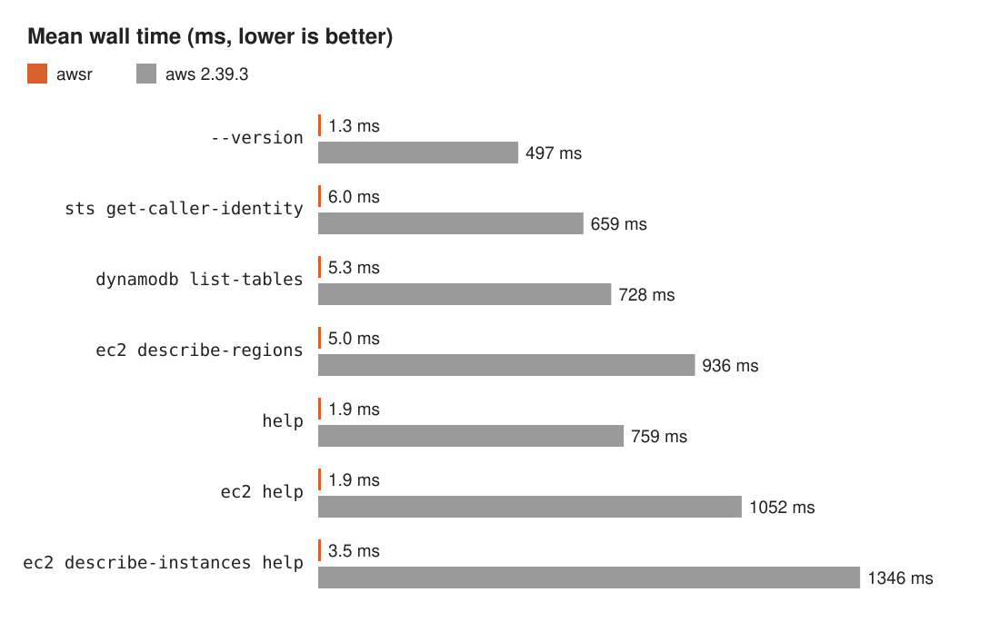
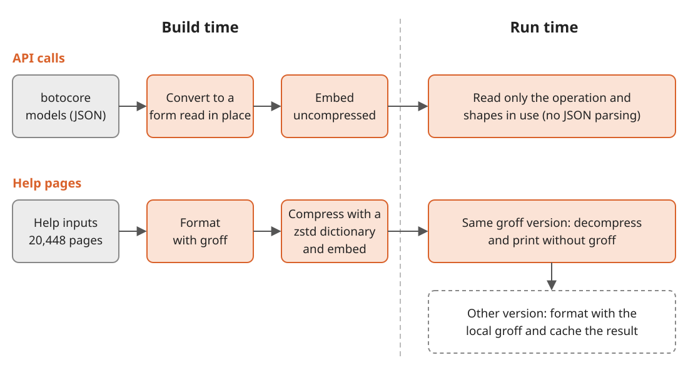

Title: awsr: the AWS CLI v2 in Rust, with the same output and up to 550 times the speed
Date: 2026-11-05
Lang: en


I wrote `awsr`, a Rust CLI that takes the command line of the AWS CLI v2 and prints the same bytes as the official CLI.
The repository is [conao3/rust-awscli](https://github.com/conao3/rust-awscli), under Apache-2.0.
`awsr sts get-caller-identity` finishes in 6.0 ms.
On the same PC, the official `aws` (2.39.3) takes 659 ms, 110 times as long.
Help pages come up 380 to 550 times faster.
`awsr` is not an AWS product.

<div class="github-card" data-repo="conao3/rust-awscli"><a href="https://github.com/conao3/rust-awscli"><span class="github-card-name"><svg class="github-card-mark" viewBox="0 0 16 16" aria-hidden="true"><path d="M6.766 11.328c-2.063-.25-3.516-1.734-3.516-3.656 0-.781.281-1.625.75-2.188-.203-.515-.172-1.609.063-2.062.625-.078 1.468.25 1.968.703.594-.187 1.219-.281 1.985-.281.765 0 1.39.094 1.953.265.484-.437 1.344-.765 1.969-.687.218.422.25 1.515.046 2.047.5.593.766 1.39.766 2.203 0 1.922-1.453 3.375-3.547 3.64.531.344.89 1.094.89 1.954v1.625c0 .468.391.734.86.547C13.781 14.359 16 11.53 16 8.03 16 3.61 12.406 0 7.984 0 3.563 0 0 3.61 0 8.031a7.88 7.88 0 0 0 5.172 7.422c.422.156.828-.125.828-.547v-1.25c-.219.094-.5.156-.75.156-1.031 0-1.64-.562-2.078-1.609-.172-.422-.36-.672-.719-.719-.187-.015-.25-.093-.25-.187 0-.188.313-.328.625-.328.453 0 .844.281 1.25.86.313.452.64.655 1.031.655s.641-.14 1-.5c.266-.265.47-.5.657-.656"/></svg><span>conao3/<strong>rust-awscli</strong></span></span><span class="github-card-description">A fast, output-compatible Rust reimplementation of the AWS CLI v2</span><span class="github-card-footer"><span class="github-card-language"><span class="github-card-language-color" style="background-color: #dea584"></span>Rust</span><span class="github-card-star"><svg viewBox="0 0 16 16" aria-hidden="true"><path d="M8 .25a.75.75 0 0 1 .673.418l1.882 3.815 4.21.612a.75.75 0 0 1 .416 1.279l-3.046 2.97.719 4.192a.751.751 0 0 1-1.088.791L8 12.347l-3.766 1.98a.75.75 0 0 1-1.088-.79l.72-4.194L.818 6.374a.75.75 0 0 1 .416-1.28l4.21-.611L7.327.668A.75.75 0 0 1 8 .25Z"/></svg><span>Star</span><span class="github-card-star-count" hidden></span></span></span></a></div>


# Usage

Type `awsr` where you typed `aws`.

```console
$ awsr sts get-caller-identity
$ awsr dynamodb list-tables --output table
$ awsr ec2 describe-instances \
    --query 'Reservations[].Instances[].InstanceId' --output text
```

`awsr` reads the same config files (`~/.aws/config` and `~/.aws/credentials`), SSO token cache, and environment variables as `aws`.
The json, text, and table output and the result of `--query` match `aws` byte for byte, so your shell scripts that call `aws` print the same thing with `awsr`.

`awsr` carries the botocore models that AWS CLI 2.39.3 ships, and you can call any operation of any service in them as `awsr <service> <operation>`.
I also ported the high-level commands such as `s3 cp` and `s3 sync`, `configure`, and `sso login`.


# Speed

I measured the mean wall time with `hyperfine -N` on my PC (Intel Core Ultra 5 225U).
The commands that call an API ran against a local stub server through `--endpoint-url`, with static credentials.
For `awsr` I used the nix flake package (statically linked), and for `aws` the official Linux installer of 2.39.3.



<table border="2" cellspacing="0" cellpadding="6" rules="groups" frame="hsides">


<colgroup>
<col  class="org-left" />

<col  class="org-left" />

<col  class="org-left" />

<col  class="org-left" />
</colgroup>
<thead>
<tr>
<th scope="col" class="org-left">Command</th>
<th scope="col" class="org-left">awsr</th>
<th scope="col" class="org-left">aws 2.39.3</th>
<th scope="col" class="org-left">Speedup</th>
</tr>
</thead>
<tbody>
<tr>
<td class="org-left"><code>--version</code></td>
<td class="org-left">1.3 ms</td>
<td class="org-left">497 ms</td>
<td class="org-left">380×</td>
</tr>

<tr>
<td class="org-left"><code>sts get-caller-identity</code></td>
<td class="org-left">6.0 ms</td>
<td class="org-left">659 ms</td>
<td class="org-left">110×</td>
</tr>

<tr>
<td class="org-left"><code>dynamodb list-tables</code></td>
<td class="org-left">5.3 ms</td>
<td class="org-left">728 ms</td>
<td class="org-left">140×</td>
</tr>

<tr>
<td class="org-left"><code>ec2 describe-regions</code></td>
<td class="org-left">5.0 ms</td>
<td class="org-left">936 ms</td>
<td class="org-left">190×</td>
</tr>

<tr>
<td class="org-left"><code>help</code></td>
<td class="org-left">1.9 ms</td>
<td class="org-left">759 ms</td>
<td class="org-left">400×</td>
</tr>

<tr>
<td class="org-left"><code>ec2 help</code></td>
<td class="org-left">1.9 ms</td>
<td class="org-left">1052 ms</td>
<td class="org-left">550×</td>
</tr>

<tr>
<td class="org-left"><code>ec2 describe-instances help</code></td>
<td class="org-left">3.5 ms</td>
<td class="org-left">1346 ms</td>
<td class="org-left">380×</td>
</tr>
</tbody>
</table>

As a floor, a C hello world takes 1.1 ms on the same PC when linked dynamically and 0.7 ms when linked statically.
In the commands that call an API, `awsr` spends the remaining few milliseconds on starting the process, evaluating the endpoint rules, and the HTTP round trip.

`aws` runs on Python.
Each call starts the interpreter, imports many modules, registers plugins, and loads the JSON model of the service.
If a script or a CI job calls `aws` hundreds of times in a loop, it pays 0.5 to 1 second for each call.


# How awsr starts fast

`aws` prepares on each run what `awsr` prepares at build time: it parses the models for API calls and formats the pages for help.




## Models embedded in parsed form

botocore describes the API of each service in a JSON model (`service-2.json` and others), and `aws` loads and parses it on each call.
The largest model, ec2, weighs 3.5 MB as JSON.

At build time, `awsr` converts the models into a tree that it walks by offsets plus a table of deduplicated strings, and embeds the result in the binary uncompressed.
Each object carries a sorted index of its keys, and `awsr` looks keys up by binary search.
At run time `awsr` neither parses nor decompresses anything and reads only the shapes the called operation uses, so an ec2 operation takes about as long as an sts one.

`awsr` generates no Rust code per service.
The official AWS SDK for Rust generates typed code for each service, and aws-sdk-ec2 alone takes 150 to 250 seconds to build ([awslabs/aws-sdk-rust#113](https://github.com/awslabs/aws-sdk-rust/issues/113)).
`awsr` interprets the models at run time, so the amount of Rust to compile stays the same however many services AWS adds.

I made a few more choices for a fast start:

-   The argument parser and the endpoint rule evaluator match patterns without compiling regular expressions.
-   `awsr` builds the tokio runtime when it sends the first request. `--version` and help do not build it.
-   The distributed binaries link glibc statically, so no dynamic loader runs at start.
-   `awsr` allocates memory with glibc's malloc. A build with mimalloc ran `--version`, the API calls, and help 1.4 to 2.3 times slower.


## Help pages formatted with groff at build time

`aws help` builds reStructuredText from the model and the docs, converts it to a man page with docutils, formats it with groff, and pipes it to the pager.
I ported the document builder and the docutils conversion to Rust, but `awsr` still formats with the local groff, as `aws` does.
Starting groff on each call makes `ec2 help` take 107 ms.

To skip that cost, the distributed binaries carry all 20,448 pages, formatted with groff at build time.
The formatted pages add up to 732 MB (the largest, `quicksight update-template`, weighs 36 MB).
I trained a zstd dictionary on one page in sixteen and compressed the pages with it at level 19, which brings them down to 35.8 MB.
With the embedded pages, the binary of the flake package weighs 150 MiB.

groff output depends on the groff version.
`awsr` compares the version of the groff on `PATH` (the first line of `groff -v`) with the version that formatted the pages.
If they match and no environment variable starting with `GROFF` is set, `awsr` decompresses and prints the embedded page.
`awsr` caches the result of `groff -v` per groff binary, so it starts groff once per machine (`ec2 help` takes 3.8 ms that time).
The GitHub Releases binaries carry pages formatted by the groff 1.23.0 of Ubuntu, and the flake package carries pages formatted by the groff of nixpkgs.
With a different version, `awsr` formats the page with the local groff as `aws` does, saves the output in `~/.cache/awsr/help`, and prints the saved page from the second time on.


# Checking the output against aws


## Differential testing

Matching `aws` means matching Python's value formatting.
`awsr` prints floats in the format of Python's `repr` (`1e-05` and `1.0`) and booleans in text output as `True` and `False`.
It counts character widths in table output with `unicodedata.east_asian_width` from the Python that `aws` bundles.

To check the ported rules, I wrote `awsr-difftest`.
It runs `awsr` and `aws` on the same command line and compares stdout, stderr, the exit code, the file a streaming operation writes, and the requests the stub server receives.
I pinned the reference by importing the official installer (2.39.3) with nix, bundled Python included.

The stub server builds each response from the output shape of the operation with a seeded random generator.
The generated values include ones that take different formatting paths: `1.50`, `1e2`, `-0`, big integers, `NaN`, timestamps with various offsets, and full-width characters.
`awsr-difftest` skips headers that change on each run, such as the signature.

Running every operation of every service with 4 seeds and the json, text, and table formats gives 233,880 cases.
233,040 of them match `aws`, and none differ.
The other 840 cases call operations that a stub server cannot compare: 552 operations that the CLI does not expose as commands, 144 that go to the real endpoint, 24 that start `session-manager-plugin`, 12 event streams, and a few more.
[difftest/exclusions.txt](https://github.com/conao3/rust-awscli/blob/master/difftest/exclusions.txt) gives the reason for each.
`awsr-difftest` caches the runs of `aws`, and with the cache a full run takes 2 to 5 minutes.


## The help pages

`scripts/compare-help.sh` compares the help pages with `aws`.
It lists every help command line of `aws` (20,482 of them), runs each with `awsr` and `aws`, and compares stdout, stderr, and the exit code byte for byte.
With an `awsr` that carries the pages formatted at build time, all 20,482 match `aws`.


# Distribution

GitHub Releases carry binaries for Linux (x86\_64, x86\_64 musl, and aarch64) and macOS (x86\_64 and aarch64).
You can also install `awsr` with nix or Cargo.

```console
$ nix profile install github:conao3/rust-awscli
$ cargo install awsr
```

`cargo install` formats no help page at build time, so `awsr` formats each page with the local groff the first time you open it.


## The 10 MB limit of crates.io

crates.io accepts .crate files of up to 10 MB.
The models that `awsr` embeds weigh 11.4 MB even after zstd compression, more than one crate can hold.
I asked crates.io to raise the limit, and they declined.

I split the models into three data crates that hold only files and their directory.

<table border="2" cellspacing="0" cellpadding="6" rules="groups" frame="hsides">


<colgroup>
<col  class="org-left" />

<col  class="org-left" />

<col  class="org-left" />
</colgroup>
<thead>
<tr>
<th scope="col" class="org-left">Crate</th>
<th scope="col" class="org-left">Contents</th>
<th scope="col" class="org-left">Size</th>
</tr>
</thead>
<tbody>
<tr>
<td class="org-left"><code>awsr-models</code></td>
<td class="org-left">CLI data, endpoints, examples, help inputs, etc.</td>
<td class="org-left">2.1 MiB</td>
</tr>

<tr>
<td class="org-left"><code>awsr-models-services-a-l</code></td>
<td class="org-left">models of services from a to l</td>
<td class="org-left">5.2 MiB</td>
</tr>

<tr>
<td class="org-left"><code>awsr-models-services-m-z</code></td>
<td class="org-left">models of services from m to z</td>
<td class="org-left">3.7 MiB</td>
</tr>

<tr>
<td class="org-left"><code>awsr</code></td>
<td class="org-left">the CLI</td>
<td class="org-left">3.1 MiB</td>
</tr>
</tbody>
</table>

`awsr` takes the three data crates as build dependencies, and `build.rs` reads the files in their directories and embeds them.
The data crates share the version of the reference CLI (2.39.3), and I publish new versions of them only when I move to a new release of the AWS CLI.
After the split, `build.rs` produces the same embedded data byte for byte, and `awsr` runs as fast as before.
I timed seven commands against the binary from before the split: they differed by 0.3 ms or less, and swapping the order of the runs swapped the faster side.


## Publishing with trusted publishing

A GitHub Actions workflow publishes the crates through crates.io trusted publishing (OIDC).
In the `Publish` workflow, [rust-lang/crates-io-auth-action](https://github.com/rust-lang/crates-io-auth-action) gets a short-lived token, so the repository keeps no crates.io API token in its secrets.
The workflow runs `cargo publish` for the three data crates and then `awsr`, skipping versions that crates.io already has.

To release, I start the `Release` workflow by hand.
`Release` bumps the version in `Cargo.toml`, pushes the commit and the tag, builds binaries for five targets, attaches them to the GitHub release, and then starts `Publish`.
The page of each version on crates.io links to the GitHub Actions run that published it.


# Wrapping up

If your scripts or CI jobs call `aws` many times, replace `aws` with `awsr`.

