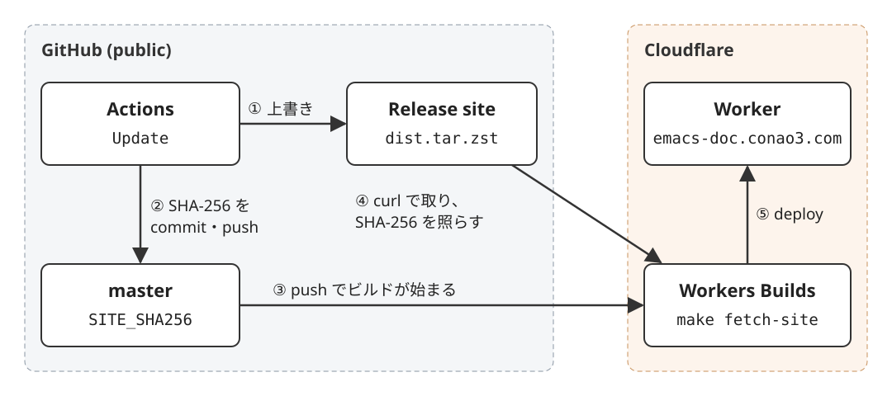

Title: Deploying GitHub Actions builds to Cloudflare Workers without an API token in GitHub
Date: 2026-11-27 17:50
Updated: 2026-11-27 17:50
Draft: true
Lang: en
Original: /blog/2026/12e5f6
Tags: github-actions cloudflare ci deployment security emacs-doc


I build the site at <https://emacs-doc.conao3.com> with GitHub Actions and deploy it to Cloudflare Workers without creating a Cloudflare API token or storing one in GitHub.
The site hosts a machine translation of the GNU Emacs manual into Japanese, and the [conao3/emacs-doc](https://github.com/conao3/emacs-doc) repository is public.

GitHub Actions attaches the build to a GitHub release.
Cloudflare Workers Builds downloads that attachment and deploys it.




# The standard GitHub Actions setup

To follow Cloudflare's [GitHub Actions guide](https://developers.cloudflare.com/workers/ci-cd/external-cicd/github-actions/), store `CLOUDFLARE_API_TOKEN` and `CLOUDFLARE_ACCOUNT_ID` as repository secrets and pass them to `cloudflare/wrangler-action`.

The [Netatalk/netatalk.io](https://github.com/Netatalk/netatalk.io/blob/5adab47738ae78f88b6f301e0d11ceb4674256d0/.github/workflows/deploy.yml#L73-L77) project uses po4a to translate its documentation and stores a token in repository secrets to deploy the site to Cloudflare Pages.

Some cloud providers accept GitHub OIDC in place of a stored token.
Cloudflare doesn't accept GitHub OIDC for Workers deployments.


# What the emacs-doc build needs

With Cloudflare's Git integration, Workers Builds runs your build and deployment commands on Cloudflare whenever you push to a branch it watches.
The default deploy command is `npx wrangler deploy`, and Workers Builds handles the Cloudflare credentials.

Building emacs-doc takes `makeinfo --html` to convert the Texinfo manual to HTML and po4a to insert the translations.

The Ubuntu 24.04 [Workers Builds image](https://developers.cloudflare.com/workers/ci-cd/builds/build-image/) ships with Node and Python, and the emacs-doc build needs texinfo, po4a, and gettext, which the image lacks.
Cloudflare's [build limit](https://developers.cloudflare.com/workers/ci-cd/builds/limits-and-pricing/) is 20 minutes per run, and `make pot` and `make site` each take about 5 minutes for emacs-doc.


# Build on GitHub Actions and deploy with Workers Builds

GitHub Actions builds the site and uploads `dist.tar.zst` to the `site` release.
Workers Builds checks the archive against the SHA-256 in `SITE_SHA256` before deploying.


## 1. Build the site and upload it to the release

I run the [Update workflow](https://github.com/conao3/emacs-doc/blob/39891ed7e2a199be41cf987eefea8e9d96bc3d9d/.github/workflows/update.yml) by hand with `workflow_dispatch`.
The workflow builds the site in `dist/` and packages it with [make package](https://github.com/conao3/emacs-doc/blob/39891ed7e2a199be41cf987eefea8e9d96bc3d9d/Makefile#L57-L72).

```makefile
package:
        mkdir -p build
        tar --sort=name --mtime=@0 --owner=0 --group=0 --numeric-owner --pax-option=delete=atime,delete=ctime \
          -C $(DIST_DIR) -cf build/dist.tar .
        zstd -q -19 -f --rm -o $(SITE_ARCHIVE) build/dist.tar
        sha256sum $(SITE_ARCHIVE) | cut -d" " -f1 > SITE_SHA256
```

I use these tar options to get the same bytes from the same files.
I sort the files by name, set their modification time, owner, and group to 0, and omit access time (atime) and status change time (ctime) from the pax headers.
The archive I made on my machine and the one GitHub Actions made had the same SHA-256.

The workflow replaces the asset on the `site` release with the new archive.

```yaml
- name: Upload the site to the release
  env:
    GH_TOKEN: ${{ github.token }}
  run: |
    gh release view site >/dev/null 2>&1 || gh release create site --title site \
      --notes "The site deployed by Workers Builds (make fetch-site)." --latest=false
    gh release upload site build/dist.tar.zst --clobber
```

With `contents: write`, the workflow can upload the asset using the `GITHUB_TOKEN` that GitHub Actions issues.


## 2. Commit the SHA-256 to master

The workflow stages `SITE_SHA256` for a commit to master. If the archive contents stay the same, the checksum gives Git nothing to commit.
This excerpt leaves out how the workflow handles PO files.

```yaml
- name: Commit the catalogs and the checksum of the site
  run: |
    git config user.name "github-actions[bot]"
    git config user.email "41898282+github-actions[bot]@users.noreply.github.com"
    git add EMACS_REVISION SITE_SHA256 po/*.ja.po
    if ! git diff --cached --quiet; then
      git commit -m "Update the site for Emacs $(cut -c1-10 EMACS_REVISION)"
      git push
    fi
```


## 3. Download and deploy the archive with Workers Builds

I connect the `emacs-doc` Worker to the GitHub repository's master branch in Workers Builds.
I set the build command to `make fetch-site` and the deploy command to `npx wrangler deploy`.

```makefile
SITE_URL := https://github.com/conao3/emacs-doc/releases/download/site/dist.tar.zst

fetch-site:
        mkdir -p build
        curl -fsSL --retry 3 -o $(SITE_ARCHIVE) $(SITE_URL)
        echo "$$(cat SITE_SHA256)  $(SITE_ARCHIVE)" | sha256sum --check
        rm -rf $(DIST_DIR)
        mkdir $(DIST_DIR)
        tar --zstd -xf $(SITE_ARCHIVE) -C $(DIST_DIR)
```

Anyone can fetch the release asset with curl because the repository is public.
The build command uses `sha256sum --check` to compare the downloaded archive with `SITE_SHA256`, then extracts it to `dist/`.
The Workers Builds image includes curl, sha256sum, tar, and zstd, so it can run this build command.

In `wrangler.jsonc`, `assets.directory` points to `./dist`, so `npx wrangler deploy` uploads that directory as the Worker's static assets.
After deployment, GitHub shows a `Workers Builds: emacs-doc` check run on the commit.


# What this setup means for deployments

-   I leave the GitHub repository's secrets empty. [Cloudflare creates and stores the token](https://developers.cloudflare.com/workers/ci-cd/builds/configuration/#api-token) that Workers Builds uses, and GitHub Actions uses its own `GITHUB_TOKEN`.
-   The site has 2,240 files. The tar archive takes up 49 MB, and zstd compresses it to 4.7 MB. Git tracks the 64-character SHA-256.
-   Identical site contents produce identical archive bytes and the same `SITE_SHA256`. Workers Builds gets a push from the workflow only when Git has changes to commit.
-   Pushes that leave `SITE_SHA256` untouched, such as a README edit, still trigger Workers Builds. It fetches the same archive and redeploys the same site.
-   If the release archive and `SITE_SHA256` disagree, `sha256sum --check` fails and stops the build before deployment. The live site keeps serving the last archive that passed the check.

The release holds one archive, so a redeploy from an older commit fails if its `SITE_SHA256` differs from the current archive's checksum.

A push between the archive upload and the push that updates `SITE_SHA256` can also trigger a build with a mismatched checksum.

To roll back, rebuild the site from the version you want and upload that build.


# Similar setups on GitHub Pages

Many GitHub Pages workflows publish builds without a stored token.
They upload the build with `actions/upload-pages-artifact` and publish it with `actions/deploy-pages`, which uses OIDC with `id-token: write`.

The [r0man/beads.el](https://github.com/r0man/beads.el/blob/bf1c50da9b3365ff9d878b4559eb55e994cbdf61/.github/workflows/pages.yml#L86-L100) project builds a manual with makeinfo and publishes it this way.
The [fierceX/freebsd-doc-cn](https://github.com/fierceX/freebsd-doc-cn/blob/3b54ea4da3ef11f51eb23a988d84f8bba821c580/.github/workflows/build.yml#L95-L104) project uses po4a to translate the FreeBSD documentation and uses `GITHUB_TOKEN` to push the build to the `bsd-doc` branch.

My searches of GitHub code and the web turned up no other projects where Workers Builds deploys a GitHub release asset.


# Deploying static assets with Workers Builds

If your site needs tools outside the Workers Builds image, build it with GitHub Actions and attach the build to a public GitHub release.
Workers Builds can deploy the site as static assets without a Cloudflare token in GitHub.
Workers Builds compares the release archive with `SITE_SHA256` on master and deploys the archive that matches.

