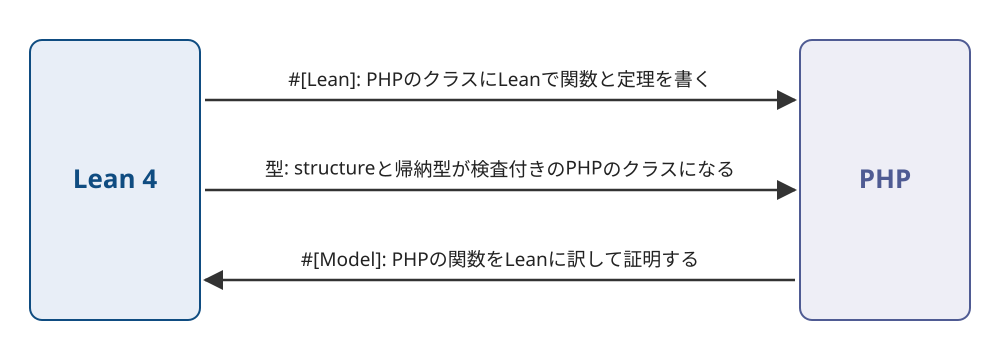

Title: leanfran for PHP: call Lean 4 functions from PHP, and prove PHP functions in Lean
Date: 2026-11-27 20:06
Updated: 2026-11-27 20:06
Draft: true
Lang: en
Original: /blog/2026/ec8faf
Tags: lean php formal-verification code-generation release lean-leanfran


I built the PHP version of leanfran, which lets you call functions written and proved in Lean 4 from PHP classes.
Lean structures and inductive types become PHP classes that check Lean's conditions when you create a value, and in the other direction you can translate functions written in PHP into Lean and prove their properties in Lean.

The repository is [langs/PHP/ in conao3/lean-leanfran](https://github.com/conao3/lean-leanfran/tree/v0.7.0/langs/PHP), under the Apache-2.0 license.
The package is on Packagist as [conao3/leanfran](https://packagist.org/packages/conao3/leanfran), and this post is based on running version 0.7.0.

leanfran turns the intermediate representation of the Lean compiler into PHP source, and the generated PHP runs with only the Composer package, so you don't need Lean at run time.

[The post that introduced leanfran](https://s.conao3.com/blog/2026/21ebbd) covers the other four languages, Rust, Python, TypeScript, and Clojure, and PHP ships from the same repository at the same version.

<div class="github-card" data-repo="conao3/lean-leanfran"><a href="https://github.com/conao3/lean-leanfran"><span class="github-card-name"><svg class="github-card-mark" viewBox="0 0 16 16" aria-hidden="true"><path d="M6.766 11.328c-2.063-.25-3.516-1.734-3.516-3.656 0-.781.281-1.625.75-2.188-.203-.515-.172-1.609.063-2.062.625-.078 1.468.25 1.968.703.594-.187 1.219-.281 1.985-.281.765 0 1.39.094 1.953.265.484-.437 1.344-.765 1.969-.687.218.422.25 1.515.046 2.047.5.593.766 1.39.766 2.203 0 1.922-1.453 3.375-3.547 3.64.531.344.89 1.094.89 1.954v1.625c0 .468.391.734.86.547C13.781 14.359 16 11.53 16 8.03 16 3.61 12.406 0 7.984 0 3.563 0 0 3.61 0 8.031a7.88 7.88 0 0 0 5.172 7.422c.422.156.828-.125.828-.547v-1.25c-.219.094-.5.156-.75.156-1.031 0-1.64-.562-2.078-1.609-.172-.422-.36-.672-.719-.719-.187-.015-.25-.093-.25-.187 0-.188.313-.328.625-.328.453 0 .844.281 1.25.86.313.452.64.655 1.031.655s.641-.14 1-.5c.266-.265.47-.5.657-.656"/></svg><span>conao3/<strong>lean-leanfran</strong></span></span><span class="github-card-description">Write and prove functions in Lean 4, run them as Rust, Python, TypeScript and Clojure</span><span class="github-card-footer"><span class="github-card-language"><span class="github-card-language-color"></span>Lean</span><span class="github-card-star"><svg viewBox="0 0 16 16" aria-hidden="true"><path d="M8 .25a.75.75 0 0 1 .673.418l1.882 3.815 4.21.612a.75.75 0 0 1 .416 1.279l-3.046 2.97.719 4.192a.751.751 0 0 1-1.088.791L8 12.347l-3.766 1.98a.75.75 0 0 1-1.088-.79l.72-4.194L.818 6.374a.75.75 0 0 1 .416-1.28l4.21-.611L7.327.668A.75.75 0 0 1 8 .25Z"/></svg><span>Star</span><span class="github-card-star-count" hidden></span></span></span></a></div>


# Three ways to use it

There are three ways to use leanfran from PHP.



1.  Write Lean functions and theorems in a PHP class with `#[Lean(...)]`, and call the methods that `vendor/bin/leanfran sync` generates from PHP.
2.  Pass Lean structures and inductive types around as PHP classes that come with checks and JSON conversion.
3.  Add `#[Model(...)]` to a function written in PHP to translate it into Lean, and check the proofs of its properties with `vendor/bin/leanfran check`.

1 and 2 go from Lean to PHP, and 3 goes from PHP to Lean.


# Writing Lean in a PHP class

Install `leanfran-php`, the CLI that converts Lean code, with nix, and add the Composer package to your application.

```console
$ nix profile install github:conao3/lean-leanfran/v0.7.0#php
$ composer require conao3/leanfran
```

The package runs on 64-bit PHP 8.4 or later with the GMP and Tokenizer extensions.
Generating code and checking proofs also need `lean` and `lake` from Lean 4.35.0 on your `PATH`.

In `autoload.psr-4` of `composer.json`, map the `App` namespace to `src/`, and write the following class in `src/Pricing.php`.

```php
<?php

declare(strict_types=1);

namespace App;

use Conao3\Leanfran\Lean;

#[Lean(<<<'LEAN'
    structure Range where
      lo : Nat
      hi : Nat
      ok : lo ≤ hi

    def width (r : Range) : Nat := r.hi - r.lo

    theorem width_le (r : Range) : width r ≤ r.hi := by
      unfold width
      omega
    LEAN)]
final class Pricing
{
    use Pricing\Functions;
}
```

The `#[Lean(...)]` attribute holds the Lean source as a nowdoc, and the class uses the generated trait `Pricing\Functions`.
The `ok` field of `Range` holds a proof of `lo ≤ hi`, and `width_le` is a theorem that the width is at most the upper bound.

The caller, `main.php`, creates a `Range` from the generated class and passes it to `Pricing::width`.

```php
<?php

declare(strict_types=1);

use App\Pricing;
use App\Pricing\Range;

require __DIR__ . '/vendor/autoload.php';

echo Pricing::width(new Range(lo: 2, hi: 5)), PHP_EOL;
```

`vendor/bin/leanfran sync` has Lean check the theorem and then generates the PHP, so after that you can run the code with PHP alone.

```console
$ vendor/bin/leanfran sync
leanfran: 1 block checked and generated
$ php main.php
3
```

The generated files go to `src/Pricing/`, next to the class.

```console
$ find src -type f | sort
src/Pricing/Functions.php
src/Pricing/Internal/LeanPricing.php
src/Pricing/leanfran.json
src/Pricing.php
src/Pricing/Range.php
```

`Functions.php` is the trait with the `width` method, `Range.php` is the class for the type, and `Internal/LeanPricing.php` is the body generated from Lean's intermediate representation.
`leanfran.json` records the hash of the block and the generated files.

If you commit the generated files to the repository, CI can check with `vendor/bin/leanfran status` that they are up to date without installing Lean.

If you change the theorem to `width r ≤ r.lo`, the proof fails and generation stops there.

```console
$ vendor/bin/leanfran sync
src/Pricing.php:19:7: error: (lean block App\Pricing, Lean 10:2) omega could not prove the goal:
a possible counterexample may satisfy the constraints
  b ≥ 0
  a ≥ 0
  a - b ≤ 0
  2*a - b ≤ -1
where
 a := ↑r.lo
 b := ↑r.hi
lake build failed
```

The error starts with the line and column in the PHP file, followed by the line and column of the Lean code inside the block.
If generation fails, the previously generated PHP stays in place, so `php main.php` still prints `3` after this.


# Lean types become PHP classes

`Range` becomes a `final readonly class`, `lo` and `hi` become public properties, and the proof field `ok` becomes a check in the constructor.
The following `range.php` creates a value from JSON, passes input that breaks the condition to the constructor, and then prints the JSON Schema.

```php
<?php

declare(strict_types=1);

use App\Pricing\Range;
use Conao3\Leanfran\ValidationError;

require __DIR__ . '/vendor/autoload.php';

$r = Range::fromJson('{"lo":1,"hi":4}');
echo $r->hi, PHP_EOL;

try {
    new Range(lo: 5, hi: 2);
} catch (ValidationError $e) {
    echo $e->getMessage(), PHP_EOL;
}

echo json_encode(Range::jsonSchema(), JSON_PRETTY_PRINT | JSON_UNESCAPED_SLASHES), PHP_EOL;
```

```console
$ php range.php
4
Range.ok: lo ≤ hi
{
    "$schema": "https://json-schema.org/draft/2020-12/schema",
    "type": "object",
    "properties": {
        "lo": {
            "type": "integer",
            "minimum": 0
        },
        "hi": {
            "type": "integer",
            "minimum": 0
        }
    },
    "required": [
        "lo",
        "hi"
    ],
    "additionalProperties": false
}
```

The constructor runs the `lo ≤ hi` check with code compiled from Lean, so a value whose `lo` is greater than `hi` raises a `ValidationError`.

JSON Schema cannot express `lo ≤ hi`, which spans two fields, so the schema only shows the lower bound of `Nat`.
The constructor checks this condition, and the same check runs when you create a value from an array or pass a generated class to the [Valinor](https://github.com/conao3/lean-leanfran/blob/v0.7.0/docs/php-guide.md#valinor) mapper.

If you pass a `readonly` class written in PHP to `models` in `#[Lean(...)]`, it comes into Lean as a structure, and ranges such as `int<0, 100>` in the class's PHPDoc become proof fields.


# Proving PHP functions in Lean

For the other direction, write `clamp`, which keeps a value within a range, in PHP, and tie it to a Lean specification with `#[Model(...)]`.

```php
<?php

declare(strict_types=1);

namespace App;

use Conao3\Leanfran\Lean;
use Conao3\Leanfran\Model;

#[Lean(<<<'LEAN'
    def clampSpec (x lo hi : Int) : Int := max lo (min hi x)
    def ordered (_x lo hi : Int) : Bool := lo ≤ hi
    def inRange (_x lo hi : Int) (r : Int) : Bool := lo ≤ r && r ≤ hi
    LEAN)]
final class Calc
{
    use Calc\Functions;

    #[Model(refines: 'clampSpec', requires: 'ordered', ensures: ['in_range' => 'inRange'])]
    public static function clamp(int $x, int $lo, int $hi): int
    {
        if ($x < $lo) {
            return $lo;
        }
        if ($x > $hi) {
            return $hi;
        }
        return $x;
    }
}
```

`refines` names a Lean function that returns the same value as the implementation, `requires` the precondition on the input, and `ensures` the conditions the return value meets.
In this example, the proof obligations are that `clamp` returns the same value as `clampSpec` when `lo ≤ hi`, and that the return value is at least `lo` and at most `hi`.

`vendor/bin/leanfran check` reads the PHP syntax tree, translates the function into a Lean function in `do` notation, and creates the obligation propositions with names such as `clamp.obligation.refines`.
The proofs go in `lean/Proofs/` next to `composer.json`, and here I use [the proof from the verified-clamp sample](https://github.com/conao3/lean-leanfran/blob/v0.7.0/langs/PHP/samples/verified-clamp/lean/Proofs/Calc.lean) as is.

```lean
import LeanPhpModel.App.Calc

open LeanPhpEmbed.App.Calc
namespace LeanPhpModel.App.Calc

theorem clamp.proof.refines : clamp.obligation.refines := by
  intro x lo hi h
  simp only [ordered, decide_eq_true_eq] at h
  simp only [clamp, clampSpec]
  split <;> (try split) <;> simp_all <;> omega

theorem clamp.proof.in_range : clamp.obligation.in_range := by
  intro x lo hi h
  simp only [ordered, decide_eq_true_eq] at h
  simp only [clamp, inRange]
  split <;> (try split) <;> simp_all <;> omega

end LeanPhpModel.App.Calc
```

leanfran reads the PHP syntax tree with `nikic/php-parser`, so add it as a development dependency and then run `check`.

```console
$ composer require -q --dev --no-interaction 'nikic/php-parser:^5.9'
$ vendor/bin/leanfran check --require proved
leanfran: 2 blocks checked and generated
App\Calc\clamp refines: proved
App\Calc\clamp in_range: proved
leanfran: all blocks up to date
```

With `--require proved`, the exit code is 1 if any obligation is not `proved`.
`proved` means that the type of the theorem matches the obligation and the proof relies on neither `sorry` nor any axiom outside the three standard ones.

You can also compare the PHP implementation with the Lean specification in a random test that doesn't use Lean.

```php
<?php

declare(strict_types=1);

use App\Calc;
use Conao3\Leanfran\Verify;
use Conao3\Leanfran\Verify\PropertyFailure;

require __DIR__ . '/vendor/autoload.php';

try {
    Verify::checkClass(Calc::class);
    echo 'ok', PHP_EOL;
} catch (PropertyFailure $e) {
    echo $e->getMessage(), PHP_EOL;
}
```

```console
$ php verify.php
ok
```

`Verify::checkClass` builds inputs from boundary values such as 0 and the integer limits and from random numbers with a fixed seed, and collects 200 inputs that meet `requires`.
For each input, it compares the return value of the PHP `clamp` with the value of the generated `clampSpec`.

Now change the second `if` of the implementation so that it returns `$hi - 1` when `$x` is greater than or equal to `$hi`.

```php
if ($x >= $hi) {
    return $hi - 1;
}
```

`check` can no longer pass the two proofs, so it prints Lean's errors to standard error and marks each obligation `failed`.

```console
$ vendor/bin/leanfran check --require proved 2>/dev/null
leanfran: 2 blocks checked and generated
App\Calc\clamp refines: failed
App\Calc\clamp in_range: failed
leanfran: all blocks up to date
```

The random test also finds a counterexample, an input where all three arguments are 0.

```console
$ php verify.php
App\Calc\clamp [refines] failed (seed=1, input=[0, 0, 0]): implementation returned -1; spec expected 0
```


# What the proofs guarantee

The Lean theorems guarantee properties of the functions written in Lean and of the Lean models translated from PHP.
For those properties to hold when the generated PHP or the original PHP runs, the converter, the runtime, and the model of PHP's operations must be correct, and I check these parts with tests.

leanfran checks integer operations in PHP within the 64-bit range, and a calculation that overflows into a float fails in the model too.
In a function with `#[Model(...)]`, ranges such as `int<0, 100>` in the PHPDoc of the arguments are not assumptions for the proof, so write the conditions the proof uses in `requires`.

leanfran can translate a subset of PHP: it handles `foreach`, `match`, list indexing, `readonly` classes, and `enum`, but not pass-by-reference, `??`, or functions that do input and output.
The full list of supported syntax is in [the PHP guide](https://github.com/conao3/lean-leanfran/blob/v0.7.0/docs/php-guide.md#php-subset).

For the generated PHP, tests compare its results with those of Lean's C backend.

At the time of writing, the results of 1,707,520 numeric operations built from boundary values and random numbers match the C backend byte for byte on both PHP 8.4 and 8.5.
65 cases, such as Float32 transcendental functions, differ by no more than one step of the smallest floating-point increment.


# Wrapping up

Besides the examples in this post, [the PHP samples](https://github.com/conao3/lean-leanfran/tree/v0.7.0/langs/PHP/samples) include verified-cart, which proves a loop that computes a total, assuming upper bounds on prices and quantities, and embed-orders, which shares types between two blocks.
There is also greet-cli, which runs a Lean `IO` function as a PHP command.

The setup steps are in [the PHP README](https://github.com/conao3/lean-leanfran/blob/master/langs/PHP/README.md), and the details of the type mapping and the CLI are in [the PHP guide](https://github.com/conao3/lean-leanfran/blob/v0.7.0/docs/php-guide.md).

