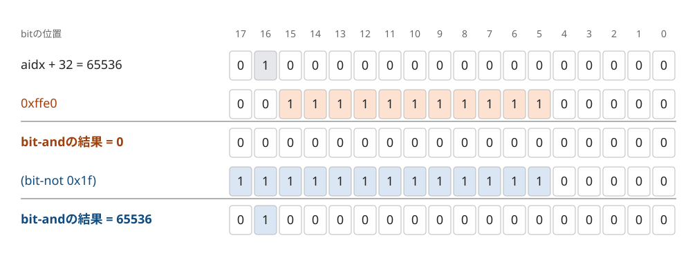

Title: Clojure本体をLeanと差分テストで調べて、HAMTとvector-ofに未報告の不具合を見つけた
Date: 2026-11-24 12:16
Draft: true
Tags: clojure lean formal-verification testing differential-testing


Koukyosyumeiさんの「[著名なRust製OSSをLean 4で形式検証してみたら、めちゃめちゃバグが見つかった話](https://zenn.dev/koukyosyumei/articles/31c8fcf4da45b7)」を読みました。
有名なRust製のOSSをLean 4で証明できる形に移植していくと、証明が通らないところに元の実装の不具合が見つかったという話です。

Clojureの永続データ構造も1.0のころから多くの人に使われていて、不具合はもう残っていないだろうと思っていました。
それでもLeanで調べれば何か見つかるのではないかと思い、試してみたくなりました。

ちょうど小さな関数をLean 4に写して全入力で確かめる手順が[hirosassa/lean-verify](https://github.com/hirosassa/lean-verify)にまとまっていたので、これをClojure本体のJavaで書かれた層に当てました。

整数とビットの計算はLeanに写して反例を探しました。
コレクションは `java.util` のコレクションと結果を比べる差分テストにかけ、Javaとの相互運用は同じ呼び出しを型ヒントの有無で比べました。

その結果、ClojureのJIRAとask.clojure.orgで見つからない不具合が17件ありました。
`vector-of` の `reduce` やHAMTのハッシュ衝突ノード、型ヒントの無い関数型インターフェースの呼び出しなどです。

一方でHAMTの本体には225万回の操作の差分テストでも食い違いが出ず、vectorの木の本体にも境界の前後の差分テストで食い違いが出ませんでした。
不具合は木の外側にある別の実装や、 `=` とハッシュの関係のように2つの仕組みが組み合わさるところに残っていました。

調べたのはClojure 1.12.6とJDK 21で、ソースは `clojure/clojure` のmasterの[92ce2a85](https://github.com/clojure/clojure/tree/92ce2a85)です。
記事で引くコードは1.12.6と同じで、行番号はmasterのものです。




# 調べ方

lean-verifyの手順では確かめる関数を1つに絞ってLeanの定義に写します。
幅を広げて計算した素朴な仕様と比べる性質を書いて、 `bv_decide` で反例を探します。

Javaの `long` と `int` を `BitVec 64` と `BitVec 32` に写すと、足し算と掛け算の折り返しがそのまま `BitVec` の演算に対応します。
`/` の0方向への丸めや `%` の符号もそのまま対応します。

反例が出たら、その値をClojureの入力に直して元のコードで再現し、直したコードをLeanに写して同じ性質を証明します。
Leanに写せるのは整数とビットの計算に切り出せる小さな関数だけなので、状態の大きい永続データ構造は差分テストで調べました。

乱数で作った操作の列を `PersistentHashMap` と `java.util.HashMap` の両方に当てて、結果を比べます。
HAMTでは5bitごとの各段で部分的に衝突するキーと、ハッシュがまったく同じキーを混ぜて1500通りの種で1500回ずつ操作しています。

vectorでは木の段が変わる32・1056・32800・1048608の前後で操作を当てて、結果を `ArrayList` と比べました。
当てた操作は `conj` と `pop` と `assoc` と、transientの操作です。

同じ報告が既に無いかは、ClojureのJIRAとask.clojure.orgで探しました。
JIRAはREST APIで、ask.clojure.orgはウェブ検索とサイト内検索で探して、どちらにも見つからないことを確かめています。


# vector-ofのreduceが終わらない

`vector-of` はプリミティブの配列に値を持つvectorで、 `PersistentVector` とは別に `gvec.clj` にClojureで書かれています。
これを `drop` してから `reduce` すると、65505件以上で処理が終わりません。

```clojure
(reduce + (drop 1 (vec (range 65537))))
;; => 2147516416
(reduce + (drop 1 (into (vector-of :long) (range 65504))))
;; => 2145354256
(reduce + (drop 1 (into (vector-of :long) (range 65537))))
;; => 終わらない
```

原因はseqの `reduce` が次の32件の塊の先頭を求める[gvec.clj の79行目](https://github.com/clojure/clojure/blob/92ce2a85/src/clj/clojure/gvec.clj#L79)です。

```clojure
(recur result (bit-and 0xffe0 (+ aidx 32)))
```

`0xffe0` で下位5bitを消して32の倍数にそろえたいのですが、このマスクは16bit目より上も消してしまいます。
冒頭の図のように65504の次の塊の先頭は65536になるはずが0に戻るので、先頭から読み直し続けます。

この `0xffe0` のマスクは `internal-reduce` を入れた[2010年のコミット](https://github.com/clojure/clojure/commit/5b281880)からそのまま残っています。
Leanでは32の倍数の位置 `a` から次の塊の先頭が `a + 32` になる性質を書きました。

```lean
import Std.Tactic.BVDecide

def stepImpl (a : BitVec 64) : BitVec 64 := 0xffe0 &&& (a + 32)
def stepFix (a : BitVec 64) : BitVec 64 := (~~~0x1f) &&& (a + 32)

theorem impl_ok (a : BitVec 64) (h32 : a &&& 0x1f = 0) (hlt : a < 0x7fffffe0) :
    stepImpl a = a + 32 := by
  unfold stepImpl; bv_decide
theorem fix_ok (a : BitVec 64) (h32 : a &&& 0x1f = 0) (hlt : a < 0x7fffffe0) :
    stepFix a = a + 32 := by
  unfold stepFix; bv_decide
```

`impl_ok` は `a = 1073741792` という反例で失敗し、 `#eval stepImpl 65504` も0を返します。
マスクを `(bit-not 0x1f)` にした `fix_ok` は、 `a` が32の倍数で `0x7fffffe0` より小さいという前提の下で証明が通りました。


# HAMTの衝突ノードからのdissocで別のキーが引けなくなる

Clojureのhash-mapはHAMTで、キーのハッシュを5bitずつ区切って木をたどります。
32bitのハッシュがまったく同じキーどうしは木の末端の `HashCollisionNode` に並べて持ち、その中では `=` でキーを探します。

キーを1つ除いた新しいノードは[HashCollisionNode.without](https://github.com/clojure/clojure/blob/92ce2a85/src/jvm/clojure/lang/PersistentHashMap.java#L1000-L1007)が作ります。
このときノードのハッシュには自分のフィールドの `this.hash` を使うべきところで、引数の `hash` を使っています。

```java
return new HashCollisionNode(null, hash, count - 1, removePair(array, idx/2));
```

引数の `hash` は `dissoc` に渡したキーのハッシュです。
保存されているキーと `=` になるのにハッシュが違うキーで `dissoc` すると、ノードに違うハッシュが記録されます。

ClojureではJavaの `ArrayList` と同じ要素のvectorは `=` になるのにハッシュが違います。
この食い違いは[CLJ-1372](https://clojure.atlassian.net/browse/CLJ-1372)で知られています。

次の例の `a` と `b` は、 `ArrayList` のハッシュがどちらも1003になるように選んだキーです。

```clojure
(def a (java.util.ArrayList. [0 42]))
(def b (java.util.ArrayList. [1 11]))
[(hash a) (hash b) (hash [0 42]) (= a [0 42])]
;; => [1003 1003 1867155179 true]

(def m3 (-> (hash-map a :A b :B)
            (dissoc [0 42])
            (assoc a :A2)))
[m3 (count m3) (get m3 b)]
;; => [{[1 11] :B, [0 42] :A2} 2 nil]
```

`m3` を表示すると `b` のキーが見えるのに、 `(get m3 b)` は `nil` を返します。
`dissoc` のあとのノードには `[0 42]` のハッシュの1867155179が記録されるので、続く `assoc` は1003のキーと衝突しないと判断して2つを別の枝に分けます。

`b` を引くときは1003の枝をたどって `a` だけを見つけるので、 `b` は見つかりません。
この例では衝突ノードが木の1段目にあるので、 `dissoc` に渡すキーはハッシュの下位5bitが1003と同じである必要があり、1867155179はこの条件を満たしています。

hash-setの `disj` でも同じことが起きて、transientの `dissoc!` を通る経路では起きません。

1.12.6の `PersistentHashMap.java` の該当行を `this.hash` に変えてコンパイルしました。
これをjarより先にclasspathに置いて同じ例を動かすと、 `(get m3 b)` は `:B` を返しました。


# 型ヒントの有無でremoveIfの結果が変わる

Clojure 1.12では、Javaのメソッドが関数型インターフェースを受け取るところにClojureの関数をそのまま渡せるようになりました。
このとき関数の返り値をClojureの真偽値として読む処理は、[CLJ-2864](https://clojure.atlassian.net/browse/CLJ-2864)で外されています。

> In prior alphas, the FI adapter returns inserted Clojure truthy return logic when adapting a Clojure function to an FI with boolean return.

コンパイラは型の分かる呼び出しにはこのとおりのコードを作りますが、型ヒントが無くてリフレクションを通る呼び出しは[Reflector.coerceAdapterReturn](https://github.com/clojure/clojure/blob/92ce2a85/src/jvm/clojure/lang/Reflector.java#L570-L583)を使います。
そこでは `boolean` の返り値に `RT.booleanCast` を当てたままなので、同じ `.removeIf` の呼び出しが型ヒントの有無で別の結果になります。

```clojure
(let [l (java.util.ArrayList. [1 2 3])]
  (.removeIf l #{1 2}) (vec l))
;; => ClassCastException
(let [l (identity (java.util.ArrayList. [1 2 3]))]
  (.removeIf l #{1 2}) (vec l))
;; => [3]
```

`identity` を挟むと `l` の型が分からなくなるので、呼び出しはリフレクションを通ります。

setを関数として渡すと要素そのものを返すので、型の分かる呼び出しは `Long` を `Boolean` にできずに例外を投げます。
リフレクションの呼び出しは返り値を真として読んで、要素を消します。


# intのあふれとsubvecの負の添字

1.12には `drop` を速くした `IDrop` の実装があります。
そのうち文字列とvectorのseqの実装は、今の位置と `n` をintのまま足してから長さと比べています。
文字列のseqの[StringSeq.drop](https://github.com/clojure/clojure/blob/92ce2a85/src/jvm/clojure/lang/StringSeq.java#L61-L68)もその1つです。

```clojure
(drop Integer/MAX_VALUE (next (seq "abc")))
;; => StringIndexOutOfBoundsException Index -2147483648
(drop Integer/MAX_VALUE (seq "abc"))
;; => ()
```

Leanに写すと `i = 2147483646` と `n = 2147483647` の反例が出ました。
`n` を残りの長さ `s.length() - i` と比べる形に直すと、 `0 <` i < s.length()= と `0 < n` の前提の下で、32bitのすべての入力について素朴な仕様と一致することを証明できました。

`subvec` の結果への `assoc` では、[SubVector.assocN](https://github.com/clojure/clojure/blob/92ce2a85/src/jvm/clojure/lang/APersistentVector.java#L661-L667)が負の添字を確かめていません。

```clojure
(assoc [2 3] -1 :x)
;; => IndexOutOfBoundsException
(let [s (assoc (subvec [0 1 2 3 4] 2 4) -1 :x)]
  [s (.-v s)])
;; => [[2 3] [0 :x 2 3 4]]
```

subvecの外にある元のvectorの要素が書き換わって、見かけは変わらないsubvecが返ります。
`nth` の同じ不具合は[CLJ-962](https://clojure.atlassian.net/browse/CLJ-962)で直っているのですが、 `assoc` の側は直っていませんでした。


# そのほかの候補

残りの12件は影響の小さいもので、どれもClojure 1.12.6で再現しています。

<table border="2" cellspacing="0" cellpadding="6" rules="groups" frame="hsides">


<colgroup>
<col  class="org-left" />

<col  class="org-left" />
</colgroup>
<thead>
<tr>
<th scope="col" class="org-left">事象</th>
<th scope="col" class="org-left">例</th>
</tr>
</thead>
<tbody>
<tr>
<td class="org-left"><code>reduce-kv</code> が <code>vector-of</code> で例外を投げる</td>
<td class="org-left"><code>(reduce-kv f [] (vector-of :long 5 6))</code></td>
</tr>

<tr>
<td class="org-left">引数3つ以上の関数型インターフェースで、型の分かる呼び出しのintの返り値が黙って切り詰められる</td>
<td class="org-left">4294967297を返す関数が1になる</td>
</tr>

<tr>
<td class="org-left">文字列やプリミティブ配列のseq、無限の <code>repeat</code> の <code>next</code> がメタデータを引き継ぐ</td>
<td class="org-left"><code>(meta (rest (with-meta (seq "abc") {:m 1})))</code></td>
</tr>

<tr>
<td class="org-left"><code>(long ##NaN)</code> と <code>(int ##NaN)</code> が0を返す</td>
<td class="org-left"><code>char</code> や <code>byte</code> は例外を投げる</td>
</tr>

<tr>
<td class="org-left"><code>long</code> がdoubleの2^63を、 <code>int</code> がfloatの2^31を最大値に丸める</td>
<td class="org-left"><code>(long (Math/pow 2 63))</code> が <code>Long/MAX_VALUE</code></td>
</tr>

<tr>
<td class="org-left"><code>char</code> がBigIntを2^64で折り返す</td>
<td class="org-left"><code>(char 18446744073709551681N)</code> が <code>\A</code></td>
</tr>

<tr>
<td class="org-left"><code>float</code> が <code>##Inf</code> を拒んで <code>##NaN</code> を通す</td>
<td class="org-left">floatは無限大を表せる</td>
</tr>

<tr>
<td class="org-left">boxedとプリミティブのdoubleで、byteなどへの変換の範囲の判定が違う</td>
<td class="org-left"><code>(byte (identity 127.9))</code> は127</td>
</tr>

<tr>
<td class="org-left"><code>get</code> が文字列とJavaの配列で小数の添字を切り詰める</td>
<td class="org-left"><code>(get "abc" 1.9)</code> が <code>\b</code></td>
</tr>

<tr>
<td class="org-left"><code>byte-array</code> と <code>short-array</code> が初期値を受け付けない</td>
<td class="org-left"><code>(byte-array 2 7)</code> が例外</td>
</tr>

<tr>
<td class="org-left">プリミティブ配列のseqで <code>.indexOf</code> と <code>.contains</code> が食い違う</td>
<td class="org-left"><code>(.indexOf (seq (byte-array [1 2 3])) 2)</code> が-1</td>
</tr>

<tr>
<td class="org-left">listの <code>.lastIndexOf</code> が <code>=</code> でなく <code>equals</code> で比べる</td>
<td class="org-left"><code>(.lastIndexOf (list 1 2) (int 2))</code> が-1</td>
</tr>
</tbody>
</table>


# 見つからなかったところ

`PersistentHashMap` と `PersistentHashSet` は、永続とtransientの操作を混ぜた225万回の操作で `java.util.HashMap` と食い違いませんでした。
更新する前のmapが変わらないことや、 `ArrayNode` の分割と統合、深さ7までの衝突ノードも見ています。

`PersistentTreeMap` も `java.util.TreeMap` と食い違わずに赤黒木の条件を保っていました。
vectorの木の境界の前後でも `ArrayList` との食い違いは出ませんでした。

数値の側では、 `Numbers` の足し算と引き算が速い経路を選ぶ判定はオーバーフローの判定と一致することを64bitで証明できました。

掛け算は `bv_decide` が16bitで時間切れになるので8bitと10bitで確かめています。
`clojure.core/mod` が床関数の剰余と一致することは32bitまで証明しました。

Leanで証明した性質はどれも記事に書いたモデルの上で成り立つものです。
モデルが実際のJavaのコードと同じ意味かは、ソースと再現の結果を突き合わせて確かめています。

