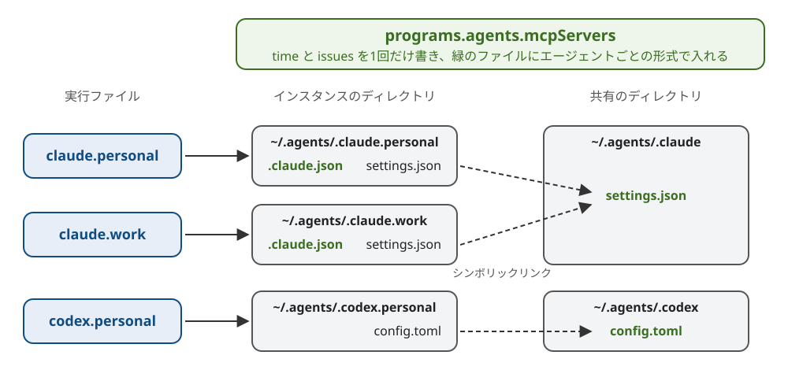

Title: nix-agents: a home-manager module that runs Claude Code and Codex under several accounts on one machine
Date: 2026-11-27 23:22
Updated: 2026-11-27 23:22
Draft: true
Lang: en
Original: /blog/2026/955ac0
Tags: nix home-manager ai-agent claude-code codex release nix-agents


I made nix-agents, a home-manager module that lets you run Claude Code and Codex under several accounts on one machine.
It creates an executable for each instance, such as `claude.personal` and `claude.work` , and each one starts the agent with its own configuration directory.

You write the MCP servers in one place, and the module writes them into each agent's configuration file in that agent's format.
For configuration files that the agent rewrites itself, such as `settings.json` , the module merges only the keys you declare.

It supports 4 agents: Claude Code, Codex, pi and cursor-agent.
Each of them takes its configuration directory from an environment variable, and nix-agents sets that variable per instance.

The repository is [conao3/nix-agents](https://github.com/conao3/nix-agents) under the [Apache-2.0](https://github.com/conao3/nix-agents/blob/d9c223c6ecbfe845896615bd62d768e8f597dcb8/LICENSE) license.
For this article I used commit [d9c223c](https://github.com/conao3/nix-agents/commit/d9c223c6ecbfe845896615bd62d768e8f597dcb8) on master, with Claude Code 2.1.330 and Codex 0.171.0 from nixpkgs-unstable.

<div class="github-card" data-repo="conao3/nix-agents"><a href="https://github.com/conao3/nix-agents"><span class="github-card-name"><svg class="github-card-mark" viewBox="0 0 16 16" aria-hidden="true"><path d="M6.766 11.328c-2.063-.25-3.516-1.734-3.516-3.656 0-.781.281-1.625.75-2.188-.203-.515-.172-1.609.063-2.062.625-.078 1.468.25 1.968.703.594-.187 1.219-.281 1.985-.281.765 0 1.39.094 1.953.265.484-.437 1.344-.765 1.969-.687.218.422.25 1.515.046 2.047.5.593.766 1.39.766 2.203 0 1.922-1.453 3.375-3.547 3.64.531.344.89 1.094.89 1.954v1.625c0 .468.391.734.86.547C13.781 14.359 16 11.53 16 8.03 16 3.61 12.406 0 7.984 0 3.563 0 0 3.61 0 8.031a7.88 7.88 0 0 0 5.172 7.422c.422.156.828-.125.828-.547v-1.25c-.219.094-.5.156-.75.156-1.031 0-1.64-.562-2.078-1.609-.172-.422-.36-.672-.719-.719-.187-.015-.25-.093-.25-.187 0-.188.313-.328.625-.328.453 0 .844.281 1.25.86.313.452.64.655 1.031.655s.641-.14 1-.5c.266-.265.47-.5.657-.656"/></svg><span>conao3/<strong>nix-agents</strong></span></span><span class="github-card-description">home-manager module for running coding agents (Claude Code, Codex, pi, cursor-agent) as multiple instances</span><span class="github-card-footer"><span class="github-card-language"><span class="github-card-language-color"></span>Nix</span><span class="github-card-star"><svg viewBox="0 0 16 16" aria-hidden="true"><path d="M8 .25a.75.75 0 0 1 .673.418l1.882 3.815 4.21.612a.75.75 0 0 1 .416 1.279l-3.046 2.97.719 4.192a.751.751 0 0 1-1.088.791L8 12.347l-3.766 1.98a.75.75 0 0 1-1.088-.79l.72-4.194L.818 6.374a.75.75 0 0 1 .416-1.28l4.21-.611L7.327.668A.75.75 0 0 1 8 .25Z"/></svg><span>Star</span><span class="github-card-star-count" hidden></span></span></span></a></div>


# What nix-agents does

-   Create executables such as `claude.work` and give each instance its own configuration directory.
-   Share settings and history between instances of the same agent, while each instance keeps its own login.
-   Write MCP servers once in `programs.agents.mcpServers` and render them into Claude Code's `.claude.json` , Codex's `config.toml` and cursor-agent's `mcp.json` .
-   Pass an MCP server's token as an environment variable name or a file path, so the token stays out of the Nix store.
-   Merge only the declared keys into configuration files that the agents rewrite.


# Declare Claude Code instances

The home-manager module [programs.claude-code](https://github.com/nix-community/home-manager/blob/5f5abf5eb8de62d954232f3797b5bf4505656b91/modules/programs/claude-code/default.nix#L353-L355) has one configuration directory, `configDir` , and exports it as the session variable `CLAUDE_CONFIG_DIR` .
nix-agents sets the variable inside each executable, so you can start a work Claude Code and a personal one side by side from the same shell.

Add nix-agents as a flake input and import `homeManagerModules.default` into your home-manager configuration.

```nix
{
  inputs = {
    nixpkgs.url = "github:nixos/nixpkgs/nixpkgs-unstable";
    home-manager = {
      url = "github:nix-community/home-manager";
      inputs.nixpkgs.follows = "nixpkgs";
    };
    nix-agents = {
      url = "github:conao3/nix-agents";
      inputs.nixpkgs.follows = "nixpkgs";
      inputs.home-manager.follows = "home-manager";
    };
  };

  outputs =
    { nixpkgs, home-manager, nix-agents, ... }:
    {
      homeConfigurations.alice = home-manager.lib.homeManagerConfiguration {
        pkgs = import nixpkgs {
          system = "x86_64-linux";
          config.allowUnfree = true;
        };
        modules = [
          nix-agents.homeManagerModules.default
          {
            home = {
              username = "alice";
              homeDirectory = "/home/alice";
              stateVersion = "25.11";
            };
          }
          ./agents.nix
        ];
      };
    };
}
```

`claude-code` is unfree in nixpkgs, so the flake sets `allowUnfree` .

`agents.nix` declares 2 Claude Code instances, 1 Codex instance and 2 MCP servers.

```nix
{ pkgs, lib, ... }:
{
  programs.agents = {
    enable = true;

    types.claude = {
      package = pkgs.claude-code;
      envVar = "CLAUDE_CONFIG_DIR";
      homeDir = ".claude";
      share = {
        enable = true;
        exclude = [
          ".claude.json"
          ".claude.json.tmp"
          ".claude.json.*"
          ".credentials.json"
        ];
      };
      mcp = {
        format = "claude";
        key = "mcpServers";
        files = [
          "settings.json"
          ".claude.json"
        ];
      };
      files = {
        "settings.json".settings = {
          theme = "dark";
          permissions.defaultMode = "acceptEdits";
        };
        ".claude.json".scope = "instances";
      };
    };

    types.codex = {
      package = pkgs.codex;
      envVar = "CODEX_HOME";
      homeDir = ".codex";
      share = {
        enable = true;
        exclude = [ "auth.json" ];
      };
      mcp = {
        format = "codex";
        key = "mcp_servers";
        files = [ "config.toml" ];
      };
      files."config.toml".settings.approval_policy = "on-request";
    };

    instances = {
      "claude.personal" = { };
      "claude.work" = { };
      "codex.personal" = { };
    };

    mcpServers = {
      time.command = lib.getExe pkgs.mcp-server-time;
      issues = {
        url = "https://mcp.example.com/issues";
        bearerTokenEnvVar = "ISSUES_API_KEY";
      };
    };
  };
}
```

`types` names each agent's program and the environment variable that selects its configuration directory.
An instance name has the form `<type>.<suffix>` and becomes the name of its executable.

With `share.enable` , the instances of one agent use a shared directory such as `~/.agents/.claude` .

Names in `share.exclude` stay in the instance directory.
I listed `.claude.json` (account state), `.credentials.json` (login) and Codex's `auth.json` there, so each instance keeps its own copy of these 3 files.

I ran the commands in this article in a [bubblewrap](https://github.com/containers/bubblewrap) sandbox with `/home/alice` as the home directory.
`home-manager switch` runs the 4 activation steps that nix-agents adds.

```sh
$ home-manager switch --flake .#alice 2>&1 | grep '^Activating agents'
Activating agentsDirs
Activating agentsCommon
Activating agentsShare
Activating agentsFiles
```

The instance executables land on `PATH` .

```sh
$ ls ~/.nix-profile/bin | grep -E '^(claude|codex)'
claude
claude.personal
claude.work
codex
codex-code-mode-host
codex.personal
```

Each executable is a [shell script made with makeWrapper](https://github.com/conao3/nix-agents/blob/d9c223c6ecbfe845896615bd62d768e8f597dcb8/default.nix#L174-L187) that sets the environment variable and then starts the real `claude` or `codex` .

```sh
$ grep -h -E 'CLAUDE_CONFIG_DIR|CODEX_HOME' ~/.nix-profile/bin/{claude.personal,claude.work,codex.personal}
export CLAUDE_CONFIG_DIR="$HOME/.agents/.claude.personal"
export CLAUDE_CONFIG_DIR="$HOME/.agents/.claude.work"
export CODEX_HOME="$HOME/.agents/.codex.personal"
```

`~/.agents` now holds the instance directories and the shared directories.

```sh
$ tree -a ~/.agents
/home/alice/.agents
├── .claude
│   └── settings.json
├── .claude.personal
│   ├── .claude.json
│   └── settings.json -> /home/alice/.agents/.claude/settings.json
├── .claude.work
│   ├── .claude.json
│   └── settings.json -> /home/alice/.agents/.claude/settings.json
├── .codex
│   └── config.toml
├── .codex.personal
│   └── config.toml -> /home/alice/.agents/.codex/config.toml
└── share

7 directories, 7 files
```

`settings.json` lives in the shared directory, and both instances link to it.
`.claude.json` is in `share.exclude` , so each instance has its own regular file.




# Write MCP servers in one place

`mcpServers` declares 2 servers: `time` , which runs locally, and `issues` , which you reach over HTTP.
`time` is `mcp-server-time` from nixpkgs, and the `issues` URL is a made-up address for this article.

Each Claude Code instance's `.claude.json` gets both servers in Claude Code's format.
`bearerTokenEnvVar` becomes an `Authorization` header that Claude Code fills in from the environment variable at startup.

```sh
$ jq .mcpServers ~/.agents/.claude.work/.claude.json
{
  "issues": {
    "headers": {
      "Authorization": "Bearer ${ISSUES_API_KEY}"
    },
    "type": "http",
    "url": "https://mcp.example.com/issues"
  },
  "time": {
    "args": [],
    "command": "/nix/store/ad9inx3brh3al09xcas4wdf5c9midyxj-mcp-server-time-2.5.0/bin/mcp-server-time",
    "type": "stdio"
  }
}
```

In Codex's `config.toml` , the same `bearerTokenEnvVar` becomes Codex's `bearer_token_env_var` .

```sh
$ cat ~/.agents/.codex/config.toml
approval_policy = "on-request"

[mcp_servers.issues]
bearer_token_env_var = "ISSUES_API_KEY"
type = "http"
url = "https://mcp.example.com/issues"

[mcp_servers.time]
args = []
command = "/nix/store/ad9inx3brh3al09xcas4wdf5c9midyxj-mcp-server-time-2.5.0/bin/mcp-server-time"
```

When you ask Claude Code and Codex to list their MCP servers, both of them show the 2 servers.
Claude Code connects to `time` and fails on `issues` , since that host does not exist.

```sh
$ export ISSUES_API_KEY=dummy
$ claude.work mcp list
Checking MCP server health…

issues: https://mcp.example.com/issues (HTTP) - ✘ Failed to connect — ENOTFOUND: getaddrinfo ENOTFOUND mcp.example.com
time: /nix/store/ad9inx3brh3al09xcas4wdf5c9midyxj-mcp-server-time-2.5.0/bin/mcp-server-time  - ✔ Connected

$ codex.personal mcp list
Name  Command                                                                                Args  Env  Cwd  Status   Auth
time  /nix/store/ad9inx3brh3al09xcas4wdf5c9midyxj-mcp-server-time-2.5.0/bin/mcp-server-time  -     -    -    enabled  Unsupported

Name    Url                             Bearer Token Env Var  Status   Auth
issues  https://mcp.example.com/issues  ISSUES_API_KEY        enabled  Bearer token
```

To keep the token in a file, give its path in `bearerTokenFile` .
Claude Code then gets a `headersHelper` command that reads the file each time it connects to the server, and the Nix store holds only the path.


# Merge into the files the agents rewrite

When Claude Code starts, it writes account and startup state into `.claude.json` in its configuration directory.
A file that home-manager places with `home.file` is a read-only link into the Nix store, so the agent cannot write to it.

nix-agents places the files in `files` with the `merge` strategy by default.
On each `home-manager switch` , it applies the declared keys to the current file and keeps the other keys as they are.

Since I ran `claude.work mcp list` above, the `claude.work` directory now holds the keys Claude Code wrote and a `backups` directory.

```sh
$ tree -a ~/.agents/.claude.work
/home/alice/.agents/.claude.work
├── backups
│   └── .claude.json.backup.1795840307736
├── .claude.json
└── settings.json -> /home/alice/.agents/.claude/settings.json

2 directories, 3 files
$ jq 'del(.mcpServers) | keys' ~/.agents/.claude.work/.claude.json
[
  "firstStartTime",
  "firstStartVersion",
  "hasResetAutoModeOptInForDefaultOffer",
  "machineID",
  "migrationVersion",
  "opusProMigrationComplete",
  "seenNotifications",
  "userID"
]
```

Now I change `theme` in `settings.json` by hand from the declared `dark` to `light` , and switch again.

```sh
$ jq 'del(.mcpServers)' ~/.agents/.claude/settings.json
{
  "permissions": {
    "defaultMode": "acceptEdits"
  },
  "theme": "dark"
}
$ jq '.theme = "light"' ~/.agents/.claude/settings.json > /tmp/s.json
$ cp /tmp/s.json ~/.agents/.claude/settings.json
$ home-manager switch --flake .#alice 2>&1 | grep '^Activating agents'
Activating agentsDirs
Activating agentsCommon
Activating agentsShare
Activating agentsFiles
```

nix-agents kept the keys Claude Code wrote in `.claude.json` and replaced only `mcpServers` with the declared value.
`backups` moved to the shared directory and became a link.

```sh
$ tree -a ~/.agents/.claude.work
/home/alice/.agents/.claude.work
├── backups -> /home/alice/.agents/.claude/backups
├── .claude.json
└── settings.json -> /home/alice/.agents/.claude/settings.json

2 directories, 2 files
$ jq 'del(.mcpServers) | keys' ~/.agents/.claude.work/.claude.json
[
  "firstStartTime",
  "firstStartVersion",
  "hasResetAutoModeOptInForDefaultOffer",
  "machineID",
  "migrationVersion",
  "opusProMigrationComplete",
  "seenNotifications",
  "userID"
]
```

On the next `switch` , files and directories that appear in an instance directory move to the shared directory like this, unless `share.exclude` lists them.
For the history file `history.jsonl` , nix-agents combines the lines of both instances and sorts them by time.

`theme` in `settings.json` no longer matched the declaration, so it stayed `light` , and nix-agents wrote 1 line to the warning log.

```sh
$ jq 'del(.mcpServers)' ~/.agents/.claude/settings.json
{
  "permissions": {
    "defaultMode": "acceptEdits"
  },
  "theme": "light"
}
$ cat ~/.agents/settings-warnings.log
WARN: claude settings: /home/alice/.agents/.claude/settings.json: .theme: expected null or "dark", got "light", skipping
```

To have a declared value win on every switch, wrap it in `agentsLib.force` or set the file's `onConflict` to `"overwrite"` .

The merge itself is the 15 lines of [merge.jq](https://github.com/conao3/nix-agents/blob/d9c223c6ecbfe845896615bd62d768e8f597dcb8/merge.jq).
Nix turns the declaration into a list of operations, and jq applies them in order to the current file at `switch` time.

Nix writes the list of operations to a store file with `builtins.toJSON` , and jq reads that file, so the shell command receives only the file's path.


# Closing

The [README](https://github.com/conao3/nix-agents/blob/d9c223c6ecbfe845896615bd62d768e8f597dcb8/README.md) has configuration examples for all 4 agents, pi and cursor-agent included, and describes every option.
If you want to run Claude Code or Codex under several accounts on one machine, give nix-agents a try.

