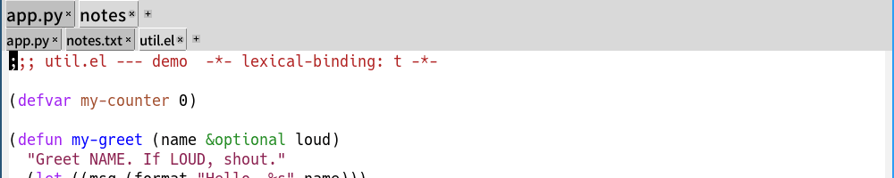
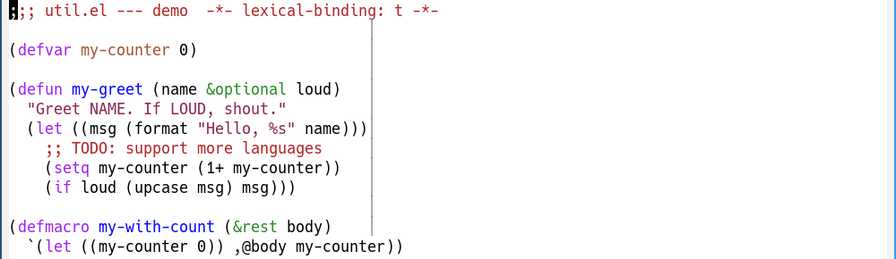
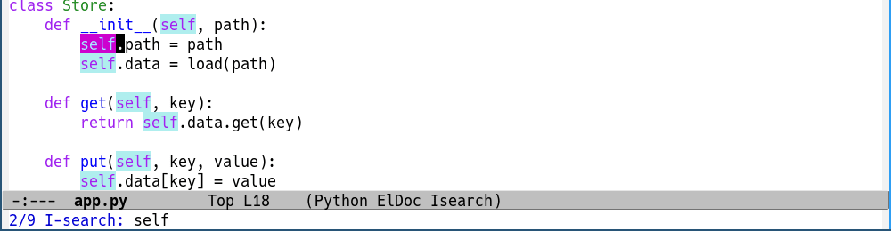
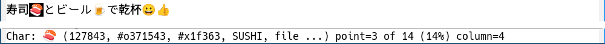
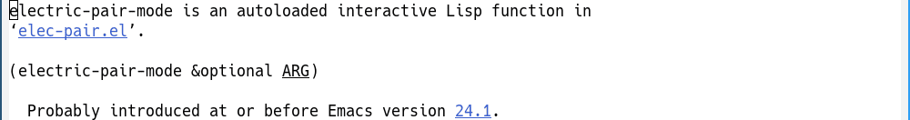
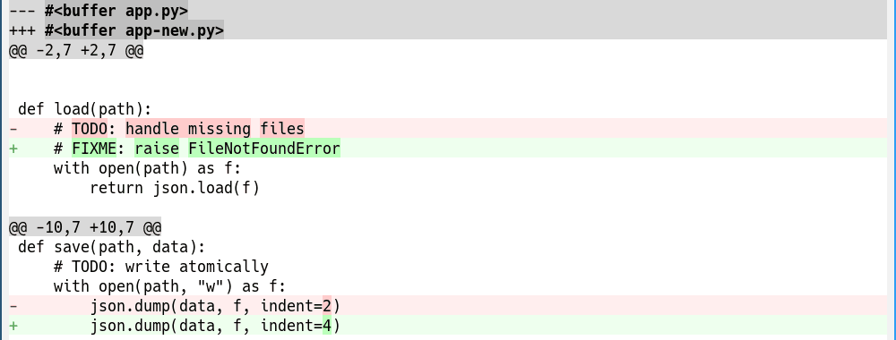
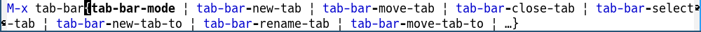

Title: Emacs 27の新機能から、動かして楽しいものを7つ画面つきで紹介する
Date: 2026-11-27 23:00
Updated: 2026-11-27 23:00
Draft: true
Tags: emacs release-notes


Emacs 27のNEWSから動かしてすぐに違いが分かる新機能を7つ選び、Emacs 27.2の実際の画面と一緒に紹介します。
ウィンドウの配置をタブで切り替える `tab-bar-mode` や検索の何件目かを出す `isearch-lazy-count` のように、今も毎日使われている機能が多く入った版です。

NEWSは [etc/NEWS.27](https://github.com/emacs-mirror/emacs/blob/emacs-31.1/etc/NEWS.27) にあり、3,251行あります。
画面はすべて `emacs -Q` で起動したEmacs 27.2で撮っていて、設定が要るものはその式を添えています。


# ウィンドウの配置をタブで切り替える

[tab-bar-mode](https://github.com/emacs-mirror/emacs/blob/emacs-31.1/etc/NEWS.27#L2336) は、フレームの上にタブを並べてタブごとにウィンドウの配置を持たせます。
[global-tab-line-mode](https://github.com/emacs-mirror/emacs/blob/emacs-31.1/etc/NEWS.27#L2364) は、ウィンドウごとにそのウィンドウで開いたバッファをタブで並べます。

```emacs-lisp
(tab-bar-mode 1)
(global-tab-line-mode 1)
```



上の段のタブバーには `app.py` と `tab-rename` で名前を付けた `notes` の2つのタブがあり、下の段のタブラインにはこのウィンドウで開いた3つのバッファが並んでいます。
タブバーのコマンドは `C-x t` の下にあり、 `C-x t 2` で新しいタブを作って `C-x t 0` で今のタブを閉じます。


# fill-columnの位置に縦線を引く

`fill-column` の桁に縦線を引く [display-fill-column-indicator-mode](https://github.com/emacs-mirror/emacs/blob/emacs-31.1/etc/NEWS.27#L526) は、NEWSによるとパッケージのfill-column-indicatorと同じことをより速く行います。

```emacs-lisp
(add-hook 'prog-mode-hook #'display-fill-column-indicator-mode)
```



画面では見やすいように `fill-column` を40にしていて、縦線より右にはみ出した行がすぐに分かります。


# 検索で何件目かを出す

`C-s` の検索のプロンプトに今の一致が何件目かと全部で何件あるかが出るようにするには [isearch-lazy-count](https://github.com/emacs-mirror/emacs/blob/emacs-31.1/etc/NEWS.27#L1589) を `t` にします。

```emacs-lisp
(setq isearch-lazy-count t)
```



app.pyで `self` を探して `C-s` をもう1回押したところでプロンプトに `2/9` と出ていて、件数が分かるとあと何回 `C-s` を押せば終わるかの見当がつきます。


# 絵文字をカラーで表示して、文字の名前を出す

Cairoで描くEmacsではNoto Color Emojiのような [多色のフォントを表示できます](https://github.com/emacs-mirror/emacs/blob/emacs-31.1/etc/NEWS.27#L523)。
Emacs 27ではフォントの割り当てを自分で書くので、記号の文字にNoto Color Emojiを使うように指定しました。

```emacs-lisp
(set-fontset-font t 'symbol "Noto Color Emoji" nil 'prepend)
(setq what-cursor-show-names t)
```



`C-x =` でポイントの文字を調べたときに文字の名前も出るように [what-cursor-show-names](https://github.com/emacs-mirror/emacs/blob/emacs-31.1/etc/NEWS.27#L341) を `t` にしています。
画面では🍣の上で `C-x =` を押していて、エコーエリアに `SUSHI` と出ています。


# 関数がどの版から入ったかを、ヘルプで見る

`C-h f` や `C-h v` の説明に [その関数や変数が入った版の見当](https://github.com/emacs-mirror/emacs/blob/emacs-31.1/etc/NEWS.27#L1549) が出ます。



`electric-pair-mode` の説明には「Probably introduced at or before Emacs version 24.1.」と出ていて24.1はリンクになっています。
この版は過去のNEWSの記述から推定していて、文の頭の `Probably` はそのことを表しています。


# diffの行の中で、変わった語に色を付ける

`diff-mode` は [hunkの中で変わった語に、開いた時点で色を付けます](https://github.com/emacs-mirror/emacs/blob/emacs-31.1/etc/NEWS.27#L1050)。
2つのバッファを比べる [diff-buffers](https://github.com/emacs-mirror/emacs/blob/emacs-31.1/etc/NEWS.27#L1046) も入りました。



画面はapp.pyとそれを書き換えたバッファを `diff-buffers` で比べたところです。
`TODO` が `FIXME` に変わったところと `indent=2` が `indent=4` に変わった部分だけが濃い色になっています。


# Fidoで、ミニバッファの補完をidoのように使う

Icompleteを元にしたidoに似た [fido-mode](https://github.com/emacs-mirror/emacs/blob/emacs-31.1/etc/NEWS.27#L1325) は、ミニバッファに候補を横に並べて打つたびに絞り込みます。
名前は「Fake Ido」の略です。

```emacs-lisp
(fido-mode 1)
```



`M-x tab-bar` と打ったところで `tab-bar-mode` を先頭にしてタブバーのコマンドが `¦` で区切られて並んでいます。
`RET` で先頭の候補を選べます。

