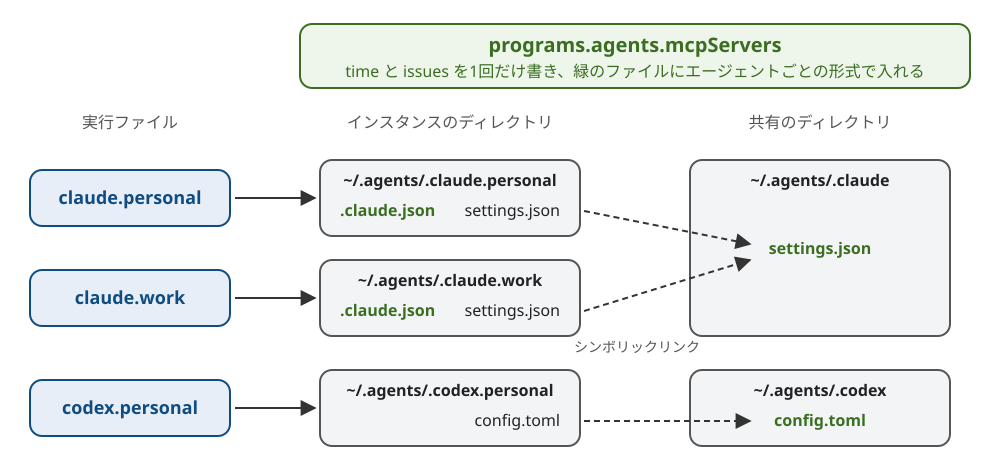

Title: Claude CodeとCodexを1台で複数のアカウントに分けて使えるhome-managerモジュールのnix-agentsを作った
Date: 2026-11-27 23:22
Updated: 2026-11-27 23:22
Draft: true
Tags: nix home-manager ai-agent claude-code codex release nix-agents


Claude CodeとCodexを1台で複数のアカウントに分けて使えるhome-managerのモジュール、nix-agentsを作りました。
`claude.personal` と `claude.work` のような実行ファイルをインスタンスごとに作り、それぞれが別の設定ディレクトリでエージェントを起動します。

MCPサーバーは1か所に書くと、エージェントごとの設定ファイルにそれぞれの形式でサーバーの設定が入ります。
エージェントが自分で書き換える `settings.json` のような設定ファイルには、宣言したキーだけをマージします。

対応しているエージェントはClaude CodeとCodexとpiとcursor-agentの4つで、どれも設定ディレクトリを環境変数で切り替えられます。
nix-agentsはその環境変数をインスタンスごとに変えています。

リポジトリは [conao3/nix-agents](https://github.com/conao3/nix-agents) で、ライセンスは [Apache-2.0](https://github.com/conao3/nix-agents/blob/d9c223c6ecbfe845896615bd62d768e8f597dcb8/LICENSE) です。
この記事ではmasterの [d9c223c](https://github.com/conao3/nix-agents/commit/d9c223c6ecbfe845896615bd62d768e8f597dcb8) と、nixpkgs-unstableのClaude Code 2.1.330とCodex 0.171.0を使いました。

<div class="github-card" data-repo="conao3/nix-agents"><a href="https://github.com/conao3/nix-agents"><span class="github-card-name"><svg class="github-card-mark" viewBox="0 0 16 16" aria-hidden="true"><path d="M6.766 11.328c-2.063-.25-3.516-1.734-3.516-3.656 0-.781.281-1.625.75-2.188-.203-.515-.172-1.609.063-2.062.625-.078 1.468.25 1.968.703.594-.187 1.219-.281 1.985-.281.765 0 1.39.094 1.953.265.484-.437 1.344-.765 1.969-.687.218.422.25 1.515.046 2.047.5.593.766 1.39.766 2.203 0 1.922-1.453 3.375-3.547 3.64.531.344.89 1.094.89 1.954v1.625c0 .468.391.734.86.547C13.781 14.359 16 11.53 16 8.03 16 3.61 12.406 0 7.984 0 3.563 0 0 3.61 0 8.031a7.88 7.88 0 0 0 5.172 7.422c.422.156.828-.125.828-.547v-1.25c-.219.094-.5.156-.75.156-1.031 0-1.64-.562-2.078-1.609-.172-.422-.36-.672-.719-.719-.187-.015-.25-.093-.25-.187 0-.188.313-.328.625-.328.453 0 .844.281 1.25.86.313.452.64.655 1.031.655s.641-.14 1-.5c.266-.265.47-.5.657-.656"/></svg><span>conao3/<strong>nix-agents</strong></span></span><span class="github-card-description">home-manager module for running coding agents (Claude Code, Codex, pi, cursor-agent) as multiple instances</span><span class="github-card-footer"><span class="github-card-language"><span class="github-card-language-color"></span>Nix</span><span class="github-card-star"><svg viewBox="0 0 16 16" aria-hidden="true"><path d="M8 .25a.75.75 0 0 1 .673.418l1.882 3.815 4.21.612a.75.75 0 0 1 .416 1.279l-3.046 2.97.719 4.192a.751.751 0 0 1-1.088.791L8 12.347l-3.766 1.98a.75.75 0 0 1-1.088-.79l.72-4.194L.818 6.374a.75.75 0 0 1 .416-1.28l4.21-.611L7.327.668A.75.75 0 0 1 8 .25Z"/></svg><span>Star</span><span class="github-card-star-count" hidden></span></span></span></a></div>


# nix-agentsでできること

-   `claude.work` のような実行ファイルを作り、エージェントの設定ディレクトリをインスタンスごとに分ける。
-   同じエージェントのインスタンスどうしで設定や履歴を共有し、ログインの情報はインスタンスごとに持たせる。
-   MCPサーバーを `programs.agents.mcpServers` に1回だけ書き、Claude Codeの `.claude.json` 、 Codexの `config.toml` 、 cursor-agentの `mcp.json` に入れる。
-   MCPサーバーのトークンを環境変数の名前かファイルのパスで渡し、Nixのストアにトークンを書き込まない。
-   エージェントが書き換える設定ファイルに、宣言したキーだけをマージする。


# Claude Codeのインスタンスを宣言する

home-managerの [programs.claude-code](https://github.com/nix-community/home-manager/blob/5f5abf5eb8de62d954232f3797b5bf4505656b91/modules/programs/claude-code/default.nix#L353-L355) は設定ディレクトリを `configDir` の1つだけ持ち、それを `CLAUDE_CONFIG_DIR` としてセッションの環境変数にします。
nix-agentsは実行ファイルの中で環境変数を設定するので、仕事用と個人用のClaude Codeを同じシェルから並べて起動できます。

flakeのinputにnix-agentsを足して、 `homeManagerModules.default` をhome-managerのモジュールに入れます。

```nix
{
  inputs = {
    nixpkgs.url = "github:nixos/nixpkgs/nixpkgs-unstable";
    home-manager = {
      url = "github:nix-community/home-manager";
      inputs.nixpkgs.follows = "nixpkgs";
    };
    nix-agents = {
      url = "github:conao3/nix-agents";
      inputs.nixpkgs.follows = "nixpkgs";
      inputs.home-manager.follows = "home-manager";
    };
  };

  outputs =
    { nixpkgs, home-manager, nix-agents, ... }:
    {
      homeConfigurations.alice = home-manager.lib.homeManagerConfiguration {
        pkgs = import nixpkgs {
          system = "x86_64-linux";
          config.allowUnfree = true;
        };
        modules = [
          nix-agents.homeManagerModules.default
          {
            home = {
              username = "alice";
              homeDirectory = "/home/alice";
              stateVersion = "25.11";
            };
          }
          ./agents.nix
        ];
      };
    };
}
```

`claude-code` はnixpkgsでunfreeなので、 `allowUnfree` を有効にしています。

`agents.nix` にClaude Codeの2つのインスタンスとCodexの1つのインスタンス、それに2つのMCPサーバーを書きます。

```nix
{ pkgs, lib, ... }:
{
  programs.agents = {
    enable = true;

    types.claude = {
      package = pkgs.claude-code;
      envVar = "CLAUDE_CONFIG_DIR";
      homeDir = ".claude";
      share = {
        enable = true;
        exclude = [
          ".claude.json"
          ".claude.json.tmp"
          ".claude.json.*"
          ".credentials.json"
        ];
      };
      mcp = {
        format = "claude";
        key = "mcpServers";
        files = [
          "settings.json"
          ".claude.json"
        ];
      };
      files = {
        "settings.json".settings = {
          theme = "dark";
          permissions.defaultMode = "acceptEdits";
        };
        ".claude.json".scope = "instances";
      };
    };

    types.codex = {
      package = pkgs.codex;
      envVar = "CODEX_HOME";
      homeDir = ".codex";
      share = {
        enable = true;
        exclude = [ "auth.json" ];
      };
      mcp = {
        format = "codex";
        key = "mcp_servers";
        files = [ "config.toml" ];
      };
      files."config.toml".settings.approval_policy = "on-request";
    };

    instances = {
      "claude.personal" = { };
      "claude.work" = { };
      "codex.personal" = { };
    };

    mcpServers = {
      time.command = lib.getExe pkgs.mcp-server-time;
      issues = {
        url = "https://mcp.example.com/issues";
        bearerTokenEnvVar = "ISSUES_API_KEY";
      };
    };
  };
}
```

`types` にはエージェントのプログラムと、設定ディレクトリを決める環境変数を書きます。
`instances` の名前は `<type>.<suffix>` の形で、そのまま実行ファイルの名前になります。

`share.enable` を有効にすると、同じエージェントのインスタンスは `~/.agents/.claude` のような共有のディレクトリを使います。

`share.exclude` に書いた名前はインスタンスのディレクトリに残ります。
アカウントの状態を持つ `.claude.json` 、ログインの情報を持つ `.credentials.json` 、 Codexの `auth.json` をここに書いたので、この3つはインスタンスごとに分かれます。

この記事のコマンドは、ホームディレクトリを `/home/alice` にした [bubblewrap](https://github.com/containers/bubblewrap) のサンドボックスで動かしました。
`home-manager switch` を実行すると、nix-agentsが足した4つのactivationの手順が動きます。

```sh
$ home-manager switch --flake .#alice 2>&1 | grep '^Activating agents'
Activating agentsDirs
Activating agentsCommon
Activating agentsShare
Activating agentsFiles
```

`PATH` にはインスタンスの実行ファイルが入ります。

```sh
$ ls ~/.nix-profile/bin | grep -E '^(claude|codex)'
claude
claude.personal
claude.work
codex
codex-code-mode-host
codex.personal
```

実行ファイルは [makeWrapperで作ったシェルスクリプト](https://github.com/conao3/nix-agents/blob/d9c223c6ecbfe845896615bd62d768e8f597dcb8/default.nix#L174-L187) で、環境変数を設定してから本体の `claude` や `codex` を起動します。

```sh
$ grep -h -E 'CLAUDE_CONFIG_DIR|CODEX_HOME' ~/.nix-profile/bin/{claude.personal,claude.work,codex.personal}
export CLAUDE_CONFIG_DIR="$HOME/.agents/.claude.personal"
export CLAUDE_CONFIG_DIR="$HOME/.agents/.claude.work"
export CODEX_HOME="$HOME/.agents/.codex.personal"
```

`~/.agents` には、インスタンスのディレクトリと共有のディレクトリができます。

```sh
$ tree -a ~/.agents
/home/alice/.agents
├── .claude
│   └── settings.json
├── .claude.personal
│   ├── .claude.json
│   └── settings.json -> /home/alice/.agents/.claude/settings.json
├── .claude.work
│   ├── .claude.json
│   └── settings.json -> /home/alice/.agents/.claude/settings.json
├── .codex
│   └── config.toml
├── .codex.personal
│   └── config.toml -> /home/alice/.agents/.codex/config.toml
└── share

7 directories, 7 files
```

`settings.json` は共有のディレクトリにあり、2つのインスタンスからシンボリックリンクで指されています。
`.claude.json` は `share.exclude` に書いたので、インスタンスごとの普通のファイルです。




# MCPサーバーを1か所に書く

`mcpServers` には、ローカルで動かす `time` とHTTPでつなぐ `issues` の2つを書きました。
`time` はnixpkgsの `mcp-server-time` で、 `issues` のURLは記事のために作った存在しないものです。

Claude Codeのインスタンスの `.claude.json` には、2つのサーバーの設定がClaude Codeの形式で入ります。
`bearerTokenEnvVar` は、Claude Codeが起動したときに環境変数から展開する `Authorization` ヘッダーになります。

```sh
$ jq .mcpServers ~/.agents/.claude.work/.claude.json
{
  "issues": {
    "headers": {
      "Authorization": "Bearer ${ISSUES_API_KEY}"
    },
    "type": "http",
    "url": "https://mcp.example.com/issues"
  },
  "time": {
    "args": [],
    "command": "/nix/store/ad9inx3brh3al09xcas4wdf5c9midyxj-mcp-server-time-2.5.0/bin/mcp-server-time",
    "type": "stdio"
  }
}
```

Codexの `config.toml` では、同じ `bearerTokenEnvVar` がCodexの `bearer_token_env_var` になります。

```sh
$ cat ~/.agents/.codex/config.toml
approval_policy = "on-request"

[mcp_servers.issues]
bearer_token_env_var = "ISSUES_API_KEY"
type = "http"
url = "https://mcp.example.com/issues"

[mcp_servers.time]
args = []
command = "/nix/store/ad9inx3brh3al09xcas4wdf5c9midyxj-mcp-server-time-2.5.0/bin/mcp-server-time"
```

Claude CodeとCodexにMCPサーバーの一覧を出させてみると、どちらも2つのサーバーを読んでいます。
Claude Codeでは `time` につながり、 `issues` はホストが無いので失敗します。

```sh
$ export ISSUES_API_KEY=dummy
$ claude.work mcp list
Checking MCP server health…

issues: https://mcp.example.com/issues (HTTP) - ✘ Failed to connect — ENOTFOUND: getaddrinfo ENOTFOUND mcp.example.com
time: /nix/store/ad9inx3brh3al09xcas4wdf5c9midyxj-mcp-server-time-2.5.0/bin/mcp-server-time  - ✔ Connected

$ codex.personal mcp list
Name  Command                                                                                Args  Env  Cwd  Status   Auth
time  /nix/store/ad9inx3brh3al09xcas4wdf5c9midyxj-mcp-server-time-2.5.0/bin/mcp-server-time  -     -    -    enabled  Unsupported

Name    Url                             Bearer Token Env Var  Status   Auth
issues  https://mcp.example.com/issues  ISSUES_API_KEY        enabled  Bearer token
```

トークンをファイルに置くときは `bearerTokenFile` にパスを書きます。
Claude Codeには、サーバーへつなぐたびにそのファイルを読む `headersHelper` のコマンドが入るので、Nixのストアにはパスだけが残ります。


# エージェントが書き換える設定ファイルをマージする

Claude Codeは起動すると、設定ディレクトリの `.claude.json` にアカウントや起動の状態を書き込みます。
home-managerの `home.file` で置くファイルはNixのストアへの読み取り専用のリンクなので、エージェントが書き込むファイルには使えません。

nix-agentsの `files` は、既定で `merge` という方法でファイルを置きます。
`home-manager switch` のたびに、宣言したキーを今のファイルに当てはめ、ほかのキーはそのまま残します。

上で `claude.work mcp list` を実行したので、 `claude.work` のディレクトリにはClaude Codeが書き込んだキーと `backups` のディレクトリがあります。

```sh
$ tree -a ~/.agents/.claude.work
/home/alice/.agents/.claude.work
├── backups
│   └── .claude.json.backup.1795840307736
├── .claude.json
└── settings.json -> /home/alice/.agents/.claude/settings.json

2 directories, 3 files
$ jq 'del(.mcpServers) | keys' ~/.agents/.claude.work/.claude.json
[
  "firstStartTime",
  "firstStartVersion",
  "hasResetAutoModeOptInForDefaultOffer",
  "machineID",
  "migrationVersion",
  "opusProMigrationComplete",
  "seenNotifications",
  "userID"
]
```

ここで、宣言で `dark` にした `settings.json` の `theme` を手で `light` に変えてから、 `switch` し直してみます。

```sh
$ jq 'del(.mcpServers)' ~/.agents/.claude/settings.json
{
  "permissions": {
    "defaultMode": "acceptEdits"
  },
  "theme": "dark"
}
$ jq '.theme = "light"' ~/.agents/.claude/settings.json > /tmp/s.json
$ cp /tmp/s.json ~/.agents/.claude/settings.json
$ home-manager switch --flake .#alice 2>&1 | grep '^Activating agents'
Activating agentsDirs
Activating agentsCommon
Activating agentsShare
Activating agentsFiles
```

nix-agentsは `.claude.json` にClaude Codeが書いたキーを残したまま、 `mcpServers` だけを宣言の値で入れ直しました。
`backups` は共有のディレクトリに移ってリンクになりました。

```sh
$ tree -a ~/.agents/.claude.work
/home/alice/.agents/.claude.work
├── backups -> /home/alice/.agents/.claude/backups
├── .claude.json
└── settings.json -> /home/alice/.agents/.claude/settings.json

2 directories, 2 files
$ jq 'del(.mcpServers) | keys' ~/.agents/.claude.work/.claude.json
[
  "firstStartTime",
  "firstStartVersion",
  "hasResetAutoModeOptInForDefaultOffer",
  "machineID",
  "migrationVersion",
  "opusProMigrationComplete",
  "seenNotifications",
  "userID"
]
```

インスタンスのディレクトリにできたファイルやディレクトリのうち、 `share.exclude` に書いていないものは、このように次の `switch` で共有のディレクトリに移ります。
履歴の `history.jsonl` は、2つのインスタンスの行を合わせて時刻の順に並べ直します。

`settings.json` の `theme` は宣言と違う値なので `light` のまま残り、警告のログに1行が書かれました。

```sh
$ jq 'del(.mcpServers)' ~/.agents/.claude/settings.json
{
  "permissions": {
    "defaultMode": "acceptEdits"
  },
  "theme": "light"
}
$ cat ~/.agents/settings-warnings.log
WARN: claude settings: /home/alice/.agents/.claude/settings.json: .theme: expected null or "dark", got "light", skipping
```

宣言の値で毎回書き換えたいキーは `agentsLib.force` で包むか、ファイルの `onConflict` を `"overwrite"` にします。

マージの式は [merge.jq](https://github.com/conao3/nix-agents/blob/d9c223c6ecbfe845896615bd62d768e8f597dcb8/merge.jq) の15行です。
Nixが宣言から作った操作の列を、 `switch` のときにjqが今のファイルに順に当てはめます。

操作の列は `builtins.toJSON` でストアのファイルにしてからjqに読ませるので、シェルのコマンドにはファイルのパスだけを渡します。


# おわりに

piとcursor-agentも含めた4つのエージェントの設定例と、すべてのoptionの説明は [README](https://github.com/conao3/nix-agents/blob/d9c223c6ecbfe845896615bd62d768e8f597dcb8/README.md) に書いています。
1台でClaude CodeやCodexを複数のアカウントで使い分けたいときに、nix-agentsを試してみてください。

