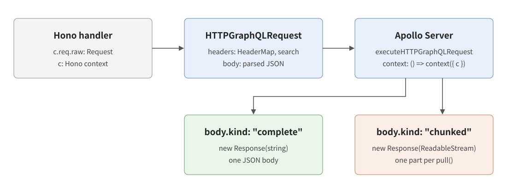

Title: HonoでApollo Server 5を動かし、@deferの応答をできた分から返すapollo-server-integration-honoを作った
Date: 2026-11-27 23:18
Updated: 2026-11-27 23:18
Draft: true
Tags: typescript graphql hono release ts-apollo-server-integration-hono


HonoのアプリでApollo Server 5のGraphQLを動かすライブラリとして、apollo-server-integration-honoを作りました。
関数 `startServerAndCreateHonoHandler` 1つで `ApolloServer` をHonoのハンドラーにできます。
`@defer` を使った問い合わせでは、Apollo Serverが部分ごとに返す `multipart/mixed` の応答を、できた順にそのまま流します。

リポジトリは [conao3/ts-apollo-server-integration-hono](https://github.com/conao3/ts-apollo-server-integration-hono)、ライセンスはApache-2.0で、npmに [@conao3/apollo-server-integration-hono](https://www.npmjs.com/package/@conao3/apollo-server-integration-hono) として公開しています。
この記事は0.1.3と、この記事を書いた時点のmasterの [b3a486e](https://github.com/conao3/ts-apollo-server-integration-hono/tree/b3a486e68f2a2c3f05fdf099d50799a4f9fb709f) をもとに、Apollo Server 5.5.2とHono 4.13.23とNode.js 26.13.1で動かして書いています。

本体は [src/index.ts](https://github.com/conao3/ts-apollo-server-integration-hono/blob/b3a486e68f2a2c3f05fdf099d50799a4f9fb709f/src/index.ts) の112行で、Honoが受けたリクエストをApollo Serverの形に直して渡し、返ってきた本文をWeb標準の `Response` にしています。
Web標準のAPIと、 `@apollo/server` と `hono` の2つの依存だけで書いていて、Honoが動くランタイムで使えるようにしています。

<div class="github-card" data-repo="conao3/ts-apollo-server-integration-hono"><a href="https://github.com/conao3/ts-apollo-server-integration-hono"><span class="github-card-name"><svg class="github-card-mark" viewBox="0 0 16 16" aria-hidden="true"><path d="M6.766 11.328c-2.063-.25-3.516-1.734-3.516-3.656 0-.781.281-1.625.75-2.188-.203-.515-.172-1.609.063-2.062.625-.078 1.468.25 1.968.703.594-.187 1.219-.281 1.985-.281.765 0 1.39.094 1.953.265.484-.437 1.344-.765 1.969-.687.218.422.25 1.515.046 2.047.5.593.766 1.39.766 2.203 0 1.922-1.453 3.375-3.547 3.64.531.344.89 1.094.89 1.954v1.625c0 .468.391.734.86.547C13.781 14.359 16 11.53 16 8.03 16 3.61 12.406 0 7.984 0 3.563 0 0 3.61 0 8.031a7.88 7.88 0 0 0 5.172 7.422c.422.156.828-.125.828-.547v-1.25c-.219.094-.5.156-.75.156-1.031 0-1.64-.562-2.078-1.609-.172-.422-.36-.672-.719-.719-.187-.015-.25-.093-.25-.187 0-.188.313-.328.625-.328.453 0 .844.281 1.25.86.313.452.64.655 1.031.655s.641-.14 1-.5c.266-.265.47-.5.657-.656"/></svg><span>conao3/<strong>ts-apollo-server-integration-hono</strong></span></span><span class="github-card-description">Apollo Server integration for Hono</span><span class="github-card-footer"><span class="github-card-language"><span class="github-card-language-color" style="background-color: #3178c6"></span>TypeScript</span><span class="github-card-star"><svg viewBox="0 0 16 16" aria-hidden="true"><path d="M8 .25a.75.75 0 0 1 .673.418l1.882 3.815 4.21.612a.75.75 0 0 1 .416 1.279l-3.046 2.97.719 4.192a.751.751 0 0 1-1.088.791L8 12.347l-3.766 1.98a.75.75 0 0 1-1.088-.79l.72-4.194L.818 6.374a.75.75 0 0 1 .416-1.28l4.21-.611L7.327.668A.75.75 0 0 1 8 .25Z"/></svg><span>Star</span><span class="github-card-star-count" hidden></span></span></span></a></div>


# Honoのアプリに入れる

空のディレクトリで、パッケージとApollo ServerとHonoを入れます。
pnpm 12は依存のビルドスクリプトを動かすかを決めていないと `pnpm add` を失敗で終えるので、先に `pnpm-workspace.yaml` で `@apollo/protobufjs` のスクリプトを止めておきます。

```yaml
allowBuilds:
  "@apollo/protobufjs": false
```

```shell
pnpm add @conao3/apollo-server-integration-hono @apollo/server graphql@16 hono @hono/node-server
```

次の `server.mts` では、Honoのミドルウェアがヘッダー `x-user` から利用者の名前を読み、GraphQLのリゾルバーに渡します。

`context` の関数は引数 `c` にHonoのコンテキストを受け取ります。
この引数に `HonoContextFunctionArgument<AppEnv>` で型を付けると、 `c.get("user")` がアプリの `Env` の型で読めます。

```typescript
import { ApolloServer } from "@apollo/server"
import { startServerAndCreateHonoHandler } from "@conao3/apollo-server-integration-hono"
import type { HonoContextFunctionArgument } from "@conao3/apollo-server-integration-hono"
import { serve } from "@hono/node-server"
import { Hono } from "hono"

type AppEnv = { Variables: { user: string } }
type GraphQLContext = { user: string }

const server = new ApolloServer<GraphQLContext>({
  typeDefs: `#graphql
    type Query {
      hello: String!
      user: String!
    }
  `,
  resolvers: {
    Query: {
      hello: () => "world",
      user: (_parent, _args, context) => context.user,
    },
  },
})

const app = new Hono<AppEnv>()
app.use(async (c, next) => {
  c.set("user", c.req.header("x-user") ?? "anonymous")
  await next()
})
app.post(
  "/api/graphql",
  startServerAndCreateHonoHandler(server, {
    context: async ({ c }: HonoContextFunctionArgument<AppEnv>) => ({ user: c.get("user") }),
  }),
)

serve({ fetch: app.fetch, port: 4000 })
```

`node server.mts` で起動して `curl` で問い合わせると、 `x-user` を付けたときだけ `user` が変わります。

```shell
$ curl -s http://localhost:4000/api/graphql \
    -H 'content-type: application/json' \
    -d '{"query":"{ hello user }"}'
{"data":{"hello":"world","user":"anonymous"}}

$ curl -s http://localhost:4000/api/graphql \
    -H 'content-type: application/json' \
    -H 'x-user: alice' \
    -d '{"query":"{ hello user }"}'
{"data":{"hello":"world","user":"alice"}}
```

`startServerAndCreateHonoHandler` はApollo Serverをバックグラウンドで起動するので、 `server.start()` を自分で書く代わりに、アプリの起動時に `startServerAndCreateHonoHandler` を1回だけ呼びます。
`hono/cors` のようなミドルウェアがHonoのコンテキストに付けたヘッダーは、GraphQLの応答にもそのまま入ります。


# @deferの応答を流す

`@defer` は、問い合わせの一部を後から返してよいとサーバーに伝えるGraphQLのディレクティブです。

[Apollo Serverのドキュメント](https://www.apollographql.com/docs/apollo-server/workflow/requests#incremental-delivery-experimental) によると、Apollo Server 5.1以降はgraphqlのパッケージがちょうど `17.0.0-alpha.9` のときだけ `@defer` の部分を後から返すので、graphqlをこの版に入れ替えます。

```shell
pnpm add graphql@17.0.0-alpha.9
```

次の `defer.mts` はすぐ返る `hello` と2秒かかる `slow` を持ち、スキーマに `@defer` の宣言を書いたサーバーです。

```typescript
import { ApolloServer } from "@apollo/server"
import { startServerAndCreateHonoHandler } from "@conao3/apollo-server-integration-hono"
import { serve } from "@hono/node-server"
import { Hono } from "hono"

const sleep = (ms: number) => new Promise((resolve) => setTimeout(resolve, ms))

const server = new ApolloServer({
  typeDefs: `#graphql
    directive @defer(if: Boolean! = true, label: String) on FRAGMENT_SPREAD | INLINE_FRAGMENT

    type Query {
      hello: String!
      slow: String!
    }
  `,
  resolvers: {
    Query: {
      hello: () => "world",
      slow: async () => {
        await sleep(2000)
        return "done"
      },
    },
  },
})

const app = new Hono()
app.post("/api/graphql", startServerAndCreateHonoHandler(server))

serve({ fetch: app.fetch, port: 4000 })
```

次の `defer.sh` は、問い合わせを送ってから応答のJSONが届くまでの秒数を、JSONの行ごとに先頭に付けます。
`@defer` を使わない問い合わせと使う問い合わせを、同じ `accept` ヘッダーで1回ずつ送ります。

```bash
query() {
  start=$(date +%s%N)
  curl -sN http://localhost:4000/api/graphql \
    -H 'content-type: application/json' \
    -H 'accept: multipart/mixed; incrementalSpec=v0.2, application/json' \
    -d "{\"query\":\"$1\"}" |
    grep --line-buffered '^{' |
    while IFS= read -r line; do
      echo "$(( ($(date +%s%N) - start) / 1000000000 ))s ${line%$'\r'}"
    done
}
query '{ hello slow }'
query '{ hello ... @defer { slow } }'
```

`node defer.mts` で起動して `bash defer.sh` を実行すると、次のように出ます。

```shell
$ bash defer.sh
2s {"data":{"hello":"world","slow":"done"}}
0s {"data":{"hello":"world"},"pending":[{"id":"0","path":[]}],"hasNext":true}
2s {"hasNext":false,"incremental":[{"data":{"slow":"done"},"id":"0"}],"completed":[{"id":"0"}]}
```

`@defer` を使わない問い合わせは、 `slow` を待って2秒後に1つのJSONで返ります。
`@defer` を使うと0秒で `hello` が届き、2秒後に `slow` が `incremental` として返るので、apollo-server-integration-honoが応答を最後まで溜めずに流していることが分かります。


# HonoとApollo Serverのあいだでしていること

Apollo ServerはHTTPのリクエストとレスポンスを、フレームワークによらない `HTTPGraphQLRequest` と `HTTPGraphQLResponse` の形で受け渡します。

統合のパッケージの仕事はこの形とフレームワークの形のあいだを直すことです。
Apollo Serverの [統合の作り方](https://www.apollographql.com/docs/apollo-server/integrations/building-integrations) もこの手順で書かれています。



リクエストの側では、 `c.req.raw` のヘッダーを `HeaderMap` に写し、クエリ文字列と本文を取り出して `executeHTTPGraphQLRequest` に渡します。

`content-type` がJSONの本文は `JSON.parse` で読み、壊れたJSONには400を返します。
`context` の関数には `c` を渡すので、リゾルバーからHonoのミドルウェアが付けた値を読めます。

レスポンスの側では、Apollo Serverが返す本文の種類で分けています。
`body.kind` が `"complete"` なら文字列をそのまま `Response` に入れ、 `"chunked"` なら本文の非同期イテレーターを `ReadableStream` にして入れます。

```typescript
const encoder = new TextEncoder()
const iterator = body.asyncIterator[Symbol.asyncIterator]()
return new ReadableStream<Uint8Array>({
  async pull(controller) {
    const { done, value } = await iterator.next()
    if (done) {
      controller.close()
    } else {
      controller.enqueue(encoder.encode(value))
    }
  },
  async cancel() {
    await iterator.return?.()
  },
})
```

読み手が次の部分を求めるたびに `pull` が呼ばれ、イテレーターから1つ取って流します。
このため、前の節の `hello` の部分は `slow` の解決を待たずに届きます。

クライアントが途中で接続を切ったときは、 `cancel` がイテレーターの `return` を呼びます。


# Apollo Serverの結合テスト

Apollo Serverは統合のパッケージ向けのテスト集 [@apollo/server-integration-testsuite](https://github.com/apollographql/apollo-server/tree/main/packages/integration-testsuite) を公開しています。
apollo-server-integration-honoは、[test/integration/integration.test.ts](https://github.com/conao3/ts-apollo-server-integration-hono/blob/b3a486e68f2a2c3f05fdf099d50799a4f9fb709f/test/integration/integration.test.ts) でこれをJestで回しています。

CIと同じgraphql 16で動かすと270件のうち246件が通り、graphql 17が要る `@defer` と `@stream` の24件は飛ばされます。

    Tests:       24 skipped, 246 passed, 270 total

飛ばされる24件を動かすには、リポジトリの `pnpm-workspace.yaml` の `overrides` に `graphql: 17.0.0-alpha.9` を足し、古い形式の `@defer` のテストが読む `@yaacovcr/transform` を入れます。
そのうえで環境変数 `INCREMENTAL_DELIVERY_TESTS_ENABLED` を付けると、この24件も動きます。

```shell
pnpm add -D @yaacovcr/transform
INCREMENTAL_DELIVERY_TESTS_ENABLED=1 pnpm exec jest --testTimeout=30000
```

    Test Suites: 1 passed, 1 total
    Tests:       270 passed, 270 total

この条件では `@defer` と `@stream` のテストも含めて270件がすべて通りました。
コンテキストの `c` 、ミドルウェアのヘッダー、GETの問い合わせ、壊れたJSONの400のようなHonoに特有の動きは、 `test/unit/` のVitestのテストで確かめています。

