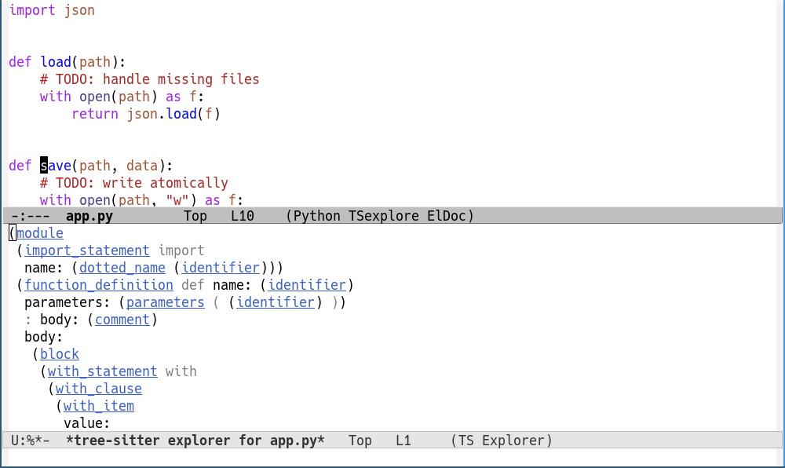
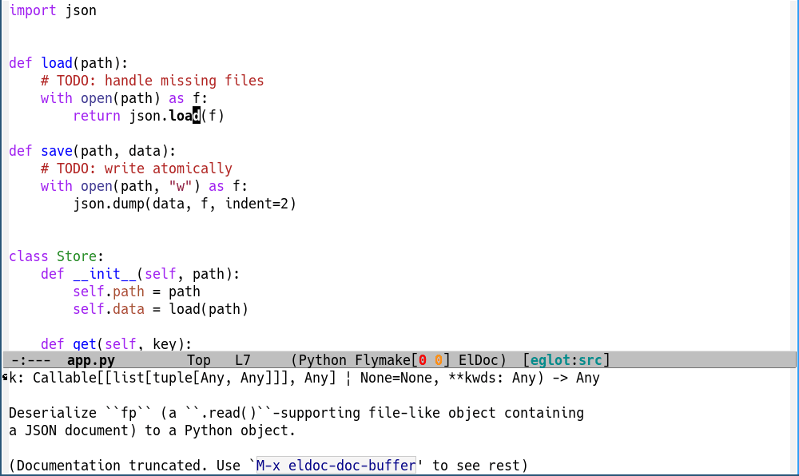
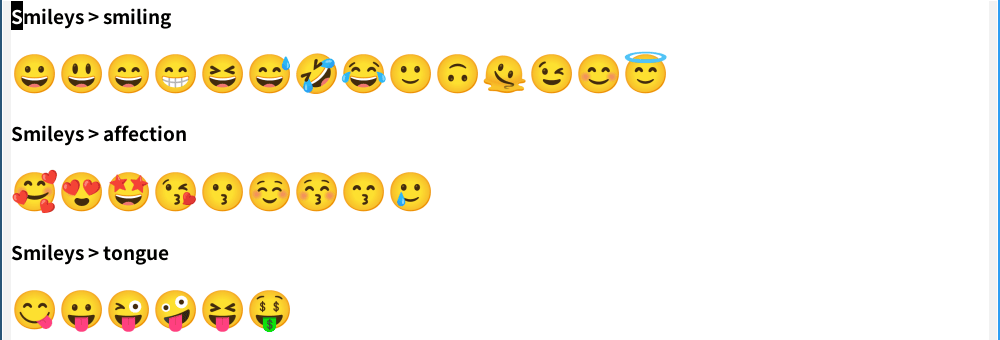
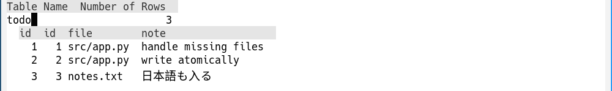
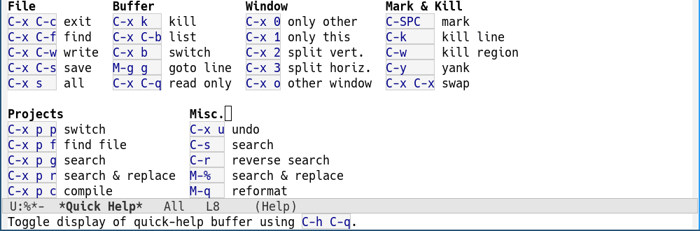
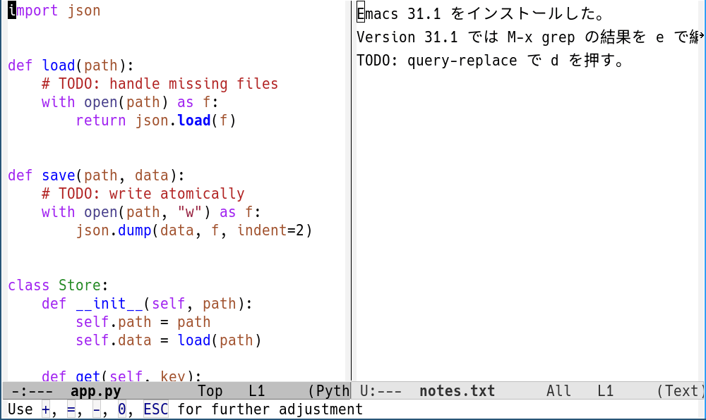

Title: Seven fun new features in Emacs 29, shown in screenshots
Date: 2026-11-27 22:50
Updated: 2026-11-27 22:50
Lang: en
Original: /blog/2026/43487f
Tags: emacs release-notes


I picked seven new features from the Emacs 29 NEWS that you notice the moment you use them, and this post shows each one in a screenshot of Emacs 29.4.
Emacs 29 added tree-sitter support and brought Eglot and use-package into Emacs, so I start with those three and then move on to smaller treats such as an emoji list and an SQLite browser.

The NEWS lives in [etc/NEWS.29](https://github.com/emacs-mirror/emacs/blob/emacs-31.1/etc/NEWS.29) and runs to 4,395 lines.
I took every screenshot in Emacs 29.4 started with `emacs -Q`, and I include the code for each feature that needs a setting.


# Highlight code with tree-sitter and look at the syntax tree

Emacs 29 [can be built with the tree-sitter library](https://github.com/emacs-mirror/emacs/blob/emacs-31.1/etc/NEWS.29#L96), and it adds [major modes based on tree-sitter](https://github.com/emacs-mirror/emacs/blob/emacs-31.1/etc/NEWS.29#L2976) such as `python-ts-mode`.
These modes highlight and indent from the parse result, so they also color things that regular expressions find hard to catch, such as function parameters.

Each language needs its own grammar library.
`M-x treesit-install-language-grammar` downloads and builds one, or you can put a library in a directory listed in `treesit-extra-load-path`.

```emacs-lisp
(setopt treesit-font-lock-level 4)
(add-to-list 'major-mode-remap-alist '(python-mode . python-ts-mode))
```



The top window shows app.py in `python-ts-mode`, where parameters such as `path` get a color too.
The bottom window is the syntax tree from `M-x treesit-explore-mode`, with `function_definition` and `parameters` under `module`.


# Connect to a language server with Eglot

The LSP client [Eglot](https://github.com/emacs-mirror/emacs/blob/emacs-31.1/etc/NEWS.29#L2918) is now part of Emacs, and with a language server installed, completion, documentation and error checking come from the server.
Run `M-x eglot` in a Python file, and Eglot finds and starts a language server such as `pylsp`.

```emacs-lisp
(add-hook 'python-base-mode-hook #'eglot-ensure)
```



The mode line shows `[eglot:src]`, and with point on `json.load`, the echo area shows the parameter types and the description that the language server returned.


# Organize your configuration with use-package

[use-package](https://github.com/emacs-mirror/emacs/blob/emacs-31.1/etc/NEWS.29#L2929), the macro that groups the configuration of a package, is now part of Emacs too.
You can write your `init.el` with `use-package` without installing use-package first.

```emacs-lisp
(use-package dired
  :custom (dired-listing-switches "-alh")
  :bind ("C-c d" . dired-jump))
```

Evaluating this form sets `dired-listing-switches` to `"-alh"` and binds `C-c d` to `dired-jump`.


# Pick an emoji from a list

The emoji commands now live under [C-x 8 e](https://github.com/emacs-mirror/emacs/blob/emacs-31.1/etc/NEWS.29#L954).
`C-x 8 e l` runs `emoji-list`, which shows a buffer of emoji grouped by category and inserts the one you choose into the buffer you came from.



You can also search by name with `C-x 8 e s`, walk the categories with `C-x 8 e e`, and pick a recent emoji with `C-x 8 e r`.


# Open an SQLite file and browse its tables

Emacs 29 can talk to SQLite, and [sqlite-mode-open-file](https://github.com/emacs-mirror/emacs/blob/emacs-31.1/etc/NEWS.29#L802) opens a database file.
It lists the tables, and `RET` on a table shows its rows.



The screenshot shows a `todo` table that I created with `sqlite-open` and `sqlite-execute`, and the Japanese value shows up as it is.


# Show a cheat sheet of common keys

[help-quick](https://github.com/emacs-mirror/emacs/blob/emacs-31.1/etc/NEWS.29#L1062) shows a cheat sheet of common keys at the bottom of the frame, and `C-h C-q` toggles it.
The sheet lists keys for files, buffers, windows, the mark and projects.



Keep it open next to someone who has just started with Emacs, and they can check the keys that confuse beginners, such as the difference between `C-x 0` and `C-x 1`.


# Enlarge the text in every buffer at once

`C-x C-+` enlarges the text of the current buffer only, while [C-x C-M-+](https://github.com/emacs-mirror/emacs/blob/emacs-31.1/etc/NEWS.29#L643) enlarges the text of every buffer, the mode line and the echo area.
`C-x C-M--` shrinks it, and `C-x C-M-0` restores the original size.



With two buffers side by side, one `C-x C-M-+` enlarged both bodies and both mode lines by the same step.
When you share your screen to explain something, one key makes everything readable.


# Other changes worth a look

-   [duplicate-line](https://github.com/emacs-mirror/emacs/blob/emacs-31.1/etc/NEWS.29#L681) duplicates the current line, and `duplicate-dwim` duplicates the region when one is active.
-   With [pixel-scroll-precision-mode](https://github.com/emacs-mirror/emacs/blob/emacs-31.1/etc/NEWS.29#L894) on, the mouse wheel or touchpad scrolls by pixels.


# New features from Emacs 27 to 31

I wrote one post in the same format for each Emacs release from 27 to 31.

-   [Seven fun new features in Emacs 31, shown in screenshots](https://s.conao3.com/blog/2026/26ed0f)
-   [Seven fun new features in Emacs 30, shown in screenshots](https://s.conao3.com/blog/2026/516114)
-   [Seven fun new features in Emacs 28, shown in screenshots](https://s.conao3.com/blog/2026/5e8afb)
-   [Seven fun new features in Emacs 27, shown in screenshots](https://s.conao3.com/blog/2026/5265b1)

