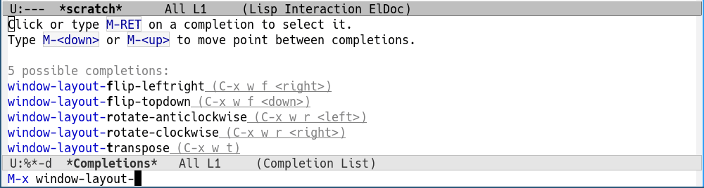
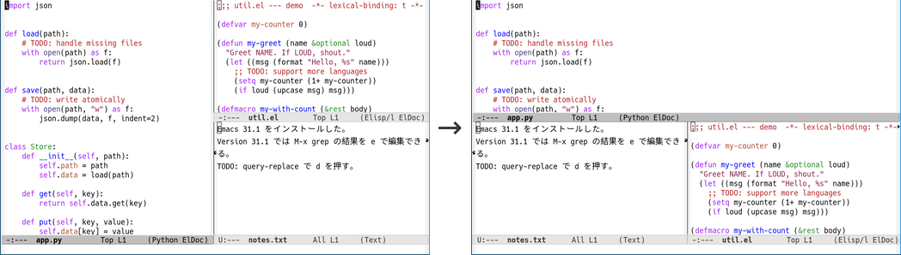
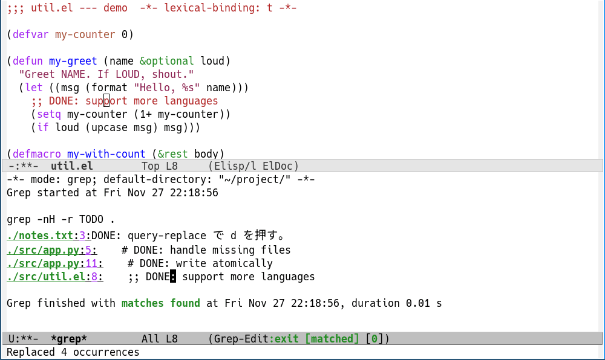
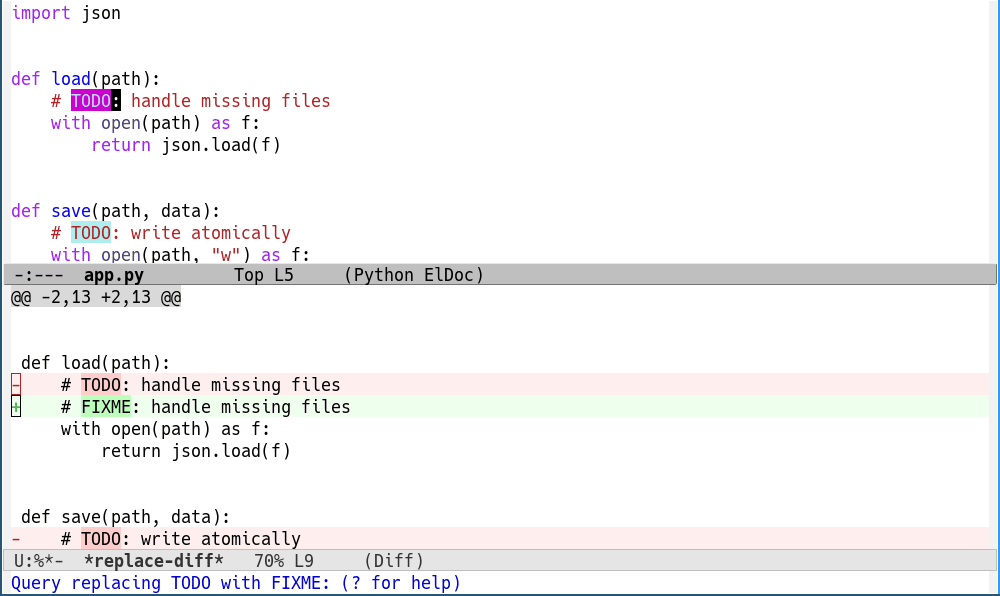
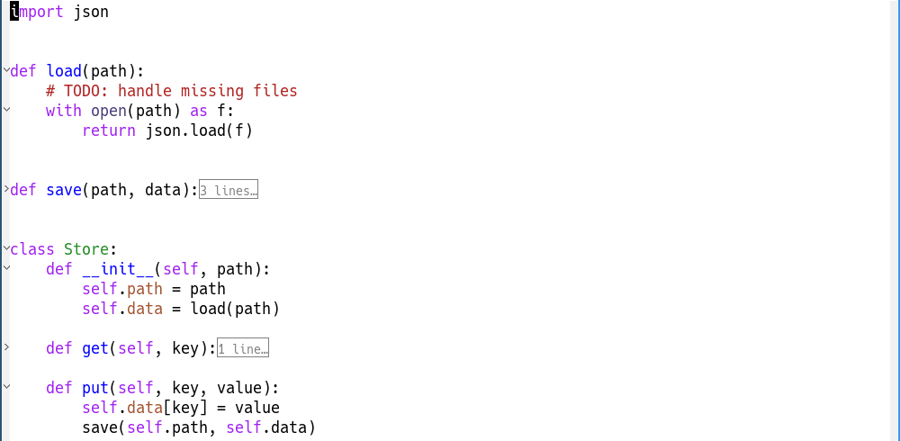
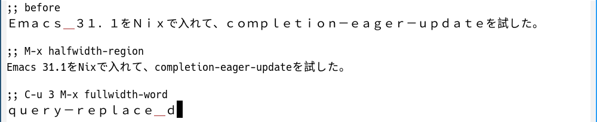
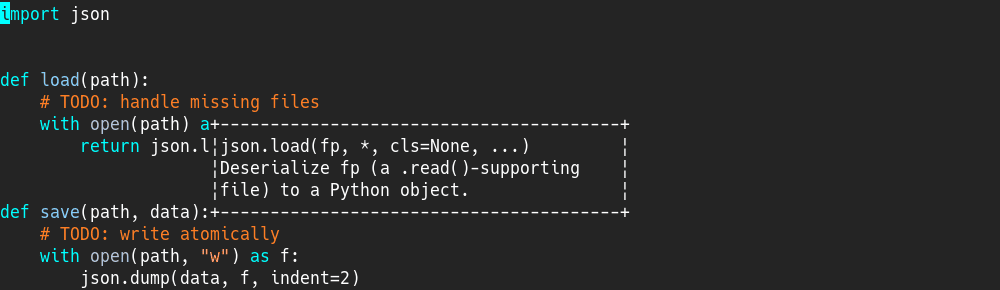

Title: Emacs 31の新機能から、動かして楽しいものを7つ画面つきで紹介する
Date: 2026-11-27 22:23
Updated: 2026-11-27 22:23
Tags: emacs release-notes


Emacs 31.1のNEWSから、動かしてすぐに違いが分かる新機能を7つ選び、実際の画面と一緒に紹介します。
補完の候補が打つそばから絞り込まれる機能や、grepの結果を書き換えて元のファイルに反映する機能のように、毎日の編集で手間が減るものを中心にしました。

NEWSは [etc/NEWS](https://github.com/emacs-mirror/emacs/blob/emacs-31.1/etc/NEWS) にあり、4,274行あります。
全部を並べるより手元で試したくなるものを選んで1つずつ動かしてみました。

画面はすべて `emacs -Q` で起動したEmacs 31.1で撮っていて、設定が要るものはその式を添えています。


# 補完の候補が、打つそばから絞り込まれる

[completion-eager-display](https://github.com/emacs-mirror/emacs/blob/emacs-31.1/etc/NEWS#L175) を `t` にすると、補完のあるミニバッファを開いた時点で `*Completions*` バッファが出ます。
[completion-eager-update](https://github.com/emacs-mirror/emacs/blob/emacs-31.1/etc/NEWS#L185) を `t` にすると、文字を打つたびに候補の一覧が更新されます。

```emacs-lisp
(setopt completion-eager-display t
        completion-eager-update t)
```

どちらも既定値は `auto` で、補完の表がその指定を持つときだけ一覧を出したり更新したりします。
どちらも `t` にするとTABを押さなくても候補が見えたままになり、VerticoのようなパッケージもIcompleteも使わない `emacs -Q` で使いやすくなります。

下の画面は `M-x` で `window-layout-` まで打ったところです。



候補が5つのコマンドに絞り込まれ、それぞれのキーバインドも並んでいます。
次の節ではこのコマンドを使ってみます。


# ウィンドウの配置を、回す、裏返す、縦横を入れ替える

フレームの中のウィンドウの配置を丸ごと組み替える [コマンド](https://github.com/emacs-mirror/emacs/blob/emacs-31.1/etc/NEWS#L327) が入りました。
どれも `C-x w` の下にあります。

<table border="2" cellspacing="0" cellpadding="6" rules="groups" frame="hsides">


<colgroup>
<col  class="org-left" />

<col  class="org-left" />

<col  class="org-left" />
</colgroup>
<thead>
<tr>
<th scope="col" class="org-left">キー</th>
<th scope="col" class="org-left">コマンド</th>
<th scope="col" class="org-left">動き</th>
</tr>
</thead>
<tbody>
<tr>
<td class="org-left"><code>C-x w r &lt;right&gt;</code></td>
<td class="org-left"><code>window-layout-rotate-clockwise</code></td>
<td class="org-left">配置を時計回りに回す</td>
</tr>

<tr>
<td class="org-left"><code>C-x w r &lt;left&gt;</code></td>
<td class="org-left"><code>window-layout-rotate-anticlockwise</code></td>
<td class="org-left">配置を反時計回りに回す</td>
</tr>

<tr>
<td class="org-left"><code>C-x w f &lt;down&gt;</code></td>
<td class="org-left"><code>window-layout-flip-topdown</code></td>
<td class="org-left">配置を上下に裏返す</td>
</tr>

<tr>
<td class="org-left"><code>C-x w f &lt;right&gt;</code></td>
<td class="org-left"><code>window-layout-flip-leftright</code></td>
<td class="org-left">配置を左右に裏返す</td>
</tr>

<tr>
<td class="org-left"><code>C-x w t</code></td>
<td class="org-left"><code>window-layout-transpose</code></td>
<td class="org-left">横の分割と縦の分割を入れ替える</td>
</tr>

<tr>
<td class="org-left"><code>C-x w o &lt;right&gt;</code></td>
<td class="org-left"><code>rotate-windows</code></td>
<td class="org-left">配置はそのままで、バッファを隣のウィンドウへ順に送る</td>
</tr>
</tbody>
</table>

左に1つ、右に上下2つのウィンドウを並べて `C-x w r <right>` を押すと、左のウィンドウが上に、右の2つが下に回りました。



縦長の画面と横長の画面を行き来したときや横に並べたdiffを縦に並べ直したいときにウィンドウを作り直さずに済みます。


# grepの結果を書き換えて、元のファイルに反映する

`M-x grep` の結果のバッファで `e` を押すと、結果の行を [編集できるGrep Editモード](https://github.com/emacs-mirror/emacs/blob/emacs-31.1/etc/NEWS#L2353) になります。
行を書き換えるとそのファイルを開いたバッファにも同じ変更が入ります。
編集を終えたら `C-c C-c` で元のモードに戻ります。

下の画面では `TODO` を探した結果の4行で `M-%` を使い、 `TODO` を `DONE` に置き換えました。



上のutil.elのバッファにも `DONE` が入り、モードラインに未保存の印の `**` が付いています。
変更はバッファに入るだけなのでファイルへの保存は `C-x s` で行います。

Occurモードの `e` と同じ操作で、grepの結果からまとめて直せます。


# 置換する前に、置換した後のdiffを見る

`M-%` で置換している途中に `d` を押すと、 [置換をすべて行った場合のdiff](https://github.com/emacs-mirror/emacs/blob/emacs-31.1/etc/NEWS#L2203) が `*replace-diff*` バッファに出ます。



画面はapp.pyで `TODO` を `FIXME` に置き換える途中で `d` を押したところです。
diffを見たあとも置換の問い合わせは続いているので、そのまま `y` や `!` で置換を進められます。

`?` で出るヘルプにも「 `d` to display the diff buffer with all replacements」と書かれています。
置換する数が多いときに1件ずつ `y` を押す前に全体を確かめられます。


# 畳んだブロックに、開閉の印と行数を出す

`hs-minor-mode` で関数やクラスを畳むと、 [hs-show-indicators](https://github.com/emacs-mirror/emacs/blob/emacs-31.1/etc/NEWS#L1276) を `t` にしたときは左端に開閉の印が出ます。
[hs-display-lines-hidden](https://github.com/emacs-mirror/emacs/blob/emacs-31.1/etc/NEWS#L1272) を `t` にすると、畳んだ行数が省略記号の横に出ます。

```emacs-lisp
(setopt hs-show-indicators t
        hs-display-lines-hidden t)
(add-hook 'prog-mode-hook #'hs-minor-mode)
```



畳んだ `save` と `get` には右向きの印と「3 lines」「1 line」が、開いているブロックには下向きの印が付いています。
印はクリックでも開閉できます。
[hs-cycle](https://github.com/emacs-mirror/emacs/blob/emacs-31.1/etc/NEWS#L1255) を使うと、親のブロックを畳む、入れ子のブロックだけを畳む、全部開く、の3つを順に切り替えられます。


# 全角の英数字を半角に、半角を全角にする

[halfwidth-region](https://github.com/emacs-mirror/emacs/blob/emacs-31.1/etc/NEWS#L1437) はリージョンの全角の英数字と記号を半角にして、 `fullwidth-region` はその逆をします。
`halfwidth-word` と `fullwidth-word` はポイントの後の単語を変換し、 `C-u 3` のように数を付けるとその数の単語を変換します。



1行目の全角で書かれた文に `halfwidth-region` をかけると、2行目のように英数字と全角の空白が半角になります。
3つ目の例の `query-replace d` に `C-u 3 M-x fullwidth-word` をかけると、区切りの `-` と空白も全角になりました。

日本語の文に混じった全角の英数字を揃えたいときに置換の正規表現を書かずに済みます。


# 端末のEmacsでも子フレームを出す

子フレームは親のフレームの中に重ねて出す小さなフレームです。
GUIではCorfuやPosframeが補完の候補やポップアップに使っていて、Emacs 31.1では `emacs -nw` の [端末でも子フレームを作れます](https://github.com/emacs-mirror/emacs/blob/emacs-31.1/etc/NEWS#L117)。

端末で子フレームが使えるかは `(featurep 'tty-child-frames)` で分かります。
NEWSによると、新しいバージョンのPosframeとCorfuは端末で子フレームが使えるときはそれを使います。
ツールチップを端末の子フレームで出すには `tty-tip-mode` を有効にします。

下の画面はfootで動かした `emacs -nw` で次の式を評価して子フレームを作ったところです。

```emacs-lisp
(let ((frame (make-frame `((parent-frame . ,(selected-frame))
                           (left . 22) (top . 6)
                           (width . 40) (height . 3)
                           (minibuffer . nil)))))
  (with-current-buffer (get-buffer-create "*doc*")
    (insert "json.load(fp, *, cls=None, ...)\n"
            "Deserialize fp (a .read()-supporting\n"
            "file) to a Python object.")
    (setq mode-line-format nil)
    (goto-char (point-min)))
  (set-window-buffer (frame-root-window frame) "*doc*"))
```



子フレームは罫線の枠付きで本文の上に重なり、重なった部分のコードだけが隠れています。
sshの先のEmacs 31.1に新しいバージョンのCorfuを入れていれば、 `emacs -nw` でも補完の候補がポップアップで出ます。


# ほかに目についたもの

-   [xterm-mouse-mode](https://github.com/emacs-mirror/emacs/blob/emacs-31.1/etc/NEWS#L46) は対応した端末では最初から有効で、 `emacs -nw` でもマウスが使えます。
-   [kill-region-dwim](https://github.com/emacs-mirror/emacs/blob/emacs-31.1/etc/NEWS#L814) を設定すると、リージョンが無いときの `C-w` が直前の単語を消します。
-   [C-h u](https://github.com/emacs-mirror/emacs/blob/emacs-31.1/etc/NEWS#L653) でユーザーオプションを探す `apropos-user-option` を呼べます。
-   [treesit-auto-install-grammar](https://github.com/emacs-mirror/emacs/blob/emacs-31.1/etc/NEWS#L1064) はtree-sitterのモードを開いたときに文法のライブラリが無ければ入れるかを決めます。
-   [newcomers-presets](https://github.com/emacs-mirror/emacs/blob/emacs-31.1/etc/NEWS#L3481) は使い始めた人に向けて既定では有効にしない設定をまとめたテーマです。


# Emacs 27から31までの新機能

Emacs 27から31までのNEWSを、1つの版ごとに同じ形で紹介しています。

-   [Emacs 30の新機能から、動かして楽しいものを7つ画面つきで紹介する](https://s.conao3.com/blog/2026/771a69)
-   [Emacs 29の新機能から、動かして楽しいものを7つ画面つきで紹介する](https://s.conao3.com/blog/2026/43487f)
-   [Emacs 28の新機能から、動かして楽しいものを7つ画面つきで紹介する](https://s.conao3.com/blog/2026/664e4a)
-   [Emacs 27の新機能から、動かして楽しいものを7つ画面つきで紹介する](https://s.conao3.com/blog/2026/92689a)

