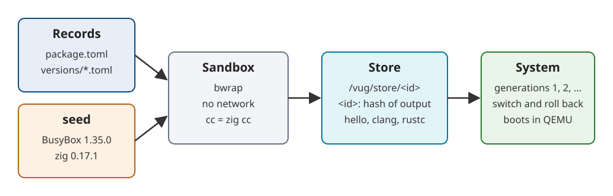

Title: vug: a declarative package manager that builds Linux from TOML records, starting from BusyBox and zig
Date: 2026-11-27 23:11
Updated: 2026-11-27 23:11
Draft: true
Lang: en
Original: /blog/2026/d4bc96
Tags: rust package-management linux zig lean lean-leanfran release rust-vug vug-packages


I wrote vug, a declarative package manager, in Rust.
You write packages, services and systems as TOML records that hold only data, and vug builds them in a sandbox that starts from 2 binaries, BusyBox and zig, all the way up to a Linux system that boots in QEMU.

vug puts each build output in a store directory named after the hash of its contents.
A system is a generation that collects store paths, so you can switch to it and go back to the previous one.

The records live in [conao3/vug-packages](https://github.com/conao3/vug-packages), which held 1,295 packages when I wrote this post.

The repository is [conao3/rust-vug](https://github.com/conao3/rust-vug), under [Apache-2.0](https://github.com/conao3/rust-vug/blob/7026623/LICENSE).
vug-packages is under [MIT](https://github.com/conao3/vug-packages/blob/004fd8f/LICENSE), and this post uses vug 0.2.28 and [004fd8f](https://github.com/conao3/vug-packages/commit/004fd8f) of vug-packages.

<div class="github-card" data-repo="conao3/rust-vug"><a href="https://github.com/conao3/rust-vug"><span class="github-card-name"><svg class="github-card-mark" viewBox="0 0 16 16" aria-hidden="true"><path d="M6.766 11.328c-2.063-.25-3.516-1.734-3.516-3.656 0-.781.281-1.625.75-2.188-.203-.515-.172-1.609.063-2.062.625-.078 1.468.25 1.968.703.594-.187 1.219-.281 1.985-.281.765 0 1.39.094 1.953.265.484-.437 1.344-.765 1.969-.687.218.422.25 1.515.046 2.047.5.593.766 1.39.766 2.203 0 1.922-1.453 3.375-3.547 3.64.531.344.89 1.094.89 1.954v1.625c0 .468.391.734.86.547C13.781 14.359 16 11.53 16 8.03 16 3.61 12.406 0 7.984 0 3.563 0 0 3.61 0 8.031a7.88 7.88 0 0 0 5.172 7.422c.422.156.828-.125.828-.547v-1.25c-.219.094-.5.156-.75.156-1.031 0-1.64-.562-2.078-1.609-.172-.422-.36-.672-.719-.719-.187-.015-.25-.093-.25-.187 0-.188.313-.328.625-.328.453 0 .844.281 1.25.86.313.452.64.655 1.031.655s.641-.14 1-.5c.266-.265.47-.5.657-.656"/></svg><span>conao3/<strong>rust-vug</strong></span></span><span class="github-card-description">A package manager and system builder with declarative TOML package records, a content-addressed store, and sandboxed builds</span><span class="github-card-footer"><span class="github-card-language"><span class="github-card-language-color" style="background-color: #dea584"></span>Rust</span><span class="github-card-star"><svg viewBox="0 0 16 16" aria-hidden="true"><path d="M8 .25a.75.75 0 0 1 .673.418l1.882 3.815 4.21.612a.75.75 0 0 1 .416 1.279l-3.046 2.97.719 4.192a.751.751 0 0 1-1.088.791L8 12.347l-3.766 1.98a.75.75 0 0 1-1.088-.79l.72-4.194L.818 6.374a.75.75 0 0 1 .416-1.28l4.21-.611L7.327.668A.75.75 0 0 1 8 .25Z"/></svg><span>Star</span><span class="github-card-star-count" hidden></span></span></span></a></div>

<div class="github-card" data-repo="conao3/vug-packages"><a href="https://github.com/conao3/vug-packages"><span class="github-card-name"><svg class="github-card-mark" viewBox="0 0 16 16" aria-hidden="true"><path d="M6.766 11.328c-2.063-.25-3.516-1.734-3.516-3.656 0-.781.281-1.625.75-2.188-.203-.515-.172-1.609.063-2.062.625-.078 1.468.25 1.968.703.594-.187 1.219-.281 1.985-.281.765 0 1.39.094 1.953.265.484-.437 1.344-.765 1.969-.687.218.422.25 1.515.046 2.047.5.593.766 1.39.766 2.203 0 1.922-1.453 3.375-3.547 3.64.531.344.89 1.094.89 1.954v1.625c0 .468.391.734.86.547C13.781 14.359 16 11.53 16 8.03 16 3.61 12.406 0 7.984 0 3.563 0 0 3.61 0 8.031a7.88 7.88 0 0 0 5.172 7.422c.422.156.828-.125.828-.547v-1.25c-.219.094-.5.156-.75.156-1.031 0-1.64-.562-2.078-1.609-.172-.422-.36-.672-.719-.719-.187-.015-.25-.093-.25-.187 0-.188.313-.328.625-.328.453 0 .844.281 1.25.86.313.452.64.655 1.031.655s.641-.14 1-.5c.266-.265.47-.5.657-.656"/></svg><span>conao3/<strong>vug-packages</strong></span></span><span class="github-card-description">Package records for vug</span><span class="github-card-footer"><span></span><span class="github-card-star"><svg viewBox="0 0 16 16" aria-hidden="true"><path d="M8 .25a.75.75 0 0 1 .673.418l1.882 3.815 4.21.612a.75.75 0 0 1 .416 1.279l-3.046 2.97.719 4.192a.751.751 0 0 1-1.088.791L8 12.347l-3.766 1.98a.75.75 0 0 1-1.088-.79l.72-4.194L.818 6.374a.75.75 0 0 1 .416-1.28l4.21-.611L7.327.668A.75.75 0 0 1 8 .25Z"/></svg><span>Star</span><span class="github-card-star-count" hidden></span></span></span></a></div>


# What vug does

-   Write packages, services and systems as TOML records that hold only data.
-   Build packages in a sandbox that starts from BusyBox and zig, and put each output in the store under the hash of its contents.
-   Run a program of a package in the store, in an environment that shows the store at `/vug/store`.
-   Write a disk image that boots in QEMU from a system record.
-   Build the next system on a running machine, switch to it, and go back to the previous generation.
-   Export build outputs to a signed binary cache, and take them from the cache on another machine in place of building.


# Writing a package in TOML

A package record lives in `packages/<first 2 letters of the name>/<name>/` and consists of `package.toml` and one `versions/<version>.toml` per version.
The record for version 2.12.2 of GNU Hello looks like this.

```toml
version = "2.12.2"

[source]
url = "https://ftp.gnu.org/gnu/hello/hello-2.12.2.tar.gz"
sha256 = "5a9a996dc292cc24dcf411cee87e92f6aae5b8d13bd9c6819b4c7a9dce0818ab"

[build]
kind = "autotools"
configure-flags = [
  "--disable-nls",
]

[dependencies]
build = [
  "make",
]
run = []

[check]
enabled = true
skip = []
```

A record holds only data: the source URL and its SHA-256, the build kind, and the dependencies.
vug carries the build steps for each build kind, such as `autotools`, `cmake` and `cargo`, and a record names its kind and passes flags.

`vug record check-tree` checks every record in the repository.

```sh
$ vug record check-tree --root .
{
  "Errors": [],
  "Packages": 1295,
  "Systems": 5,
  "Versions": 1328
}
```


# Building in a sandbox that starts from BusyBox and zig



A vug build starts from 2 binaries that vug calls the seed, and vug-packages lists them in `seed.toml`.

```toml
[busybox]
url = "https://busybox.net/downloads/binaries/1.35.0-x86_64-linux-musl/busybox"
sha256 = "6e123e7f3202a8c1e9b1f94d8941580a25135382b99e8d3e34fb858bba311348"

[zig]
url = "https://ziglang.org/download/0.17.1/zig-x86_64-linux-0.17.1.tar.xz"
sha256 = "3581863e3cbcfd0fce0efc682ce7e9e93da96668a977791d356a26d2a7e9b17a"
```

BusyBox from the seed provides `sh`, `tar`, `sed` and the other basic tools, and `cc` and `c++` call `zig cc` and `zig c++`, so make, perl, python, LLVM and the Linux kernel all build from this seed.

The Rust and Go compilers are the binaries their upstreams distribute, unpacked into the store.
At the time of writing, vug takes the outputs of 99 packages from the Nix binary cache.

The build runs under `bwrap --unshare-all`, cut off from the network and the host file system, and sees only the seed, the declared dependencies and the source.

The output goes to `/vug/store/<id>`.
vug computes `<id>` from the BLAKE3 hash of the output's file tree, so the package name and version aren't part of the path.

Putting outputs in a store and switching generations resembles Nix and Guix, but [Nix](https://nix.dev/manual/nix/2.28/store/derivation/outputs/input-address) and [Guix](https://guix.gnu.org/manual/1.4.0/en/html_node/Features.html) derive a store path from the build inputs, and vug derives it from [the hash of the output's contents](https://github.com/conao3/rust-vug/blob/7026623/docs/build.md#store-paths).

An output can contain its own path, so vug installs it into [a placeholder path of the same length](https://github.com/conao3/rust-vug/blob/7026623/docs/build.md#self-references), computes the hash, and then replaces the placeholder with the real path.

```sh
$ vug package build-package --root . --name hello --output text
/vug/store/mrhlynr4ckz4frus7zgii7cj4374xedx
$ vug package run-package --root . --name hello --program bin/hello
Hello, world!
```

`build-package` builds the package when the store has no output for it, and prints the store path.
`run-package` runs the program in a namespace with the store mounted at `/vug/store`, so programs that load shared libraries from the store run too.

vug-packages also has records for LLVM with clang, and for vug itself.

```sh
$ vug package run-package --root . --name llvm:tools --program bin/clang --arguments --version
clang version 23.1.6
Target: x86_64-unknown-linux-musl
Thread model: posix
InstalledDir: /vug/store/5sbeidlvsehmdgmsvswgq56pnvi7aetf/bin
$ vug package run-package --root . --name vug --program bin/vug --arguments --version
vug 0.2.28
```

`llvm:tools` names the auxiliary tools among the outputs of the LLVM package.


# Building a system and booting it in QEMU

A system record lists a kernel, packages, files below `/etc`, and users.
`systems/minimal.toml` in vug-packages is a system that prints the versions of a few commands at boot and then runs bash.

```toml
name = "minimal"
kernel = "linux"
init = "{pkg:bash}/bin/bash /etc/vug-init"
sh = "{pkg:bash}/bin/bash"
packages = [
  "bash",
  "coreutils",
  "findutils",
  "grep",
  "procps",
  "sed",
  "util-linux",
]

[[file]]
path = "/etc/vug-init"
mode = "755"
content = """
#!/bin/bash
export PATH=/bin
mount -t sysfs sys /sys
echo "vug system: $(cat /etc/hostname)"
bash --version | head -n 1
ls --version | head -n 1
mount --version
uname -srm
echo "processes: $(ps -e | wc -l)"
echo VUG-SYSTEM-OK
exec bash
"""
```

`vug system build-image` builds the system into the store and writes a disk image.
`Kernel` in the JSON that `build-image` prints is the path of the kernel file, and you pass it to QEMU to boot.

```sh
$ KERNEL=$(vug system build-image --root . --name minimal --image minimal.img | jq -r .Kernel)
$ qemu-system-x86_64 -enable-kvm -m 2048 -nographic \
    -kernel "$KERNEL" \
    -drive file=minimal.img,if=virtio,format=raw \
    -append "console=ttyS0 root=/dev/vda rw init=/vug/profiles/system/init"
```

Apart from the kernel log, the serial console shows the following.

```sh
vug system: vug-minimal
GNU bash, version 5.3.0(1)-release (x86_64-unknown-linux-musl)
ls (GNU coreutils) 9.12
mount from util-linux 2.41.2 (libmount 2.41.2: namespaces, idmapping, fd-based-mount, statx, assert, debug)
Linux 6.18.45 x86_64
processes: 38
VUG-SYSTEM-OK
```

On a running machine, you edit the records in `/vug/tree` and run `vug system switch-system`, and vug builds the next system on the machine and switches to it.
Each switch adds a generation, and running `/vug/profiles/system-<N>/bin/switch-to-system` takes you back to generation N.

I describe switching systems and going back to an earlier generation in [docs/system.md](https://github.com/conao3/rust-vug/blob/7026623/docs/system.md#switching).

vug-packages also has [a system with systemd, PAM and sshd](https://github.com/conao3/vug-packages/blob/004fd8f/systems/systemd.toml) and [a system on a GPT disk that boots through EFI](https://github.com/conao3/vug-packages/blob/004fd8f/systems/generic.toml).
You can add a sway desktop to a system with [its sway service](https://github.com/conao3/vug-packages/blob/004fd8f/services/sway.toml).
I have booted systems built with vug only in QEMU, and as the [rust-vug README](https://github.com/conao3/rust-vug/blob/7026623/README.md#vug) says, they haven't run on real hardware yet.


# Sharing build outputs through a binary cache

`vug store export-cache` writes the outputs in the store to a directory you can serve over HTTP, and signs each entry with Ed25519.
On another machine, you pass `--binary-cache` and `--trusted-key` to the build, and vug takes from the cache only the outputs that the trusted key signed.
I describe the layout of a cache in [docs/cache.md](https://github.com/conao3/rust-vug/blob/7026623/docs/cache.md).


# Writing version comparison and naming rules in Lean 4

I wrote vug's version comparison and the rules for package names and paths in Lean 4, and [leanfran](https://github.com/conao3/lean-leanfran) turns them into Rust.

```sh
$ vug version compare-versions --left 1.2.10 --right 1.2.9
{
  "Ordering": "Greater"
}
```

vug compares runs of digits in a version as numbers, so 1.2.10 is greater than 1.2.9.

For any 2 strings, I proved in Lean that [swapping the arguments reverses the result](https://github.com/conao3/rust-vug/blob/7026623/src/version.rs#L422) of this comparison, and that [the less-than relation is transitive](https://github.com/conao3/rust-vug/blob/7026623/src/version.rs#L444).
The proofs are about the Lean definitions; whether the Rust code that leanfran generates behaves like those definitions lies outside the proofs.


# Installing vug

The [release](https://github.com/conao3/rust-vug/releases/tag/v0.2.28) has a statically linked executable for x86\_64 Linux.

```sh
$ curl -sL https://github.com/conao3/rust-vug/releases/download/v0.2.28/vug-0.2.28-x86_64-linux-musl.tar.gz | tar xz
$ ./vug --version
vug 0.2.28
```

Building packages requires `bwrap` on `PATH`.
With an empty store, the first build fetches the seed and builds the tool chain from it.


# Wrapping up

A record holds only data, so to add a package you write the source URL, its SHA-256, the build kind and the dependencies, then check it with `check-tree` and a build.
Read the records in vug-packages and try building a package you like with vug.

