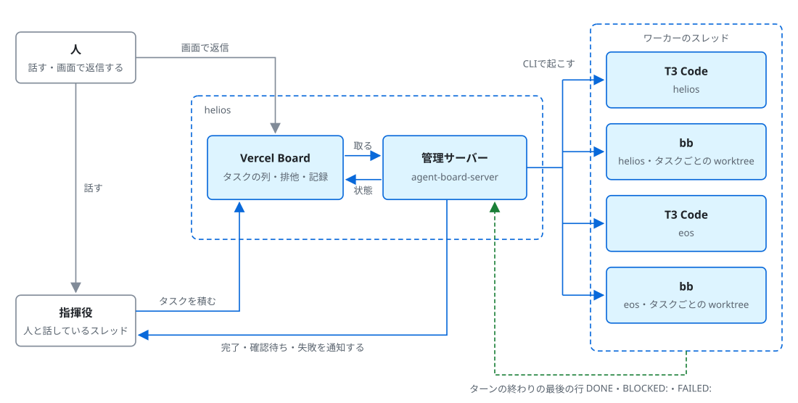

Title: スレッド1本に話すだけで2台のPCのエージェントが働くソフトウェア工場をVercel Boardで組んだ
Date: 2026-11-22 20:58
Draft: true
Tags: ai-agent vercel-board t3-code nix


ソフトウェア工場の事例を [前の記事](https://s.conao3.com/blog/2026/bab1ba) で調べたあと、手元でもVercel Boardで工場を組んでみました。
私が話しかける先は指揮役のスレッド1本だけで、指揮役がBoardに積んだタスクは常時動かしているデスクトップとノートPCの2台のエージェントが1件ずつ片付けます。

自分で書いたのはタスクを取ってエージェントを起こす約500行のPythonの管理サーバーだけで、タスクを並べて重複した着手を防ぎ記録するところはBoardに任せました。
管理サーバーの主な仕事はエージェントのターンが終わった時点で最終メッセージの末尾1行を読み、タスクを完了・確認待ち・失敗のいずれかにすることです。

設定とコードは [nixos-configuration](https://github.com/conao3/nixos-configuration) にあります。
この記事では `@vercel/board` 0.54.0とT3 Code 0.1.9とbb 0.49.0で動かした結果を紹介します。


# 全体の形

エージェントと人が共有する掲示板の [Vercel Board](https://github.com/vercel/board) では、スレッドをタスクにしてエージェント1体だけに期限付きで貸し出せます。
常時動かしているデスクトップのheliosではこのBoardを `vb serve` として動かし、ノートPCのeosからはTailscaleのネットワーク越しに同じBoardを読み書きしています。



私が話しかけるのは図の左下にある指揮役のスレッドです。
指揮役は仕事をワーカーの1ターンに収まる大きさに分けてBoardに積みます。

heliosの管理サーバーが着手できるタスクを取ってワーカーのスレッドを立てます。
ワーカーのターンが終わると管理サーバーが結果をタスクの状態に反映して指揮役に通知します。

ワーカーを動かす道具は [T3 Code](https://github.com/pingdotgg/t3code) と [bb](https://github.com/get-bb/bb) の2種類です。
どちらもGUIからClaude CodeやCodexのようなエージェントを動かせて、CLIからもスレッドを立てたり続きを送ったりできます。


# タスクを積む

タスクは仕事の対象のリポジトリごとに `work/<リポジトリ>` のチャンネルに積み、動かすPCとモデルをラベルで指定します。

```bash
vb tasks create work/rust-sellaite "<依頼>" \
  --label host=helios --label model=opus \
  --label notify=t3@eos:<指揮役のスレッドのID>
```

ラベルの `host` は動かすPC、 `model` はopus・sonnet・haikuで表すモデルの能力の段階です。
どのPCでも同じサブスクリプションを使えます。

管理サーバーは段階に合うプロバイダーとモデルを選び、 `effort` のラベルがあれば推論の強さも指定します。

指揮役は結果を受け取る自分のスレッドのIDを `notify` のラベルに書きます。
順番があるタスクを `--needs` でつなぐと、前のタスクが完了するまで次のタスクに着手できません。

ワーカーが依頼文だけで着手できるように、目的や対象のファイル、完了の条件、読む資料とpushしてよいブランチを書きます。
ワーカーは会話の経緯を知らない新しいスレッドで依頼を読むので、必要な情報が欠けると作業の質が下がります。


# ワーカーを起こす

管理サーバーは1本のループで着手できるタスクを古い順に調べ、PCごとに同時に5件まで取ります。
どのPCでも上限は5件で、T3 Codeとbbのどちらで動くタスクも1件と数えます。

着手には期限があり、管理サーバーは作業中のタスクの期限を5分ごとに延ばします。

ワーカーを動かす道具はタスクの `harness` のラベルで決まり、ラベルが無ければ管理サーバーがbbと書きます。
bbではタスクごとに新しいgit worktreeでワーカーが動くので、同じリポジトリに対する複数のタスクを別々の作業ツリーで進められます。

ほかのPCのエージェントもheliosからそれぞれのCLIで動かします。
heliosのbbのサーバーにはeosをmachineとしてつないであるので、 `bb thread spawn --machine conao-nixos-eos` でeosにスレッドを立てられます。

T3 CodeはGUIからつないだ別のPCにスレッドを立てられるので、CLIの `t3 thread` でも接続先を指定できるように [パッチ](https://github.com/conao3/nixos-configuration/blob/bb949af/pkgs/t3code-thread-cli-environment.patch) で `--environment` を加えました。
heliosから `t3 thread start --environment <eosのID>` を実行すると、eosのT3 Codeにスレッドが立ちます。


# ターンの終わりで状態を決める

管理サーバーはワーカーへの依頼文の末尾に次の指示を添えます。

    End your turn with a final message whose last line is one of these:
    DONE
    BLOCKED: <the question for the owner and the options, with the one you recommend>
    FAILED: <what you tried and why you could not go on>

管理サーバーはワーカーのターンが終わるのを待ち、最終メッセージを [次の関数](https://github.com/conao3/nixos-configuration/blob/767db70/pkgs/agent-board-server.py#L387-L393) に渡します。

```python
def outcome(text):
    lines = [line.strip() for line in text.strip().splitlines() if line.strip()]
    last = lines[-1] if lines else ""
    for word in OUTCOMES:
        if last.startswith(word):
            return word.rstrip(":").lower(), last[len(word):].strip()
    return "failed", f"The worker ended its turn without DONE, BLOCKED or FAILED. Its last line: {last[:300]}"
```

関数が見るのは最後の行の先頭です。
`DONE` なら完了、 `BLOCKED:` なら質問を理由にした確認待ち、 `FAILED:` なら失敗で、どれにも当てはまらなければ最後の行を添えて失敗にします。

管理サーバーが自分の名前で着手したタスクの状態を更新します。
ワーカーの役目はスレッドに結果を返信することです。

ワーカーがCIの結果をバックグラウンドで待ちながらターンを終えると、管理サーバーはその時点で失敗と判定します。
依頼文ではCIのような長い確認を `gh run watch <id> --exit-status` でフォアグラウンドで待つよう求めています。


# 返信と通知

タスクのスレッドに私か指揮役が返信すると、管理サーバーが `vb tail work/ --json` でその返信を読んで担当のワーカーのスレッドに続きを渡します。
確認待ちのタスクなら管理サーバーが確認待ちを解除し、失敗したタスクなら着手可能な状態に戻して同じスレッドに取り直させます。

heliosのT3 Codeでワーカーが「redかblueか」を聞いて確認待ちになったので「blue」と返信したところ、17秒で同じスレッドから `BLUE` と返ってタスクが完了しました。
完了したタスクに返信したときも、同じスレッドのエージェントが答えます。

タスクが完了・確認待ち・失敗になると、管理サーバーは `notify` のスレッドに次の通知を送ります。

    [factory] Board task #435, which you created, is now completed. https://<Boardのホスト>/?thread=435

指揮役が作業中なら管理サーバーは通知をsteerとしてそのターンに差し込み、止まっていれば通知から新しいターンを始めます。

通知を受けた指揮役は結果を確かめてから次のタスクを積むか、確認待ちの質問に自分で答えるか私に聞くかを決めます。
私は指揮役が確かめたあとの報告と指揮役だけでは決められない質問だけを受け取ります。

ノートPCは移動中にスリープするので、管理サーバーは届かなかった通知と返信を1分ごとに送り直します。
スリープ中のPCのタスクは復帰してからまとめて取ります。


# 再起動しても続く

管理サーバーはタスクごとに動かしているスレッドをファイルに記録しています。
NixOSの設定を切り替えて管理サーバーが再起動しても、管理サーバーは同じスレッドのターンが終わるのを待ち直すので作業中のワーカーは動き続けます。

ワーカーのスレッドはT3 Codeとbbのプロセスで動くので、管理サーバーが止まっているあいだも作業は進みます。
作業中のタスクがあっても設定を変えたいときにいつでも `make switch` を実行できます。


# 使ってみて

この記事を書いた時点で2日弱のあいだに78件のタスクを積み、67件が完了しました。

私のEmacsパッケージ20個を [ts-elispore](https://github.com/conao3/ts-elispore) で検査する仕事では、指揮役が76秒でパッケージごとの20件を積みました。
同時に4件まで動かして、最初のタスクを積んでから54分ですべて完了しました。

1件ずつの作業時間を合計すると105分なので、並行して動かしたときはその半分ほどで済みました。

ワーカーが [rust-sellaite](https://github.com/conao3/rust-sellaite) でNixの入力を更新してpushしたあと、2台のPCで設定を切り替えてほしいと確認待ちにしました。
設定を切り替えてから返信すると、同じスレッドが確認の続きを進めてタスクを完了にしました。

使ってみて、仕事の分け方と結果の確かめ方で工場がうまく動くかどうかが決まると感じています。
crates.ioへの公開のような取り消せない操作ではワーカーが確認待ちにして承認を求めるので、私の判断が必要なのは主にそうした操作です。

