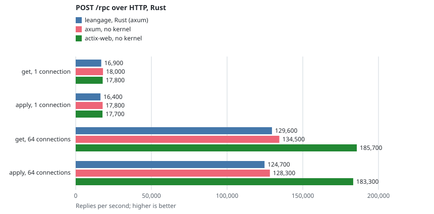

Title: Lean 4で証明したkernelをRustとPythonとGoのHTTPサーバーにするleangageを作った
Date: 2026-11-26 13:10
Updated: 2026-11-26 13:10
Draft: true
Tags: lean rust python go formal-verification code-generation postgresql performance release lean-leangage lean-leanfran


Lean 4で書いて証明した関数を、RustとPythonとGoのHTTPサーバーとして動かすwebフレームワークのleangageを作りました。
サービスのロジックを1つの関数にまとめてLeanで証明すると、認可やテナントの分離のような性質を定理として持ったまま、3つの言語で同じサーバーを動かせます。

リポジトリは[conao3/lean-leangage](https://github.com/conao3/lean-leangage)で、ライセンスはApache-2.0です。
パッケージの登録先には出していないので、この記事はリポジトリのcommit [6fb2663](https://github.com/conao3/lean-leangage/tree/6fb2663)をもとに書いています。

設計は[h5i-app](https://github.com/h5i-dev/h5i/blob/main/crates/h5i-app/README.md)を参考にしています。
h5i-appはRustで書いたロジックを[Aeneas](https://github.com/AeneasVerif/aeneas)でLeanに訳して証明するフレームワークで、leangageは向きを逆にして、Leanで書いたロジックを各言語に変換します。

<div class="github-card" data-repo="conao3/lean-leangage"><a href="https://github.com/conao3/lean-leangage"><span class="github-card-name"><svg class="github-card-mark" viewBox="0 0 16 16" aria-hidden="true"><path d="M6.766 11.328c-2.063-.25-3.516-1.734-3.516-3.656 0-.781.281-1.625.75-2.188-.203-.515-.172-1.609.063-2.062.625-.078 1.468.25 1.968.703.594-.187 1.219-.281 1.985-.281.765 0 1.39.094 1.953.265.484-.437 1.344-.765 1.969-.687.218.422.25 1.515.046 2.047.5.593.766 1.39.766 2.203 0 1.922-1.453 3.375-3.547 3.64.531.344.89 1.094.89 1.954v1.625c0 .468.391.734.86.547C13.781 14.359 16 11.53 16 8.03 16 3.61 12.406 0 7.984 0 3.563 0 0 3.61 0 8.031a7.88 7.88 0 0 0 5.172 7.422c.422.156.828-.125.828-.547v-1.25c-.219.094-.5.156-.75.156-1.031 0-1.64-.562-2.078-1.609-.172-.422-.36-.672-.719-.719-.187-.015-.25-.093-.25-.187 0-.188.313-.328.625-.328.453 0 .844.281 1.25.86.313.452.64.655 1.031.655s.641-.14 1-.5c.266-.265.47-.5.657-.656"/></svg><span>conao3/<strong>lean-leangage</strong></span></span><span class="github-card-description">Web services whose core is a kernel proved in Lean 4, generated to Rust, Python and Go with leanfran</span><span class="github-card-footer"><span class="github-card-language"><span class="github-card-language-color" style="background-color: #dea584"></span>Rust</span><span class="github-card-star"><svg viewBox="0 0 16 16" aria-hidden="true"><path d="M8 .25a.75.75 0 0 1 .673.418l1.882 3.815 4.21.612a.75.75 0 0 1 .416 1.279l-3.046 2.97.719 4.192a.751.751 0 0 1-1.088.791L8 12.347l-3.766 1.98a.75.75 0 0 1-1.088-.79l.72-4.194L.818 6.374a.75.75 0 0 1 .416-1.28l4.21-.611L7.327.668A.75.75 0 0 1 8 .25Z"/></svg><span>Star</span><span class="github-card-star-count" hidden></span></span></span></a></div>


# kernelとサーバー

leangageでは、サービスのロジックを書いた関数をkernelと呼びます。
テナントはサービスを使う組織ごとの区画のことで、kernelは1つのテナントの状態だけを見ます。

kernelは呼び出した利用者とテナントの状態と命令の3つを受け取ります。
命令を受け付けるなら状態への書き込みと返信を返し、受け付けないならエラーを返します。


Leanにはkernelのほかに、どのサービスでも使う部品が書いてあります。
認可のguardとSQLのコンパイラとtokenの形式に加えて、JSONを書く関数がその部品です。

要求を命令に直す関数と、kernelの結果を返信に直す関数も、サービスごとにLeanで書きます。

これらを[leanfran](https://s.conao3.com/blog/2026/23d62c)の0.13.2でRustとPythonとGoのコードに変換しています。
読んだ要求をどの命令として扱い、どんな返信を返すかは、この変換したコードが決めます。

HTTPの受け付けと署名の計算と状態の保存の3つは、言語ごとに手で書いています。
本文のJSONは、それぞれの言語のライブラリで読みます。
状態の置き場所はメモリとPostgreSQLから選べます。


# 電卓のkernelを書く

最初の例は利用者ごとに数を1つ覚えておく電卓で、kernelは[lean/Calculator/Kernel.lean](https://github.com/conao3/lean-leangage/blob/6fb2663/lean/Calculator/Kernel.lean)の `transition` という関数です。
`actor` が呼び出した利用者で、 `snap` がテナントの状態です。

```lean
def transition (actor : Principal) (snap : Snapshot) (cmd : Command) :
    Except Error (Option Memory × Reply) :=
  match cmd with
  | .set value => .ok (some { user := actor.user, value }, .value value)
  | .apply op arg =>
    match compute op (memoryOf snap.memories actor.user) arg with
    | .ok v => .ok (some { user := actor.user, value := v }, .value v)
    | .error e => .error e
  | .get => .ok (none, .value (memoryOf snap.memories actor.user))
```

命令は `set` と `apply` と `get` の3つです。
`set` は数を覚え、 `apply` は覚えている数に演算をして結果を覚え直し、 `get` は覚えている数を返します。

返り値の `Option Memory` は状態に書き込む行で、 `get` のように何も書き込まない命令では `none` になります。
結果が64bitに収まらない演算と0での割り算は `Error` を返して、何も書き込みません。


# kernelの性質を証明する

この関数の性質は[lean/Calculator/Proofs.lean](https://github.com/conao3/lean-leangage/blob/6fb2663/lean/Calculator/Proofs.lean)で証明しています。
たとえば次の `others_unchanged` は、ある利用者の命令がほかの利用者の数を変えないという定理です。

```lean
theorem others_unchanged (a : Principal) (s : Snapshot) (c : Command) (w : Option Memory)
    (r : Reply) (ht : transition a s c = .ok (w, r)) (u : UInt64) (hu : u ≠ a.user) :
    memoryOf (apply s w).memories u = memoryOf s.memories u
```

仮定の `ht` は命令が受け付けられたことを表し、 `hu` は `u` が呼び出した利用者とは別の利用者であることを表します。
結論は、書き込みを反映したあとの `u` の数が反映する前と同じだという等式です。

ほかの定理には次のものがあります。

<table border="2" cellspacing="0" cellpadding="6" rules="groups" frame="hsides">


<colgroup>
<col  class="org-left" />

<col  class="org-left" />
</colgroup>
<thead>
<tr>
<th scope="col" class="org-left">定理</th>
<th scope="col" class="org-left">内容</th>
</tr>
</thead>
<tbody>
<tr>
<td class="org-left"><code>transition_spec</code></td>
<td class="org-left">返信は、桁の上限がない自然数で同じ計算をした結果と一致し、命令を拒否するのは結果が64bitに収まらないときと0で割るときだけである</td>
</tr>

<tr>
<td class="org-left"><code>get_after</code></td>
<td class="org-left">受け付けられた命令のあとで同じ利用者が <code>get</code> を呼ぶと、その命令の返信と同じ数が返る</td>
</tr>

<tr>
<td class="org-left"><code>read_only_sound</code></td>
<td class="org-left"><code>get</code> は何も書き込まない</td>
</tr>
</tbody>
</table>


# サーバーを動かす

Rustのサーバーは変換したkernelをaxumのrouterの後ろに置いたものです。

```console
$ export LEANGAGE_SECRET=dev-secret
$ TOKEN=$(LEANGAGE_ISSUE=1:7 cargo run --release -q --bin leangage-calculator)
$ LEANGAGE_LISTEN=127.0.0.1:8080 cargo run --release -q --bin leangage-calculator &
$ curl -s -H "Authorization: Bearer $TOKEN" -d '{"cmd":"set","value":6}' 127.0.0.1:8080/rpc
{"value":6}
$ curl -s -H "Authorization: Bearer $TOKEN" -d '{"cmd":"apply","op":"mul","arg":7}' 127.0.0.1:8080/rpc
{"value":42}
$ curl -s -H "Authorization: Bearer $TOKEN" -d '{"cmd":"apply","op":"div","arg":0}' 127.0.0.1:8080/rpc
{"error":"division_by_zero"}
```

`LEANGAGE_SECRET` は署名の鍵で、 `LEANGAGE_ISSUE=1:7` を付けて起動するとテナント1の利用者7のtokenを出力して終わります。

要求が届くと、サーバーは変換した関数を順に呼びます。
最初の関数は `Authorization` ヘッダーからtokenを取り出して、署名を計算する範囲のbytesを返します。

サーバーはこのbytesの署名をHMAC-SHA256で確かめます。

本文のJSONは、それぞれの言語のJSONのライブラリで読みます。
Rustではserde\_json、Pythonでは標準の `json` 、Goでは `encoding/json` です。
サーバーは読んだ結果を、かっこと名前と値が本文と同じ順に並ぶトークンの列にして、次の関数に渡します。

次の関数はtokenの期限を調べて、このトークンの列を命令に直します。
kernelが命令を処理すると、最後の関数がその結果から状態コードと本文を決めます。

手で書いたコードは、ヘッダーとトークンの列を変換した関数に渡して、関数が返した状態コードと本文をそのまま送ります。
JSONのライブラリを呼ぶコードは、言語ごとに1つのファイルにまとめてあります。
このファイルは本文をトークンの列に直します。
どの名前があるかも、値が命令に合うかも判断しません。

要求を処理する経路にある10個のファイルがJSONのライブラリを呼んでいないことを、 `make check` が検査しています。
状態コードを自分で決めていないことも検査しています。

トークンの列を命令に直す関数にも定理があります。
たとえば `decode_ok_iff` は、どのトークンの列がどの命令として読まれるかを述べる定理です。
トークンの列がその命令のフィールドだけを持つJSONのオブジェクトであれば命令として読まれ、そうでなければ読まれません。
フィールドの順序は問いません。

PythonとGoのサーバーも同じLeanのファイルから変換したkernelを動かします。
3つのサーバーは同じ命令に同じ返信をして、1つのサーバーが出したtokenはほかの2つでも使えます。

```console
$ cd python && LEANGAGE_LISTEN=127.0.0.1:8081 uv run leangage-calculator &
$ cd go && LEANGAGE_LISTEN=127.0.0.1:8082 go run ./calculator/cmd/leangage-calculator &
```


# 認可をguardに任せる

2つ目の例は、組織のメンバーがノートを書くサービスです。
共有したノートは組織の全員が読めて、共有していないノートは持ち主と管理者だけが読めます。

このkernelは[lean/Notes/Kernel.lean](https://github.com/conao3/lean-leangage/blob/6fb2663/lean/Notes/Kernel.lean)にあって、命令の処理と認可を分けて書いています。
命令の処理は `handle` という関数に書き、誰が何を読み書きしてよいかは方針として別の関数に書きます。

方針の関数では、 `permits` が書き込みを許すかを返し、 `visible` が行を見せてよいかを返します。
サーバーが呼ぶ `transition` は `handle` をleangageのguardに通したものです。

```lean
def transition (a : Principal) (s : Snapshot) (c : Command) :
    Except (Guarded Error) (List Write × Reply) :=
  guardViewed handle apply ⟨permits, visible, stored⟩ disclosed readOnly view a s c
```

guardは `handle` が返した書き込みと、返信に含まれる行を1件ずつ方針に照らします。
1件でも方針が許さなければ、命令の全体を `denied` で拒否して何も書き込みません。

guardについての定理は[lean/Leangage/AuthzProofs.lean](https://github.com/conao3/lean-leangage/blob/6fb2663/lean/Leangage/AuthzProofs.lean)にあります。
kernelと方針を引数に取る形で証明してあるので、自分のkernelをguardに通せば同じ定理が使えます。

<table border="2" cellspacing="0" cellpadding="6" rules="groups" frame="hsides">


<colgroup>
<col  class="org-left" />

<col  class="org-left" />
</colgroup>
<thead>
<tr>
<th scope="col" class="org-left">定理</th>
<th scope="col" class="org-left">内容</th>
</tr>
</thead>
<tbody>
<tr>
<td class="org-left"><code>guard_authorized</code></td>
<td class="org-left">guardが受け付けた命令では、どの書き込みも方針が許していて、返信に含まれるどの行も呼び出した利用者に見せてよい行である</td>
</tr>

<tr>
<td class="org-left"><code>guard_complete</code></td>
<td class="org-left">書き込みと行がすべて方針に合う命令を、guardは拒否しない</td>
</tr>

<tr>
<td class="org-left"><code>guard_viewed_noninterference</code></td>
<td class="org-left">見てよい行が同じである2つの状態は、読み取りだけの命令に同じ結果を返す</td>
</tr>
</tbody>
</table>

`guard_viewed_noninterference` は、読み取りだけの命令の結果が見てはいけない行に左右されないことを言っています。

ノートのサーバーで、利用者1が共有していないノートを書き、利用者2がそれを読もうとしてみます。

```console
$ A=$(LEANGAGE_ISSUE=1:1 cargo run --release -q --bin leangage-notes)
$ B=$(LEANGAGE_ISSUE=1:2 cargo run --release -q --bin leangage-notes)
$ LEANGAGE_LISTEN=127.0.0.1:8080 cargo run --release -q --bin leangage-notes &
$ curl -s -H "Authorization: Bearer $A" -d '{"cmd":"add_member","user":1,"admin":true}' 127.0.0.1:8080/rpc
{"done":true}
$ curl -s -H "Authorization: Bearer $A" -d '{"cmd":"put_note","id":7,"body":"draft","shared":false}' 127.0.0.1:8080/rpc
{"done":true}
$ curl -s -H "Authorization: Bearer $B" -d '{"cmd":"read_note","id":7}' 127.0.0.1:8080/rpc
{"error":"not_found"}
$ curl -s -H "Authorization: Bearer $B" -d '{"cmd":"put_note","id":7,"body":"mine now","shared":true}' 127.0.0.1:8080/rpc
{"error":"denied"}
```

利用者2にはノートが無いときと同じ `not_found` が返り、利用者2がそのノートを書き換えようとするとguardが `denied` で拒否します。
ノートのHTTPサーバーはRustにだけあって、PythonとGoでは変換したノートのkernelをテストの中で動かしています。


# PostgreSQLに保存する

環境変数の `LEANGAGE_DATABASE_URL` にPostgreSQLの接続先を渡すと、サーバーは状態をメモリの代わりにPostgreSQLに保存します。
電卓の3つのサーバーとノートのRustのサーバーがこれに対応しています。

kernelの側では、表の定義と、状態の行を表の行に変換する関数をLeanで書きます。

```lean
def tables : List Tab := [⟨"memories", [⟨"user", .int, false⟩, ⟨"value", .int, false⟩], 1⟩]

def toRow (m : Memory) : List Val := [.int m.user.toInt64, .int m.value.toInt64]

def fromRow : List Val → Option Memory
  | [.int user, .int value] => some { user := user.toUInt64, value := value.toUInt64 }
  | _ => none
```

SQLの文はLeanで書いたコンパイラがこの定義から作ります。
コンパイラはどの表にも `tenant_id` の列を足し、 `SELECT` と `DELETE` にはテナントを絞る条件を付けます。

サーバーは `SERIALIZABLE` のtransactionの中でテナントの行を読んで状態を作り、kernelを呼んで、コンパイラが作った文を送ります。
同じテナントへの命令が続くときは前の命令のあとの状態を覚えておき、ほかのサーバーから書き込まれていなければ行を読み直しません。

コンパイラについての定理は、Leanで書いたPostgreSQLのモデルに対して証明しています。
モデルは `CREATE TABLE` と `INSERT` と `DELETE` と `SELECT` が表の行をどう変えるかをLeanの関数として書いたものです。

<table border="2" cellspacing="0" cellpadding="6" rules="groups" frame="hsides">


<colgroup>
<col  class="org-left" />

<col  class="org-left" />
</colgroup>
<thead>
<tr>
<th scope="col" class="org-left">定理</th>
<th scope="col" class="org-left">内容</th>
</tr>
</thead>
<tbody>
<tr>
<td class="org-left"><code>compile_sound</code></td>
<td class="org-left">コンパイラが作った文は実行でき、そのテナントの行だけが書き込みのとおりに変わる</td>
</tr>

<tr>
<td class="org-left"><code>select_sound</code></td>
<td class="org-left">コンパイラが作った <code>SELECT</code> は、そのテナントの行のうち条件に合うものを1回ずつ返す</td>
</tr>

<tr>
<td class="org-left"><code>tenant_isolation</code></td>
<td class="org-left">あるテナントのために作った文はほかのテナントの行を変えず、 <code>SELECT</code> が返す行はそのテナントの行だけで決まる</td>
</tr>
</tbody>
</table>

保存した行から読み戻した状態が、保存する前の状態と同じ返信をすることも証明しています。
この定理は `stored_transition` という名前で、電卓とノートのそれぞれにあります。


# 証明していないところ

定理はLeanで書いた関数に対して証明しています。
サーバーはその関数をleanfranで変換したコードを動かします。
leangageはleanfranを信頼していて、変換したコードがLeanの関数と同じ結果を返すことを前提にしています。

この前提を確かめるテストも置いていて、同じ入力をLeanが直接コンパイルした関数と3つの言語の関数に渡して出力を比べます。
電卓では5,000件の命令と3,000行の要求で、どの言語の出力もLeanの出力と一致します。

定理が関数の書き換えを見逃さないかは[leanassay](https://s.conao3.com/blog/2026/51d6b7)で調べています。
leanassayは関数を少しずつ書き換えて、書き換えたあとも定理が成り立ってしまうものを探す道具です。

手で書いた部分と各言語のライブラリは証明の外にあって、大きく分けると4つです。
HTTPと状態の保存を証明の外に置くところは、h5i-appと同じです。

1つ目はHTTPの受け付けで、axumと `http.server` と `net/http` に任せています。
2つ目は署名の計算で、HMAC-SHA256と鍵の保管と時計がここに入ります。
3つ目は状態の保存で、メモリの上の排他制御とPostgreSQLとのやり取りが入ります。
4つ目はJSONの読み取りで、serde\_jsonと `json` と `encoding/json` に任せています。

変換した関数の間をつなぐ処理も手で書いています。
ライブラリが読んだ結果をトークンの列に直す処理と、保存の失敗を返信の種類に対応づける処理がこれに当たります。

PostgreSQLがLeanで書いたモデルのとおりに動くことも前提にしています。
サーバーとPostgreSQLの組み合わせは、COMMITの応答を落とすproxyを挟むテストや、処理の途中で接続を切るテストで確かめています。

JSONの読み取りをライブラリに任せているので、3つの言語のサーバーが違う答えを返す本文があります。
テストで見つけた違いは3つです。

対になっていないサロゲートのエスケープ ( `"\ud800"` ) を、serde\_jsonとPythonのサーバーは拒否し、 `encoding/json` はU+FFFDに置き換えて読みます。
配列の入れ子は、serde\_jsonが深さ127まで読みます。
`encoding/json` は深さ10,000まで読み、Pythonは深さ2,000の本文も読みます。
`1e400` のように倍精度の範囲を超える数は、serde\_jsonだけが拒否します。

この3つを除いて作った3,000行の要求の一覧では、3つの言語の返信が一致します。

何を証明して何を前提にしているかの一覧は[READMEの「What is proved, and what is trusted」](https://github.com/conao3/lean-leangage/tree/6fb2663#what-is-proved-and-what-is-trusted)にあります。


# 速さ

kernelを挟むとどれだけ遅くなるかを、kernelのないサーバーと比べて測りました。
比べる相手は、JSONを読んでJSONを返すだけの各言語のサーバーです。

計測には4 vCPUのXeon 2.10GHzとメモリ16GBのVMを使い、 `oha` で `POST /rpc` に8秒間要求を送って毎秒の返信の件数を数えました。
表の値はどれも2回の平均で、大きいほど速いことを表します。



<table border="2" cellspacing="0" cellpadding="6" rules="groups" frame="hsides">


<colgroup>
<col  class="org-left" />

<col  class="org-left" />

<col  class="org-left" />

<col  class="org-left" />

<col  class="org-left" />
</colgroup>
<thead>
<tr>
<th scope="col" class="org-left">毎秒の返信の件数、Rust</th>
<th scope="col" class="org-left">get、1接続</th>
<th scope="col" class="org-left">apply、1接続</th>
<th scope="col" class="org-left">get、64接続</th>
<th scope="col" class="org-left">apply、64接続</th>
</tr>
</thead>
<tbody>
<tr>
<td class="org-left">leangage (axum)</td>
<td class="org-left">17,800</td>
<td class="org-left">17,100</td>
<td class="org-left">131,200</td>
<td class="org-left">125,900</td>
</tr>

<tr>
<td class="org-left">axum、kernelなし</td>
<td class="org-left">18,300</td>
<td class="org-left">18,600</td>
<td class="org-left">141,300</td>
<td class="org-left">138,200</td>
</tr>

<tr>
<td class="org-left">actix-web、kernelなし</td>
<td class="org-left">18,500</td>
<td class="org-left">18,400</td>
<td class="org-left">178,700</td>
<td class="org-left">185,900</td>
</tr>
</tbody>
</table>

Rustのサーバーは、kernelのないaxumに対して1接続で92〜97%、64接続で91〜93%の件数を返します。
この記事の表のどのセルでも、2回の値の差は16%以内です。

leangageの値はどれも、本文をライブラリで読み、命令への変換と返信の組み立てをLeanから変換した関数が行うサーバーで測りました。

計測の要求はどれも同じtokenを送っています。
サーバーは一度確かめたtokenを覚えているので、同じtokenの要求では署名を計算し直さずに期限だけを確かめます。

本文を読んで命令に直すまでの時間を、別の6コアの機械で測りました。
本文1件にRustで約0.6マイクロ秒、Goで約3マイクロ秒、Pythonで約85マイクロ秒かかり、本文に空白があってもなくても同じです。

Pythonでは、ライブラリが本文を約20マイクロ秒で読んでトークンの列に直します。
変換した関数は約54マイクロ秒かかり、その多くはトークンの列を渡すときと結果を受け取るときの値の変換です。

Goのサーバーは `net/http` の上で動きます。
kernelのない `net/http` に対して、1接続で69〜83%、64接続で57〜63%の件数を返します。


<table border="2" cellspacing="0" cellpadding="6" rules="groups" frame="hsides">


<colgroup>
<col  class="org-left" />

<col  class="org-left" />

<col  class="org-left" />

<col  class="org-left" />

<col  class="org-left" />
</colgroup>
<thead>
<tr>
<th scope="col" class="org-left">毎秒の返信の件数、Go</th>
<th scope="col" class="org-left">get、1接続</th>
<th scope="col" class="org-left">apply、1接続</th>
<th scope="col" class="org-left">get、64接続</th>
<th scope="col" class="org-left">apply、64接続</th>
</tr>
</thead>
<tbody>
<tr>
<td class="org-left">leangage (net/http)</td>
<td class="org-left">11,000</td>
<td class="org-left">9,320</td>
<td class="org-left">58,000</td>
<td class="org-left">48,400</td>
</tr>

<tr>
<td class="org-left">net/http、kernelなし</td>
<td class="org-left">13,200</td>
<td class="org-left">13,600</td>
<td class="org-left">92,500</td>
<td class="org-left">84,200</td>
</tr>

<tr>
<td class="org-left">gin、kernelなし</td>
<td class="org-left">13,100</td>
<td class="org-left">12,100</td>
<td class="org-left">70,700</td>
<td class="org-left">70,100</td>
</tr>
</tbody>
</table>

Pythonのサーバーは `http.server` を1プロセスで動かしています。
1接続ではFastAPIの57〜69%の件数を返し、64接続では4プロセスで動くFastAPIの1割ほどになります。

kernelを速く呼ぶため、サーバーはテナントの状態をLeanの値のまま持ち続けて、呼び出した利用者と命令と返信だけを要求のたびに変換します。
利用者が1,000人のテナントで、Rustに変換したkernelを直接呼んで測りました。

状態も毎回変換する形では毎秒7,400件の命令しか処理できませんが、Leanの値のまま渡す形では同じテナントで毎秒493万件を処理できます。
PostgreSQLに保存する場合の値と計測の手順は[READMEの「Speed」](https://github.com/conao3/lean-leangage/tree/6fb2663#speed)に載せています。


# おわりに

ロジックを1つの関数にまとめると、証明する対象が小さくなって、同じ関数を3つの言語のサーバーで動かせます。
読んだ本文を命令に直すところから返信の組み立てまでLeanで書いてあるので、返信の状態コードと本文は、証明した関数を変換したコードが決めます。

