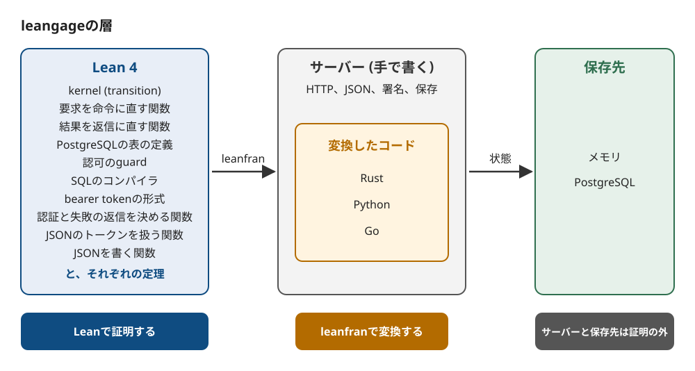
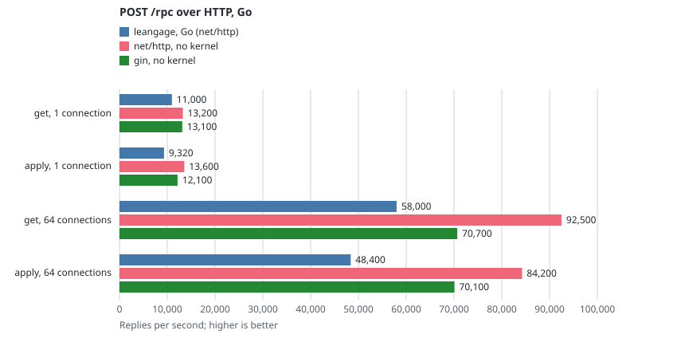

Title: 認可とテナント分離をLean 4で証明し、axumの92〜97%の速さで返すwebフレームワークleangageを作った
Date: 2026-11-26 13:10
Updated: 2026-11-26 13:10
Draft: true
Tags: lean rust python go formal-verification code-generation postgresql performance release lean-leangage lean-leanfran


Webサービスのロジックを1つの関数としてLean 4で書いて証明し、Rust・Python・GoのHTTPサーバーとして動かすwebフレームワークのleangageを作りました。
認可の判定とテナントの分離と保存に使うSQLをLeanの定理で持っていて、Rustのサーバーはkernelを持たないaxumのサーバーの92〜97%の件数を返します。

この値は4 vCPUのVMで `POST /rpc` に1接続と64接続で要求を送ったときのもので、比べたaxumのサーバーはJSONを読んでJSONを返すだけのものです。
同じセルを2回測ると値が最大10%開くので、3〜8%の差は計測の揺れと同じ大きさです。

engineはテナントの状態をLeanの値のまま持ち続けて、要求ごとに変換するものを呼び出し元と命令と返信だけにしています。
生成したkernelを直接呼んで比べると、利用者が1,000人のテナントで、状態を毎回Rustの値から変換する形は毎秒8,660件、Leanの値のまま渡す形は毎秒524万件の命令を処理します。

リポジトリは[conao3/lean-leangage](https://github.com/conao3/lean-leangage)で、ライセンスはApache-2.0です。
この記事はcommit [9039711](https://github.com/conao3/lean-leangage/tree/9039711)を[leanfran](https://s.conao3.com/blog/2026/23d62c) 0.13.2で動かした結果をもとに書いていて、パッケージの登録先には出していません。

leangageはkernelと呼ぶ1つの純粋な関数の形を決めています。
kernelは呼び出した人とテナントの状態と命令を受けて、書き込みと返信を返すか命令を拒否します。

設計は[h5i-app](https://github.com/h5i-dev/h5i/blob/main/crates/h5i-app/README.md)に沿っています。
h5i-appはRustで書いたロジックを[Aeneas](https://github.com/AeneasVerif/aeneas)でLeanに訳して証明するフレームワークで、leangageは向きを逆にしてLeanを元にしています。

<div class="github-card" data-repo="conao3/lean-leangage"><a href="https://github.com/conao3/lean-leangage"><span class="github-card-name"><svg class="github-card-mark" viewBox="0 0 16 16" aria-hidden="true"><path d="M6.766 11.328c-2.063-.25-3.516-1.734-3.516-3.656 0-.781.281-1.625.75-2.188-.203-.515-.172-1.609.063-2.062.625-.078 1.468.25 1.968.703.594-.187 1.219-.281 1.985-.281.765 0 1.39.094 1.953.265.484-.437 1.344-.765 1.969-.687.218.422.25 1.515.046 2.047.5.593.766 1.39.766 2.203 0 1.922-1.453 3.375-3.547 3.64.531.344.89 1.094.89 1.954v1.625c0 .468.391.734.86.547C13.781 14.359 16 11.53 16 8.03 16 3.61 12.406 0 7.984 0 3.563 0 0 3.61 0 8.031a7.88 7.88 0 0 0 5.172 7.422c.422.156.828-.125.828-.547v-1.25c-.219.094-.5.156-.75.156-1.031 0-1.64-.562-2.078-1.609-.172-.422-.36-.672-.719-.719-.187-.015-.25-.093-.25-.187 0-.188.313-.328.625-.328.453 0 .844.281 1.25.86.313.452.64.655 1.031.655s.641-.14 1-.5c.266-.265.47-.5.657-.656"/></svg><span>conao3/<strong>lean-leangage</strong></span></span><span class="github-card-description">Web services whose core is a kernel proved in Lean 4, generated to Rust, Python and Go with leanfran</span><span class="github-card-footer"><span class="github-card-language"><span class="github-card-language-color" style="background-color: #dea584"></span>Rust</span><span class="github-card-star"><svg viewBox="0 0 16 16" aria-hidden="true"><path d="M8 .25a.75.75 0 0 1 .673.418l1.882 3.815 4.21.612a.75.75 0 0 1 .416 1.279l-3.046 2.97.719 4.192a.751.751 0 0 1-1.088.791L8 12.347l-3.766 1.98a.75.75 0 0 1-1.088-.79l.72-4.194L.818 6.374a.75.75 0 0 1 .416-1.28l4.21-.611L7.327.668A.75.75 0 0 1 8 .25Z"/></svg><span>Star</span><span class="github-card-star-count" hidden></span></span></span></a></div>


# 全体の構成

Leanにはサービスごとのkernelと、どのkernelでも使う認可のguard・SQLのコンパイラ・tokenの形式・JSONのwriterを書きます。



これらの定義と定理をLeanに置くと、leanfranが定義をRust・Python・Goのコードにします。
生成したコードを動かす殻は言語ごとに手で書いてあって、HTTPの受け付け・HMACでのtokenの検査・テナントの状態を持つengineが入っています。

engineはメモリに状態を持つものとPostgreSQLに保存するものの2つがあり、kernelの表に送るSQLの文も生成したコンパイラが作ります。


# 電卓のkernelをLeanで書く

最初の例は利用者ごとに数を1つ持つ電卓で、kernelは[lean/Calculator/Kernel.lean](https://github.com/conao3/lean-leangage/blob/9039711/lean/Calculator/Kernel.lean)の `transition` です。

```lean
def transition (actor : Principal) (snap : Snapshot) (cmd : Command) :
    Except Error (Option Memory × Reply) :=
  match cmd with
  | .set value => .ok (some { user := actor.user, value }, .value value)
  | .apply op arg =>
    match compute op (memoryOf snap.memories actor.user) arg with
    | .ok v => .ok (some { user := actor.user, value := v }, .value v)
    | .error e => .error e
  | .get => .ok (none, .value (memoryOf snap.memories actor.user))
```

`actor` はtokenから読んだ呼び出し元で、 `snap` はそのテナントの状態です。
返り値は `Option Memory` が状態に書く行で `Reply` がクライアントに返す値になっていて、64bitに収まらない計算と0での割り算は `Error` になります。

この関数の性質は[lean/Calculator/Proofs.lean](https://github.com/conao3/lean-leangage/blob/9039711/lean/Calculator/Proofs.lean)で証明しています。
たとえば `others_unchanged` は、受理された命令がほかの利用者の数を変えないという定理です。

```lean
theorem others_unchanged (a : Principal) (s : Snapshot) (c : Command) (w : Option Memory)
    (r : Reply) (ht : transition a s c = .ok (w, r)) (u : UInt64) (hu : u ≠ a.user) :
    memoryOf (apply s w).memories u = memoryOf s.memories u
```

ほかに、返信が上限のない自然数の四則演算と一致し、拒否するのは結果が64bitに収まらないときと0で割るときだけだという `transition_spec` があります。
`get` が何も書き込まないという `read_only_sound` も証明していて、PostgreSQLのengineはこの定理を頼りに、idempotency keyのない `get` を読み取り専用のtransactionで動かします。

Rustのサーバーは、生成したkernelをaxumのrouterの後ろに置いたものです。

```console
$ export LEANGAGE_SECRET=dev-secret
$ TOKEN=$(LEANGAGE_ISSUE=1:7 cargo run --release -q --bin leangage-calculator)
$ LEANGAGE_LISTEN=127.0.0.1:8080 cargo run --release -q --bin leangage-calculator &
$ curl -s -H "Authorization: Bearer $TOKEN" -d '{"cmd":"set","value":6}' 127.0.0.1:8080/rpc
{"value":6}
$ curl -s -H "Authorization: Bearer $TOKEN" -d '{"cmd":"apply","op":"mul","arg":7}' 127.0.0.1:8080/rpc
{"value":42}
$ curl -s -H "Authorization: Bearer $TOKEN" -d '{"cmd":"apply","op":"div","arg":0}' 127.0.0.1:8080/rpc
{"error":"division_by_zero"}
```

`LEANGAGE_ISSUE=1:7` はテナント1の利用者7のtokenを発行する指定で、サーバーはtokenの署名と期限を確かめてからkernelを呼びます。

PythonとGoのサーバーも同じLeanのmoduleから生成したkernelを動かしていて、1つのサーバーが発行したtokenをほかの2つも受け付けます。

```console
$ cd python && LEANGAGE_LISTEN=127.0.0.1:8081 uv run leangage-calculator &
$ cd go && LEANGAGE_LISTEN=127.0.0.1:8082 go run ./calculator/cmd/leangage-calculator &
```


# 認可をguardに任せる

2つ目の例は、組織のメンバーがノートを持つサービスです。
共有したノートは全員が読めて、共有していないノートは持ち主と管理者だけが読めます。

kernelの[lean/Notes/Kernel.lean](https://github.com/conao3/lean-leangage/blob/9039711/lean/Notes/Kernel.lean)は、命令が何をするかを決める `handle` と、誰が何を読み書きしてよいかを決める方針を分けて書いています。
方針は `permits` ・ `visible` ・ `stored` のBoolの関数と、呼び出し元が見てよい行を返す `view` で、engineが動かす `transition` は `handle` をguardに通したものです。

```lean
def transition (a : Principal) (s : Snapshot) (c : Command) :
    Except (Guarded Error) (List Write × Reply) :=
  guardViewed handle apply ⟨permits, visible, stored⟩ disclosed readOnly view a s c
```

guardは書き込みを1件ずつ方針に照らし、返信が見せる行も1件ずつ照らして、1つでも許されなければ命令の全体を `denied` で拒否します。
読み取りだけの命令は、呼び出し元が見てよい行だけを残した状態の上で動かします。

guardの定理は[lean/Leangage/AuthzProofs.lean](https://github.com/conao3/lean-leangage/blob/9039711/lean/Leangage/AuthzProofs.lean)にあり、どのkernelとどの方針についても成り立つ形で証明しています。

<table border="2" cellspacing="0" cellpadding="6" rules="groups" frame="hsides">


<colgroup>
<col  class="org-left" />

<col  class="org-left" />
</colgroup>
<thead>
<tr>
<th scope="col" class="org-left">定理</th>
<th scope="col" class="org-left">内容</th>
</tr>
</thead>
<tbody>
<tr>
<td class="org-left"><code>guard_authorized</code></td>
<td class="org-left">guardが受理した命令では、どの書き込みも方針が許していて、返信が見せるどの行も保存されていて見てよい行である</td>
</tr>

<tr>
<td class="org-left"><code>guard_complete</code></td>
<td class="org-left">その条件を満たす命令をguardは拒否しない</td>
</tr>

<tr>
<td class="org-left"><code>guard_viewed_noninterference</code></td>
<td class="org-left">見てよい行が同じ2つの状態は、読み取りだけの命令に同じ結果を返す</td>
</tr>
</tbody>
</table>

`guard_viewed_noninterference` があるので、読み取りだけの命令の返信からは見てはいけない行の有無が漏れません。
ノートのサーバーで試すと、利用者2は共有していないノートを読めず、他人のノートの書き換えは拒否されます。

```console
$ A=$(LEANGAGE_ISSUE=1:1 cargo run --release -q --bin leangage-notes)
$ B=$(LEANGAGE_ISSUE=1:2 cargo run --release -q --bin leangage-notes)
$ LEANGAGE_LISTEN=127.0.0.1:8080 cargo run --release -q --bin leangage-notes &
$ curl -s -H "Authorization: Bearer $A" -d '{"cmd":"add_member","user":1,"admin":true}' 127.0.0.1:8080/rpc
{"done":true}
$ curl -s -H "Authorization: Bearer $A" -d '{"cmd":"put_note","id":7,"body":"draft","shared":false}' 127.0.0.1:8080/rpc
{"done":true}
$ curl -s -H "Authorization: Bearer $B" -d '{"cmd":"read_note","id":7}' 127.0.0.1:8080/rpc
{"error":"not_found"}
$ curl -s -H "Authorization: Bearer $B" -d '{"cmd":"put_note","id":7,"body":"mine now","shared":true}' 127.0.0.1:8080/rpc
{"error":"denied"}
```

ノートのHTTPサーバーがあるのはRustだけです。
PythonとGoのノートのkernelは差分テストの中で動かしています。


# PostgreSQLに保存してテナントを分ける

環境変数の `LEANGAGE_DATABASE_URL` を渡すと、電卓の3つのサーバーとノートのRustのサーバーは状態をPostgreSQLに保存します。
kernelの側は、行と値を相互に変換する関数と表の定義をLeanで書きます。

```lean
def tables : List Tab := [⟨"memories", [⟨"user", .int, false⟩, ⟨"value", .int, false⟩], 1⟩]

def toRow (m : Memory) : List Val := [.int m.user.toInt64, .int m.value.toInt64]

def fromRow : List Val → Option Memory
  | [.int user, .int value] => some { user := user.toUInt64, value := value.toUInt64 }
  | _ => none
```

SQLのコンパイラはどの表にも `tenant_id` の列を足し、 `SELECT` と `DELETE` にはテナントの条件を付けて、 `INSERT` ではテナントを先頭の値にします。

engineは1回の試行を `SERIALIZABLE` のtransaction 1つで動かします。
テナントの版の行を読み、その版の状態を覚えていなければテナントの行を読んで、kernelを呼んだあとにコンパイラが作った文を値をパラメータにして送ります。

コンパイラの定理はLeanで書いたPostgreSQLのモデルに対して述べています。
モデルは表と行と、 `CREATE TABLE` ・ `INSERT` ・ `DELETE` ・ `SELECT` が表に何をするかを定めたものです。

<table border="2" cellspacing="0" cellpadding="6" rules="groups" frame="hsides">


<colgroup>
<col  class="org-left" />

<col  class="org-left" />
</colgroup>
<thead>
<tr>
<th scope="col" class="org-left">定理</th>
<th scope="col" class="org-left">内容</th>
</tr>
</thead>
<tbody>
<tr>
<td class="org-left"><code>compile_sound</code></td>
<td class="org-left">コンパイルした文は実行でき、そのテナントの行だけが書き込みのとおりに変わる</td>
</tr>

<tr>
<td class="org-left"><code>select_sound</code></td>
<td class="org-left">コンパイルした <code>SELECT</code> は、そのテナントの条件に合う行を1回ずつ返す</td>
</tr>

<tr>
<td class="org-left"><code>tenant_isolation</code></td>
<td class="org-left">あるテナントの文はほかのテナントの行を変えず、 <code>SELECT</code> の結果はそのテナントの行だけで決まる</td>
</tr>
</tbody>
</table>

保存した行を読み戻した状態がengineの持っている状態と同じ返信をすることも、電卓とノートのそれぞれで証明していて、これが `stored_transition` です。
ノートでは、読み戻した状態で受理された命令が認可を満たすという `stored_authorized` も加えています。


# 証明している範囲と信頼している範囲

定理はLeanの定義について述べていて、動いているのはそこから生成したコードです。
この間は、同じ命令の列をLeanが直接コンパイルしたkernelと生成したRust・Python・Goに流して出力を比べる差分テストで確かめています。

電卓は5,000件、ノートは3,000件の命令で3つの言語の出力がLeanの出力と一致していて、SQLはschemaと文を合わせて3,024行、tokenは3,000行、JSONは3,000件の入力で同じように比べています。

定理がkernelの書き換えを退けられるかは[leanassay](https://s.conao3.com/blog/2026/51d6b7)で確かめています。
電卓のkernelを167通りに書き換えたところ、132通りは定理が退け、30通りはコンパイルできず、残る5通りは試したどの入力でも出力が変わりませんでした。

証明の外にあって信頼しているものは次のとおりです。

-   leanfranの変換と各言語のruntime、rustc・CPython・Goのコンパイラ
-   手で書いた殻: HTTP、HMAC-SHA256と期限の検査、命令のJSONの読み取り、engine
-   PostgreSQLが、モデルが定めたとおりに文を実行すること
-   Leanで書いた仕様と方針が、作りたいサービスを表していること

PostgreSQLのengineには8項目の契約があります。
COMMITを落とすproxyや途中で接続を切るテストで項目ごとに確かめています。

どの定理も `propext` ・ `Classical.choice` ・ `Quot.sound` のほかに公理を使っていないことは、 `make check` が検査します。


# 速さ

計測は4 vCPUのXeon 2.10GHzとメモリ16GBのVMで行いました。
`oha` で `POST /rpc` に8秒間要求を送って毎秒の返信の件数を数えていて、値が大きいほど速いです。

HTTPの表はどのセルも2回の平均で、どの要求も同じtokenを送るので、サーバーは最初の要求のあとは受理済みのtokenと照合して期限だけを確かめます。


<table border="2" cellspacing="0" cellpadding="6" rules="groups" frame="hsides">


<colgroup>
<col  class="org-left" />

<col  class="org-left" />

<col  class="org-left" />

<col  class="org-left" />

<col  class="org-left" />
</colgroup>
<thead>
<tr>
<th scope="col" class="org-left">毎秒の返信の件数、Rust</th>
<th scope="col" class="org-left">get、1接続</th>
<th scope="col" class="org-left">apply、1接続</th>
<th scope="col" class="org-left">get、64接続</th>
<th scope="col" class="org-left">apply、64接続</th>
</tr>
</thead>
<tbody>
<tr>
<td class="org-left">leangage (axum)</td>
<td class="org-left">16,900</td>
<td class="org-left">16,400</td>
<td class="org-left">129,600</td>
<td class="org-left">124,700</td>
</tr>

<tr>
<td class="org-left">axum、kernelなし</td>
<td class="org-left">18,000</td>
<td class="org-left">17,800</td>
<td class="org-left">134,500</td>
<td class="org-left">128,300</td>
</tr>

<tr>
<td class="org-left">actix-web、kernelなし</td>
<td class="org-left">17,800</td>
<td class="org-left">17,700</td>
<td class="org-left">185,700</td>
<td class="org-left">183,300</td>
</tr>
</tbody>
</table>

「kernelなし」の行はJSONの本文を読んでJSONを返すだけのサーバーで、tokenの検査も状態もありません。
leangageの行との差がtokenの検査とengineと生成したkernelにかかる分です。

Goのサーバーは `net/http` の上で動きます。
kernelのない `net/http` に対して1接続で88〜90%、64接続で71〜75%の件数を返します。



<table border="2" cellspacing="0" cellpadding="6" rules="groups" frame="hsides">


<colgroup>
<col  class="org-left" />

<col  class="org-left" />

<col  class="org-left" />

<col  class="org-left" />

<col  class="org-left" />
</colgroup>
<thead>
<tr>
<th scope="col" class="org-left">毎秒の返信の件数、Go</th>
<th scope="col" class="org-left">get、1接続</th>
<th scope="col" class="org-left">apply、1接続</th>
<th scope="col" class="org-left">get、64接続</th>
<th scope="col" class="org-left">apply、64接続</th>
</tr>
</thead>
<tbody>
<tr>
<td class="org-left">leangage (net/http)</td>
<td class="org-left">10,400</td>
<td class="org-left">10,300</td>
<td class="org-left">65,300</td>
<td class="org-left">60,300</td>
</tr>

<tr>
<td class="org-left">net/http、kernelなし</td>
<td class="org-left">11,600</td>
<td class="org-left">11,700</td>
<td class="org-left">86,500</td>
<td class="org-left">84,900</td>
</tr>

<tr>
<td class="org-left">gin、kernelなし</td>
<td class="org-left">11,400</td>
<td class="org-left">11,200</td>
<td class="org-left">72,600</td>
<td class="org-left">69,700</td>
</tr>
</tbody>
</table>

Pythonのサーバーは `http.server` の1プロセスで、1接続ではFastAPIに対して `get` で103%と `apply` で86%の件数を返します。
64接続ではPythonのサーバーが返す件数は、4プロセスで動くFastAPIの1割ほどになります。

HTTPを通さずにengineだけを測ると、3回の中央値で、利用者が1,000人のテナントでRustは毎秒441万件、Goは74万件、Pythonは3万件の命令を処理します。
PostgreSQLに保存するRustのサーバーは、同じ表を直接読み書きするaxumとtokio-postgresのサーバーに対して、 `get` で96〜106%、 `apply` で56〜63%です。

計測の手順とすべての値は[READMEのSpeed](https://github.com/conao3/lean-leangage/tree/9039711#speed)に載せています。


# おわりに

kernelを1つの純粋な関数にすると、証明する対象が小さくなり、同じ関数を3つの言語のサーバーで動かせます。
HTTPと認証と保存の層は手で書いた殻に残っているので、定理が述べている範囲と信頼している範囲は[READMEの一覧](https://github.com/conao3/lean-leangage/tree/9039711#what-is-proved-and-what-is-trusted)で分けて書いています。

