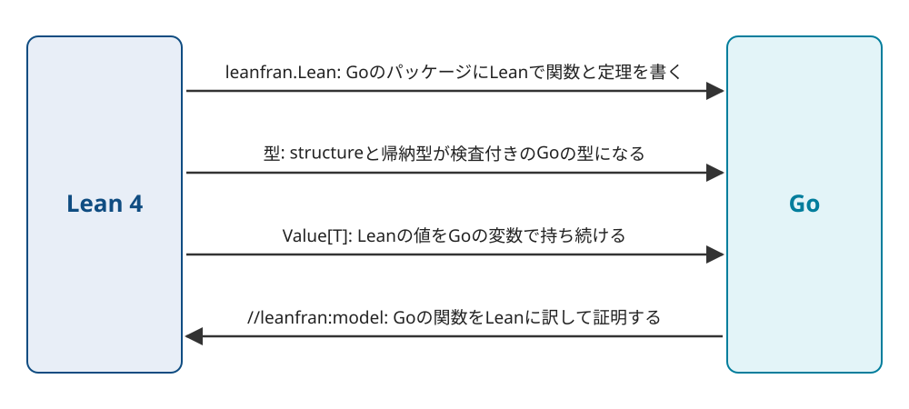

Title: Lean 4で証明した関数をGoから呼べて、Goの関数をLeanで証明できるleanfranのGo版を作った
Date: 2026-11-25 05:00
Draft: true
Tags: lean go formal-verification code-generation release lean-leanfran


Lean 4で書いて証明した関数をGoのパッケージから呼べるようにするleanfranのGo版を作りました。
Leanのstructureと帰納型は値を作るときにLeanの条件で検査するGoの型になります。
逆向きに、Goで書いた関数をLeanに訳してその性質をLeanで証明することもできます。

リポジトリは[conao3/lean-leanfranのlangs/Go/](https://github.com/conao3/lean-leanfran/tree/v0.11.1/langs/Go)で、ライセンスはApache-2.0です。
Goのmoduleは[github.com/conao3/leanfran-go](https://pkg.go.dev/github.com/conao3/leanfran-go@v0.11.1)の名前で公開していて、この記事は0.11.1で動かした結果をもとに書いています。

leanfranはLeanのコンパイラの中間表現をGoに変換するものです。
生成したGoはこのmoduleとGoの標準ライブラリだけで動き、実行するときにLeanもcgoも要りません。

Rust・Python・TypeScript・Clojureの4つは[leanfranを紹介した記事](https://s.conao3.com/blog/2026/23d62c)で、PHPは[PHP版の記事](https://s.conao3.com/blog/2026/ec8faf)で取り上げています。
Go版も同じリポジトリから同じ版で出しています。

<div class="github-card" data-repo="conao3/lean-leanfran"><a href="https://github.com/conao3/lean-leanfran"><span class="github-card-name"><svg class="github-card-mark" viewBox="0 0 16 16" aria-hidden="true"><path d="M6.766 11.328c-2.063-.25-3.516-1.734-3.516-3.656 0-.781.281-1.625.75-2.188-.203-.515-.172-1.609.063-2.062.625-.078 1.468.25 1.968.703.594-.187 1.219-.281 1.985-.281.765 0 1.39.094 1.953.265.484-.437 1.344-.765 1.969-.687.218.422.25 1.515.046 2.047.5.593.766 1.39.766 2.203 0 1.922-1.453 3.375-3.547 3.64.531.344.89 1.094.89 1.954v1.625c0 .468.391.734.86.547C13.781 14.359 16 11.53 16 8.03 16 3.61 12.406 0 7.984 0 3.563 0 0 3.61 0 8.031a7.88 7.88 0 0 0 5.172 7.422c.422.156.828-.125.828-.547v-1.25c-.219.094-.5.156-.75.156-1.031 0-1.64-.562-2.078-1.609-.172-.422-.36-.672-.719-.719-.187-.015-.25-.093-.25-.187 0-.188.313-.328.625-.328.453 0 .844.281 1.25.86.313.452.64.655 1.031.655s.641-.14 1-.5c.266-.265.47-.5.657-.656"/></svg><span>conao3/<strong>lean-leanfran</strong></span></span><span class="github-card-description">Write and prove functions in Lean 4, run them as Rust, Python, TypeScript, Clojure, PHP and Go</span><span class="github-card-footer"><span class="github-card-language"><span class="github-card-language-color"></span>Lean</span><span class="github-card-star"><svg viewBox="0 0 16 16" aria-hidden="true"><path d="M8 .25a.75.75 0 0 1 .673.418l1.882 3.815 4.21.612a.75.75 0 0 1 .416 1.279l-3.046 2.97.719 4.192a.751.751 0 0 1-1.088.791L8 12.347l-3.766 1.98a.75.75 0 0 1-1.088-.79l.72-4.194L.818 6.374a.75.75 0 0 1 .416-1.28l4.21-.611L7.327.668A.75.75 0 0 1 8 .25Z"/></svg><span>Star</span><span class="github-card-star-count" hidden></span></span></span></a></div>


# 4つの使い方

leanfranをGoから使う方法は4つあります。



1.  Goのパッケージの `leanfran.Lean(...)` の引数にLeanの関数と定理を書き、 `go tool leanfran sync` で生成した関数をGoから呼ぶ。
2.  Leanのstructureと、列挙や場合分けを表す帰納型を、値の検査とJSONの変換が付いたGoの型として使う。
3.  Leanの値を `leanfran.Value[T]` でGoの変数に持ち続け、次の呼び出しに変換せずに渡す。
4.  Goで書いた関数に `//leanfran:model` を付けてLeanに訳し、 `go tool leanfran check` で関数の性質を証明したLeanの定理を検査する。

1から3はLeanからGoへ、4はGoからLeanへの向きです。


# GoのパッケージにLeanを書く

Leanを変換するCLIの `leanfran-go` はnixで入れ、アプリケーションのmoduleにはleanfran-goのパッケージと `go tool` で呼ぶコマンドを足します。

```console
$ nix profile install github:conao3/lean-leanfran/v0.11.1#go
$ go mod init example.com/shop
$ go get github.com/conao3/leanfran-go@v0.11.1
$ go get -tool github.com/conao3/leanfran-go/cmd/leanfran@v0.11.1
```

Goは1.26以上が要ります。
生成と証明の検査にはLean 4.35.0の `lean` と `lake` も `PATH` に要ります。

`pricing/pricing.go` に次のパッケージを書きます。

```go
package pricing

import "github.com/conao3/leanfran-go"

var _ = leanfran.Lean(`
structure Range where
  lo : Nat
  hi : Nat
  ok : lo ≤ hi

def width (r : Range) : Nat := r.hi - r.lo

theorem width_le (r : Range) : width r ≤ r.hi := by
  unfold width
  omega
`)
```

`leanfran.Lean(...)` にはLeanのソースをraw stringで書き、この記事では `leanfran.Lean(...)` に渡したLeanをブロックと呼びます。
ブロックは1つのパッケージに1つ置きます。

`Range` の `ok` は `lo ≤ hi` が成り立つことを表すフィールドです。
`width_le` は幅が上限を超えないという定理です。

呼び出す側の `main.go` では、生成される `NewRange` で値を作って `pricing.Width` に渡します。

```go
package main

import (
        "fmt"
        "log"
        "math/big"

        "example.com/shop/pricing"
)

func main() {
        r, err := pricing.NewRange(big.NewInt(2), big.NewInt(5))
        if err != nil {
                log.Fatal(err)
        }
        width, err := pricing.Width(r)
        if err != nil {
                log.Fatal(err)
        }
        fmt.Println(width)
}
```

`go tool leanfran sync` を実行するとLeanが定理を検査し、leanfranがGoを生成するので、そのあとはGoだけでビルドして実行できます。

```console
$ go tool leanfran sync
leanfran: 1 block checked and generated
$ go run .
3
```

`sync` は生成したファイルを `pricing.go` と同じディレクトリに置きます。

```console
$ ls pricing
leanfran_funcs_gen.go
leanfran.json
leanfran_lean_gen.go
leanfran_types_gen.go
pricing.go
```

`leanfran_funcs_gen.go` が `Width` の関数、 `leanfran_types_gen.go` が `Range` の型、 `leanfran_lean_gen.go` がLeanの中間表現から生成した、 `Width` の中で動く処理です。
`leanfran.json` には `sync` がブロックのハッシュと生成したファイルを記録します。

生成したファイルをリポジトリにcommitしておけば、CIではLeanを入れずに `go tool leanfran status` でそれらが古くなっていないかを確かめられます。

定理を `width r ≤ r.lo` に書き換えると証明が通らなくなり、生成はそこで止まります。

```console
$ go tool leanfran sync 2>&1 | sed "s|$PWD/||"
leanfran: lake build: exit status 1
✖ [4/6] Building LeanGoEmbed.B6578616d706c652e636f6d2f73686f702f70726963696e67 (263ms)
pricing/pricing.go:15:3: error: (lean block example.com/shop/pricing, Lean 11:2) omega could not prove the goal:
a possible counterexample may satisfy the constraints
  b ≥ 0
  a ≥ 0
  a - b ≤ 0
  2*a - b ≤ -1
where
 a := ↑r.lo
 b := ↑r.hi
Some required targets logged failures:
- LeanGoEmbed.B6578616d706c652e636f6d2f73686f702f70726963696e67
error: build failed
```

エラーはGoのファイルの行と列から始まり、そのあとにブロックの中のLeanの行と列が続きます。
生成に失敗したときは前に生成したGoが残るので、 `go run .` はこのあとも `3` を出力します。


# Leanの型がGoの型になる

`Range` はGoのstructになり、 `lo` と `hi` は `*big.Int` 型のフィールドの `Lo` と `Hi` になります。
`ok` は値を作るときの `lo ≤ hi` の検査になります。

次の `cmd/rangecheck/main.go` ではJSONから値を作り、条件を満たさない入力を `NewRange` に渡してから、JSON Schemaを出力しています。

```go
package main

import (
        "encoding/json"
        "fmt"
        "log"
        "math/big"

        "example.com/shop/pricing"
)

func main() {
        var r pricing.Range
        if err := json.Unmarshal([]byte(`{"lo":1,"hi":4}`), &r); err != nil {
                log.Fatal(err)
        }
        fmt.Println(r.Hi)

        _, err := pricing.NewRange(big.NewInt(5), big.NewInt(2))
        fmt.Println(err)

        schema, err := r.JSONSchema("draft-2020-12")
        if err != nil {
                log.Fatal(err)
        }
        out, _ := json.MarshalIndent(schema, "", "  ")
        fmt.Println(string(out))
}
```

```console
$ go run ./cmd/rangecheck
4
Range.ok: lo ≤ hi
{
  "$schema": "https://json-schema.org/draft/2020-12/schema",
  "additionalProperties": false,
  "properties": {
    "hi": {
      "minimum": 0,
      "type": "integer"
    },
    "lo": {
      "minimum": 0,
      "type": "integer"
    }
  },
  "required": [
    "lo",
    "hi"
  ],
  "type": "object"
}
```

`NewRange` はLeanからコンパイルしたコードで `lo ≤ hi` を判定するので、 `lo` が `hi` より大きい値を渡すと `*leanfran.ValidationError` を返します。
JSON Schemaでは2つのフィールドにまたがる `lo ≤ hi` を表せないので、schemaには `Nat` が0以上であることだけが出ます。

`json.Unmarshal` と `Validate` も `NewRange` と同じ条件を検査します。
生成した関数も引数を受け取ったときに検査するので、structリテラルで作った値を `pricing.Width` に渡しても `*leanfran.ValidationError` が返ります。

逆に、Goで書いたstructをLeanのstructureとして取り込むには、 `leanfran.Lean(...)` の2つめ以降の引数に `leanfran.Models(Item{})` を渡します。
そのstructのフィールドのstruct tagに書いた `leanfran:"ge=1,le=100"` のような範囲は、Leanの側で証明のフィールドになります。


# Leanの値をGoで持ち続ける

生成した関数は呼び出しのたびに引数をLeanの表現に変換し、戻り値をGoの値に変換します。
大きな値を繰り返し渡すと、この変換が実行時間の大半を占めます。

`leanfran.Value[T]` はLeanの値への参照を1つ持つhandleです。
handleを使うと、Leanの値を変換せずにGoの変数に置いておけます。

`ledger/ledger.go` に、配列に金額を1件足す `record` と件数を返す `count` を書きます。

```go
package ledger

import "github.com/conao3/leanfran-go"

var _ = leanfran.Lean(`
def record (xs : Array UInt64) (x : UInt64) : Array UInt64 := xs.push x

def count (xs : Array UInt64) : Nat := xs.size

theorem count_record (xs : Array UInt64) (x : UInt64) :
    count (record xs x) = count xs + 1 := by
  simp [count, record]
`)
```

`sync` は `[]uint64` を受け取る `Record` と一緒に、handleを受け取ってhandleを返す `Handle.Record` も生成します。
Goの値とhandleの変換には、 `ledger.Value.NewArrayUInt64` や `ledger.Value.ReadNat` のように、生成される `ledger.Value` のメソッドを使います。

次の `cmd/ledger/main.go` では最初の2件をGoのスライスからhandleにして、そのあとの2件はhandleの `entries` に足しています。
`record` と `count` は引数を検査せず、Lean側でも失敗しないので、生成される関数は `error` を返しません。

```go
package main

import (
        "fmt"

        "example.com/shop/ledger"
)

func main() {
        entries := ledger.Value.NewArrayUInt64([]uint64{1200, 800})
        defer func() { entries.Close() }()

        for _, amount := range []uint64{300, 50} {
                x := ledger.Value.NewUInt64(amount)
                entries = ledger.Handle.Record(entries.Take(), x.Take())
        }

        n := ledger.Handle.Count(entries.Borrow())
        defer n.Close()
        fmt.Println(ledger.Value.ReadNat(n))
        fmt.Println(ledger.Value.ReadArrayUInt64(entries))
}
```

```console
$ go tool leanfran sync
leanfran: 2 blocks checked and generated
$ go run ./cmd/ledger
4
[1200 800 300 50]
```

引数には `entries.Borrow()` か `entries.Take()` を渡します。
`Borrow` は呼び出しのあとも `entries` を使い続けるとき、 `Take` は参照ごとLeanに渡して、そのhandleを手放すときに使います。

`Take` で渡した配列にはほかに参照が無いので、Leanの `Array.push` は配列をコピーせずにその場で1件足します。
`Value.ReadNat` と `Value.ReadArrayUInt64` がhandleの中身をGoの値に変換するメソッドです。
使い終えたhandleは `Close` を呼んで参照を手放します。

10件と1,000件と100,000件の配列に1件足す操作を、Linux・amd64のIntel Core i5-8400とGo 1.27.3で測りました。
`Record` には同じスライスを毎回渡し、 `Handle.Record` には同じ件数の配列で作ったhandleを `Take` で渡し続けています。

図と表の値は、CPUを1つに固定して11回測った時間の中央値から求めた1秒あたりの回数で、大きいほど速いことを表します。


<table border="2" cellspacing="0" cellpadding="6" rules="groups" frame="hsides">


<colgroup>
<col  class="org-left" />

<col  class="org-left" />

<col  class="org-left" />
</colgroup>
<thead>
<tr>
<th scope="col" class="org-left">配列の件数</th>
<th scope="col" class="org-left"><code>Record</code> (回/秒)</th>
<th scope="col" class="org-left"><code>Handle.Record</code> (回/秒)</th>
</tr>
</thead>
<tbody>
<tr>
<td class="org-left">10</td>
<td class="org-left">2,170,000</td>
<td class="org-left">3,270,000</td>
</tr>

<tr>
<td class="org-left">1,000</td>
<td class="org-left">52,100</td>
<td class="org-left">3,230,000</td>
</tr>

<tr>
<td class="org-left">100,000</td>
<td class="org-left">335</td>
<td class="org-left">3,080,000</td>
</tr>
</tbody>
</table>

`Record` は配列の件数が増えるほど回数が減りますが、 `Handle.Record` は件数によらず毎秒308万回から327万回です。

handleの操作はleanfran-goのランタイムがプロセスの中で1つずつ順に実行するので、複数のgoroutineから呼んでもLeanの処理は並列になりません。
続けて行う操作を `leanfran.WithValues` の中で `Handle.In(scope)` と `Value.In(scope)` から呼ぶと、この順番待ちのロックを取るのが1回で済みます。

サーバーが状態をhandleで持ち、リクエストごとに次の状態のhandleへ置き換える使い方は[value-serverのサンプル](https://github.com/conao3/lean-leanfran/tree/v0.11.1/langs/Go/samples/value-server)にあります。


# Goの関数をLeanで証明する

逆向きの例として、値を範囲に収める `Clamp` をGoで書き、 `//leanfran:model` でLeanの仕様と結びつけます。

```go
package calc

import "github.com/conao3/leanfran-go"

var _ = leanfran.Lean(`
def clampSpec (x lo hi : Int64) : Int64 := max lo (min hi x)
def ordered (_x lo hi : Int64) : Bool := decide (lo ≤ hi)
def inRange (_x lo hi r : Int64) : Bool := decide (lo ≤ r) && decide (r ≤ hi)
`)

//leanfran:model refines=clampSpec requires=ordered ensures=in_range:inRange
func Clamp(x, lo, hi int64) int64 {
        if x < lo {
                return lo
        }
        if x > hi {
                return hi
        }
        return x
}
```

`refines` には実装と同じ値を返すLeanの関数、 `requires` には入力の前提、 `ensures` には戻り値が満たす条件を書きます。
この例では `lo ≤ hi` のときに `Clamp` が `clampSpec` と同じ値を返すことと、戻り値が `lo` 以上 `hi` 以下になることが証明の義務です。

`go tool leanfran check` はGoの構文木と型を読んで関数をLeanの関数に訳し、 `Clamp.obligation.refines` のような名前で義務の命題を作ります。
証明は `go.mod` の隣の `lean/Proofs/` に書きます。
ここでは[verified-clampのサンプルの証明](https://github.com/conao3/lean-leanfran/blob/v0.11.1/langs/Go/samples/verified-clamp/lean/Proofs/Clamp.lean)のモジュール名だけをこのパッケージに合わせています。

```lean
import LeanGoModel.B6578616d706c652e636f6d2f73686f702f63616c63

open LeanGoEmbed.B6578616d706c652e636f6d2f73686f702f63616c63
namespace LeanGoModel.B6578616d706c652e636f6d2f73686f702f63616c63

theorem Clamp.proof.refines : Clamp.obligation.refines := by
  intro x lo hi h
  simp only [ordered, decide_eq_true_eq] at h
  simp only [Clamp, clampSpec, Id.run, pure, Pure.pure, Int64.min_def, Int64.max_def,
    decide_eq_true_eq]
  repeat' split
  all_goals simp_all only [Int64.lt_iff_toInt_lt, Int64.le_iff_toInt_le, ← Int64.toInt_inj] <;> omega

theorem Clamp.proof.in_range : Clamp.obligation.in_range := by
  intro x lo hi h
  simp only [ordered, decide_eq_true_eq] at h
  simp only [Clamp, inRange, Id.run, pure, Pure.pure, Bool.and_eq_true, decide_eq_true_eq]
  split <;> try split
  all_goals simp_all only [Int64.lt_iff_toInt_lt, Int64.le_iff_toInt_le]
  all_goals constructor <;> first | exact True.intro | omega

end LeanGoModel.B6578616d706c652e636f6d2f73686f702f63616c63
```

モジュール名の `B` に続く部分は、Goのimport pathの `example.com/shop/calc` をUTF-8のバイトごとに16進数で書いたものです。

```console
$ go tool leanfran check --require proved
leanfran: 3 blocks checked and generated
example.com/shop/calc.Clamp [in_range]: proved
example.com/shop/calc.Clamp [refines]: proved
```

`--require proved` を付けると、義務が1つでも `proved` でなければ終了コードが1になります。
`proved` は定理の型が義務と一致していて、証明を省く `sorry` や `propext` ・ `Classical.choice` ・ `Quot.sound` 以外の公理に頼っていないことを表します。

`check` は義務ごとの結果を `go.mod` の隣の `leanfran.lock` に書くので、これもcommitしておけば `go tool leanfran status` でLeanを入れずに証明の結果が古くなっていないかを確かめられます。

Goの実装とLeanの仕様は乱数で作った入力を使うテストでも比べられ、このテストはLeanなしで動きます。
`sync` は `//leanfran:model` のあるパッケージに `leanfran_model_test.go` を生成するので、 `go test` で実行できます。

```console
$ go test ./calc/
ok  	example.com/shop/calc	0.003s
```

生成されるテストはシードを固定した乱数と、0や整数の上限などの境界の値で入力を作り、 `requires` を満たす入力を200件集めます。
その入力ごとに、Goの `Clamp` の戻り値を `clampSpec` から生成した `ClampSpec` の値と比べます。

実装の2つめの `if` を、 `x` が `hi` 以上のときに `hi - 1` を返すように書き換えてみます。

```go
if x >= hi {
        return hi - 1
}
```

2つの証明が通らなくなるので、 `check` はLeanのエラーを標準エラー出力に出したうえで、義務ごとの状態を `failed` にします。

```console
$ go tool leanfran check --require proved 2>/dev/null
leanfran: 3 blocks checked and generated
example.com/shop/calc.Clamp [in_range]: failed
example.com/shop/calc.Clamp [refines]: failed
```

このテストも、3つの引数がすべて0の入力で反例を見つけます。

```console
$ go test ./calc/
--- FAIL: TestLeanfranModels (0.00s)
    --- FAIL: TestLeanfranModels/Clamp (0.00s)
        leanfran_model_test.go:12: Clamp: refines: got []interface {}{-1}, want []interface {}{0} (seed=1, input=[]interface {}{0, 0, 0})
FAIL
FAIL	example.com/shop/calc	0.002s
FAIL
```


# 証明が保証する範囲

Leanの定理はLeanで書いた関数とGoから訳したLeanのモデルの性質を保証します。
生成したGoや元のGoの実行にもその性質が成り立つには、LeanをGoに変換する生成器とランタイム、GoをLeanに訳す翻訳器とGoの演算のモデルが正しい必要があるので、この4つはテストで確かめています。

翻訳器は手で書いたGoを実行した結果と、訳したモデルをLeanの標準のCバックエンドでコンパイルして動かした結果を比べるテストで確かめています。
演算のモデルはモデルから生成したコードとGoの演算を境界の値で比べ、モデルの失敗とGoの `panic` が対応することも見ています。

LeanをGoに変換する生成器とランタイムも、生成したGoの結果をLeanのCバックエンドの結果と比べています。
この記事を書いた時点で、Linux・amd64では境界の値と乱数で作った1,769,817件の数値の演算を試しました。
そのうち1,764,071件の結果がCバックエンドの結果とバイト単位で一致しています。

残りの5,746件は浮動小数点数を返す関数のもので、差は関数ごとに決めた幅に収まっています。
`Float.cos` は差が最も大きく、隣り合う浮動小数点数の間隔の88個分です。

GoをLeanに訳すときには、Goの整数を同じ幅のLeanの整数にして、 `int` と `uint` は `Int64` と `UInt64` にします。
ゼロ除算と範囲外の添字と `panic` は、モデルの上では失敗を表す値になります。

訳せるのはGoの一部です。
`if` ・ `switch` ・ `for` 、スライスの添字と `append` 、structを訳せます。
ポインタ・map・channel・goroutine・メソッド・generics・ `defer` ・入出力を含む関数は対象外です。
対応する構文の一覧は[Goのガイド](https://github.com/conao3/lean-leanfran/blob/v0.11.1/docs/go-guide.md#go-subset-and-proof-scope)にあります。


# おわりに

この記事の例のほかにも、[Goのサンプル](https://github.com/conao3/lean-leanfran/tree/v0.11.1/langs/Go/samples)にはビットマスクと剰余が等しいことを証明するverified-nibbleを置いてあります。
2つのパッケージでGoのstructを共有するembed-modelsや、Leanの `IO` の関数をGoのコマンドとして動かすgreet-cliもあります。

導入の手順は[GoのREADME](https://github.com/conao3/lean-leanfran/blob/v0.11.1/langs/Go/README.md)、型の対応やCLIの詳細は[Goのガイド](https://github.com/conao3/lean-leanfran/blob/v0.11.1/docs/go-guide.md)にあります。

