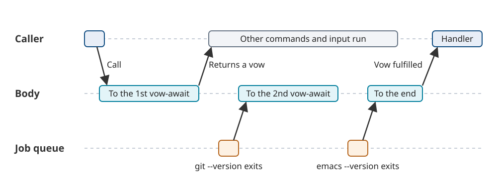

Title: vow: async/await for Emacs Lisp that you can step through in Edebug
Date: 2026-11-27 17:24
Updated: 2026-11-27 18:05
Lang: en
Original: /blog/2026/7d9eba
Tags: emacs emacs-lisp async macro release vow-el


I rewrote chuntaro's [promise.el](https://github.com/chuntaro/emacs-promise) into a library called vow.
With vow, you can step through Emacs Lisp async/await functions in Edebug.

vow follows JavaScript's Promise and async/await, so you write code that waits for processes and timers from top to bottom, with no nested callbacks.

You can keep using Emacs while `vow-await` waits.
When the awaited work fails, you handle the error with `condition-case`, the same way you do in synchronous code.

When `vow-await` stops and resumes, Edebug continues stepping from where it stopped.

The repository is [conao3/vow.el](https://github.com/conao3/vow.el), under [GPL-3.0](https://github.com/conao3/vow.el/blob/afb6269/LICENSE).
It runs on Emacs 31.1 and later, and this post uses [afb6269](https://github.com/conao3/vow.el/commit/afb6269) on master with Emacs 31.1.

<div class="github-card" data-repo="conao3/vow.el"><a href="https://github.com/conao3/vow.el"><span class="github-card-name"><svg class="github-card-mark" viewBox="0 0 16 16" aria-hidden="true"><path d="M6.766 11.328c-2.063-.25-3.516-1.734-3.516-3.656 0-.781.281-1.625.75-2.188-.203-.515-.172-1.609.063-2.062.625-.078 1.468.25 1.968.703.594-.187 1.219-.281 1.985-.281.765 0 1.39.094 1.953.265.484-.437 1.344-.765 1.969-.687.218.422.25 1.515.046 2.047.5.593.766 1.39.766 2.203 0 1.922-1.453 3.375-3.547 3.64.531.344.89 1.094.89 1.954v1.625c0 .468.391.734.86.547C13.781 14.359 16 11.53 16 8.03 16 3.61 12.406 0 7.984 0 3.563 0 0 3.61 0 8.031a7.88 7.88 0 0 0 5.172 7.422c.422.156.828-.125.828-.547v-1.25c-.219.094-.5.156-.75.156-1.031 0-1.64-.562-2.078-1.609-.172-.422-.36-.672-.719-.719-.187-.015-.25-.093-.25-.187 0-.188.313-.328.625-.328.453 0 .844.281 1.25.86.313.452.64.655 1.031.655s.641-.14 1-.5c.266-.265.47-.5.657-.656"/></svg><span>conao3/<strong>vow.el</strong></span></span><span class="github-card-description">Promises/A+ and async/await for Emacs Lisp</span><span class="github-card-footer"><span class="github-card-language"><span class="github-card-language-color" style="background-color: #c065db"></span>Emacs Lisp</span><span class="github-card-star"><svg viewBox="0 0 16 16" aria-hidden="true"><path d="M8 .25a.75.75 0 0 1 .673.418l1.882 3.815 4.21.612a.75.75 0 0 1 .416 1.279l-3.046 2.97.719 4.192a.751.751 0 0 1-1.088.791L8 12.347l-3.766 1.98a.75.75 0 0 1-1.088-.79l.72-4.194L.818 6.374a.75.75 0 0 1 .416-1.28l4.21-.611L7.327.668A.75.75 0 0 1 8 .25Z"/></svg><span>Star</span><span class="github-card-star-count" hidden></span></span></span></a></div>


# What vow does

-   Step through async/await functions in Edebug.
-   Create a promise that follows [Promises/A+](https://promisesaplus.com) as a vow, and chain vows with `vow-then`.
-   Call `vow-await` inside a function defined with `vow-defun` to wait for a vow to settle.
-   Wait for several vows at once with `vow-all` or `vow-race`.
-   Run an external command with `vow-process` and get its output as a vow.
-   Hand a function to another Emacs with `vow-async-start`, so Emacs keeps running during heavy computation.
-   Bind buffers and processes with `vow-using`, and clean them up when the body ends.


# Writing async/await in Emacs Lisp

Install vow from GitHub with leaf's `:vc`.

```emacs-lisp
(leaf vow
  :vc (:url "https://github.com/conao3/vow.el"))
```

Here is an example that waits for the output of external commands.

`vow-process` runs a command asynchronously and fulfills the vow with its standard output when the exit code is 0.
For any other exit code, it rejects the vow with a `vow-process-failed` error.

```emacs-lisp
;;; vow-example.el --- vow example  -*- lexical-binding: t; -*-
(require 'vow)

(vow-defun my-versions ()
  (let ((git (vow-await (vow-process "git" "--version")))
        (emacs (vow-await (vow-process "emacs" "--version"))))
    (format "%s / %s" (string-trim git) (car (split-string emacs "\n")))))

(vow-defun my-status ()
  (condition-case err
      (vow-await (vow-process "git" "no-such-command"))
    (vow-process-failed (format "failed: exit %d" (nth 3 err)))))

(message "%s" (vow-wait (my-versions)))
(message "%s" (vow-wait (my-status)))
```

`my-versions` waits for the versions of git and emacs in turn, and joins them into one string.

`my-status` waits for a command that fails, so the error of the rejected vow appears at `vow-await`.
It handles that error with `condition-case` and takes out the exit code.

A function defined with `vow-defun` returns a vow as soon as you call it, so in batch mode you wait for the vow with `vow-wait` and get its value.

```sh
$ emacs --batch -Q -L vow.el -l vow-example.el
git version 2.56.0 / GNU Emacs 31.1
failed: exit 1
```

To run two commands at the same time, wait for them with `vow-all`.

```emacs-lisp
(vow-defun my-versions-at-once ()
  (pcase-let ((`(,git ,emacs)
               (vow-await (vow-all (list (vow-process "git" "--version")
                                         (vow-process "emacs" "--version"))))))
    (format "%s / %s" (string-trim git) (car (split-string emacs "\n")))))
```

You can wrap a function that takes a callback in `vow-new`, so that it returns a vow.
The `my-fetch` below fulfills the vow with the body of the page that `url-retrieve` fetched.

```emacs-lisp
(defun my-fetch (url)
  "Return a vow for the body of URL."
  (vow-new
   (lambda (resolve reject)
     (url-retrieve url
                   (lambda (status)
                     (let ((error (plist-get status :error)))
                       (if error
                           (funcall reject error)
                         (goto-char url-http-end-of-headers)
                         (funcall resolve (buffer-substring (point) (point-max))))
                       (kill-buffer)))))))
```


# Stepping through with Edebug

[async-await.el](https://github.com/chuntaro/emacs-async-await), another library by chuntaro, gives `async-defun` no `debug` declaration, so `C-u C-M-x` does not instrument its body.
`vow-defun` has a `debug` declaration, and passes the body that Edebug instrumented to generator.el, which comes with Emacs.

Put the cursor on a `vow-defun` definition and press `C-u C-M-x` to instrument it with Edebug, the same way you instrument an ordinary function.
When stepping reaches `vow-await`, Edebug exits, and when the awaited vow settles, stepping continues from where it stopped.

Edebug keeps its execution mode after a resume, so when you run with `g` or `c`, it goes across `vow-await` to the next breakpoint.
Edebug stops at the expression that signals an error that no `condition-case` handles.

generator.el renames the local variables of the body, so Edebug's `e` reads only the local variables from before the first `vow-await`.
After a resume, check variable values in the expression values that Edebug shows while you step.


# How vow-await stops and resumes



`vow-defun` turns the body into `iter-lambda`, a generator function, and turns `vow-await` into `iter-yield`.
generator.el rewrites the body in continuation-passing style, so the body stops at `iter-yield` and can resume from there later.

When you call `my-versions`, the body runs to the first `vow-await` and stops, and the caller gets a vow for the result of the body.

When the `git --version` process exits, vow fulfills the awaited vow and puts a job that continues the body into the job queue.
A `run-at-time` timer runs the job queue, which advances the body to the next `vow-await`.

To resume, vow passes the body a function that returns the value of the awaited vow, and the body uses what that function returns as the value of `vow-await`.
When the vow was rejected, the error appears at the same place, so `condition-case` and `unwind-protect` work as usual.

generator.el does not rewrite the inside of nested lambdas, so you cannot use `vow-await` inside a function passed to `mapcar`.
A `vow-await` in such a place signals an error at macro expansion, so use `dolist` or `cl-loop` to wait inside a loop.


# Buffers and cleanup while waiting

The body resumes in the buffer that was current when it stopped.
`with-current-buffer` and `save-excursion` work across `vow-await`, and when that buffer is killed during the wait, `vow-await` signals a `vow-buffer-killed` error.

`vow-using` is JavaScript's `await using`: when the body ends, it cleans up the bound buffers and processes in reverse order.
When the body ends with an error, it cleans up the same way, and when the cleanup signals another error, it keeps both errors in `vow-suppressed`.
`my-open` and `my-close` are functions that open and close a connection.

```emacs-lisp
(vow-defun my-download (url)
  (vow-using ((buffer (generate-new-buffer " *download*"))
              (conn (my-open url) #'my-close))
    (vow-await (my-read conn buffer))
    (with-current-buffer buffer (buffer-string))))
```


# Running heavy computation in another Emacs

When you wait for a process or a timer, Emacs accepts input during `vow-await`.
Heavy computation written in Emacs Lisp runs in the same Emacs even inside a vow, so Emacs accepts no input and runs no timers until the computation ends.

`vow-async-start` starts a child Emacs with `async-start` from the [async](https://github.com/jwiegley/emacs-async) package.
The child runs the function, and its value fulfills the vow.

vow loads the async package from GNU ELPA only when you call `vow-async-start`, so the other functions work without it.

To see the difference, I ran two computations, A and B, that count the primes below 300000, in two ways.

The first way wraps A and B in `vow-try` and waits for them in the current Emacs.
The second way hands B to a child Emacs and then counts A in the current Emacs.

I used version 2.0 of the async package.
`my-time` calls a function and prints how many seconds it took.

```emacs-lisp
;;; vow-child-example.el --- vow example  -*- lexical-binding: t; -*-
(require 'vow)

(defun my-count-primes (n)
  "Return the number of primes below N."
  (let ((count 0))
    (dotimes (i n)
      (let ((d 2) (prime (> i 1)))
        (while (and prime (<= (* d d) i))
          (when (zerop (% i d)) (setq prime nil))
          (setq d (1+ d)))
        (when prime (setq count (1+ count)))))
    count))

(defun my-count-primes-in-child (n)
  "Return a vow for the number of primes below N, counted in a child Emacs."
  (let ((count-primes (symbol-function 'my-count-primes)))
    (vow-async-start (lambda () (funcall count-primes n)))))

(defun my-time (label function)
  "Call FUNCTION and show how many seconds it took."
  (let ((start (float-time)))
    (funcall function)
    (message "%s: %.0f seconds" label (- (float-time) start))))

(my-time "A and B in this Emacs"
         (lambda ()
           (vow-wait (vow-all (list (vow-try #'my-count-primes 300000)
                                    (vow-try #'my-count-primes 300000))))))
(my-time "A in this Emacs, B in a child Emacs"
         (lambda ()
           (let ((b (my-count-primes-in-child 300000)))
             (my-count-primes 300000)
             (vow-wait b))))
```

The child Emacs does not have the functions defined in the parent, so `my-count-primes-in-child` takes the function definition with `symbol-function` and passes it inside a closure.

```sh
$ emacs --batch -Q -L vow.el -L async -l vow-child-example.el
A and B in this Emacs: 5 seconds
A in this Emacs, B in a child Emacs: 3 seconds
```

Even inside vows, the two computations run one after the other in the current Emacs, so they take 5 seconds.
With B in a child Emacs, B runs at the same time as A, and both finish in 3 seconds.

A vow only arranges how you wait, so to make computation faster, split it into another process with `vow-async-start`.

The function and its value travel between the two Emacs as text, so you can pass only values that Emacs can print and read back.
A closure passes copies of the values of its captured variables to the child, so changes the child makes to those variables do not reach the parent.

To run an external command, use `vow-process`, which starts no child Emacs and gives you the standard error output when the command fails.


# Correspondence with JavaScript

vow follows the Promise and async function features of ECMAScript up to ECMAScript 2027, and the Await Dictionary proposal at stage 3.
The main correspondences are below.

<table border="2" cellspacing="0" cellpadding="6" rules="groups" frame="hsides">


<colgroup>
<col  class="org-left" />

<col  class="org-right" />

<col  class="org-left" />
</colgroup>
<thead>
<tr>
<th scope="col" class="org-left">ECMAScript</th>
<th scope="col" class="org-right">Edition</th>
<th scope="col" class="org-left">vow</th>
</tr>
</thead>
<tbody>
<tr>
<td class="org-left"><code>new Promise(executor)</code></td>
<td class="org-right">2015</td>
<td class="org-left"><code>vow-new</code></td>
</tr>

<tr>
<td class="org-left"><code>async function</code>, <code>await</code></td>
<td class="org-right">2017</td>
<td class="org-left"><code>vow-defun</code>, <code>vow-await</code></td>
</tr>

<tr>
<td class="org-left"><code>Promise.allSettled</code></td>
<td class="org-right">2020</td>
<td class="org-left"><code>vow-all-settled</code></td>
</tr>

<tr>
<td class="org-left"><code>Promise.any</code></td>
<td class="org-right">2021</td>
<td class="org-left"><code>vow-any</code></td>
</tr>

<tr>
<td class="org-left"><code>Promise.withResolvers</code></td>
<td class="org-right">2024</td>
<td class="org-left"><code>vow-with-resolvers</code></td>
</tr>

<tr>
<td class="org-left"><code>Promise.try</code></td>
<td class="org-right">2025</td>
<td class="org-left"><code>vow-try</code></td>
</tr>

<tr>
<td class="org-left"><code>Array.fromAsync</code></td>
<td class="org-right">2026</td>
<td class="org-left"><code>vow-from-async</code></td>
</tr>

<tr>
<td class="org-left"><code>await using</code></td>
<td class="org-right">2027</td>
<td class="org-left"><code>vow-using</code></td>
</tr>

<tr>
<td class="org-left"><code>Promise.allKeyed</code></td>
<td class="org-right">stage 3</td>
<td class="org-left"><code>vow-all-keyed</code></td>
</tr>
</tbody>
</table>

The full list is in ["ECMAScript correspondence" in the README](https://github.com/conao3/vow.el/blob/afb6269/README.org#ecmascript-correspondence).


# Conclusion

With `vow-await`, you read the waiting code from top to bottom in the body, and you handle its errors with `condition-case`.
Edebug steps through that code, so give vow a try the next time you wait for a process or a timer.

