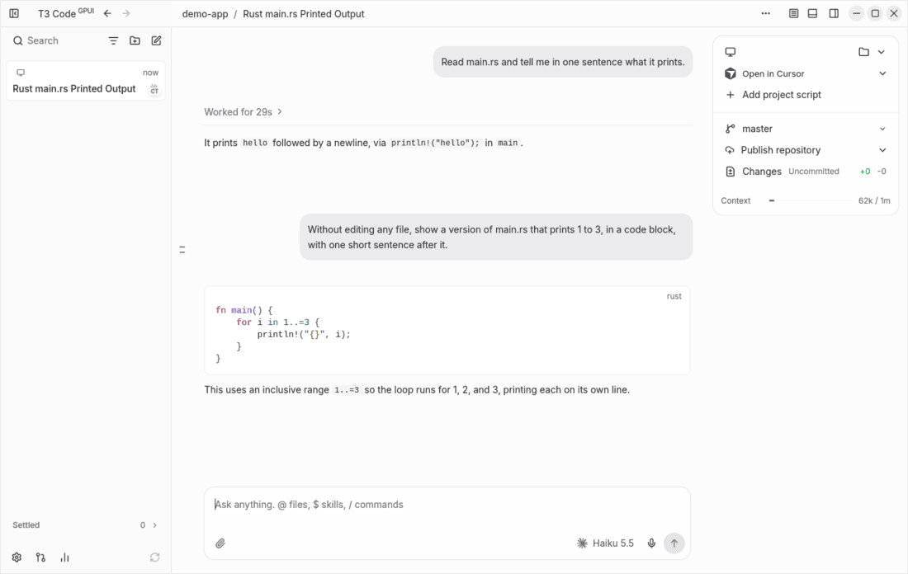

Title: T3 Code GPUI: use T3 Code in a native Rust and GPUI window instead of Electron
Date: 2026-11-27 23:22
Updated: 2026-11-27 23:22
Draft: true
Lang: en
Original: /blog/2026/ed26d1
Tags: rust gpui t3-code ai-agent release rust-t3code-gpui


I built T3 Code GPUI, an unofficial frontend for T3 Code, the app that drives coding agents.
It replaces the Electron desktop app with a native window drawn in Rust and GPUI, and connects to an unmodified `t3 serve` over its WebSocket protocol to show the thread list, the reply timeline and the composer.

The repository is [conao3/rust-t3code-gpui](https://github.com/conao3/rust-t3code-gpui), under the Apache-2.0 license.
For this post I ran 0.1.0 at commit `d5cfde1` on Linux with X11.

While an agent streams its reply, the window redraws at most four times a second and re-lays out only the last block of the growing reply.

T3 Code GPUI is an independent, unofficial project with no ties to the T3 Code team, and the team neither endorses nor maintains it.

<div class="github-card" data-repo="conao3/rust-t3code-gpui"><a href="https://github.com/conao3/rust-t3code-gpui"><span class="github-card-name"><svg class="github-card-mark" viewBox="0 0 16 16" aria-hidden="true"><path d="M6.766 11.328c-2.063-.25-3.516-1.734-3.516-3.656 0-.781.281-1.625.75-2.188-.203-.515-.172-1.609.063-2.062.625-.078 1.468.25 1.968.703.594-.187 1.219-.281 1.985-.281.765 0 1.39.094 1.953.265.484-.437 1.344-.765 1.969-.687.218.422.25 1.515.046 2.047.5.593.766 1.39.766 2.203 0 1.922-1.453 3.375-3.547 3.64.531.344.89 1.094.89 1.954v1.625c0 .468.391.734.86.547C13.781 14.359 16 11.53 16 8.03 16 3.61 12.406 0 7.984 0 3.563 0 0 3.61 0 8.031a7.88 7.88 0 0 0 5.172 7.422c.422.156.828-.125.828-.547v-1.25c-.219.094-.5.156-.75.156-1.031 0-1.64-.562-2.078-1.609-.172-.422-.36-.672-.719-.719-.187-.015-.25-.093-.25-.187 0-.188.313-.328.625-.328.453 0 .844.281 1.25.86.313.452.64.655 1.031.655s.641-.14 1-.5c.266-.265.47-.5.657-.656"/></svg><span>conao3/<strong>rust-t3code-gpui</strong></span></span><span class="github-card-description">Native GPUI frontend for T3 Code</span><span class="github-card-footer"><span class="github-card-language"><span class="github-card-language-color" style="background-color: #dea584"></span>Rust</span><span class="github-card-star"><svg viewBox="0 0 16 16" aria-hidden="true"><path d="M8 .25a.75.75 0 0 1 .673.418l1.882 3.815 4.21.612a.75.75 0 0 1 .416 1.279l-3.046 2.97.719 4.192a.751.751 0 0 1-1.088.791L8 12.347l-3.766 1.98a.75.75 0 0 1-1.088-.79l.72-4.194L.818 6.374a.75.75 0 0 1 .416-1.28l4.21-.611L7.327.668A.75.75 0 0 1 8 .25Z"/></svg><span>Star</span><span class="github-card-star-count" hidden></span></span></span></a></div>


# How it relates to T3 Code

[T3 Code](https://t3.codes) lets you drive coding agents you are already signed in to, such as Claude Code and Codex, from one screen.
It has a server, `t3 serve`, and the web UI and desktop app that connect to it.

The T3 Code team built the desktop app on Electron, so I rewrote its screen in Rust and kept the upstream server as it is.
T3 Code GPUI draws its window with [GPUI](https://github.com/zed-industries/zed/tree/main/crates/gpui), the UI framework of the Zed editor, and the buttons and text fields come from [gpui-kit](https://github.com/longbridge/gpui-kit).

In the screenshot below, I connected T3 Code GPUI to a temporary `t3 serve` and sent two messages in a new thread.
The thread list is on the left, the reply timeline and the composer are in the middle, and the right panel shows the Git branch and changes.
I painted over the host name and a few other labels.



I am still porting features from the upstream screens one by one.


# Install and connect

The repository is a Nix flake, so on Linux this command opens the window:

```console
$ nix run github:conao3/rust-t3code-gpui
```

Each server needs a token, so run this on the host where the server is running:

```console
$ t3 auth session issue --ttl 365d --label t3code-gpui --token-only
```

Write the token, with the server's URL and a label, to `~/.config/t3code-gpui/environments.json`.
T3 Code GPUI refuses to read the file when other users can read it, so set its mode to 600.

```json
{
  "environments": [
    { "label": "local", "httpBaseUrl": "http://127.0.0.1:39471", "token": "..." }
  ]
}
```

With several servers listed, buttons at the top of the sidebar filter the threads by server.
When several servers have a project for the same repository, a new thread starts on the one that comes first in the file.
`check-environment` tells you whether the connection works, and shows `Authenticated` as `true` once the server accepts the token.

```console
$ t3code-gpui environment check-environment --label local
{
  "Label": "local",
  "EnvironmentId": "d2347fbc-2c6c-4188-b246-ba58ebb3840a",
  "ServerVersion": "0.1.12-nightly.20261122.5111",
  "OrchestrationProtocolVersion": 2,
  "Authenticated": true
}
```


# Keys

Type in the composer and press `Ctrl+Enter` to send.
When you send from the new-thread screen, the thread starts in the background, and you open it from the "Open" button on the toast or from the sidebar.

<table border="2" cellspacing="0" cellpadding="6" rules="groups" frame="hsides">


<colgroup>
<col  class="org-left" />

<col  class="org-left" />
</colgroup>
<thead>
<tr>
<th scope="col" class="org-left">Key</th>
<th scope="col" class="org-left">Action</th>
</tr>
</thead>
<tbody>
<tr>
<td class="org-left"><code>Ctrl+Enter</code></td>
<td class="org-left">Send the composer text, or answer the open question</td>
</tr>

<tr>
<td class="org-left"><code>Ctrl+Shift+O</code></td>
<td class="org-left">Start a new thread</td>
</tr>

<tr>
<td class="org-left"><code>Alt+O</code></td>
<td class="org-left">Open the next thread that is done or waiting for input</td>
</tr>

<tr>
<td class="org-left"><code>Alt+P</code> / <code>Alt+N</code></td>
<td class="org-left">Jump to the previous or next message of yours</td>
</tr>

<tr>
<td class="org-left"><code>Ctrl+Shift+]</code> / <code>Ctrl+Shift+[</code></td>
<td class="org-left">Open the next or previous thread in the sidebar</td>
</tr>
</tbody>
</table>

When an agent finishes a reply or starts waiting for your input, you get a desktop notification, unless that thread is the one you have open.


# Four redraws a second

While an agent writes a reply, the T3 Code server batches updates that carry the reply text so far and sends them [every 50 ms](https://github.com/pingdotgg/t3code/blob/b72cb0385cc7f682c05c1976d36fa9c712d995e0/apps/server/src/orchestration-v2/ThreadLiveEventCoalescer.ts#L18).
T3 Code GPUI puts each update into its local state right away, but redraws only once every [250 ms](https://github.com/conao3/rust-t3code-gpui/blob/d5cfde166d3b47a036a587e88ef74b29ee783747/crates/t3code-gpui/src/app.rs#L108), so the screen shows only the latest update from each interval.

T3 Code GPUI [splits the reply at a blank line outside code blocks each time about 1,200 bytes pile up](https://github.com/conao3/rust-t3code-gpui/blob/d5cfde166d3b47a036a587e88ef74b29ee783747/crates/t3code-gpui/src/timeline.rs#L203-L224), and puts each block on its own row of the timeline.
Finished blocks keep the same text, so while the reply grows, T3 Code GPUI lays out only the last block again.

On X11 I patched GPUI to present frames without waiting for vertical sync, so that key handling does not wait for a frame to be shown.


# Layout

The Cargo workspace has three crates:

-   `t3-client` : the server connection, the thread list and thread state, and reconnecting after a dropped connection. It has no UI dependency.
-   `t3-terminal` : a terminal engine that runs the Ghostty VT module as WebAssembly through wasmtime. It has no UI dependency either.
-   `t3code-gpui` : the window and the CLI.

