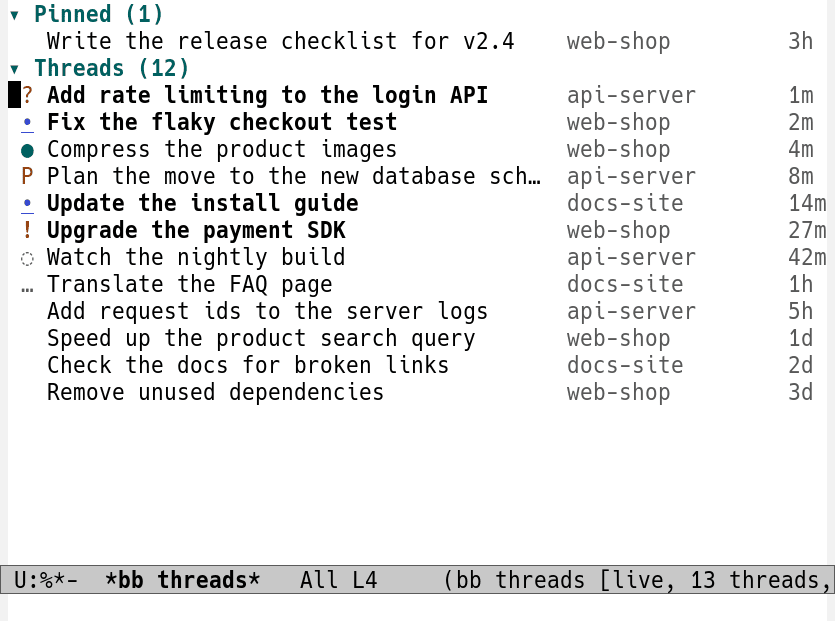
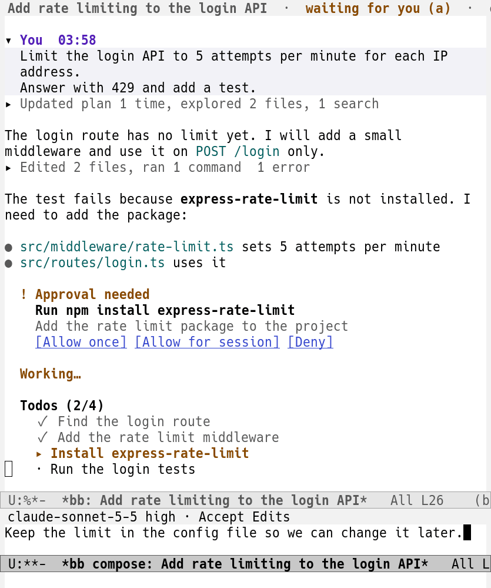
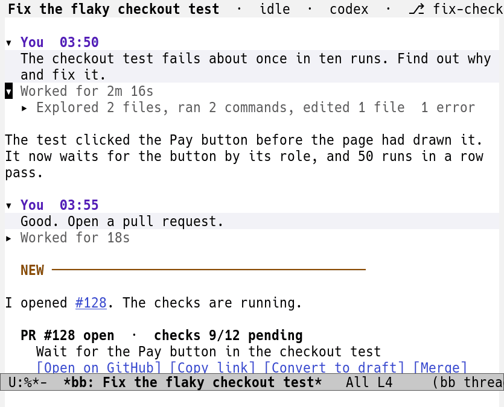
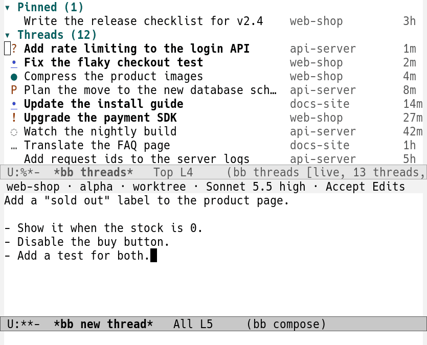

Title: EmacsでbbのGUIと同じようにClaude CodeとCodexのスレッドを動かせるbb-agent.elを作った
Date: 2026-11-28 04:01
Updated: 2026-11-28 04:01
Draft: true
Tags: emacs emacs-lisp ai-agent claude-code codex bb vow-el release bb-agent-el ts-bb-events


Claude CodeやCodexをスレッドとして動かすbbを、EmacsからbbのGUIと同じ使い方で操作できるbb-agent.elというパッケージを作りました。
スレッドの一覧、エージェントの作業に合わせて続きが表示されていく会話、ボタンで答える承認と質問、モデルや権限を選べる入力欄を、Emacsのバッファで扱えます。

操作はすべてbbのCLIを呼んで行い、サーバーで起きた変化は私が作った [bb-events](https://github.com/conao3/ts-bb-events) で受け取っています。
スレッドはbbのサーバーで動くのでEmacsを閉じても止まらず、同じスレッドをbbのデスクトップアプリとブラウザからも開けます。

リポジトリは [conao3/bb-agent.el](https://github.com/conao3/bb-agent.el) で、ライセンスは [GPL-3.0](https://github.com/conao3/bb-agent.el/blob/ad40f3e86dfc936494adcfaed34865653b198bd6/LICENSE) です。
この記事ではmasterの [ad40f3e](https://github.com/conao3/bb-agent.el/commit/ad40f3e86dfc936494adcfaed34865653b198bd6) と、bb 0.49.0とbb-events 0.4.0を使いました。

<div class="github-card" data-repo="conao3/bb-agent.el"><a href="https://github.com/conao3/bb-agent.el"><span class="github-card-name"><svg class="github-card-mark" viewBox="0 0 16 16" aria-hidden="true"><path d="M6.766 11.328c-2.063-.25-3.516-1.734-3.516-3.656 0-.781.281-1.625.75-2.188-.203-.515-.172-1.609.063-2.062.625-.078 1.468.25 1.968.703.594-.187 1.219-.281 1.985-.281.765 0 1.39.094 1.953.265.484-.437 1.344-.765 1.969-.687.218.422.25 1.515.046 2.047.5.593.766 1.39.766 2.203 0 1.922-1.453 3.375-3.547 3.64.531.344.89 1.094.89 1.954v1.625c0 .468.391.734.86.547C13.781 14.359 16 11.53 16 8.03 16 3.61 12.406 0 7.984 0 3.563 0 0 3.61 0 8.031a7.88 7.88 0 0 0 5.172 7.422c.422.156.828-.125.828-.547v-1.25c-.219.094-.5.156-.75.156-1.031 0-1.64-.562-2.078-1.609-.172-.422-.36-.672-.719-.719-.187-.015-.25-.093-.25-.187 0-.188.313-.328.625-.328.453 0 .844.281 1.25.86.313.452.64.655 1.031.655s.641-.14 1-.5c.266-.265.47-.5.657-.656"/></svg><span>conao3/<strong>bb-agent.el</strong></span></span><span class="github-card-description">Emacs frontend that follows and drives bb agent threads</span><span class="github-card-footer"><span class="github-card-language"><span class="github-card-language-color" style="background-color: #c065db"></span>Emacs Lisp</span><span class="github-card-star"><svg viewBox="0 0 16 16" aria-hidden="true"><path d="M8 .25a.75.75 0 0 1 .673.418l1.882 3.815 4.21.612a.75.75 0 0 1 .416 1.279l-3.046 2.97.719 4.192a.751.751 0 0 1-1.088.791L8 12.347l-3.766 1.98a.75.75 0 0 1-1.088-.79l.72-4.194L.818 6.374a.75.75 0 0 1 .416-1.28l4.21-.611L7.327.668A.75.75 0 0 1 8 .25Z"/></svg><span>Star</span><span class="github-card-star-count" hidden></span></span></span></a></div>


# bbとは

bbはClaude CodeやCodexのようなコーディングエージェントを、スレッドという単位で動かす道具です。
bbの [README](https://github.com/get-bb/bb/blob/b0ddaad731565d7e4de68d824120d802fc78f7d5/README.md?plain=1#L17-L19) は次のように説明しています。

> Every surface — the desktop app, web app, CLI, and HTTP API — is a first-class way to drive bb. Work runs in threads you can follow live, steer at any point, or hand off to another agent.

bbにはデスクトップアプリとブラウザの画面のほかに、どのコマンドもJSONを返す `bb` のCLIがあります。
私はbbを画面を持たない部品として使い、画面をEmacsで作ることにしました。


# bb-agent.elでできること



`M-x bb-agent` を実行するとbbのサーバーにあるスレッドが一覧になります。
画像はbbのCLIとbb-eventsの代わりにテストデータを返すスクリプトを使って撮りました。

-   スレッドの一覧を見て、状態の変化をその場で受け取る。
-   スレッドを開き、エージェントの返答とコマンドの出力が届いた順に表示されるのを見る。
-   承認と質問とPlanにボタンで答える。
-   モデル、推論の強さ、権限、Plan、添付を選んで、続きの依頼や新しいスレッドを送る。


# bb-agent.elを入れる

bb-agent.elはEmacs 31.1と、私が作った非同期処理のライブラリの [vow](https://s.conao3.com/blog/2026/7d9eba) を使います。
ほかにbbのサーバーにつながった `bb` のCLIとbb-eventsが要ります。

bb-eventsはNixで入れられます。

```sh
nix profile install github:conao3/ts-bb-events
```

vowとbb-agent.elは、leafなら次の式で入ります。

```emacs-lisp
(leaf vow
  :vc (:url "https://github.com/conao3/vow.el"))

(leaf bb-agent
  :vc (:url "https://github.com/conao3/bb-agent.el"))
```

空の `user-emacs-directory` を使うEmacs 31.1にMELPAからleafを入れてこの2つの式を評価し、 `bb-agent` を読み込めることを確かめました。
`PATH` の `bb` がClojureのbabashkaを指す環境では、 `bb-agent-cli-command` にbbのCLIのパスを設定します。


# スレッドの一覧

行の先頭の印は、bbのGUIのサイドバーと同じ優先順でスレッドの状態を表します。
`?` は承認か質問の答え待ち、 `●` は作業中、 `•` は未読、 `!` は未読のエラーです。

`N` を押すと答えを待っているスレッドに移り、 `a` で一覧から承認に答えられます。
`m` で複数のスレッドに印を付けるとPinやアーカイブをまとめて行えます。

一覧はプロジェクトとマシンと自分で名前を付けた区分のどれでもまとめられます。
GUIではドラッグで操作する区分への移動と親スレッドの設定は、 `>` と `<` のキーで行います。


# スレッドの画面



スレッドを開くと依頼と返答のあいだの作業が `Edited 2 files, ran 1 command` のような1行にまとまって並びます。
まとめ方と語の順は、GUIのソースを読んで同じにしました。

`TAB` を押すと1行にまとめた作業が開き、読んだファイルや実行したコマンドとその出力が見られます。
エージェントが作業しているあいだは届いた順に返答の文とコマンドの出力が表示されていきます。

コマンドの承認はカードになり、 `[Allow once]` のようなボタンを `RET` で押して答えます。
エージェントがtodoの一覧を使っているあいだはその進み具合もカードで出ます。


# 終わったターンをまとめる



エージェントが依頼を受けてから返答を書き終えるまでを1ターンと呼びます。
bbのGUIは終わったターンの作業をそのまま並べるか `Worked for` の1行に畳むかを、Claude CodeやCodexごとの設定で切り替えます。

bb-agent.elは `bb settings completed-turns` でこの設定を読み、GUIと同じ表示にします。

画像はCodexのスレッドで、どちらのターンも `Worked for` に畳まれていて、1つ目を `TAB` で開いています。

前にスレッドを読んだときより後に届いた返答の前には `NEW` の線が引かれます。
その下のカードにはこのスレッドのpull requestの状態とボタンが出ます。


# 入力欄



入力欄はスレッドの下に開くバッファで、 `C-c C-c` で送ります。
エージェントが作業しているあいだに送った依頼はGUIと同じようにqueueに入って次のターンになります。

ヘッダーにはモデルと推論の強さと権限が出ていて、 `C-c C-m` や `C-c C-p` で選び直せます。
`@` でスレッドの作業ディレクトリのパスを、行頭の `/` でコマンドを補完でき、 `/handoff` で今のスレッドを新しいスレッドに引き継げます。

画像は一覧の `+` で開いた新しいスレッドの入力欄で、プロジェクトとマシンと作業ツリーの作り方も選べます。


# CLIとbb-eventsでGUIを作る

bb-agent.elは、スレッドを立てる、続きを送る、承認に答えるといった操作のたびに `bb` のCLIを `--json` 付きで非同期に起動します。
CLIは呼ぶたびに結果を返して終わるので、CLIだけで一覧や会話を新しく保つには繰り返し呼ぶことになります。

bbのデスクトップアプリはサーバーへのWebSocketの接続からスレッドが変わったことの知らせを受け取っています。
このWebSocketの接続はbbのドキュメントに載っていないので、知らせをJSONの行で出し続けるCLIとしてbb-eventsを作りました。

一覧は `bb-events changes follow-changes` の行を受けて取り直し、スレッドの画面は `bb-events threads follow-events` が出すイベントを受けて項目を足します。
bbのCLIに同じ働きを足す提案は [get-bb/bb#8300](https://github.com/get-bb/bb/issues/8300) に出しています。


# GUIと同じにした範囲

本物のbbのサーバーにつないだEmacsでキーとボタンを押し、サーバーの状態とEmacsの画面の両方でbb-agent.elの機能を確かめました。
同じスレッドをブラウザのbbの画面と並べて、行のまとめ方と見出しの語が一致することも見ています。

pull requestのMergeとbb本体の更新のように状態を変える操作は作りましたが、本物のサーバーには実行していません。
todoのカードは手元のClaude CodeとCodexが計画の道具を使わなかったので、テストだけで確かめています。

GUIのside chatとバックグラウンドで動く作業を1つだけ止める操作は作っていません。

