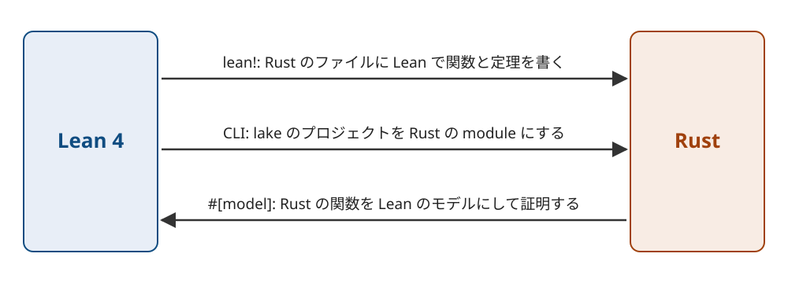

Title: Lean 4で証明した関数をRustから呼べるlean-rsを作った
Date: 2026-11-09 09:58


Lean 4で書いて証明した関数をRustから呼べるようにする、lean-rsを作りました。
逆向きに、Rustで書いた関数の性質をLeanで証明することもできます。
リポジトリは[conao3/lean-rs](https://github.com/conao3/lean-rs)で、ライセンスはApache-2.0です。
crates.ioには `lean-rust` の名前で公開していて、この記事は0.2.1で動かした結果をもとに書いています。

lean-rsはLeanのコンパイラの中間表現をRustのソースに変換します。
生成したRustはcargoだけでビルドでき、LeanのtoolchainもLeanのCのruntimeも要りません。
先日紹介した[lean-clj](https://s.conao3.com/blog/2026/4e5aa2)はLeanの関数をClojureから呼ぶもので、lean-rsはその仕組みをRustに移したものです。

<div class="github-card" data-repo="conao3/lean-rs"><a href="https://github.com/conao3/lean-rs"><span class="github-card-name"><svg class="github-card-mark" viewBox="0 0 16 16" aria-hidden="true"><path d="M6.766 11.328c-2.063-.25-3.516-1.734-3.516-3.656 0-.781.281-1.625.75-2.188-.203-.515-.172-1.609.063-2.062.625-.078 1.468.25 1.968.703.594-.187 1.219-.281 1.985-.281.765 0 1.39.094 1.953.265.484-.437 1.344-.765 1.969-.687.218.422.25 1.515.046 2.047.5.593.766 1.39.766 2.203 0 1.922-1.453 3.375-3.547 3.64.531.344.89 1.094.89 1.954v1.625c0 .468.391.734.86.547C13.781 14.359 16 11.53 16 8.03 16 3.61 12.406 0 7.984 0 3.563 0 0 3.61 0 8.031a7.88 7.88 0 0 0 5.172 7.422c.422.156.828-.125.828-.547v-1.25c-.219.094-.5.156-.75.156-1.031 0-1.64-.562-2.078-1.609-.172-.422-.36-.672-.719-.719-.187-.015-.25-.093-.25-.187 0-.188.313-.328.625-.328.453 0 .844.281 1.25.86.313.452.64.655 1.031.655s.641-.14 1-.5c.266-.265.47-.5.657-.656"/></svg><span>conao3/<strong>lean-rs</strong></span></span><span class="github-card-description">Lean 4 to Rust: run Lean functions from Rust, embed Lean in Rust with lean!, and verify Rust functions in Lean on top of Aeneas</span><span class="github-card-footer"><span class="github-card-language"><span class="github-card-language-color" style="background-color: #dea584"></span>Rust</span><span class="github-card-star"><svg viewBox="0 0 16 16" aria-hidden="true"><path d="M8 .25a.75.75 0 0 1 .673.418l1.882 3.815 4.21.612a.75.75 0 0 1 .416 1.279l-3.046 2.97.719 4.192a.751.751 0 0 1-1.088.791L8 12.347l-3.766 1.98a.75.75 0 0 1-1.088-.79l.72-4.194L.818 6.374a.75.75 0 0 1 .416-1.28l4.21-.611L7.327.668A.75.75 0 0 1 8 .25Z"/></svg><span>Star</span><span class="github-card-star-count" hidden></span></span></span></a></div>


# 3つの使い方

lean-rsの使い方は3つあります。



1.  `lean!` マクロを使い、Rustのファイルの中にLeanで関数と定理を書き、Rustから呼びます。
2.  CLIを使い、既存のlakeのプロジェクトをRustのmoduleの集まりに変換します。
3.  `#[lean_rust::model]` と `cargo lean-rust` を使い、Rustで書いた関数をLeanに変換し、その性質を証明します。

1と2はLeanからRustへ、3はRustからLeanへ変換します。


# LeanでRustの関数を書く

`Cargo.toml` に2つのcrateを追加し、 `build.rs` で `lean-rust-build` を呼びます。

```toml
[dependencies]
lean-rust = "0.2.1"

[build-dependencies]
lean-rust-build = "0.2.1"
```

```rust
// build.rs
fn main() {
    lean_rust_build::Builder::new().compile().unwrap();
}
```

初めてビルドするときは、Lean 4.35.0の `lake` と `lean-rust` のCLIを `PATH` に置いておきます。
`lake` はelanで、CLIはnixで入れられます。

```console
$ nix profile install github:conao3/lean-rs#lean-rust
```

`lean!` のブロックの中にはLeanのソースを文字列のまま書きます。

```rust
lean_rust::lean! {
    pub mod arith;
    r#"
    def double (n : Nat) : Nat := n + n

    theorem double_eq (n : Nat) : double n = 2 * n := by
      unfold double; omega

    structure Account where
      owner : String
      balance : Nat
    deriving DecidableEq

    def deposit (a : Account) (n : Nat) : Account :=
      { a with balance := a.balance + n }
    "#
}

fn main() {
    println!("{}", arith::double(21u64.into()));
    let a = arith::Account { owner: "ann".to_string(), balance: 10u64.into() };
    println!("{:?}", arith::deposit(a, 5u64.into()));
}
```

`double_eq` は `double` の定義を展開してから `omega` で等式を示しています。
`omega` は自然数と整数の線形算術を解くタクティクです。
`cargo build` を実行すると、build scriptがブロックをLeanのソースに書き出し、 `lake build` で定理の証明を検査します。
検査が通ると、ブロックの関数はmodule `arith` のRustの関数になります。
Leanの `Nat` は任意精度の `lean_rust::Nat` に、structureの `Account` はRustのstructになります。

```console
$ cargo run -q
42
Account { owner: "ann", balance: 15 }
```

証明が通らなければ、ビルドが失敗します。
定理の右辺を `3 * n` に書き換えてビルドすると、次のエラーになります。

```text
warning: demo@0.1.0: src/main.rs:7:22: error: omega could not prove the goal:
warning: demo@0.1.0:   a possible counterexample may satisfy the constraints
warning: demo@0.1.0:     a ≥ 1
warning: demo@0.1.0:   where
warning: demo@0.1.0:    a := ↑n
error: failed to run custom build command for `demo v0.1.0 (/path/to/demo)`
```

`src/main.rs:7:22` は `omega` を書いた位置です。
lean-rsは、Leanが報告した行と列を、Rustのファイルの中の位置に直して表示します。

生成したRustのコードは `.lean-rust/cache/` に保存されます。
ブロックを変えなければ、2回目からのビルドはLeanを呼ばずにこれを使います。
このキャッシュをcommitしておけば、Leanの入っていないCIでも、crates.ioからcrateを取得した利用者の環境でもビルドできます。

`lean!` マクロは生成済みのファイルを `include!` するだけなので、rust-analyzerがマクロを展開するときにLeanは動きません。

Leanの型とRustの型は次のように対応します。

<table border="2" cellspacing="0" cellpadding="6" rules="groups" frame="hsides">


<colgroup>
<col  class="org-left" />

<col  class="org-left" />
</colgroup>
<thead>
<tr>
<th scope="col" class="org-left">Lean</th>
<th scope="col" class="org-left">Rust</th>
</tr>
</thead>
<tbody>
<tr>
<td class="org-left"><code>Nat</code> 、 <code>Int</code></td>
<td class="org-left">任意精度の <code>lean_rust::Nat</code> 、 <code>lean_rust::Int</code></td>
</tr>

<tr>
<td class="org-left"><code>UInt8</code> 〜 <code>UInt64</code> 、 <code>Int8</code> 〜 <code>Int64</code></td>
<td class="org-left"><code>u8</code> 〜 <code>u64</code> 、 <code>i8</code> 〜 <code>i64</code></td>
</tr>

<tr>
<td class="org-left"><code>String</code></td>
<td class="org-left"><code>String</code></td>
</tr>

<tr>
<td class="org-left"><code>List α</code> 、 <code>Array α</code></td>
<td class="org-left"><code>Vec&lt;T&gt;</code></td>
</tr>

<tr>
<td class="org-left"><code>Option α</code> 、 <code>Except ε α</code></td>
<td class="org-left"><code>Option&lt;T&gt;</code> 、 <code>Result&lt;T, E&gt;</code></td>
</tr>

<tr>
<td class="org-left">structure、inductive</td>
<td class="org-left">生成した <code>struct</code> 、 <code>enum</code></td>
</tr>

<tr>
<td class="org-left"><code>IO α</code></td>
<td class="org-left"><code>std::io::Result&lt;T&gt;</code></td>
</tr>
</tbody>
</table>

型引数を持つ関数は、ブロックの中に `rust_instances largest [Nat, String]` のように型を指定すると、Rustのgenericな関数になります。
Rustから呼べるのは指定した型だけです。


# lakeのプロジェクトをRustのmoduleにする

lakeのプロジェクトとして書いたLeanのコードは、CLIでRustのmoduleに変換できます。
サンプルの[roman-numerals](https://github.com/conao3/lean-rs/tree/master/samples/roman-numerals)では、整数とローマ数字を相互に変換する関数をLeanで書いています。
1〜999の数をローマ数字にして戻すと元の数になることも、Leanで証明しています。

```lean
def toRoman (n : Nat) : String := toRomanAux (n + 13) numerals n

def fromRoman (s : String) : Option Nat :=
  if s.isEmpty then none else fromRomanAux s.toList

theorem roundtrip : ∀ n, n < 1000 → fromRoman (toRoman n) = if n = 0 then none else some n := by
  decide +kernel
```

`project generate` は `lake build` で証明を検査してから、moduleごとにRustのファイルを書き出します。

```console
$ lean-rust project generate --lake-dir lean --output-dir src/generated
```

Leanで公開している関数は、名前をsnake\_caseにしたRustの関数になります。

```rust
mod generated;
use generated::roman;

fn main() {
    assert_eq!(roman::to_roman(1994u64.into()), "MCMXCIV");
    assert_eq!(roman::from_roman("MMXXVI"), Some(2026u64.into()));
    assert_eq!(roman::from_roman("hello"), None);
}
```

`src/generated/` のファイルは普通のRustのソースなので、commitしておけば使う側にLeanは要りません。


# Rustの関数をLeanで証明する

3つ目の使い方では実装をRustで書き、その性質をLeanで証明します。
RustからLeanへの変換には[Charon](https://github.com/AeneasVerif/charon)と[Aeneas](https://github.com/AeneasVerif/aeneas)を使います。
Charonがrustcから関数の中間表現を取り出し、AeneasがそれをLeanの関数に変換します。
この変換で得たLeanの関数を、以下ではモデルと呼びます。

例として、2つの `u32` のうち大きい方を返す `max_u32` の性質を証明します。
証明したい仕様は `lean!` のブロックにLeanの関数で書き、以下ではspecと呼びます。
specの型にはAeneasのモデルの型を使い、 `u32` に当たる型は `Std.U32` です。
示すのは、 `max_u32` がspecの `max` と等しいことと、結果が両方の引数以上であることです。

```rust
lean_rust::lean! {
    #[lean(imports = ["Aeneas"])]
    pub mod bits;
    r#"
    open Aeneas Aeneas.Std

    def max (a b : Std.U32) : Std.U32 := if a.val ≤ b.val then b else a

    def max_bound (a b r : Std.U32) : Bool := decide (a.val ≤ r.val ∧ b.val ≤ r.val)
    "#
}

#[lean_rust::model(refines = bits::max, ensures(bound = bits::max_bound))]
pub fn max_u32(a: u32, b: u32) -> u32 {
    if a <= b { b } else { a }
}
```

`refines = bits::max` は、 `max_u32` がすべての入力で `bits::max` と同じ値を返すという主張です。
`ensures(bound = bits::max_bound)` は、結果が `max_bound` を満たすという主張です。
属性の引数ではspecをRustのpathで指すので、名前や引数の型を間違えるとコンパイルエラーになります。

`cargo lean-rust extract` は、CharonとAeneasでモデルを作り、主張ごとに証明すべきLeanの命題を書き出します。
lean-rsはこの命題をobligationと呼び、以下では義務と書きます。
証明はcrateの `lean/Proofs/` にLeanで書きます。

```lean
theorem max_u32.proof.refines : max_u32.obligation.refines := by
  intro a b
  unfold max_u32 _root_.bits.max
  by_cases h : a.val ≤ b.val <;> simp [UScalar.le_equiv, h]
```

`cargo lean-rust check` は証明を検査し、義務ごとの状態を `lean-rust.lock` に記録します。
サンプルの[verified-rust](https://github.com/conao3/lean-rs/tree/master/samples/verified-rust)では、ビットを数えるループと挿入ソートを含め、すべての義務を証明してあります。
義務ごとの状態は `cargo lean-rust status` で一覧できます。

```console
$ cargo lean-rust status
crate::bits::popcount_fast
  refines  proved    axioms: Classical.choice, Quot.sound, propext
crate::bits::max_u32
  refines  proved    axioms: Quot.sound, propext
  bound    proved    axioms: Classical.choice, Quot.sound, propext
crate::sort::insert_sorted
  sorted  proved    axioms: Classical.choice, Quot.sound, propext
  perm    proved    axioms: Classical.choice, Quot.sound, propext
```

`axioms:` の後ろには、証明が使った公理が並びます。
Leanの標準の公理はClassical.choice、Quot.sound、propextの3つです。
`sorry` で証明を飛ばした義務は `proved` の位置に `sorry` と、標準の3つ以外の公理を使った義務は `axioms` と表示されます。


## 普段のビルドにLeanもnightlyも要らない

Charonは決まった版のnightlyのRustで動きますが、Charonを呼ぶのは `cargo lean-rust extract` だけです。
普段の `cargo build` はstableのRustで動きます。
build scriptは `lean-rust.lock` と今のソースを比べて、モデルを作ったときから関数が変わっていないかを確かめます。
`max_u32` の `<=` を `<` に書き換えてビルドすると、証明が古くなったという警告が出ます。

```text
warning: verified-rust@0.1.0: lean-rust: crate::bits::max_u32: 2 obligations are stale (crate::bits::max_u32 changed since `cargo lean-rust extract`)
```

`Cargo.toml` の `[package.metadata.lean-rust]` に `require = "proved"` を書くと、証明の済んでいない義務があるときにビルドが失敗します。
環境変数 `LEAN_RUST_REQUIRE=proved` でも同じ動作になるので、CIだけで必須にするときはこちらを使います。


## 証明を書く前にテストで間違いを見つける

`#[lean_rust::model]` は、Rustの関数とspecを同じ入力で呼んで結果を比べるテストを生成します。
入力はproptestが作ります。
specはLeanの関数をRustにコンパイルしたものなので、テストと証明で同じ定義を使えます。
`max_u32` を小さい方を返すように書き換えて `cargo test` を実行すると、次のように失敗します。

```text
Test failed: the function returned 0, and the spec bits::max returned 1 at samples/verified-rust/src/bits.rs:17.
minimal failing input: __args = (
    0,
    1,
)
```

メッセージには、関数とspecがそれぞれ返した値と、食い違いの出た最小の入力が表示されます。


## 証明したRustの実装をLeanから呼ぶ

Leanでは、2つの関数が等しいという定理に `@[csimp]` を付けると、コンパイル時に一方の呼び出しを他方へ置き換えられます。
`refines` の証明が通ると、 `cargo lean-rust check` はこの `@[csimp]` の補題を書き出します。
ただし、引数の前提条件を書く `requires` を付けた関数は対象外です。
lean-rsはこの補題でspecの `bits::max` をRustの `max_u32` に置き換えるので、Leanの側で `max` を呼んでも、実行されるのはRustの関数です。
読みやすいspecをLeanで、速い実装をRustで書き、等しいことを証明してから差し替えられます。


# 仕組み

lean-rsが生成するRustは、LeanのC backendが書き出すCのコードをそのままRustに写したものです。
runtimeのcrateである `lean-rust-runtime` は、objectの配置と参照カウントを `lean.h` と同じ形でRustに実装しています。
生成コードは、参照カウントが1の値を複製せずにその場で書き換えます。
そのため、 `Array` の更新などの性能の特性はC backendと変わりません。
`deposit` の生成コードにも、 `lean_is_exclusive` で `Account` の参照カウントが1かを確かめ、1なら同じobjectを書き換える分岐があります。

```rust
x_3 = rt::lean_ctor_get(x_1, 0);
x_4 = rt::lean_ctor_get(x_1, 1);
x_12 = (!rt::lean_is_exclusive(x_1)) as u8;
```

C backendは、関数の中で分岐が合流する先と自己末尾呼び出しを `goto` で書きます。
Rustには `goto` が無いので、lean-rsは関数の本体を `loop` の中の `match` にします。
移動先の基本ブロックの番号を書き換えて `continue` することで、 `goto` を表しています。

RustからLeanの関数を呼ぶには、C backendの出力とLeanのruntimeをリンクして、FFIで呼ぶ方法もあります。
[lean-sys](https://crates.io/crates/lean-sys)などはこの方法で、ビルドにも実行にもLeanのtoolchainが要ります。
lean-rsはruntimeをRustで書き直したので、Cのライブラリをリンクせず、Rustのcrateだけで動きます。

生成コードの内部の関数は `unsafe` ですが、公開する関数はRustの値を受け渡す安全な関数です。

`IO` も、ファイル、ディレクトリ、環境変数、子プロセスなどCのruntimeと同じ範囲を実装しています。
OSのエラーはCのruntimeと同じ文面の `IO.Error` になります。

lean-rsが生成したRustは、LeanのC backendでビルドしたプログラムと同じ出力を返します。
テストには、整数、浮動小数点数、文字列、リスト、配列、クロージャ、ファイルや子プロセスの `IO` などを使うLeanのコードを用意しています。
これをlean-rsとC backendの両方で実行し、標準出力と標準エラーが1文字も違わないことをCIで確かめています。


# できないこと

-   参照カウントはatomicではありません。
-   `Task` は別スレッドを作らず、作った場所で同期的に実行します。
-   runtimeをビルドできるのはLinuxとmacOSだけです。
-   `#[lean_rust::model]` で検証できるのは、Aeneasが扱えるRustだけです。 `unsafe` 、内部可変性、並行処理を含む関数は検証できません。
-   2つのmoduleが同じLeanの型を使うと、別々のRustの型が2つできます。型を共有するには、 `uses` でブロック同士を結びます。


# おわりに

[samples/steps](https://github.com/conao3/lean-rs/tree/master/samples/steps)には、最初の `lean!` のブロックからgenericな関数の検証まで、機能を1つずつ試せる17段階のサンプルがあります。
Issue / PR大歓迎です。

