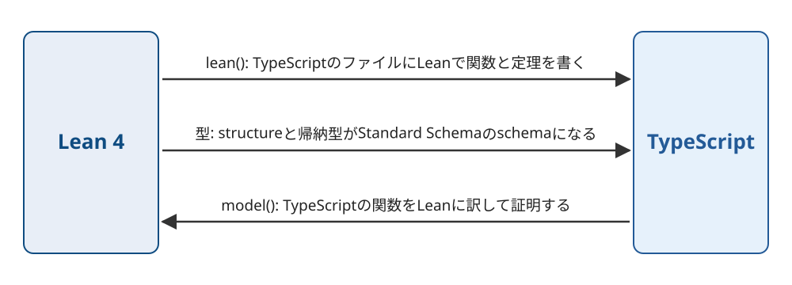

Title: Lean 4で証明した関数をTypeScriptから呼べるlean-tsを作った
Date: 2026-11-12 17:01
Draft: true


Lean 4で書いて証明した関数をTypeScriptから呼べるようにする、lean-tsを作りました。
Leanのstructureと帰納型はStandard Schemaのschemaになり、zodのschemaと同じようにHonoのバリデータにそのまま渡せます。
逆向きに、TypeScriptで書いた関数をLeanに訳して、その性質をLeanで証明することもできます。
リポジトリは[conao3/lean-leanfranのTypeScript/](https://github.com/conao3/lean-leanfran/tree/master/TypeScript)で、ライセンスはApache-2.0です。
npmには `lean-ts` の名前で公開していて、この記事は0.5.0で動かした結果をもとに書いています。

lean-tsはLeanのコンパイラの中間表現をTypeScriptのソースに変換します。
生成したTypeScriptは `lean-ts` のパッケージだけで動き、実行するときにLeanは要りません。
[lean-clj](https://s.conao3.com/blog/2026/4e5aa2)、[lean-rs](https://s.conao3.com/blog/2026/b43a06)、[lean-py](https://s.conao3.com/blog/2026/dc65bb)はLeanの関数をClojure・Rust・Pythonから呼ぶもので、lean-tsは同じ仕組みをTypeScriptに移したものです。
4つはlean-leanfranのリポジトリにまとめています。

<div class="github-card" data-repo="conao3/lean-leanfran"><a href="https://github.com/conao3/lean-leanfran"><span class="github-card-name"><svg class="github-card-mark" viewBox="0 0 16 16" aria-hidden="true"><path d="M6.766 11.328c-2.063-.25-3.516-1.734-3.516-3.656 0-.781.281-1.625.75-2.188-.203-.515-.172-1.609.063-2.062.625-.078 1.468.25 1.968.703.594-.187 1.219-.281 1.985-.281.765 0 1.39.094 1.953.265.484-.437 1.344-.765 1.969-.687.218.422.25 1.515.046 2.047.5.593.766 1.39.766 2.203 0 1.922-1.453 3.375-3.547 3.64.531.344.89 1.094.89 1.954v1.625c0 .468.391.734.86.547C13.781 14.359 16 11.53 16 8.03 16 3.61 12.406 0 7.984 0 3.563 0 0 3.61 0 8.031a7.88 7.88 0 0 0 5.172 7.422c.422.156.828-.125.828-.547v-1.25c-.219.094-.5.156-.75.156-1.031 0-1.64-.562-2.078-1.609-.172-.422-.36-.672-.719-.719-.187-.015-.25-.093-.25-.187 0-.188.313-.328.625-.328.453 0 .844.281 1.25.86.313.452.64.655 1.031.655s.641-.14 1-.5c.266-.265.47-.5.657-.656"/></svg><span>conao3/<strong>lean-leanfran</strong></span></span><span class="github-card-description">Write and prove functions in Lean 4, run them as Rust, Python, TypeScript and Clojure</span><span class="github-card-footer"><span class="github-card-language"><span class="github-card-language-color" style="background-color: #dea584"></span>Rust</span><span class="github-card-star"><svg viewBox="0 0 16 16" aria-hidden="true"><path d="M8 .25a.75.75 0 0 1 .673.418l1.882 3.815 4.21.612a.75.75 0 0 1 .416 1.279l-3.046 2.97.719 4.192a.751.751 0 0 1-1.088.791L8 12.347l-3.766 1.98a.75.75 0 0 1-1.088-.79l.72-4.194L.818 6.374a.75.75 0 0 1 .416-1.28l4.21-.611L7.327.668A.75.75 0 0 1 8 .25Z"/></svg><span>Star</span><span class="github-card-star-count" hidden></span></span></span></a></div>


# 3つの使い方

lean-tsの使い方は3つあります。



1.  TypeScriptのファイルの中にLeanで関数と定理を書き、TypeScriptから呼ぶ。 `lean(...)` と `lean-ts sync` を使う。
2.  Leanのstructureと帰納型を、Standard Schemaのschemaとして受け渡す。zodで書いたschemaをLeanから使うこともできる。
3.  TypeScriptで書いた関数をLeanに訳し、その性質をLeanで証明する。 `model(...)` と `lean-ts check` を使う。

1と2はLeanからTypeScriptへ、3はTypeScriptからLeanへの向きです。


# TypeScriptのファイルにLeanを書く

npmのパッケージと、Leanのコードを変換するCLIの `lean-typescript` を入れます。
CLIはnixで入れられます。

```console
$ npm i lean-ts
$ nix profile install 'github:conao3/lean-leanfran?dir=TypeScript'
```

証明を検査するときは、Lean 4.35.0の `lake` も `PATH` に要ります。

`lean(...)` にはLeanのソースを `String.raw` のテンプレート文字列で書きます。
生成されるmoduleは隣の `_lean/` に置かれるので、そのmoduleをimportして呼びます。

```typescript
// src/arith.ts
import { lean } from "lean-ts"
import * as arith from "./_lean/arith.ts"

export const block = lean(
  "arith",
  String.raw`
def double (n : Nat) : Nat := n + n

theorem double_eq (n : Nat) : double n = 2 * n := by
  unfold double; omega

structure Range where
  lo : Nat
  hi : Nat
  ok : lo ≤ hi

def Range.width (r : Range) : Nat := r.hi - r.lo
`,
)

export { arith }
```

`double_eq` は `double` の定義を展開してから `omega` で等式を示しています。
`omega` は自然数と整数の線形算術を解くタクティクです。
`lean-ts sync` は `src/` の下のファイルからoxc-parserで `lean(...)` のブロックを集めます。
集めたブロックの証明は `lake build` で検査します。
検査が通ると、ブロックのLeanのコードをTypeScriptに変換して `src/_lean/` に書き出します。

```console
$ npx lean-ts sync --package .
lean-ts: 1 blocks of /path/to/demo checked and generated
```

書き出したmoduleからは、型の付いたTypeScriptの関数を呼べます。

```typescript
import { stringify } from "lean-ts/schema"
import { arith } from "./arith.ts"

console.log(arith.double(21))
console.log(arith.double(2n ** 70n))
const r: arith.Range = { lo: 3n, hi: 10n }
console.log(arith.Range.width(r))
console.log(stringify(arith.Range, r))
```

```text
42n
2361183241434822606848n
7n
{"lo":3,"hi":10}
```

Leanの `Nat` はTypeScriptの `bigint` になり、 `2n ** 70n` のような大きな数もそのまま渡せます。
引数には、安全な整数に収まる `number` も渡せます。
structureの `Range` は `{ readonly lo: bigint; readonly hi: bigint }` の型になり、同じ名前のschemaにもなります。

証明が通らなければ、 `lean-ts sync` が失敗します。
定理の右辺を `3 * n` に書き換えると、次のエラーになります。

```text
lean-ts: /path/to/demo/src/arith.ts:10:18: error: (lean block arith, Lean 5:17) omega could not prove the goal:
a possible counterexample may satisfy the constraints
  a ≥ 1
where
 a := ↑n
lean-ts: lake build failed
```

`arith.ts:10` は `omega` を書いた行です。
lean-tsは、Leanが報告した行を、TypeScriptのファイルの中の行に直して表示します。

`lean-ts sync` には `lake` と `lean-typescript` が要りますが、書き出した `_lean/` はただのTypeScriptのファイルです。
`_lean/` と `.lean-ts/blocks.json` をリポジトリにcommitしておけば、Leanの入っていない環境でもパッケージは動きます。
実行するときは、生成したmoduleが今のブロックのソースから作られたものかを `lean(...)` が確かめます。
ブロックを書き換えたまま `lean-ts sync` を忘れると、importの時点で止まります。

```text
LeanBlockStale: the Lean block "arith" is stale (it has changed since `lean-ts sync` generated it); run `lean-ts sync` (or set LEAN_TS_AUTO_SYNC=1)
```


# Leanの型がStandard Schemaのschemaになる

Leanの型とTypeScriptの型は次のように対応します。

<table border="2" cellspacing="0" cellpadding="6" rules="groups" frame="hsides">


<colgroup>
<col  class="org-left" />

<col  class="org-left" />
</colgroup>
<thead>
<tr>
<th scope="col" class="org-left">Lean</th>
<th scope="col" class="org-left">TypeScript</th>
</tr>
</thead>
<tbody>
<tr>
<td class="org-left"><code>Nat</code> 、 <code>Int</code></td>
<td class="org-left"><code>bigint</code></td>
</tr>

<tr>
<td class="org-left"><code>String</code></td>
<td class="org-left"><code>string</code></td>
</tr>

<tr>
<td class="org-left"><code>Bool</code></td>
<td class="org-left"><code>boolean</code></td>
</tr>

<tr>
<td class="org-left"><code>List α</code> 、 <code>Array α</code></td>
<td class="org-left"><code>α[]</code></td>
</tr>

<tr>
<td class="org-left"><code>Option α</code></td>
<td class="org-left"><code>α</code> または <code>null</code></td>
</tr>

<tr>
<td class="org-left">structure</td>
<td class="org-left">readonlyなプロパティを持つobject</td>
</tr>

<tr>
<td class="org-left">引数のない構成子だけの帰納型</td>
<td class="org-left">文字列リテラルのunion</td>
</tr>

<tr>
<td class="org-left">その他の帰納型</td>
<td class="org-left"><code>ctor</code> で区別するunion</td>
</tr>

<tr>
<td class="org-left"><code>IO α</code></td>
<td class="org-left"><code>α</code> を返し、 <code>IO.Error</code> を <code>LeanIOError</code> として投げる</td>
</tr>
</tbody>
</table>

帰納型のunionを区別するプロパティの名前は、 `package.json` の `"lean-ts"` の設定で選べます。
`Option` を `null` と `undefined` のどちらにするかも、同じ設定で選べます。

[Standard Schema](https://standardschema.dev/)は、zod・valibot・ArkTypeなどのバリデーションのライブラリが共通に実装しているインターフェースです。
Leanのstructureと帰納型には、同じ名前のschemaが生成されます。
このschemaは `StandardSchemaV1` と `StandardJSONSchemaV1` を実装しています。
HonoやtRPCのように、Standard Schemaを受け取るライブラリにはlean-tsのschemaをそのまま渡せます。

`Range` には、 `lo ≤ hi` の証明を持つフィールド `ok` があります。
証明はTypeScriptの値にはなりません。
lean-tsはこの命題を判定する関数をLeanで作り、TypeScriptに変換してschemaの検査に使います。

```typescript
console.log(arith.Range["~standard"].validate({ lo: 10, hi: 3 }))
```

```text
{ issues: [ { message: 'Range.ok: lo ≤ hi', path: [] } ] }
```

Leanの関数に渡る値は、すべてこの検査を通ります。
命題を満たさない値を渡すと、関数は `LeanValidationError` を投げます。
そのため、 `ok` を前提にしたLeanの証明は、TypeScriptから渡した値についても成り立ちます。
`p ≤ 100` のような定数との比較は、JSON Schemaに `maximum` として出ます。

schemaが受け取るJSONはLeanの `deriving ToJson, FromJson` と同じ形にしています。
帰納型は、引数のない構成子が `"none"` 、引数を持つ構成子が `{"percent": {"p": 10}}` になります。
Leanの `toJson` の出力と同じになることを、テストで確かめています。

zodで書いたschemaを、Leanのstructureとして使うこともできます。
`lean(..., { models: { LineItem } })` と書くと、lean-tsはzodのschemaが出すJSON Schemaを読んでLeanのstructureを作り、ブロックから使えるようにします。

```typescript
export const LineItem = z.object({
  sku: z.string().min(1),
  qty: z.number().int().min(1),
  unitPrice: z.number().int().min(0),
})
```

このschemaは次のLeanのstructureになります。

```lean
structure LeanTsModels.pricing.LineItem where
  qty : Nat
  qty_ge : 1 ≤ qty
  qty_le : qty ≤ 9007199254740991
  sku : String
  sku_min_length : 1 ≤ sku.length
  unitPrice : Nat
  unitPrice_le : unitPrice ≤ 9007199254740991
```

`min` などの制約は証明を持つフィールドになるので、Leanの証明の中で `1 ≤ qty` を前提として使えます。
zodの `int()` は安全な整数を表すので、上限の `9007199254740991` も前提になります。
下限が0以上の整数はLeanの `Nat` になります。

次の例では、structureの `Order` が `LineItem` とLeanの帰納型 `Discount` を持ちます。
この `Order` を、Honoのリクエストの型にしています。
サンプルの[pricing-api](https://github.com/conao3/lean-leanfran/tree/master/TypeScript/samples/pricing-api)から抜き出しています。

```typescript
export const block = lean(
  "pricing",
  String.raw`
inductive Discount where
  | none
  | percent (p : Nat) (h : p ≤ 100)
  | fixed (amount : Nat)

structure Order where
  items : List LineItem
  discount : Discount

def subtotal (items : List LineItem) : Nat :=
  items.foldl (fun acc i => acc + i.qty * i.unitPrice) 0

def total (o : Order) : Nat :=
  match o.discount with
  | .none => subtotal o.items
  | .percent p _ => subtotal o.items - subtotal o.items * p / 100
  | .fixed a => subtotal o.items - a

theorem total_le (o : Order) : total o ≤ subtotal o.items := by
  unfold total; split <;> omega
`,
  { models: { LineItem } },
)

export const app = new Hono()
  .post("/total", sValidator("json", pricing.Order), (c) =>
    c.json({ total: Number(pricing.total(c.req.valid("json"))) }),
  )
```

`total_le` は、どの割引でも合計が小計を超えないことを示しています。
`sValidator` は `@hono/standard-validator` のパッケージにある、HonoのStandard Schemaのバリデータです。
単価120のりんご3個と単価200の梨1個の注文を、割引を変えて送った結果は次のとおりです。

```text
"none" 200 560
{"percent":{"p":25}} 200 420
{"fixed":{"amount":1000}} 200 0
{"percent":{"p":150}} 400 Discount.percent.h: p ≤ 100
qty 0 400 Too small: expected number to be >=1
```

`p` が100を超える割引と、 `qty` が0の注文は、Honoが400で返します。
`qty` の検査はzodのschemaが行うので、エラーの文はzodのものです。
schemaの `jsonSchema.input` からは、OpenAPIのschemaも作れます。
作られたschemaには、 `Discount` の3つの構成子と `p` の上限が出ます。


# TypeScriptの関数をLeanで証明する

3つ目の使い方では、実装をTypeScriptで書き、その性質をLeanで証明します。
仕様はLeanのブロックに書き、TypeScriptの関数とは `model(...)` でつなぎます。

```typescript
import { lean } from "lean-ts"
import { model } from "lean-ts/verify"
import * as spec from "./_lean/calc.ts"

export const specBlock = lean(
  "spec",
  String.raw`
def clampSpec (x lo hi : Int) : Int := max lo (min hi x)
def ordered (_x lo hi : Int) : Bool := lo ≤ hi
def inRange (_x lo hi : Int) (r : Int) : Bool := lo ≤ r && r ≤ hi
`,
)

export function clamp(x: number, lo: number, hi: number): number {
  if (x < lo) return lo
  if (x > hi) return hi
  return x
}

model(clamp, {
  refines: spec.clampSpec,
  requires: spec.ordered,
  ensures: { inRange: spec.inRange },
})
```

`refines` は、 `clamp` がすべての入力で `clampSpec` と同じ値を返すという主張です。
`requires` は前提で、 `ensures` は結果が満たす条件です。
`model` は関数を記録するだけなので、 `clamp` は普通のTypeScriptの関数として動きます。

`lean-ts check` はoxc-parserで関数を読んでLeanの `do` 記法に訳し、主張ごとに証明すべき命題を作ります。
Leanの `do` 記法には、変数の再代入、 `for` 、 `while` 、途中の `return` があるので、TypeScriptの文がほぼそのまま対応します。

```lean
def clamp (x : Int) (lo : Int) (hi : Int) : Int := Id.run do
  if (decide (x < lo)) then
    return lo
  if (decide (x > hi)) then
    return hi
  return x
```

`refines` から作る命題は、名前の前半を省くと次のとおりです。

```lean
abbrev clamp.obligation.refines : Prop :=
  ∀ (x : Int) (lo : Int) (hi : Int), ordered x lo hi = true → (clamp x lo hi) = (clampSpec x lo hi : Int)
```

TypeScriptの `number` はLeanの `Int` に訳します。
そのため、証明は `number` の引数と途中の値が安全な整数であることを前提にしています。
小数を扱う関数の性質は、この方法では示せません。
`bigint` と、 `lean-ts/schema` の `Nat` ・ `Int` の型を付けた引数には、この前提が要りません。

証明は `package.json` の隣の `lean/Proofs/` にLeanで書きます。

```lean
import LeanTsModel.calc

namespace LeanTsModel.calc

theorem clamp.proof.refines : clamp.obligation.refines := by
  intro x lo hi h
  simp only [LeanTsEmbed.calc.spec.ordered, decide_eq_true_eq] at h
  simp only [clamp, LeanTsEmbed.calc.spec.clampSpec]
  split <;> (try split) <;> simp_all <;> omega
```

`lean-ts check` は主張ごとに証明の状態を表示します。
リポジトリのテストに使っているパッケージには、 `clamp` のほかに、配列の先頭を返す `firstOr` や、絶対値の和を返す `sumAbs` があります。

```console
$ npx lean-ts check --package .
lean-ts: 3 blocks of /path/to/app checked and generated
proved      src/calc.ts:clamp refines
proved      src/calc.ts:clamp inRange
proved      src/calc.ts:firstOr refines
sorry       src/calc.ts:sumTo refines
missing     src/calc.ts:sumTo returnsNat
proved      src/calc.ts:sumAbs nonneg
axioms      src/calc.ts:twice refines
proved      src/calc.ts:addOne refines
```

`proved` は証明が通ったこと、 `sorry` は証明に `sorry` が残っていること、 `missing` は証明がないことを表します。
`axioms` は、Leanの標準の公理のほかに、自分で置いた公理を使っている証明です。
定理の主張が命題と食い違っていれば `mismatch` に、証明のファイルがビルドできなければ `failed` になります。
`--require proved` を付けると、すべてが `proved` でないときに失敗するので、CIで使えます。

結果は `lean-ts.lock` に、関数のソースのハッシュと一緒に記録されます。
`lean-ts status` はLeanを使わずにこのファイルを読み、証明したあとにソースが変わった関数を `stale` と表示します。
生成したmoduleは、 `requires` のない `refines` が証明された関数を、仕様の関数の代わりに呼びます。

証明を書く前に、同じ仕様でテストすることもできます。
`checkModel` は引数の型注釈から[fast-check](https://fast-check.dev/)で値を作り、 `requires` を満たす入力について `refines` と `ensures` を確かめます。
仕様の `clampSpec` もLeanから変換したTypeScriptの関数なので、Leanで証明する対象と同じ計算がテストの基準になります。
`hi` で頭打ちにするのを忘れた実装には、反例が見つかります。

```typescript
export function badClamp(x: number, lo: number, hi: number): number {
  return Math.max(lo, x)
}

model(badClamp, { refines: spec.clampSpec, requires: spec.ordered })

await checkModel(badClamp)
```

```text
PropertyFailure: badClamp(0, -1, -1) = 0, the spec gives -1n
```


# 仕組み

lean-tsは、Leanのコンパイラが最後に作る中間表現を読み、関数ごとにTypeScriptの関数を書き出します。
この中間表現には参照カウントの増減と、参照が1つしかないオブジェクトを使い回す指示が入っています。
TypeScriptの実行時のライブラリも、構成子のオブジェクトと配列に参照カウントを持たせています。
配列への追加や更新は、参照が1つのときにその場で行います。
そのため、 `Array` に要素を足していくループは、Cにコンパイルしたときと同じく要素数に比例する時間で終わります。
配列に100万個の要素を足し、更新し、合計するループは0.44秒で、Cにコンパイルしたものは0.016秒です。
計測した値は[READMEのPerformance](https://github.com/conao3/lean-leanfran/tree/master/TypeScript#performance)に載せています。

Leanの組み込みの関数は、LeanのCのruntimeの `lean.h` に合わせて、同じ振る舞いをTypeScriptで書いています。
テストでは、同じLeanのプログラムをCにコンパイルして動かしたときと、TypeScriptに変換して動かしたときの出力を比べています。
標準出力と標準エラー出力と終了コードが一致します。
生成したTypeScriptは `tsc --strict` の型検査を通ります。


# おわりに

LeanでTypeScriptの関数を書けるようにし、Leanの型をStandard Schemaのschemaにし、TypeScriptの関数をLeanで証明できるようにしました。
使い方を1つずつ試せるサンプルは[samples](https://github.com/conao3/lean-leanfran/tree/master/TypeScript/samples)にあります。

