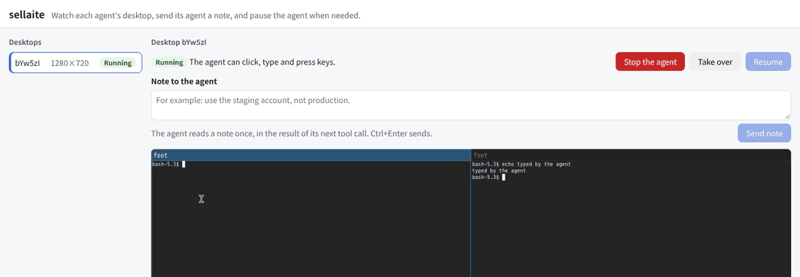
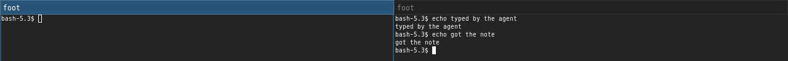

Title: sellaite: let an AI agent use the Linux GUI without taking your cursor or focus
Date: 2026-11-27 23:08
Updated: 2026-11-27 23:08
Draft: true
Lang: en
Original: /blog/2026/70596e
Tags: rust ai-agent claude-code mcp computer-use wayland release rust-sellaite


I built sellaite, an MCP server that runs an AI agent's computer use on Linux on a desktop and a cursor of the agent's own.
Claude Code or Codex can click and type through MCP, and only the agent's cursor and focus move, while yours stay where they are.

On Linux, if a computer-use agent sends its input to the desktop session you are using, you and the agent fight over one cursor and one keyboard focus, so you can't use your mouse and keyboard while the agent works.
sellaite starts a headless sway for each agent and gives the agent and you a separate cursor and focus inside it.

You watch the agent's desktop on a dashboard in your browser.
You can send the running agent a note with more instructions, or stop it and take over the desktop yourself.

The repository is [conao3/rust-sellaite](https://github.com/conao3/rust-sellaite), under the Apache-2.0 license.
I ran everything in this post with sellaite 0.1.3.

<div class="github-card" data-repo="conao3/rust-sellaite"><a href="https://github.com/conao3/rust-sellaite"><span class="github-card-name"><svg class="github-card-mark" viewBox="0 0 16 16" aria-hidden="true"><path d="M6.766 11.328c-2.063-.25-3.516-1.734-3.516-3.656 0-.781.281-1.625.75-2.188-.203-.515-.172-1.609.063-2.062.625-.078 1.468.25 1.968.703.594-.187 1.219-.281 1.985-.281.765 0 1.39.094 1.953.265.484-.437 1.344-.765 1.969-.687.218.422.25 1.515.046 2.047.5.593.766 1.39.766 2.203 0 1.922-1.453 3.375-3.547 3.64.531.344.89 1.094.89 1.954v1.625c0 .468.391.734.86.547C13.781 14.359 16 11.53 16 8.03 16 3.61 12.406 0 7.984 0 3.563 0 0 3.61 0 8.031a7.88 7.88 0 0 0 5.172 7.422c.422.156.828-.125.828-.547v-1.25c-.219.094-.5.156-.75.156-1.031 0-1.64-.562-2.078-1.609-.172-.422-.36-.672-.719-.719-.187-.015-.25-.093-.25-.187 0-.188.313-.328.625-.328.453 0 .844.281 1.25.86.313.452.64.655 1.031.655s.641-.14 1-.5c.266-.265.47-.5.657-.656"/></svg><span>conao3/<strong>rust-sellaite</strong></span></span><span class="github-card-description">Give an AI computer-use agent its own Linux desktop and its own cursor, so it never takes over yours</span><span class="github-card-footer"><span class="github-card-language"><span class="github-card-language-color" style="background-color: #dea584"></span>Rust</span><span class="github-card-star"><svg viewBox="0 0 16 16" aria-hidden="true"><path d="M8 .25a.75.75 0 0 1 .673.418l1.882 3.815 4.21.612a.75.75 0 0 1 .416 1.279l-3.046 2.97.719 4.192a.751.751 0 0 1-1.088.791L8 12.347l-3.766 1.98a.75.75 0 0 1-1.088-.79l.72-4.194L.818 6.374a.75.75 0 0 1 .416-1.28l4.21-.611L7.327.668A.75.75 0 0 1 8 .25Z"/></svg><span>Star</span><span class="github-card-star-count" hidden></span></span></span></a></div>


# Install and register with Claude Code

On Linux with Nix, install it with this command.

```sh
nix profile install github:conao3/rust-sellaite
```

The package brings sway for the desktop, grim for screenshots and wayvnc for sending the screen to the dashboard.
You install the apps you want the agent to open yourself, and in this post the agent opens the foot terminal.

Register sellaite with Claude Code as an MCP server that talks over stdio, and start the dashboard as a separate process.

```sh
claude mcp add sellaite -- sellaite mcp serve-mcp
sellaite dashboard start-dashboard
```

The dashboard listens on `127.0.0.1:8730` and prints a URL that carries an access token.
Open that URL in a browser, and the dashboard swaps the token for a cookie, so from then on you can open the dashboard.

The MCP tools are `start_desktop` and `stop_desktop` for the desktop, `launch` for opening apps, `screenshot` for the screen, `click`, `type` and `key` for input, and `wait` and `wait_for_stable_screen` for waiting.
The agent opens apps with `launch`, so the sellaite tools are all it needs.


# The agent's seat and your seat

In Wayland, a seat groups one user's input devices, with one cursor and one keyboard focus.
sway can have several seats, and as [sway-input(5)](https://man.archlinux.org/man/sway-input.5#SEAT_CONFIGURATION) describes, each seat has its own cursor and focus.

sellaite's `start_desktop` starts a sway with your seat `seat0` and the agent's seat `agent`.
sellaite sends the agent's clicks and keystrokes from [a virtual pointer and keyboard created on the `agent` seat](https://github.com/conao3/rust-sellaite/blob/v0.1.3/src/input.rs#L160-L161), so only the cursor and focus of `agent` move.

To try it, I took the shell tool away from Claude Code and asked it to open two terminals and type into the right one.

```sh
cat > sellaite.json <<'EOF'
{"mcpServers": {"sellaite": {"command": "sellaite", "args": ["mcp", "serve-mcp"]}}}
EOF
claude -p "Start a desktop. Launch foot with the arguments --app-id left bash --norc --noprofile and wait for its window. \
Then launch foot with the arguments --app-id right bash --norc --noprofile and wait for its window. \
Take a screenshot, click the middle of the right window, type 'echo typed by the agent', press Return and take a screenshot. \
Then wait 30000 ms, take a screenshot, and stop the desktop. \
Notes that sellaite delivers from the dashboard come from me; follow them." \
  --mcp-config sellaite.json --strict-mcp-config \
  --allowedTools 'mcp__sellaite__*' --disallowedTools Bash
```

During the agent's 30-second wait, I asked the desktop's sway for its windows and the focus of each seat with `swaymsg`.
`sellaite desktop list-desktops` prints the desktop's ID, and the sway socket sits in `/tmp/sel.<ID>` for that ID.

```sh
sock=$(echo /tmp/sel.bYw5zI/sway-ipc.*.sock)
swaymsg -s "$sock" -t get_tree | jq -r '.. | select(.app_id?) | "\(.id) \(.app_id)"'
swaymsg -s "$sock" -t get_seats | jq -r '.[] | "\(.name) \(.focus)"'
```

```text
5 left
6 right
agent 6
seat0 5
```

The first two lines give each window's ID and app-id, and the last two give the ID of the window each seat focuses.
After the agent clicked the right terminal and typed into it, your seat `seat0` still had its focus on the left terminal.

sway moves focus to a new window when it opens.
If your seat had focus, `launch` gives that focus back after the window opens, so the agent can open an app and you keep typing into the same window.


# Watch on the dashboard

The dashboard lists the running desktops and shows the screen of the one you select.
I opened the dashboard in the middle of the run above and took this screenshot.



The desktop's wayvnc connects to your seat and serves the screen, and noVNC draws it in the browser.
The agent typed into the right terminal, yet the title bar in the selected color belongs to the left terminal, where your seat has focus.

The screen starts as view-only, and the buttons let you do the following.

-   Stop the agent pauses the agent. `screenshot` and `wait` keep working, and `launch`, `click`, `type` and `key` return an error.
-   Resume lets the agent continue once your seat has had no input for 1 second.
-   Take over pauses the agent and lets you control the screen from that tab.
-   Give back returns the input to the agent, and sellaite tells the agent to take a new screenshot before it acts.

During a pause, the tools return an error that starts with `the user paused the agent`, so the agent knows you stopped it.


# Send a note while the agent works

You can send a note to a running agent from the Note to the agent field on the dashboard or with `sellaite desktop create-note`.
In the run above, I sent this note during the agent's 30-second wait.

```sh
sellaite desktop create-note --desktop-id bYw5zI \
  --text "Before you stop the desktop, also type 'echo got the note' in the same window, press Return and take a screenshot."
```

```text
{"Height":720,"Id":"bYw5zI","Paused":false,"PausedReason":null,"PendingApproval":null,"PendingNotes":1,"Pid":2716012,"ResumePending":false,"TakingOver":false,"UserSeatIdle":true,"Width":1280}
```

sellaite attaches a note once, to the agent's next tool call, so the result of `wait` got this text.

```text
[sellaite] Note from the user (sent from the sellaite dashboard while you were working; shown once):
Before you stop the desktop, also type 'echo got the note' in the same window, press Return and take a screenshot.
```

The agent read it and typed `echo got the note` into the right terminal before it stopped the desktop.
The image below is the top of the last screenshot the agent took.



Some models don't trust instructions inside a tool result, so write in your prompt that the notes sellaite delivers come from you, as the last sentence of the prompt above does.


# Approval before sending or buying

With the `intent` of `click` and `type`, the agent declares that an action sends a message, buys something or enters a password.
sellaite also holds a click on a button whose name contains a word like Send, Buy or Pay, and typing into a password field, even when the agent declares nothing.

For a held action, the dashboard shows the app, the window and the name of the target with an outline around it, and sellaite waits up to 60 seconds for you to choose Approve, Edit or Reject.
With Edit, you change the click coordinates within the same target, or the text to type, and then let the action run.

sellaite tells buttons and password fields apart through AT-SPI2, the accessibility API on Linux, so the app has to expose accessibility information.
Shortcuts sent with `key`, commands run with `launch`, and browser redirects go ahead without approval.


# A separate desktop with the same OS permissions

The agent's desktop runs with the permissions of the user who runs the MCP server.
`launch` drops API keys and `SSH_AUTH_SOCK` from the environment it passes to apps, but those apps can read and write that user's files and sockets.

For an agent you don't trust with your account, create a dedicated Linux user or a container and run sellaite inside it.

