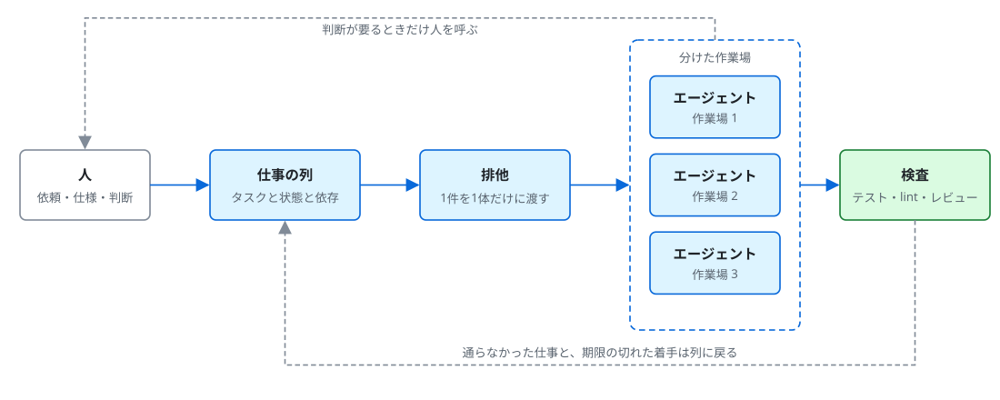

Title: AIの「ソフトウェア工場」の現在地を1968年からの歴史で読む
Date: 2026-11-21 14:20
Draft: true
Tags: ai-agent history vercel-board


コーディングエージェントを何体も並べて、人がほとんど見ないままPRがマージされていく開発を「ソフトウェア工場」と呼ぶ人が増えました。

<div class="tweet-card"><a href="https://x.com/happy_ryo/status/2123942567746375930"><span class="tweet-card-header"><span class="tweet-card-author"><strong>happy_ryo</strong><span>@happy_ryo</span></span><svg class="tweet-card-logo" viewBox="0 0 24 24" aria-hidden="true"><path d="M18.244 2.25h3.308l-7.227 8.26 8.502 11.24H16.17l-5.214-6.817L4.99 21.75H1.68l7.73-8.835L1.254 2.25H8.08l4.713 6.231zm-1.161 17.52h1.833L7.084 4.126H5.117z"/></svg></span><span class="tweet-card-text">Orcaとかを使わずに、自前でコーディングエージェントを用いたソフトウェアファクトリーを実装していて、こんな感じの作りにしている。一番気を掛けているのは、窓口になるエージェント1体以外は人間が見なくて良いこと。OSSとして公開してる。</span><time class="tweet-card-time" datetime="2026-11-20T19:52:23-0500">2026-11-20 19:52</time></a></div>

このポストを見て自分でも組みたくなり、「工場」という言葉がどこから来て、いまどこまで出来ているのかを調べてみました。

調べてみるとソフトウェアを工場で作る考えは1968年からあり、成果を左右してきたのは書く速さよりも仕事の受け渡し方と確かめる仕組みでした。
いまのAIの工場も同じ場所で苦労していて、構成はどの事例もよく似た形に落ち着いたのですが、成果を外から確かめた数字はまだほとんどありません。


# 1968年のソフトウェア工場

「ソフトウェア工場」という言葉は、1968年のNATOのソフトウェア工学会議でGeneral ElectricのR. W. Bemerが出した提案に出てきます。
会議の[報告書](https://web.archive.org/web/2016/http://homepages.cs.ncl.ac.uk/brian.randell/NATO/nato1968.PDF)は、Bemerの作業文書を次のように引いています。

> By utilizing the machine-controlled production environment, or software factory. Program construction, checkout and usage are done entirely within this environment using the tools it contains. Ideally it should be impossible to produce programs exterior to this environment.

Bemerが工場と呼んだのは、プログラムの作成と検査をすべてその中で行わせる、機械が管理する環境です。

翌1969年には日立がソフトウェアの部門を神奈川工場から独立させました。
日立の[沿革](https://www.hitachi.co.jp/Div/soft/history.html)はこれを「世界で最初のソフトウェア専門事業所」と書いていて、東芝や日本電気や富士通も1970年代に同じ方向へ進みます。

アメリカではSystem Development Corporationが1975年ごろに約200人のソフトウェア工場を作ったのですが、数年で使われなくなりました。
MITのMichael Cusumanoが1991年に書いた[草稿](https://www.gregorystrachta.com/resources/Touchstones/swp-3268-23661042.pdf)によると、顧客ごとのプロジェクトの責任者は仕様を工場へ渡すより自分で作りたがり、道具もプロジェクトの間で使い回せなかったそうです。

成果が数字で残っている工場は東芝の府中です。
同じ草稿によると納めたコードのうち既存のものを再利用した行の割合が1979年の13%から1985年の48%に上がり、東芝は生産性と品質が上がった主な理由を再利用だとしています。

一方でFred Brooksは1986年の[No Silver Bullet](https://www.cs.unc.edu/techreports/86-020.pdf)で次のように書きました。

> There is no single development, in either technology or management technique, which by itself promises even one order of magnitude improvement in productivity, in reliability, in simplicity.

ソフトウェアの難しさは仕様と設計と検査にあるので、書き表す手間を減らしても桁は変わらないという指摘です。

2004年にはMicrosoftも[Software Factories](https://learn.microsoft.com/en-us/archive/blogs/askburton/moving-to-software-factories-2)を掲げて、分野ごとの言語とひな型でアプリケーションを組み立てる道具をVisual Studioに載せました。
その道具のページには[2011年11月に保守を終えた](https://learn.microsoft.com/en-us/previous-versions/msp-n-p/ff648577(v=pandp.10))と書かれています。

こうして並べると標準化と計測と再利用とビルドから検査までの自動化はいまの開発に残っています。
仕様を別の部門に渡して作らせる形と、すべてを生成しようとした重い道具は続きませんでした。


# 2023年から2025年、1体から並列へ

LLMで同じ発想が戻ってきたのは2023年です。
[MetaGPT](https://arxiv.org/abs/2308.00352)の論文は、役割を持つエージェントに標準の手順を与える構成を「assembly line paradigm」と呼びました。

ところが同じ年に出たベンチマークの[SWE-bench](https://arxiv.org/abs/2310.06770)では、実際のGitHubのissueを解けた割合が最も良いモデルでも1.96%でした。
2024年3月にCognitionが出した[Devin](https://cognition.com/blog/introducing-devin)は、この値を13.86%にしたと発表しています。

流れが変わったのは2025年5月で、Cursorの[background agent](https://cursor.com/changelog/0-50)とOpenAIの[Codex](https://openai.com/index/introducing-codex/)、GitHub Copilotの[coding agent](https://github.blog/news-insights/product-news/github-copilot-meet-the-new-coding-agent/)、Googleの[Jules](https://blog.google/technology/google-labs/jules/)が1週間のうちに出そろいました。
どれもタスクを渡すと離れた環境で作業してPRを返すもので、Codexの発表は「work on many tasks in parallel」と書いています。

1人が何体も同時に動かす使い方は、ここで普通になりました。

その2か月後にGeoffrey Huntleyが書いた[Ralph](https://ghuntley.com/ralph/)は、この使い方を最も短い形にしたものです。

```bash
while :; do cat PROMPT.md | claude-code ; done
```

同じプロンプトを繰り返し読ませて、テストが通るまで回し続けます。

同じ月にMETRが出した[実験](https://metr.org/blog/2025-07-10-early-2025-ai-experienced-os-dev-study/)では、経験のあるOSSの開発者がAIを使うと作業が19%長くかかり、本人たちは20%速くなったと感じていました。
速くなった実感と測った結果が食い違ったことは、あとで出てくる数字を読むときにも関わってきます。


# 窓口の系譜と列の系譜

並列に動かせるようになると、次に足りなくなるのは人の注意でした。
ここから先の道具は人がどこで話すかを決める系譜と仕事をどこに積むかを決める系譜に分かれて進みます。

人がどこで話すかを決めたのが、2025年11月にリポジトリが作られた[OpenClaw](https://github.com/openclaw/openclaw)です。
自分のマシンで動かし続けるエージェントで、DiscordやSlackのような普段のチャットから話しかけます。

OpenClawではGatewayという常駐のプロセスがセッションと道具とチャットの接続を受け持ちます。
[スケジューラ](https://docs.openclaw.ai/automation/cron-jobs)が決まった時刻にエージェントを起こし、[sub-agent](https://docs.openclaw.ai/tools/subagents)は裏で動いて結果を頼んだ側へ知らせます。

人が話す相手は1体で起こす役と裏の作業はその後ろに隠れるという、冒頭のポストの「窓口」と同じ形がここにあります。

仕事をどこに積むかを決めたのが、OpenAIが2026年4月に公開した[Symphony](https://openai.com/index/open-source-codex-orchestration-symphony/)です。
OpenAIの技術者は1人で3から5のセッションまでなら無理なく見られたのですが、それを超えると切り替えの負担で生産性が落ちたと書いています。

> For every open task, guarantee that an agent is running in its own workspace.

SymphonyはLinearのissueを見張り、開いているタスクごとに作業場を1つ用意してエージェントを動かし続けます。
セッションを人が見張る代わりに、issueの状態が仕事の進み具合を表します。

この2つの系譜を1つにまとめようとしたのが、Vercelが2026-11-18に出した[Vercel Board](https://vercel.com/blog/introducing-vercel-board)だと私は読んでいます。
Boardはエージェントと人が共有する掲示板で、スレッドは会話であると同時にタスクにもなり、タスクは期限付きで1体だけに貸し出されます。


# 2026年、工場を名乗る事例

「工場」という言葉が広まったのは2026年に入ってからです。
Dan ShapiroはAIの使い方を5つの段階に分けて、最後の段階を「Dark Factory」と呼びました。

Simon Willisonの[紹介](https://simonwillison.net/2026/Jan/28/the-five-levels/)によると、仕様を入れるとソフトウェアが出てくる黒い箱のことで、人が要らないので照明も要らない工場という意味です。

その段階を運用していると公表したのがStrongDMで、Willisonの[訪問記](https://simonwillison.net/2026/Feb/7/software-factory/)には次の2つの決まりが載っています。

> Code must not be written by humans
> 
> Code must not be reviewed by humans

人が読まない代わりにエージェントには見せない検証用のシナリオを用意して、OktaやSlackのような外部サービスの模造品の上で動きを確かめるそうです。
費用については、技術者1人あたり1日に1,000ドルをトークンに使っていなければ改善の余地があるという目安が書かれています。

構成を詳しく公開した事例も続きました。
Cursorは数百体のエージェントでブラウザを一から作る実験の[報告](https://cursor.com/blog/scaling-agents)で、全員が同じ立場でロックを取り合う構成では20体いても2、3体ぶんの速さしか出なかったと書いています。

最終的には計画役と作業役と判定役に分けていて、品質を見る統合役は詰まる場所になったので外したそうです。

Anthropicの[Cコンパイラの実験](https://www.anthropic.com/engineering/building-c-compiler)は司令役を置かず、16体のClaudeがgitのリポジトリに置いたロックのファイルで仕事を分けました。
約2,000回のセッションと2万ドルのAPIの費用で、Linuxのカーネルをビルドできる10万行のコンパイラができています。

OpenAIの[harness engineering](https://openai.com/index/harness-engineering/)の記事は、3人の技術者がCodexだけで約1,500件のPRをマージした経験を書いたもので、合言葉は「Humans steer. Agents execute.」です。
人は層の依存の向きを守らせるlintと構造のテストを用意していて、コードが増える速さに人のQAが追いつかなくなったとも書いています。


# いまの到達点

事例を並べると、どの工場も同じ部品でできています。



仕事の列と1件を1体だけに渡す排他、エージェントごとに分けた作業場と人の代わりに確かめる検査です。

<table border="2" cellspacing="0" cellpadding="6" rules="groups" frame="hsides">


<colgroup>
<col  class="org-left" />

<col  class="org-left" />

<col  class="org-left" />

<col  class="org-left" />
</colgroup>
<thead>
<tr>
<th scope="col" class="org-left">事例</th>
<th scope="col" class="org-left">仕事の列</th>
<th scope="col" class="org-left">排他と作業場</th>
<th scope="col" class="org-left">確かめ方</th>
</tr>
</thead>
<tbody>
<tr>
<td class="org-left">Cursorの実験</td>
<td class="org-left">計画役が作るタスク</td>
<td class="org-left">作業役が1件ずつ受け持つ</td>
<td class="org-left">周期の終わりに判定役が続けるかを決める</td>
</tr>

<tr>
<td class="org-left">AnthropicのCコンパイラ</td>
<td class="org-left">各エージェントが次に直す問題を選ぶ</td>
<td class="org-left">gitに置くロックのファイルとコンテナごとのclone</td>
<td class="org-left">テストスイートとGCCとの比較</td>
</tr>

<tr>
<td class="org-left">Symphony</td>
<td class="org-left">Linearのissue</td>
<td class="org-left">issueごとの作業場</td>
<td class="org-left">CIの結果を付けて人が受け入れる</td>
</tr>

<tr>
<td class="org-left">Vercel Board</td>
<td class="org-left">掲示板のタスク</td>
<td class="org-left">期限付きの貸し出し</td>
<td class="org-left">修正が終わると着手できるレビューのタスク</td>
</tr>
</tbody>
</table>

どの報告でも、人の仕事はコードを書くことから仕様と検査と環境を作ることへ移っています。
Lauren Tanは[講演](https://ai.engineer/code/2026/talks/lauren-tan)で、エージェントが同じ失敗を繰り返すときは注意書きを増やすより型やlintやテストで防ぐよう勧めて、月に約11,000件のPRで差し戻しが約0.5%だったと報告しました。

ただ、ここまでの数字はどれも当事者が出したものです。
VercelはBoardの上に作り直したv0の工場がPRの50%超をマージしていると書いていますが、分母も期間も差し戻しの割合も載っていません。

METRは2026年2月の[追跡調査](https://metr.org/blog/2026-02-24-uplift-update/)で、新しい実験のデータは現在の効果を測る信号として信頼できないと書きました。
AIなしで作業することを嫌って参加を断る開発者が増えたので、速くなる度合いを低く見積もる偏りが入ったそうです。


# 歴史から読めること

1つ目は、中央に渡す形が詰まることです。
System Development Corporationの工場は仕様の受け渡しで行き詰まり、Cursorの統合役はおよそ50年後に同じ場所で詰まりました。

AnthropicとVercelの構成が司令役を置かずに排他だけを決めているのは、この失敗を避けた形だと思っています。

2つ目は、効いたのが標準と再利用と検査だったことです。
東芝は生産性と品質が上がった理由に再利用を挙げていて、OpenAIはlintのエラーの文面に直し方まで書いて同じ失敗を機械に止めさせました。

3つ目は、Brooksの指摘がそのまま残っていることです。
エージェントは書き表す手間をほぼ消しましたが、仕様と検査の難しさは人の側に残り、StrongDMのシナリオやOpenAIのlintはその難しさに人の時間を使った結果に見えます。

4つ目は、Bemerの「環境の外では作れないようにする」がようやく安く実現できるようになったことです。
エージェントごとの作業場と決まりに反する操作を実行の前に止めるhookは、1968年の提案の2026年の姿だと思います。


# 手元で組んでみた形

私もVercel Boardを自宅のデスクトップで動かして、Tailscaleのネットワークの中でノートPCと共有してみました。
タスクにホストとエージェントの種類のラベルを付けると、そのホストの常駐がタスクを取ってエージェントに渡します。

設定は[nixos-configurationのagent-board.nix](https://github.com/conao3/nixos-configuration/blob/master/home-manager/features/agent-board.nix)に置いてあります。
自分で書いたのはタスクを取ってエージェントを起こす数十行のシェルだけで、列と排他と記録はBoardに任せました。

タスクのスレッドに返信すると同じエージェントが続きを進めるようにしたので、ブラウザから依頼と返事を書くだけで仕事が進みます。

使ってみると数分おきに方針を変えるような企画の段階は、エージェントと直接話すほうが速く進みました。
工場に向いているのは方針が固まって切り出せる仕事で、そこに渡す前の仕様と受け取ったあとに確かめる仕組みを私が用意できるかどうかで結果が変わります。

次は人待ちになったタスクを知らせる通知と、検査を先に用意してから仕事を切る進め方を試すつもりです。

