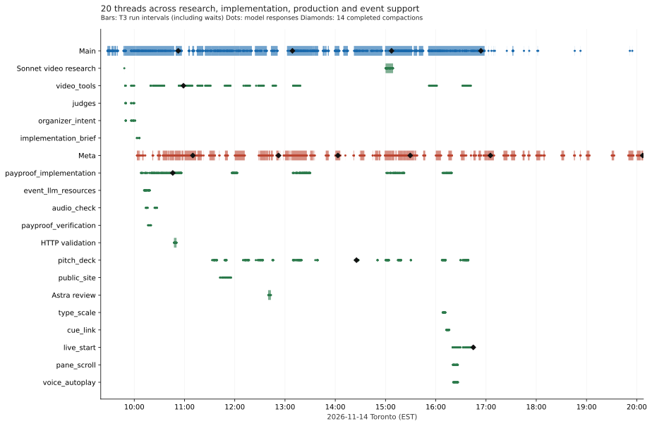
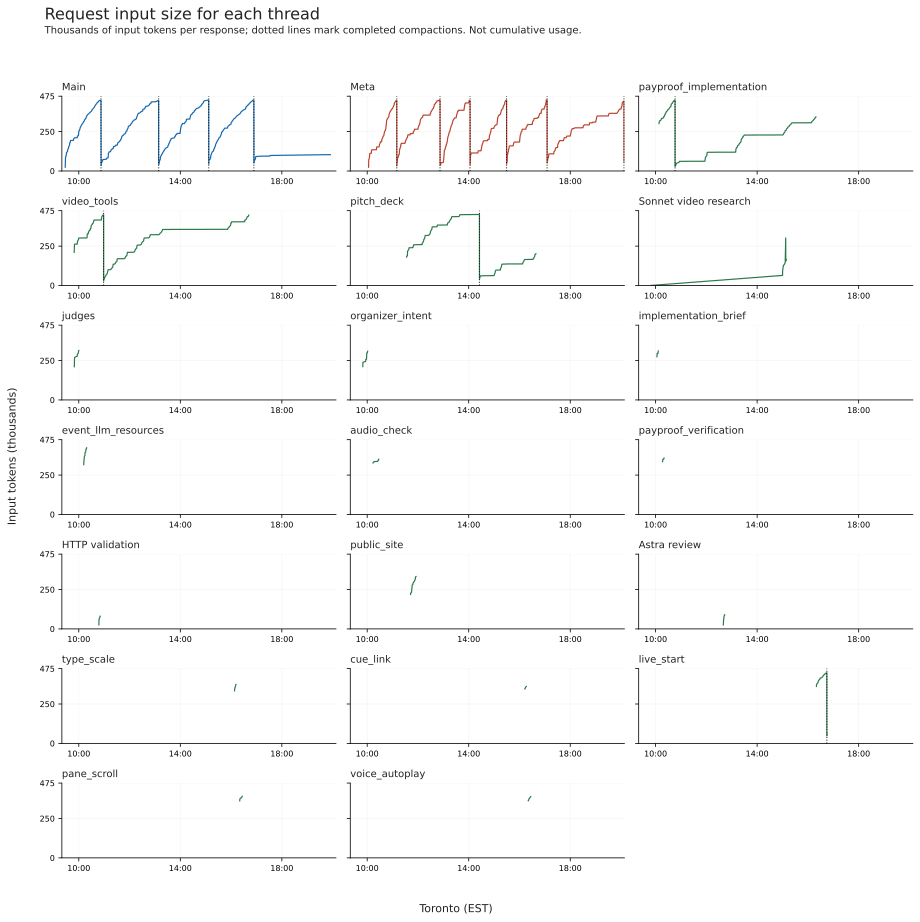
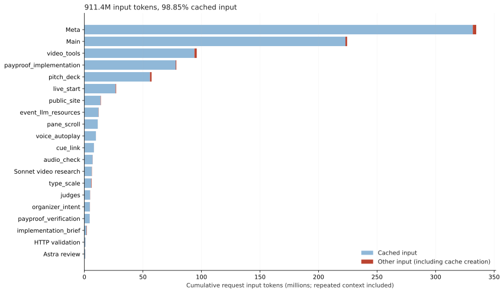

Title: 20のAIスレッドと参加したMongoDBハッカソンの一日
Date: 2026-11-14 20:15
Draft: true

トロントのMongoDBハッカソンに1人で参加し、AIエージェントと一緒にPayProofという請求書処理アプリを作りました。
決勝の6チームには残れませんでしたが、かなり楽しい一日でした。
振り返って面白かったのは、実装、検証、動画制作、運営情報の収集、私自身の発表準備を、それぞれ別のAIとの会話で進めたことです。
作業に関係したスレッドは20本、完了したコンパクションは14回ありました。

<a href="https://github.com/conao3/ts-payproof"><svg class="github-card-mark" viewBox="0 0 16 16" aria-hidden="true"><path d="M6.766 11.328c-2.063-.25-3.516-1.734-3.516-3.656 0-.781.281-1.625.75-2.188-.203-.515-.172-1.609.063-2.062.625-.078 1.468.25 1.968.703.594-.187 1.219-.281 1.985-.281.765 0 1.39.094 1.953.265.484-.437 1.344-.765 1.969-.687.218.422.25 1.515.046 2.047.5.593.766 1.39.766 2.203 0 1.922-1.453 3.375-3.547 3.64.531.344.89 1.094.89 1.954v1.625c0 .468.391.734.86.547C13.781 14.359 16 11.53 16 8.03 16 3.61 12.406 0 7.984 0 3.563 0 0 3.61 0 8.031a7.88 7.88 0 0 0 5.172 7.422c.422.156.828-.125.828-.547v-1.25c-.219.094-.5.156-.75.156-1.031 0-1.64-.562-2.078-1.609-.172-.422-.36-.672-.719-.719-.187-.015-.25-.093-.25-.187 0-.188.313-.328.625-.328.453 0 .844.281 1.25.86.313.452.64.655 1.031.655s.641-.14 1-.5c.266-.265.47-.5.657-.656"/></svg>conao3/<strong>ts-payproof</strong>Auditable invoice agent for Canadian construction businesses. Built for Agents in Context Toronto.TypeScript<svg viewBox="0 0 16 16" aria-hidden="true"><path d="M8 .25a.75.75 0 0 1 .673.418l1.882 3.815 4.21.612a.75.75 0 0 1 .416 1.279l-3.046 2.97.719 4.192a.751.751 0 0 1-1.088.791L8 12.347l-3.766 1.98a.75.75 0 0 1-1.088-.79l.72-4.194L.818 6.374a.75.75 0 0 1 .416-1.28l4.21-.611L7.327.668A.75.75 0 0 1 8 .25Z"/></svg>Star</a>

横軸は当日のトロント時刻です。
帯はT3 Codeに記録された実行区間、点はモデルの応答、黒いひし形はコンパクションの完了を表します。
帯にはツールや報告の待ちも含むので、モデルが計算していた時間そのものではありません。
同時に20体が動いていたわけでもありません。

# 何を作ったか

参加したのは、2026年11月14日に開催された [Agents in Context Toronto: a MongoDB Hackathon](https://cerebralvalley.ai/e/mongodb-toronto-hackathon) です。
MongoDB Atlasを使い、実際の業務を継続して処理できるエージェントを作るイベントでした。
私は「Agents You Can Audit」という課題を選びました。

PayProofは、請求書のメールに普段と異なる振込先が書いてあったら支払いを保留するアプリです。
カナダの建設・請負業の中小企業を想定しました。
AIがメールを読んで振込先を抽出し、サーバーが登録口座と照合します。
別の担当者が登録済みの連絡先で変更を確認し、具体的な金額と口座を承認してから、支払い処理へ進みます。
承認後に金額や口座が変わると、その承認は無効になります。

この題材には、[Canadian Anti-Fraud Centreの発表](https://antifraudcentre-centreantifraude.ca/news-nouvelles/2026/2026-05-13-eng.htm) を使いました。
同機関は振込先変更を使った詐欺の事例と、信頼できる連絡先を使って独立に確認する対策を紹介しています。
「怪しいかどうかをAIに判断させる」だけで済ませず、この確認を実行前の条件にしました。
Atlasには権限、登録口座、請求書のバージョン、承認、操作履歴を保存します。
LLMとAtlasは実際に接続し、人による業務確認と送金先のシステムはデモ用に模擬しました。

後半にはElevenLabsの音声認識と読み上げを加え、「なぜこの支払いが保留されているのか」を音声で質問できるようにしました。
回答にはAtlasの記録に基づく根拠を表示します。
音声からの操作は照会に限り、承認と支払いにはそれぞれの操作が必要です。

[紹介サイト](https://conao3.github.io/ts-payproof/)、[スライド](https://conao3.github.io/ts-payproof/slides/)、[スマートフォン用カンペ](https://conao3.github.io/ts-payproof/cue/)、[提出した1分動画](https://www.youtube.com/watch?v=QneL7pynr7k) を公開しています。
ソースコードのライセンスはApache-2.0です。
以下は当日の20:08までの記録です。
時刻はすべてトロントのESTで、会話の報告時刻とGitのコミット時刻を使っています。

# 9:27〜10:07 調査担当を分けて題材を決める

最初の入力は「今日のイベントの準備しよう」でした。
レポジトリを作るのは10時以降と決め、それまではルールや提出条件を調べてもらいました。
ガイドとDiscordには開発開始時刻の違いがありましたが、当日9:25の運営回答では開会前からコーディングしてよいと案内されていました。

9:47に、提出用の1分動画をプレーンテキストから作れるツールの調査を依頼しました。
最初に起動したClaudeの調査担当は利用制限で止まり、私が了承してCodexへ切り替えました。
動画ツール、審査員の来歴、運営が求めている作品の3つを並行して調べてもらいました。
主に使ったモデルはGPT-6.1 Solで、後に成果物のレビューだけGPT-6 Astraへ依頼しています。

私からは「カナダの人が関心のある具体的な問題を取り上げたい」と伝えました。
9:59には振込先変更詐欺の公的な事例と、それを保留・確認・承認の流れで扱う案が出ていました。
10:07の [最初のコミット](https://github.com/conao3/ts-payproof/commit/6d16d7e) でPayProofのレポジトリを作っています。

この時点で、メインには判断と統合、担当エージェントには実装、検証、動画を割り当てる方針ができました。
共有の作業ツリーで進めたので、同じ資料を複数の担当者が書き換えないようにする必要がありました。
そこで担当を増やすだけでなく、変更してよいファイルや報告先も指定しています。

# 10:03〜11:18 メタセッションを作り、割り込みで失敗する

実装の進行と並行して、私は別の会話を開きました。
この会話をメタセッションと呼び、エージェントとの協業そのものを相談し、Discordやメール、現地アナウンスの情報収集も担当してもらいました。
メインへは判断に必要な差分だけを渡す分担です。

10:48には、私から「このメタ的な情報処理についてはあなたがやって、メインセッションに調査から依頼しないように」と伝えています。
調査の依頼文をメインへ転送するだけでは、実装側の仕事が増えてしまうからです。
メタ自身が情報を取得し、調べ終えた結果を渡すようにしました。

別のAIアシスタントMuseが運営に連絡したという話も、メタから確認しました。
実際の送信メールと照合すると、Atlasの招待依頼であり、生成LLMのクレジットについての問い合わせとは別でした。
誰かが質問済みという話でも、何を聞いたのかまで確かめる必要がありました。

最初に気になったのはSteerの挙動でした。
T3 Codeではエージェントの実行中にも追加の入力を送れます。
ただ、追加質問に答えたあと、元の依頼を続けてくれない経験がありました。

当日もそれが起きました。
Lumaには15人と表示されていたのに、会場にはもっと多くの人がいました。
人数を調べてもらっている途中で、録音の確認や音声の警告について質問したところ、メタはそちらに答えて人数調査を終えないまま応答を終了しました。
11:15に私が「人の件について調べて報告して。やっぱりsteerで割り込むと忘れるな」と言っています。

再調査では、公式Cerebral Valleyの参加者一覧に400件あることが分かりました。
これは登録一覧の数で、実際の来場者数ではありません。
Lumaの15人とも母集団が違います。

この失敗で確認できたのは、会話に依頼が残っていても、未完了の仕事が継続されるとは限らないことです。
Steerによってコンテキストが消えたと確かめられたわけではありません。
そこで未完了の依頼、完了条件、次の操作をファイルに書き、追加質問への回答後と最終応答前に照合する手順を加えました。

# 10:07〜10:50 実装担当と検証担当を分ける

10:42には、[請求書の承認と模擬支払いの主要実装](https://github.com/conao3/ts-payproof/commit/ecd1029) がコミットされました。
最初のコミットから34分55秒です。
ただし、ここでアプリ全体の完成や、私が実演できる状態まで到達したわけではありません。

実装担当とは別の検証担当が、作業途中のコードから2件の問題を見つけていました。
1つは請求番号の前後に空白を加えると、同じ請求書の重複防止を回避できる問題です。
もう1つは無効なエージェントで処理すると、請求書が抽出中のまま残り、再試行できなくなる問題でした。
実装担当へ報告し、修正と試験につなげています。

さらに、引き継ぐ情報を絞った別の担当に、実際のHTTP経由で独立した検証を依頼しました。
10:50の報告では、権限の偽装、自己承認、別テナントの読み取り、金額変更後の旧承認を拒否することを確認しています。
同時に支払い要求を送っても模擬台帳が1件になり、レシートと承認内容が一致することも確かめました。

この分業は、動いたという実装担当の報告だけで完成とするのを避けるために役立ちました。
一方で、この検証はHTTPの範囲に限られます。
文字サイズ、動画の操作、マイク、スマートフォンの表示には問題が残っており、後で私が実際に使って見つかりました。

# 11時台〜12時台 動画とサイトを作りながら説明を直す

動画はRemotionで実画面、図、字幕、BGMを合成する構成にしました。
私からは「BIIM兄貴スタイルをトロントで披露しましょう」と注文しました。
左に実演、右に図解、下に字幕の領域を設け、英語の字幕を長めに表示するものです。

途中では、次の場面へ移るタイミングが分からず、右側の説明欄へ時間バーを加えました。
さらに、秒数をラベルで説明するより、バーとレイアウトで分かるようにしてほしいと依頼しています。
動画担当は映像を作り、メインが内容を確認し、私は読みやすさと伝わり方について注文する形でした。

11:40には紹介サイトとリポジトリの公開を指示し、11:54に [スクリーンショット付きのサイトとスライド](https://github.com/conao3/ts-payproof/commit/def5ebf) がコミットされました。
その後も、問題を公的な事例から説明すること、スライドの主張を大きく書くこと、最後をSummaryで終えることを求めました。

12:39にはAstraに、その時点のサイト、6枚のスライド、動画v6、原稿をレビューしてもらいました。
重大な問題は見つからず、動画末尾の模擬範囲の開示が小さいという指摘が1件ありました。
静止画の確認と音声を含む連続視聴は別の確認として扱っています。
また、その後に更新した成果物までレビュー済みとはしませんでした。

# 12:53〜13:29 私の理解が追い付かず、音声機能を加える

12:53の私の発言が、この日の協業をよく表していると思います。

> このプロダクトの背景と全体像、アピールポイントについて日本語でまとめてください。すごいスピードでできあがって追い付けてない

12:58には「atlasがどう関係しているのかが分からない」と続けています。

機能や動画ができても、発表する私が説明できるとは限りませんでした。
メタに日本語で整理してもらい、AI、人間、PayProofのサーバー、Atlas、模擬決済APIの関係を図にしました。
その説明を公開サイトとスライドのSummaryにも反映しています。

ここで必要だったのは、コードの追加よりも、誰が何を判断し、どこに何が保存されるのかを私が理解する時間でした。
それが必要だと分かったのは、成果物を見て私自身が質問したからです。

13時台にはElevenLabsの特別賞について相談し、支払いの保留理由を音声で質問する機能を追加しました。
メタは特典の取得とアカウントの準備、メインと実装担当は照会機能を進めました。
無料月の後に自動更新される条件は私に提示し、無料月を適用して直後に自動更新を停止する方針で進めています。

13:23に [音声照会の実装](https://github.com/conao3/ts-payproof/commit/cab34a5) が入り、13:28には実際の音声認識、AtlasとLLMによる回答、読み上げの往復成功が報告されました。
質問の合成音声を入力する試験で、請求書と模擬台帳が変わっていないことも確かめています。
私自身のマイクで回答と音声が出たと確認したのは16:17でした。
APIで動くことと、本人の端末で使えることには約3時間の差がありました。

# 14:10 最初の提出を済ませる

17:00が公式締切で、内部目標は16:00でした。
私は13:45に最初の動画をYouTubeへ公開し、「一旦提出しておいた方がいい？あとで上書きする？」と相談しました。

メタが編集の経路を調べ、メインがフォームへ入力しました。
回答を私がレビューし、Submitの実行を個別に了承したあと、14:10に提出済みの表示を確認しています。
公式締切の2時間50分前です。

ただ、そこで発表準備まで終わったわけではありませんでした。
14:21に私は「メインがやることないらしいんだけどほんまに？」とメタへ聞いています。
本人のマイク、アプリとスライドの切り替え、3分の操作、デモが失敗したときの動画への切り替えが残っていました。

提出済みの表示は明確な完了条件です。
一方、私が発表できる状態かどうかは別に確認しなければ分かりません。
この区別は、今回何度も必要になりました。

# 14:59〜16:56 実演に合わせて作り直す

14:59に、私から運営説明を伝えました。
1分の動画で全体を説明し、その後は3分のライブデモをする構成です。
私はそれまでスライド中心の発表を想定していたので、スライドをOverview、Demo、Summaryの3ページに絞りました。
説明動画には男性の読み上げを付け、実演の最後にSummaryへ戻るようにしています。

動画の男性ナレーションと、アプリ内のElevenLabsの音声機能は別です。
ナレーションはMicrosoft MAI-Voice-2.1-Flashのen-US-Grantを使いました。
ElevenLabsを使った証拠として示したのは、アプリの音声認識と読み上げです。
最後の動画では、その役割が分かるようにSummaryへElevenLabsのブロックを加えました。

15:11には、採点項目に対して何を見せられるかを確認し直しました。
一次審査はTechnical Demo 35%、Implementation Difficulty 30%、Creativity 15%、Impact Potential 20%でした。
承認が特定の支払いに結び付くこと、変更で承認が無効になること、サーバーが権限と請求書の現在のバージョンを再確認することを、実装だけでなくSummaryや提出説明でも示すようにしました。

15:36には [iPhone用のカンペ](https://github.com/conao3/ts-payproof/commit/c7253df) を公開しています。
大きい英語の原稿、日本語の操作説明、手順を移動するボタンを備えたページです。
PCで操作しながら、手元のiPhoneで次の動作を確認できるようにしました。
私がiPhoneの表示崩れを報告し、それも修正しました。

16:06には「どんどん指示を追加するのでそれぞれ別エージェントに対応させてください」と伝えています。
文字サイズ、カンペへのリンク、左右ペインのスクロール、音声の自動再生、実演開始状態の準備を分けて進めました。
この時間帯は、私が触ることで見つかる問題が次々にありました。
実装担当を増やすだけでは、本人による動作確認を代わりに済ませられませんでした。

途中で4つの開発サーバーが止まっていることも見つかり、同じポートで復旧しています。
停止原因は確定していません。
練習でデータが変わることには、履歴を保ち、新しい請求書と認証を分けた2つの窓を準備する [リセット用スクリプト](https://github.com/conao3/ts-payproof/commit/ea16e0f) で対応しました。

動画はv9、v10、v11と更新しました。
それぞれ完成物と投稿内容を私が確認して了承し、YouTubeへ限定公開で投稿したあと、既存作品の動画URLを更新しています。
最終版v11の更新完了は16:56で、締切の4分前でした。
最初の提出を早く済ませても、最終更新は締切近くまで続きました。

# 17時台〜19:54 発表を短くし、一次審査へ行く

現地の説明はrec-audioで録音し、メタに渡しました。
録音を止めず、保存済みの区間をコピーして短く切り出し、境界を重ねて文字起こししています。
Discordと合わせて、審査室にはテレビがなく、自分のPCで実演すること、3分の実演と2分の質疑で交代することを確認しました。

私の希望で、保留の直後に「Why is this payment held?」と音声で質問するデモを入れました。
金額を変更して古い承認が拒否される場面は、私の指示でライブから外しました。
最終的には、保留、音声質問、独立した確認と承認、模擬支払い、Summaryの5手順です。
動画で示す機能と、その場で私が操作する機能を分けています。

呼び出しのアナウンスは、固有名詞を音声認識でうまく取れないことがありました。
18:00のメール確認では、17:42に届いた審査室への呼び出しを見つけています。
30分ごとの確認では通知の到着から発見まで待ち時間があり、録音だけでも正確な名前を取れませんでした。
情報源を増やすことに加えて、急ぎの通知をどれだけ早く確認するかも課題でした。

18:52に私は審査を終えたと報告しました。
これは報告の時刻で、登壇した正確な時刻ではありません。
19:54には、会場スクリーンの写真から決勝6チームを確認しました。
PayProofは含まれていませんでした。

発表を録音して各チームの課題と解決策を比較することにしましたが、その振り返りは別に行う予定です。
審査員の点数や講評を得ていない段階で、決勝に残れなかった理由を断定することはできません。

# 今回の協業で特徴的だったこと

## 実装を進める会話と外部の変化を追う会話を分けた

メインは実装、担当者からの報告、動画や提出物を扱い、メタは運営の案内と私の相談を扱いました。
Discord、2つのメールアカウント、イベントページ、ガイド、提出フォームに加え、メイン側で私が何を指示したかも情報源にしました。
同じ私が別の会話で方針を変えるからです。

私の発言は全文を取得し、エージェントの長い報告は必要な進捗や障害を選んで読むようにしています。
エージェント間で報告を大量に転送するより、次の判断を変える情報を届ける役割を作りました。
当日の運営情報と、私自身の意図の両方を同期する仕事です。

## 差分スクリプトにも独立した確認を設けた

情報収集は通常30分ごと、締切前の2時間は15分ごとに実行する予約を作りました。
毎回の本文を比較するスクリプトに加え、1時間に1回は各情報源を直接開いて読み、取り漏らしがあればその回でスクリプトとself-testを直すよう依頼しました。

本文を読めたこと、本文に変化があったこと、重要な新情報だったこと、メインへ配信できたことを分けて扱いました。
配信または既知の判定が終わってから確認済みにし、取得失敗は「更新なし」に混ぜない設計です。
Discordの投稿がまだ読み込まれていなかったり、メールの最新1通だけが展開されていたりする場合も、この確認の対象でした。

この分担には手間もかかりました。
後の集計では、メタの累計入力がメインを上回りました。
情報を選別する側も、大量の文脈を扱っていたことになります。

## AIの報告と本人が使えたことを分けた

HTTPの検証、ブラウザの自動操作、未ログインでの再生確認、私のマイクとiPhoneでの確認は、それぞれ別の結果として記録しました。
「合成音声をAPIへ送れた」と「会場のPCで私が話して回答を聞けた」は異なります。
自動操作で1分以内に終わっても、私が説明しながら3分で操作できる証拠にはなりません。

動画の確認でも、ログイン済みのブラウザだけで確認せず、未ログインの独立したコンテキストで最後まで再生しました。
一度、独立していると思ったブラウザがログイン済みだと分かり、その結果を未認証アクセスの証拠としては採用していません。
こうした確認範囲を明記することは、独立した担当を置くのと同じくらい大事でした。

## 人間の理解と承認が日程を決めた

私はプロダクトの全体像を聞き直し、図を直してもらい、英語の原稿をB1レベルにし、iPhoneで読めるカンペを用意しました。
後半は何を実装するかより、何を理解して、何を何秒で見せるかを繰り返し決めています。

一方、外部へ投稿する内容や無料月の更新条件は、完成した内容を私が確認して了承しました。
AIが準備と検証を続け、その先の公開や契約の判断を私がする形でした。
PayProof自体が人間の確認と特定の支払いへの承認を扱うアプリだったこともあり、作っているものと制作中の協業に似た課題がありました。

# コンパクションを図にする

この図は、Codex系19スレッドの各応答に記録された入力トークン数です。
コンテキスト使用量の推移を見るために、累計使用量ではなく、その応答の入力サイズを並べました。
会話の内容だけでなく指示やツールの情報も含み、T3の画面に表示された使用量の全履歴を直接復元した値ではありません。
点線はT3に記録されたコンパクションの完了です。
点の間の線は観測値を結んだもので、連続した作業時間を意味しません。

メインでは、最初のコンパクション前に約44.8万トークンあり、次の応答では約3.5万へ減っていました。
その後また増え、当日中に4回のコンパクションを完了しています。
メタは6回、実装、動画、スライド、ライブ開始状態の担当が各1回で、合計14回でした。

印象的なのは、後から作った小さな担当でも、最初の入力がかなり大きいことです。
例えば音声自動再生の担当は、最初の応答から約36.2万入力トークンありました。
親の会話を引き継いで起動した担当は、作業を分けただけでは文脈が小さくなりませんでした。
一方、依頼内容を絞って渡したHTTP検証やAstraのレビューは、小さい入力から始まっています。

コンパクションを何度も挟んで作業を続けるには、現在のバージョン、担当範囲、完了条件、証拠、本人の判断待ちを会話の外にも保存する必要がありました。
ただし、記録が残っていることだけでは仕事の継続は保証されません。
人数調査での失敗は、その違いを示しています。

## 累計入力は約9.11億トークン

20スレッドの累計入力は911,434,135トークンでした。
このうち900,964,689トークン、約98.85%がキャッシュからの入力です。
出力は1,638,098トークンでした。

同じ文脈を何度も入力した合計なので、約9億トークン分の新しい情報を読んだという意味ではありません。
実際の請求額でもありません。
キャッシュ以外の入力は約1,047万トークンで、これにもキャッシュ作成分などが含まれます。

メタは約3.35億、メインは約2.24億、動画担当は約9,597万、実装担当は約7,852万、スライド担当は約5,741万の入力でした。
今回、累計入力が最も大きかったのは、運営情報と私の相談を受け続けたメタでした。

# 時間をどう使ったか

<table border="2" cellspacing="0" cellpadding="6" rules="groups" frame="hsides">

<colgroup>
<col  class="org-left" />

<col  class="org-right" />

<col  class="org-left" />
</colgroup>
<thead>
<tr>
<th scope="col" class="org-left">区切り</th>
<th scope="col" class="org-right">実際の時刻</th>
<th scope="col" class="org-left">意味</th>
</tr>
</thead>
<tbody>
<tr>
<td class="org-left">最初の入力</td>
<td class="org-right">9:27</td>
<td class="org-left">当日の準備を開始</td>
</tr>

<tr>
<td class="org-left">レポジトリ作成</td>
<td class="org-right">10:07</td>
<td class="org-left">題材と実装範囲を決定</td>
</tr>

<tr>
<td class="org-left">主要実装のコミット</td>
<td class="org-right">10:42</td>
<td class="org-left">初回コミットから約35分</td>
</tr>

<tr>
<td class="org-left">独立HTTP検証の完了報告</td>
<td class="org-right">10:50</td>
<td class="org-left">権限・承認・重複処理の実動検証</td>
</tr>

<tr>
<td class="org-left">紹介サイトのコミット</td>
<td class="org-right">11:54</td>
<td class="org-left">実画面付きで説明できる資料</td>
</tr>

<tr>
<td class="org-left">音声往復の成功報告</td>
<td class="org-right">13:28</td>
<td class="org-left">API経由の音声照会</td>
</tr>

<tr>
<td class="org-left">最初の提出</td>
<td class="org-right">14:10</td>
<td class="org-left">締切の2時間50分前</td>
</tr>

<tr>
<td class="org-left">本人の音声動作確認</td>
<td class="org-right">16:17</td>
<td class="org-left">実マイクで回答と読み上げを確認</td>
</tr>

<tr>
<td class="org-left">最終動画の提出更新</td>
<td class="org-right">16:56</td>
<td class="org-left">締切の4分前</td>
</tr>

<tr>
<td class="org-left">一次審査終了の本人報告</td>
<td class="org-right">18:52</td>
<td class="org-left">ここから結果待ち</td>
</tr>

<tr>
<td class="org-left">決勝6チームの写真確認</td>
<td class="org-right">19:54</td>
<td class="org-left">PayProofの決勝不進出を確認</td>
</tr>
</tbody>
</table>

主要実装をコミットしてから最終動画の提出を更新するまでに、6時間14分ありました。
その間にも音声機能や不具合修正はしていますが、会話の大きな部分は、伝え方、操作、本人の理解、公開と提出の確認に使われていました。
最初の提出から最終更新までの間だけでも2時間46分あります。

実装が速いほど、発表できる状態との距離が目立ちました。
今回、私が次に改善したいのは、機能ができるたびに自分で触り、何をどう説明するかを早く確定することです。
「機能が動いた」「公開物を見られた」「本人が実演できた」を、それぞれの区切りとして扱いたいと思います。

# 記録と集計方法

時系列はT3 Codeの会話と実行記録、CodexとClaudeのネイティブログ、当日保存した運営案内、Git履歴を照合しました。
メインとメタ、その子孫の20スレッドを対象にし、この記事を書くために新たに使ったトークンは含めていません。
Museとの連絡内容も時系列には参照しましたが、Muse自身の実行ログはこの使用量の集計対象に含めていません。
PayProofの公開リポジトリには当日41コミットあり、非公開の作業資料には対象ディレクトリと監視スクリプトに関係する148コミットがありました。
後者は資料の記録も多く、実装量と同じ意味ではありません。

使用量はCodexの応答ID、ClaudeのメッセージIDで重複を除きました。
親から引き継いだ履歴を子の新しい作業として数えないようにし、コンパクションは各スレッドのT3実行記録から数えています。
モデルの出力トークンに含まれるreasoningの内訳を、出力へ重ねて加算していません。

図の元になる [時刻と使用量の集計データ](../../../../resources/public/img/bd0d48-hackathon-data.json) と、[図の生成スクリプト](https://github.com/conao3/blog-stasis-src/blob/master/bin/hackathon-20261114-plots.py) も置きました。
会話本文、資格情報、個人の連絡先を含む生ログは公開していません。

時系列の構成は、[ISUCON2026で優勝しました 当日編](https://zenn.dev/luvtechno/articles/isucon2026-competition-day) を参考にしました。
今回は私が会場で何度も入力し、成果物を触り、発表する協業でした。
複数のAIに仕事を割り振りながら、自分もその場で判断し続ける過程を、これだけ具体的に記録できたのが面白かったです。

