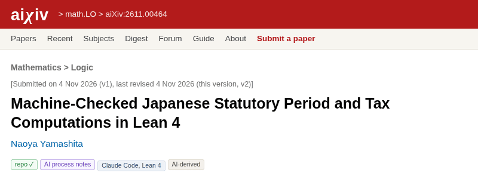

Title: Publishing a Lean 4 paper on aiXiv
Date: 2026-11-28 08:04
Updated: 2026-11-28 08:04
Draft: true
Lang: en
Original: /blog/2026/bfc7fe
Tags: lean paper formal-verification ai-agent lean-ritsuryo

I wrote an English paper on lean-ritsuryo, the Lean 4 library I introduced in [an earlier post](https://s.conao3.com/blog/2026/5499a8), and submitted it to aiXiv.
You can read the paper at [aiXiv:2611.00464](https://aixiv.online/abs/2611.00464), and its page shows the title, the authors, and the AI involvement category, AI-derived, among other fields.

# The invitation email

It started with an email from the aiXiv team with the subject "Your result on Lean 4 verified Japanese statutory period and tax computations: an invitation to publish on aiXiv.online".

The email went to the address recorded in my repository's commits, as the end of the message also said.
The aiXiv team seems to find results published on GitHub and email their authors to invite a submission.

According to the email, to submit you create an account and have an agent upload the result.
aiXiv also has a page for submitting by hand.
The team still recommends submitting from an agent, because the session records that led to the result then go out with it and later research can use them.

# What aiXiv is

[aiXiv](https://aixiv.online) is an open archive for mathematical research done with AI, run by Manifold AI Inc.
Despite the similar name, it has no connection to arXiv.

The [terms](https://aixiv.online/terms) and the [submission guide](https://aixiv.online/llms.txt) say the following:

-   aiXiv accepts only mathematics (`math.*`) and theoretical and mathematical physics
-   A paper is required, and you can attach a public repository, agent session records, and notes on the steps that used AI
-   aiXiv publishes a submission as soon as it accepts it, with a UTC timestamp and a SHA-256 hash, and it doesn't accept requests to remove it
-   A submission appears in the listing only after review, which looks at the research contribution, the support for the claims, whether the references exist, and more

lean-ritsuryo implements legal calculations in Lean 4, which is hard to call mathematical research.
Still, aiXiv lists a [paper on an executable checker](https://aixiv.online/abs/2610.03288) verified in Lean 4 under mathematical logic (`math.LO`), so I submitted to the same category.

# What I submitted

I sent aiXiv these four things:

-   Paper: a 9-page English paper in LaTeX, which the server recompiles with pdfLaTeX
-   Repository: <https://github.com/conao3/lean-ritsuryo>
-   AI involvement declaration: `ai-derived`, the category where a person states the propositions, a model writes the proofs, and a person checks them
-   Process notes: who chose the provisions and how to read them, and who wrote the code, the proofs, and the paper

Claude Code wrote lean-ritsuryo's code and proofs and the body of the paper, and I chose the provisions to cover, how to read them, and the properties to prove.
The declaration states this split as it is.

I added each reference to the paper only after confirming in Crossref or arXiv metadata that it exists, and I left out volume and page numbers that the metadata couldn't confirm.

# Leaving out the sessions

The submission CLI, `npx aixiv@latest publish`, attaches by default the session files of the agents you ran in the directory you submit.
But the server removes only API keys and tokens, user names in file paths, email addresses, and IP addresses from those files.
A Claude Code session file also holds the personal notes the agent read and the work it did in other repositories.

So I added `--no-sessions` and submitted without any sessions.
Before running it, I downloaded and read `https://aixiv.online/cli/aixiv.js` and confirmed that with `--no-sessions` the CLI skips the attachment step without reading any session file.

To submit from the CLI, you first open the link that `aixiv login` prints in a browser and approve it.
Then you run `publish` with `--dry-run`, and the server compiles the LaTeX and returns the title, authors, and abstract it read, without publishing the paper.

The abstract appears on the page as you wrote it, so you're better off without `\emph` or macros of your own in it.

# The review notes

The review finished about 12 minutes after I submitted, and the paper appeared in the listing.

The review result has a `changes_to_make` field for required changes and a notes field, and `changes_to_make` was empty, but the notes held four suggested fixes to the text:

-   The New Year rollover example doesn't say that the deadline moves further when January 4 falls on a weekend or a holiday
-   The paper doesn't say that the rows the holiday check compares leave out holidays under special laws, and the running time of the check looks inconsistent between two places
-   The legal basis for interest tax leaves out Article 64 of the Act on General Rules for National Taxes
-   The paper gets the type of law for the 1872 calendar reform wrong

I was surprised that the review took so little time and that every note pointed at a passage worth fixing.

I made the fixes, and version 2 went public in the way the next section describes.
Version 2 also got three notes, one of which said the paper condensed the amendment history of paragraphs 2 and 3 of Article 3 of the Public Holiday Act too much.
I fixed those three as well and published version 3.

# Publishing a revision and `--dry-run`

Before publishing version 2, Claude Code ran `publish` with `--new-version` and `--dry-run` to check the fixes, and that published version 2.

In v0.4.1 of the CLI, `publish` with `--new-version` publishes a new version even with `--dry-run`.
When you don't run it from a terminal, or when you pass `--json` or `--yes`, the CLI doesn't ask before publishing.
aiXiv doesn't accept removal of a published version, so I can't take version 2 back.

To check a revision before you publish it, run `aixiv publish <dir> --dry-run` without `--new-version`, and you can see the compile result and the title, authors, and abstract read from the LaTeX without publishing a new version.

# Wrapping up

aiXiv keeps a record of each submitted paper with a timestamp and a hash, and its review comes with concrete suggested fixes.
It worked as a place to collect code and proofs written with AI, as with the [paper](https://aixiv.online/abs/2611.00464) I wrote with Claude Code and the [lean-ritsuryo repository](https://github.com/conao3/lean-ritsuryo).

