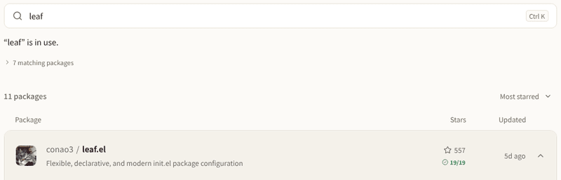
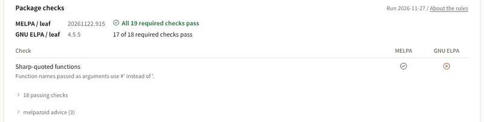

Title: MELPAとGNU ELPAとGitHubのEmacsパッケージを1つの検索欄で探せるElisporeを作った
Date: 2026-11-27 23:23
Updated: 2026-11-27 23:23
Draft: true
Tags: emacs emacs-lisp melpa package-management release ts-elispore


MELPAとGNU ELPAとNonGNU ELPAに載っているEmacsパッケージも、GitHubに置いてあるだけのものも、1つの検索欄で探せるElisporeというサイトを作りました。
パッケージ名を打つとその名前がすでに使われているかが分かり、検索結果の行を開くとleafやuse-packageで入れる式と、MELPAの決まりに沿っているかを検査した結果が出ます。

サイトは [elispore.conao3.com](https://elispore.conao3.com) で、この記事を書いた時点で6,889件のパッケージを載せています。
載せているパッケージのカタログはGitHub Actionsが毎日作り直しています。

リポジトリは [conao3/ts-elispore](https://github.com/conao3/ts-elispore) で、ライセンスは [Apache-2.0](https://github.com/conao3/ts-elispore/blob/b456119/LICENSE) です。
この記事ではmasterの [b456119](https://github.com/conao3/ts-elispore/commit/b456119) と、2026-11-27に作り直したカタログを使いました。

<div class="github-card" data-repo="conao3/ts-elispore"><a href="https://github.com/conao3/ts-elispore"><span class="github-card-name"><svg class="github-card-mark" viewBox="0 0 16 16" aria-hidden="true"><path d="M6.766 11.328c-2.063-.25-3.516-1.734-3.516-3.656 0-.781.281-1.625.75-2.188-.203-.515-.172-1.609.063-2.062.625-.078 1.468.25 1.968.703.594-.187 1.219-.281 1.985-.281.765 0 1.39.094 1.953.265.484-.437 1.344-.765 1.969-.687.218.422.25 1.515.046 2.047.5.593.766 1.39.766 2.203 0 1.922-1.453 3.375-3.547 3.64.531.344.89 1.094.89 1.954v1.625c0 .468.391.734.86.547C13.781 14.359 16 11.53 16 8.03 16 3.61 12.406 0 7.984 0 3.563 0 0 3.61 0 8.031a7.88 7.88 0 0 0 5.172 7.422c.422.156.828-.125.828-.547v-1.25c-.219.094-.5.156-.75.156-1.031 0-1.64-.562-2.078-1.609-.172-.422-.36-.672-.719-.719-.187-.015-.25-.093-.25-.187 0-.188.313-.328.625-.328.453 0 .844.281 1.25.86.313.452.64.655 1.031.655s.641-.14 1-.5c.266-.265.47-.5.657-.656"/></svg><span>conao3/<strong>ts-elispore</strong></span></span><span class="github-card-description">Find Emacs packages hosted on GitHub</span><span class="github-card-footer"><span class="github-card-language"><span class="github-card-language-color" style="background-color: #3178c6"></span>TypeScript</span><span class="github-card-star"><svg viewBox="0 0 16 16" aria-hidden="true"><path d="M8 .25a.75.75 0 0 1 .673.418l1.882 3.815 4.21.612a.75.75 0 0 1 .416 1.279l-3.046 2.97.719 4.192a.751.751 0 0 1-1.088.791L8 12.347l-3.766 1.98a.75.75 0 0 1-1.088-.79l.72-4.194L.818 6.374a.75.75 0 0 1 .416-1.28l4.21-.611L7.327.668A.75.75 0 0 1 8 .25Z"/></svg><span>Star</span><span class="github-card-star-count" hidden></span></span></span></a></div>


# Elisporeでできること

-   MELPAとGNU ELPAとNonGNU ELPAとGitHubのEmacsパッケージを、1つの検索欄で探す。
-   `user:minad` や `stars:>=1000` のような修飾子で絞り込む。
-   パッケージ名がカタログの中で使われているかを確かめる。
-   leafかuse-packageの `:vc` でGitリポジトリから入れる式をコピーする。
-   MELPAの決まりに沿っているかを、22個の必須のルールで検査した結果を見る。


# MELPAの審査を待たずにEmacsパッケージを探す

MELPAに新しいパッケージを載せるときはレシピをプルリクエストで送り、MELPAのメンテナーがパッケージを見て審査します。
[プルリクエストのテンプレート](https://github.com/melpa/melpa/blob/c906d3e4d5e04766a3656feffb2bcde941c4d25b/.github/PULL_REQUEST_TEMPLATE.md?plain=1#L34) には次の確認の項目があります。

> I understand the package must have been maintained in a public repository for 1 month or more

AIを使って書いたパッケージについては、 [CONTRIBUTING.org](https://github.com/melpa/melpa/blob/c906d3e4d5e04766a3656feffb2bcde941c4d25b/CONTRIBUTING.org?plain=1#L92-L95) が次のように求めています。

> Using AI to assist in writing your packages is not prohibited, but the human author must be the **first** and **most thorough** reviewer of any such output.

AIを使うとパッケージを書く速さが上がるので、1つずつ人が審査する仕組みでは追いつかなくなると思っています。
機械で確かめられる決まりは機械で検査して、GitHubに置いたパッケージをそのまま探して入れられるようにしたいと考えて作りました。

Emacs Lispは名前空間が1つしかないので、MELPAの一覧はパッケージ名がすでに使われているかを調べるのにも役に立っていました。
ElisporeではGitHubにだけあるパッケージも含めて名前を調べられるようにしています。


# Emacsパッケージを名前で探す



検索欄に `leaf` と打つと、 `leaf` という名前のパッケージがすでにあることと、 `leaf` と `leaf-` で始まる名前のパッケージが合わせて7件あることが出ます。
名前が使われているかは絞り込みの条件によらずカタログ全体で確かめます。

その下には名前と説明とトピックが検索語に合う11件が並びます。
leaf.elの行にはGitHubのスター数557と19/19が出ていて、検査した必須のルール19個をすべて通したことを示しています。

検索欄には `source:gnu-elpa` や `user:minad` 、 `topic:completion` 、 `license:gpl-3.0` 、 `pushed:>=2026-01-01` 、 `stars:>=1000` のような修飾子も書けて、左の絞り込みで選んだ条件も検索欄の文字列に入ります。
検索欄の文字列はURLの `?q=` にも入るので、例えば `user:minad stars:>=1000` でminadさんのorg-modernとverticoとconsultとcorfuの4件に絞り込んだ結果をURLで渡せます。


# leafやuse-packageで入れる式をコピーする

行を開くと、ライセンスや最後にpushした日時、載っている場所と一緒に、パッケージを入れる式が出ます。
式は初めはleafの形で、コードブロックの右上のボタンでuse-packageの形に切り替えられます。

GitHubにだけあるパッケージはリポジトリのURLを `:vc` に書いた式になります。
例えば [vow](https://s.conao3.com/blog/2026/7d9eba) の行には次の式が出ます。

```emacs-lisp
(leaf vow
  :vc (:url "https://github.com/conao3/vow.el"))
```

MELPAのレシピがあるパッケージでは、レシピのブランチと、リポジトリで確かめたLispのディレクトリが式に入ります。
magitはLispのファイルが `lisp/` にあるので、 `:lisp-dir` の付いた式になります。

```emacs-lisp
(leaf magit
  :vc (:url "https://github.com/magit/magit" :lisp-dir "lisp"))
```

leafの `:vc` はEmacs 29で入った [package-vc](https://www.gnu.org/software/emacs/manual/html_node/emacs/Fetching-Package-Sources.html) でGitリポジトリからパッケージを入れるキーワードです。
この記事を書いた時点ではMELPAのleafで使えて、空の `user-emacs-directory` を使うEmacs 31.1にMELPAからleafを入れてこの2つの式を評価し、vowとmagitを読み込めることを確かめました。

use-packageの `:vc` はEmacs 30から使えます。
GNU ELPAかNonGNU ELPAに載っているパッケージはELPAの切り替えを選ぶと `:ensure t` の式になります。


# MELPAの決まりに沿っているかを検査する



行を開くと、パッケージを検査した結果も出ます。

検査のルールはMELPAの [CONTRIBUTING.org](https://github.com/melpa/melpa/blob/c906d3e4d5e04766a3656feffb2bcde941c4d25b/CONTRIBUTING.org) と、CONTRIBUTING.orgが従うよう求めている [Emacs Lispの規約](https://www.gnu.org/software/emacs/manual/html_node/elisp/Tips.html) と、MELPAに出すパッケージの検査に使われている [melpazoid](https://github.com/riscy/melpazoid) から取っています。
どのルールにも出典の原文の引用を付けています。

必須のルールは22個でパッケージの点数になり、例えば `<package>.el` があることや、どのファイルも1行目で `lexical-binding` を有効にしていること、どのファイルも `;;; <file>.el ends here` の行で終わることなどを確かめます。
melpazoidのほかの検査84個は助言として並べ、点数には入れません。

ルールごとの説明と引用はサイトの [ルールの一覧](https://elispore.conao3.com/about/#package-checks-about) で読めます。
検査はパッケージのファイルを読むだけでEmacsで動かさないので、バイトコンパイルとcheckdocとpackage-lintは含みません。

同じパッケージでも載っている場所ごとに検査します。
leafはMELPAのバージョン20261122.915が19個のルールをすべて通していて、GNU ELPAのバージョン4.5.5は関数名を `#'` で渡すルールで落ちています。

GitHubのリポジトリだけで確かめるルールが3つと、MELPAのバージョンだけで確かめるルールが1つあるので、通ったルールの数の分母はMELPAで19、GNU ELPAで18になります。

検査するコマンドはRustで書いていて、必須のルールは [leanfran](https://s.conao3.com/blog/2026/23d62c) を使ってLeanで定義し、Rustのコードにしています。
GitHubのリポジトリを手元で検査するときは、 `owner/repo` を1行に1つ書いたファイルを渡します。

```sh
$ printf 'conao3/leaf.el\nconao3/flylint.el\n' > repos.txt
$ nix run github:conao3/ts-elispore#checker -- \
    --source github --github-list repos.txt --output checks.json | head -n 1
Packages: 2; errors: 0; cached: 0; downloaded: 2
$ jq '.results | map_values(.failed)' checks.json
{
  "github/conao3/flylint.el": [
    "provide",
    "footer"
  ],
  "github/conao3/leaf.el": [
    "mz-have-you-done-the-paperwork-to"
  ]
}
```

flylintはテストで使うファイル `flylint-tests-flylint.el` に `provide` が無く、最後の行が `;;; flylint-tests.el ends here` になっているので、2つの必須のルールで落ちました。

GitHubのleaf.elは必須のルールをすべて通っています。
著作権をFSFに譲渡したGNU ELPAのパッケージなので、著作権の表示にmelpazoidの「Have you done the paperwork to assign this copyright?」の助言が付きます。

[Vercel Boardで組んだソフトウェア工場](https://s.conao3.com/blog/2026/a80aa6) では、私のEmacsパッケージ20個をこの検査にかける仕事を、パッケージごとのタスク20件に分けて動かしました。


# カタログに載るEmacsパッケージ

カタログはGitHubの検索とMELPAとGNU ELPAとNonGNU ELPAから毎日作り直します。
フォークや設定ファイルの集まり、awesomeの一覧は外し、直下か `lisp/` に `.el` のファイルがあるリポジトリだけを載せます。

GitHubの検索では、スターが20以上のEmacs Lispのリポジトリをスターの多い順に400件まで読みます。
トピック `emacs-package` のリポジトリと、2026-01-01より後にpushされたEmacs Lispのリポジトリはそれぞれ200件まで読み、ほかのトピックのリポジトリも加えます。

MELPAに載っていない自分のパッケージをカタログに載せたいときは、フォークでない公開のリポジトリの直下か `lisp/` に `.el` のファイルを置き、リポジトリにトピック `emacs-package` を付けます。
`emacs-package` の検索はスターの多い順に200件までなので、トピックを付けても載らないことがあります。

