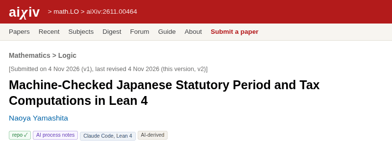

Title: Leanの論文をaiXivに投稿した
Date: 2026-11-04 14:43

[Leanで書く証明付きの日付と税計算](https://s.conao3.com/blog/2026/5499a8)で紹介したlean-ritsuryoについて、英語の論文を書いてaiXivに投稿しました。
論文は[aiXiv:2611.00464](https://aixiv.online/abs/2611.00464)で読めます。
論文のページには、タイトルと著者のほか、AIの関与の区分 (AI-derived) などが出ます。

# 招待のメール

きっかけはaiXivの運営から届いた1通のメールです。
件名は "Your result on Lean 4 verified Japanese statutory period and tax computations: an invitation to publish on aiXiv.online" でした。
宛先はリポジトリのコミットに記録したメールアドレスで、本文の末尾にもそう書いてあります。
aiXivの運営はGitHubで公開された結果を見つけて、投稿を勧めるメールを送っているようです。

本文によれば、投稿の手順はアカウントを作り、エージェントに結果をアップロードさせるだけです。
手で投稿する画面もありますが、運営はエージェントからの投稿を勧めています。
結果に至るまでのエージェントのセッションの記録も共有され、あとの研究の役に立つからだそうです。

# aiXivとは

[aiXiv](https://aixiv.online)はAIを使った数学の研究を載せるオープンアーカイブです。
運営はManifold AI Inc. で、名前は似ていますがarXivとは関係がありません。

規約と投稿の案内 (<https://aixiv.online/llms.txt>) には、次のことが書かれています。

-   載せるのは数学 (`math.*`) と理論・数理物理の研究だけ
-   論文は必須で、公開リポジトリ、エージェントのセッションの記録、AIを使った工程のメモを添えられる
-   投稿は受け付けた時点でUTCの時刻とSHA-256が付いて公開され、削除の依頼は受け付けない
-   一覧に載るのは審査を通ってからで、審査は研究としての寄与、主張の論証、参考文献の実在などを見る

lean-ritsuryoは法令の計算をLean 4で書いたもので、数学の研究とは言いにくい内容です。
それでも、Lean 4で検証した実行可能なチェッカーの論文が `math.LO` (数理論理学) に載っていたので、同じ分野で出しました。

# 送るもの

aiXivに送ったのは次の4つです。

-   論文: LaTeXで書いた9ページの英語の論文。サーバーがpdfLaTeXでコンパイルし直す
-   リポジトリ: <https://github.com/conao3/lean-ritsuryo>
-   AIの関与の申告: 区分は `ai-derived` (人が結果を立て、モデルが証明を出し、人が確かめる)
-   工程のメモ: 範囲と条文の読み方を誰が決め、コードと証明と論文を誰が書いたか

lean-ritsuryoのコードと証明、論文の本文はClaude Codeが書きました。
私が決めたのは、扱う条文、条文の読み方、証明する性質です。
申告にはこの分担をそのまま書きました。

論文の参考文献はCrossrefとarXivの記録で実在を確かめてから載せました。
記録で確かめられない巻やページは書いていません。

# セッションは添付しない

投稿のCLI (`npx aixiv@latest publish`) は、既定でそのプロジェクトで動かしたエージェントのセッションファイルを添付します。
サーバーがセッションから消すのはAPIキー、メールアドレス、IPアドレスだけです。
Claude Codeのセッションには、エージェントが読み込んだ個人用のメモや、ほかのリポジトリでの作業の内容も入ります。
そのため、 `--no-sessions` を付けてセッションを添付せずに投稿しました。

CLIは `https://aixiv.online/cli/aixiv.js` をダウンロードし、中身を読んでからnodeで動かしました。
`--no-sessions` を付けたときは、セッションファイルを読む前に添付の処理を終えることも、このとき確かめました。

ログインは `aixiv login` が出すリンクをブラウザで開いて承認します。
`publish` に `--dry-run` を付けると、サーバーはLaTeXをコンパイルして、LaTeXから読み取ったタイトル、著者、要旨を返すだけで、何も公開しません。
要旨はそのままページに出るので、 `\emph` や自前のマクロは使わないほうがよいです。

# 審査のnotes

投稿して約12分後に審査が終わり、一覧に載りました。
直すことを求める項目 (`changes_to_make`) はありませんでしたが、notesとして本文の直し候補が4点付いていました。

-   年末年始の繰り下げの例で、1月4日が土日や祝日に当たるとさらに先へ延びることが書かれていない
-   祝日の検査が比べる行に特別法の休日を含まないことが書かれておらず、検査の所要時間が2か所で食い違って見える
-   利子税の根拠に国税通則法 第64条が抜けている
-   1872年の改暦の法令の種別が正確でない

どれも指摘のとおりだったので、直して第2版を出しました。
投稿から十数分で審査の結果が付き、その指摘が実際に直したほうがよい箇所を突いていたことには驚きました。
第2版にもnotesが3点付き、そのうち1点は祝日法 第3条の第2項と第3項の改正の経過をまとめすぎているという指摘でした。
この3点も直して、第3版を出しました。

# 改訂の公開と `--dry-run`

第2版を出す前に、直した内容を確かめるつもりで、Claude Codeが `--new-version` と `--dry-run` を付けて `publish` を実行しました。
すると、第2版がそのまま公開されました。
CLI (v0.4.1) の `publish` に `--new-version` を付けると、 `--dry-run` を付けても新しい版が公開されます。
端末から実行していないときや、 `--json` か `--yes` を付けたときは、公開する前の確認も出ません。
aiXivは公開した版の削除を受け付けないので、第2版の公開は取り消せません。

改訂を出す前に確かめるときは、 `--new-version` を付けずに `aixiv publish <dir> --dry-run` を実行します。
こうすると、コンパイルの結果と、LaTeXから読み取ったタイトル、著者、要旨だけを見られます。

# おわりに

aiXivでは、投稿した論文に時刻とハッシュの付いた記録が残り、審査の結果には具体的な直し候補が付きます。
lean-ritsuryoのように、AIを使って書いたコードと証明をまとめる先として使えました。

論文は<https://aixiv.online/abs/2611.00464>、リポジトリは<https://github.com/conao3/lean-ritsuryo>です。

