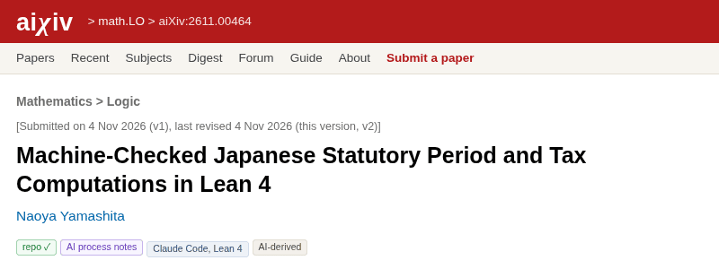

Title: Leanの論文をaiXivに投稿した
Date: 2026-11-04 14:43
Tags: lean paper formal-verification ai-agent lean-ritsuryo

[Leanで書く証明付きの日付と税計算](https://s.conao3.com/blog/2026/5499a8)で紹介したlean-ritsuryoについて、英語の論文を書いてaiXivに投稿しました。
論文は[aiXiv:2611.00464](https://aixiv.online/abs/2611.00464)で読めて、ページにはタイトルと著者のほか、AIの関与の区分のAI-derivedなどが出ます。

# 招待のメール

きっかけはaiXivの運営から届いた1通のメールで、件名は "Your result on Lean 4 verified Japanese statutory period and tax computations: an invitation to publish on aiXiv.online" でした。

宛先はリポジトリのコミットに記録したメールアドレスで、本文の末尾にもそう書いてあったので、aiXivの運営はGitHubで公開された結果を見つけて投稿を勧めるメールを送っているようです。

本文によれば、投稿するにはアカウントを作って、エージェントに結果をアップロードさせるだけです。
手で投稿する画面もあるのですが、エージェントから投稿すると結果に至るまでのセッションの記録も共有されてあとの研究の役に立つという理由で、運営はエージェントからの投稿を勧めています。

# aiXivとは

[aiXiv](https://aixiv.online)はAIを使った数学の研究を載せるオープンアーカイブで、Manifold AI Inc.が運営しています。
名前は似ていますが、arXivとは関係がありません。

[規約](https://aixiv.online/terms)と[投稿の案内](https://aixiv.online/llms.txt)には、次のことが書かれています。

-   載せるのは `math.*` の数学と、理論・数理物理の研究だけ
-   論文は必須で、公開リポジトリ、エージェントのセッションの記録、AIを使った工程のメモを添えられる
-   投稿は受け付けた時点でUTCの時刻とSHA-256が付いて公開され、削除の依頼は受け付けない
-   一覧に載るのは審査を通ってからで、審査は研究としての寄与、主張の論証、参考文献の実在などを見る

lean-ritsuryoは法令の計算をLean 4で書いたもので、数学の研究とは言いにくい内容です。
それでも、Lean 4で検証した[実行可能なチェッカーの論文](https://aixiv.online/abs/2610.03288)が数理論理学の `math.LO` に載っていたので、同じ分野で出すことにしました。

# 送るもの

aiXivに送ったのは次の4つです。

-   論文: LaTeXで書いた9ページの英語の論文。サーバーがpdfLaTeXでコンパイルし直す
-   リポジトリ: <https://github.com/conao3/lean-ritsuryo>
-   AIの関与の申告: 人が命題を決め、モデルが証明を書き、人が確かめる `ai-derived` の区分
-   工程のメモ: 条文の範囲と読み方を誰が決め、コードと証明と論文を誰が書いたか

lean-ritsuryoのコードと証明、論文の本文はClaude Codeが書いていて、私は扱う条文と条文の読み方、証明する性質を決めました。
申告にはこの分担をそのまま書いています。

論文の参考文献はCrossrefとarXivの書誌情報で実在を確かめてから載せ、書誌情報で確かめられない巻やページは書きませんでした。

# セッションは添付しない

投稿のCLIの `npx aixiv@latest publish` は、投稿するディレクトリで動かしたエージェントのセッションファイルを既定で添付します。
ところがサーバーがセッションファイルから消すのはAPIキーとトークン、ファイルパスの中のユーザー名、メールアドレス、IPアドレスだけです。
Claude Codeのセッションファイルには、エージェントが読み込んだ個人用のメモやほかのリポジトリでの作業の内容も入ってしまいます。

そこで `--no-sessions` を付けて、セッションを添付せずに投稿しました。
実行する前に `https://aixiv.online/cli/aixiv.js` をダウンロードして読み、 `--no-sessions` を付けたときはセッションファイルを読まずに添付の処理を飛ばすことも確かめてあります。

CLIから投稿するときは、まず `aixiv login` が出すリンクをブラウザで開いて承認します。
続けて `publish` に `--dry-run` を付けて実行すると、論文は公開されず、サーバーがLaTeXをコンパイルして読み取ったタイトル、著者、要旨だけが返ってきます。

要旨はそのままページに出るので、 `\emph` や自前のマクロは使わないほうがよいです。

# 審査のnotes

投稿して約12分後に審査が終わり、一覧に載りました。

審査の結果には直すことを求める `changes_to_make` とnotesの欄があり、 `changes_to_make` はなかったものの、notesに本文の直し候補が4点付いていました。

-   年末年始の繰り下げの例で、1月4日が土日や祝日に当たるとさらに先へ延びることが書かれていない
-   祝日の検査が比べる行に特別法の休日を含まないことが書かれておらず、検査の所要時間が2か所で食い違って見える
-   利子税の根拠に国税通則法 第64条が抜けている
-   1872年の改暦の法令の種別が正確でない

短い時間で審査が終わったうえに、指摘がどれも直したほうがよい箇所を突いていたので驚きました。

指摘に沿って直したところ、次の節の経緯で第2版が公開されました。
第2版にもnotesが3点付き、うち1点は祝日法 第3条の第2項と第3項の改正の経過をまとめすぎているという指摘だったので、この3点も直して第3版を出しました。

# 改訂の公開と `--dry-run`

第2版を出す前に、直した内容を確かめるつもりでClaude Codeが `--new-version` と `--dry-run` を付けて `publish` を実行したところ、第2版がそのまま公開されてしまいました。

CLIのv0.4.1では、 `publish` に `--new-version` を付けると、 `--dry-run` を付けても新しいバージョンが公開されます。
端末から実行していないときや、 `--json` か `--yes` を付けたときは公開する前の確認も出ず、aiXivは公開した版の削除を受け付けないので、第2版は取り消せません。

改訂を出す前に確かめたいときは、 `--new-version` を付けずに `aixiv publish <dir> --dry-run` を実行すれば、新しいバージョンを公開せずに、コンパイルの結果とLaTeXから読み取ったタイトル、著者、要旨を確かめられます。

# おわりに

aiXivでは、投稿した論文に時刻とハッシュの付いた記録が残り、審査の結果には具体的な直し候補が付きます。
Claude Codeと書いた[論文](https://aixiv.online/abs/2611.00464)と[lean-ritsuryoのリポジトリ](https://github.com/conao3/lean-ritsuryo)のように、AIを使って書いたコードと証明をまとめる先として使えました。

