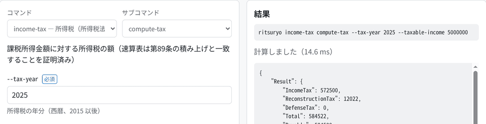
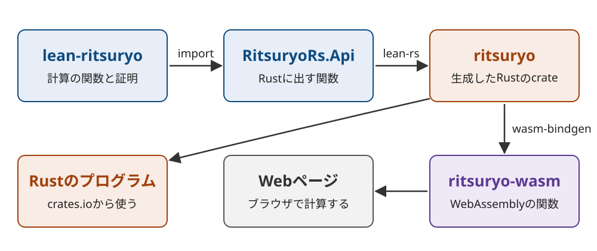

Title: rust-ritsuryo: Japanese date and tax calculations proved in Lean 4, as a Rust crate and a web page
Date: 2026-11-27 18:40
Updated: 2026-11-27 18:40
Lang: en
Original: /blog/2026/c4f11a
Tags: lean rust formal-verification tax release rust-ritsuryo lean-ritsuryo lean-rs


[lean-ritsuryo](https://s.conao3.com/blog/2026/232531) is a library that computes the periods and tax amounts set by Japanese law in Lean 4, with proofs that the calculations match a specification transcribed from the statutes.
I compiled it to Rust with [lean-rs](https://s.conao3.com/blog/2026/1ff994) and turned it into a Rust crate and a web page that does the calculations in the browser alone.

The repository is [conao3/rust-ritsuryo](https://github.com/conao3/rust-ritsuryo), under Apache-2.0, and the crate is on [crates.io](https://crates.io/crates/ritsuryo) as `ritsuryo`.

<div class="github-card" data-repo="conao3/rust-ritsuryo"><a href="https://github.com/conao3/rust-ritsuryo"><span class="github-card-name"><svg class="github-card-mark" viewBox="0 0 16 16" aria-hidden="true"><path d="M6.766 11.328c-2.063-.25-3.516-1.734-3.516-3.656 0-.781.281-1.625.75-2.188-.203-.515-.172-1.609.063-2.062.625-.078 1.468.25 1.968.703.594-.187 1.219-.281 1.985-.281.765 0 1.39.094 1.953.265.484-.437 1.344-.765 1.969-.687.218.422.25 1.515.046 2.047.5.593.766 1.39.766 2.203 0 1.922-1.453 3.375-3.547 3.64.531.344.89 1.094.89 1.954v1.625c0 .468.391.734.86.547C13.781 14.359 16 11.53 16 8.03 16 3.61 12.406 0 7.984 0 3.563 0 0 3.61 0 8.031a7.88 7.88 0 0 0 5.172 7.422c.422.156.828-.125.828-.547v-1.25c-.219.094-.5.156-.75.156-1.031 0-1.64-.562-2.078-1.609-.172-.422-.36-.672-.719-.719-.187-.015-.25-.093-.25-.187 0-.188.313-.328.625-.328.453 0 .844.281 1.25.86.313.452.64.655 1.031.655s.641-.14 1-.5c.266-.265.47-.5.657-.656"/></svg><span>conao3/<strong>rust-ritsuryo</strong></span></span><span class="github-card-description">Japanese statutory periods and taxes for Rust and the browser, compiled from proved Lean 4 code with lean-rs</span><span class="github-card-footer"><span class="github-card-language"><span class="github-card-language-color" style="background-color: #dea584"></span>Rust</span><span class="github-card-star"><svg viewBox="0 0 16 16" aria-hidden="true"><path d="M8 .25a.75.75 0 0 1 .673.418l1.882 3.815 4.21.612a.75.75 0 0 1 .416 1.279l-3.046 2.97.719 4.192a.751.751 0 0 1-1.088.791L8 12.347l-3.766 1.98a.75.75 0 0 1-1.088-.79l.72-4.194L.818 6.374a.75.75 0 0 1 .416-1.28l4.21-.611L7.327.668A.75.75 0 0 1 8 .25Z"/></svg><span>Star</span><span class="github-card-star-count" hidden></span></span></span></a></div>


# Calculate in the browser

The web page is at this URL.

<https://conao3.github.io/rust-ritsuryo/>



The form offers the same calculations as the lean-ritsuryo CLI, such as the end date of a period, public holidays, income tax, inheritance tax, and consumption tax.

The image above shows the income tax for 2025 on a total taxable income of 5,000,000 yen, and the amount to pay comes to 584,500 yen.
That amount is the income tax of 572,500 yen plus 12,022 yen of [special income tax for reconstruction](https://laws.e-gov.go.jp/law/423AC0000000117#Mp-Ch_4-Se_2-At_13) (2.1% of the income tax), which makes 584,522 yen, [with the part under 100 yen cut off](https://laws.e-gov.go.jp/law/423AC0000000117#Mp-Ch_4-Se_2-At_24-Pr_2).
The calculation runs inside the browser, so the page sends your input nowhere.


# Call it from Rust

Add `ritsuryo` to `Cargo.toml`, and you can call the same calculations from Rust.

```toml
[dependencies]
ritsuryo = "0.1.0"
serde_json = "1"
```

```rust
use serde_json::json;

fn main() {
    let out = ritsuryo::invoke(
        "income-tax",
        "compute-tax",
        &json!({"TaxYear": 2025, "TaxableIncome": 5_000_000}),
    )
    .unwrap();
    println!("{}", out["Result"]);

    for h in ritsuryo::holiday::holidays(2027).iter().take(3) {
        println!("{}/{} {}", h.month, h.day, h.name);
    }
}
```

```console
$ cargo run -q
{"DefenseTax":0,"IncomeTax":572500,"Payable":584500,"ReconstructionTax":12022,"Total":584522}
1/1 元日
1/11 成人の日
2/11 建国記念の日
```

`invoke` takes a CLI subcommand and its parameters as they are, and returns the same JSON that the CLI prints.
For common calculations such as holidays and income tax, I also added functions that take and return Rust types.

The crate builds with cargo alone, without Lean installed.


# How it works



The input to the translation is a single Lean module that holds only the functions to expose to Rust, and lean-rs turns this module into Rust code together with the lean-ritsuryo functions it calls.

The lean-ritsuryo CLI keeps the parts that handle IO, such as files and standard output, apart from the calculations, and the calculations are functions without IO, so Rust and the browser can call them as they are.

The web page compiles this crate to WebAssembly and calls it from a static page on GitHub Pages.
The lean-rs runtime also runs on WebAssembly, where operations that use IO, such as file access, return an error, but the lean-ritsuryo calculations use no IO and run unchanged.

Generating the Rust code builds the Lean package, including the lean-ritsuryo proofs, so only calculations whose proofs pass become Rust code.
The proofs cover the Lean definitions only, though, and whether the Rust code computes the same thing depends on the lean-rs translation being correct.

