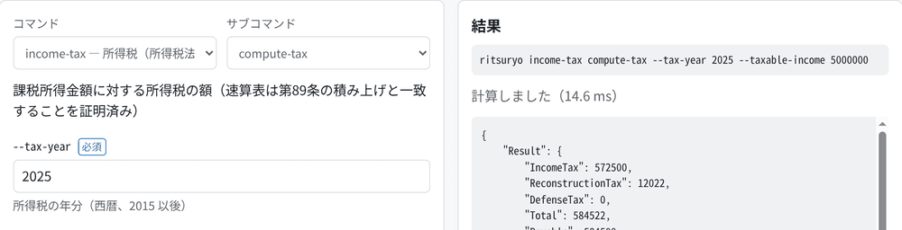
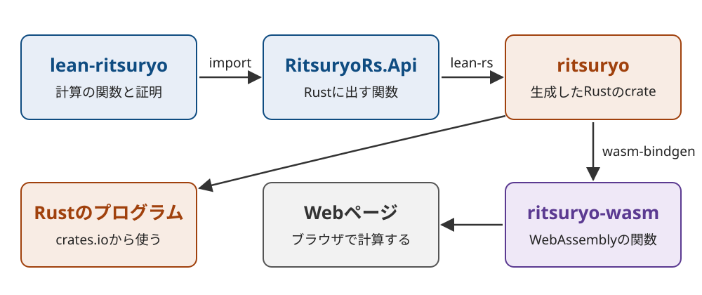

Title: Leanで証明した日付と税計算を、RustのcrateとWebページにした
Date: 2026-11-09 14:40


[lean-ritsuryo](https://s.conao3.com/blog/2026/5499a8)は、日本の法令が定める期間と税額の計算をLean 4で書き、条文どおりに計算することを証明したライブラリです。
これを[lean-rs](https://s.conao3.com/blog/2026/b43a06)でRustに変換して、Rustのcrateと、ブラウザだけで計算するWebページにしました。
リポジトリは[conao3/rust-ritsuryo](https://github.com/conao3/rust-ritsuryo)で、ライセンスはApache-2.0です。
crateは[crates.io](https://crates.io/crates/ritsuryo)に `ritsuryo` の名前で公開しています。

<div class="github-card" data-repo="conao3/rust-ritsuryo"><a href="https://github.com/conao3/rust-ritsuryo"><span class="github-card-name"><svg class="github-card-mark" viewBox="0 0 16 16" aria-hidden="true"><path d="M6.766 11.328c-2.063-.25-3.516-1.734-3.516-3.656 0-.781.281-1.625.75-2.188-.203-.515-.172-1.609.063-2.062.625-.078 1.468.25 1.968.703.594-.187 1.219-.281 1.985-.281.765 0 1.39.094 1.953.265.484-.437 1.344-.765 1.969-.687.218.422.25 1.515.046 2.047.5.593.766 1.39.766 2.203 0 1.922-1.453 3.375-3.547 3.64.531.344.89 1.094.89 1.954v1.625c0 .468.391.734.86.547C13.781 14.359 16 11.53 16 8.03 16 3.61 12.406 0 7.984 0 3.563 0 0 3.61 0 8.031a7.88 7.88 0 0 0 5.172 7.422c.422.156.828-.125.828-.547v-1.25c-.219.094-.5.156-.75.156-1.031 0-1.64-.562-2.078-1.609-.172-.422-.36-.672-.719-.719-.187-.015-.25-.093-.25-.187 0-.188.313-.328.625-.328.453 0 .844.281 1.25.86.313.452.64.655 1.031.655s.641-.14 1-.5c.266-.265.47-.5.657-.656"/></svg><span>conao3/<strong>rust-ritsuryo</strong></span></span><span class="github-card-description">Japanese statutory periods and taxes for Rust and the browser, compiled from proved Lean 4 code with lean-rs</span><span class="github-card-footer"><span class="github-card-language"><span class="github-card-language-color" style="background-color: #dea584"></span>Rust</span><span class="github-card-star"><svg viewBox="0 0 16 16" aria-hidden="true"><path d="M8 .25a.75.75 0 0 1 .673.418l1.882 3.815 4.21.612a.75.75 0 0 1 .416 1.279l-3.046 2.97.719 4.192a.751.751 0 0 1-1.088.791L8 12.347l-3.766 1.98a.75.75 0 0 1-1.088-.79l.72-4.194L.818 6.374a.75.75 0 0 1 .416-1.28l4.21-.611L7.327.668A.75.75 0 0 1 8 .25Z"/></svg><span>Star</span><span class="github-card-star-count" hidden></span></span></span></a></div>


# ブラウザで計算する

Webページは次のURLで開けます。

<https://conao3.github.io/rust-ritsuryo/>



期間の満了日や祝日、所得税、相続税、消費税など、lean-ritsuryoのCLIと同じ計算をフォームから使えます。
上の画像は2025年分の課税総所得金額が500万円のときの所得税で、納める額は584,500円になりました。
計算はブラウザの中で行うので、入力はどこにも送りません。


# Rustから呼ぶ

`Cargo.toml` に `ritsuryo` を追加すると、Rustから同じ計算を呼べます。

```toml
[dependencies]
ritsuryo = "0.1.0"
serde_json = "1"
```

```rust
use serde_json::json;

fn main() {
    let out = ritsuryo::invoke(
        "income-tax",
        "compute-tax",
        &json!({"TaxYear": 2025, "TaxableIncome": 5_000_000}),
    )
    .unwrap();
    println!("{}", out["Result"]);

    for h in ritsuryo::holiday::holidays(2027).iter().take(3) {
        println!("{}/{} {}", h.month, h.day, h.name);
    }
}
```

```console
$ cargo run -q
{"DefenseTax":0,"IncomeTax":572500,"Payable":584500,"ReconstructionTax":12022,"Total":584522}
1/1 元日
1/11 成人の日
2/11 建国記念の日
```

`invoke` にはCLIのサブコマンドとパラメータをそのまま渡します。
返ってくるのは、CLIが出力するものと同じJSONです。
祝日や所得税のようによく使う計算は、Rustの型で呼べる関数も用意しました。
Leanが入っていなくても、cargoだけでビルドできます。


# 仕組み



lean-ritsuryoとRustのあいだには、Rustに出す関数だけを書いたLeanのmoduleを1つ置いています。
lean-rsはこのmoduleを、呼ばれるlean-ritsuryoの関数まで含めてRustのファイルにします。

lean-ritsuryoのCLIは、ファイルや標準出力を扱う部分と計算の部分が分かれています。
計算の部分はIOを使わない関数なので、CLIのコマンドをそのままRustとブラウザから呼べました。

Rustのファイルを作るときは、lean-ritsuryoの証明も含めてLeanのパッケージをビルドします。
証明が通らない計算は、Rustのコードになりません。
ただし証明が保証するのはLeanの定義のほうで、Rustが同じ計算をすることは、lean-rsの変換が正しいことに頼っています。

WebページのほうはこのcrateをWebAssemblyにして、GitHub Pagesの静的なページから呼んでいます。
lean-rsのruntimeはWebAssemblyでも動き、ファイル操作のようにOSが要る処理はエラーを返します。
lean-ritsuryoの計算はOSを使わないので、そのまま動きます。

