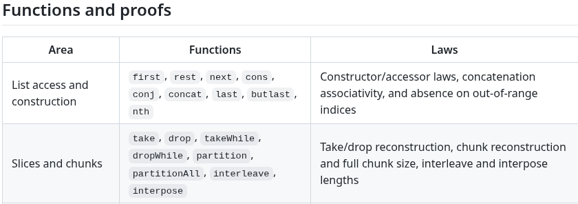

Title: clojure.coreの46個の関数を性質の定理つきでLean 4から使えるleancloveを作った
Date: 2026-11-27 23:02
Updated: 2026-11-27 23:02
Draft: true
Tags: lean clojure formal-verification standard-library release lean-leanclove


Lean 4でclojure.coreの `partition-all` や `frequencies` など46個の関数を使えるライブラリとして、leancloveを作りました。
関数はLeanのリストと `Option` と `HashMap` の上に書いていて、 `partitionAll` で分けた塊をつなぐと元のリストに戻ることや `frequencies` で数えた値が出現回数に等しいことを定理として証明しています。

リポジトリは[conao3/lean-leanclove](https://github.com/conao3/lean-leanclove)、ライセンスはApache-2.0で、Leanの標準ライブラリのほかに依存はありません。
この記事はLean 4.35.0と、この記事を書いた時点のmainの[9312d6c](https://github.com/conao3/lean-leanclove/tree/9312d6c8ac058383d0fae6ffda2d2942e1906e50)をもとに書いています。

定理は使う側の証明から呼べるので、Leanで書いたプログラムの性質を証明するときに `partition-all` や `group-by` の性質を自分で証明し直さずに済みます。
Clojureの記事としては[Clojure本体をLeanと差分テストで調べた記事](https://s.conao3.com/blog/2026/8bda7e)と[clojure.coreの関数を数式で表したチートシート](https://s.conao3.com/blog/2026/76293c)も書いています。

<div class="github-card" data-repo="conao3/lean-leanclove"><a href="https://github.com/conao3/lean-leanclove"><span class="github-card-name"><svg class="github-card-mark" viewBox="0 0 16 16" aria-hidden="true"><path d="M6.766 11.328c-2.063-.25-3.516-1.734-3.516-3.656 0-.781.281-1.625.75-2.188-.203-.515-.172-1.609.063-2.062.625-.078 1.468.25 1.968.703.594-.187 1.219-.281 1.985-.281.765 0 1.39.094 1.953.265.484-.437 1.344-.765 1.969-.687.218.422.25 1.515.046 2.047.5.593.766 1.39.766 2.203 0 1.922-1.453 3.375-3.547 3.64.531.344.89 1.094.89 1.954v1.625c0 .468.391.734.86.547C13.781 14.359 16 11.53 16 8.03 16 3.61 12.406 0 7.984 0 3.563 0 0 3.61 0 8.031a7.88 7.88 0 0 0 5.172 7.422c.422.156.828-.125.828-.547v-1.25c-.219.094-.5.156-.75.156-1.031 0-1.64-.562-2.078-1.609-.172-.422-.36-.672-.719-.719-.187-.015-.25-.093-.25-.187 0-.188.313-.328.625-.328.453 0 .844.281 1.25.86.313.452.64.655 1.031.655s.641-.14 1-.5c.266-.265.47-.5.657-.656"/></svg><span>conao3/<strong>lean-leanclove</strong></span></span><span class="github-card-description">clojure.core-equivalent function library for Lean 4, with proofs</span><span class="github-card-footer"><span class="github-card-language"><span class="github-card-language-color"></span>Lean</span><span class="github-card-star"><svg viewBox="0 0 16 16" aria-hidden="true"><path d="M8 .25a.75.75 0 0 1 .673.418l1.882 3.815 4.21.612a.75.75 0 0 1 .416 1.279l-3.046 2.97.719 4.192a.751.751 0 0 1-1.088.791L8 12.347l-3.766 1.98a.75.75 0 0 1-1.088-.79l.72-4.194L.818 6.374a.75.75 0 0 1 .416-1.28l4.21-.611L7.327.668A.75.75 0 0 1 8 .25Z"/></svg><span>Star</span><span class="github-card-star-count" hidden></span></span></span></a></div>


# leancloveを入れる

Lean 4.35.0のプロジェクトの `lakefile.toml` に次の行を足します。

```toml
[[require]]
name = "leanclove"
git = "https://github.com/conao3/lean-leanclove.git"
rev = "main"
```

`lake update leanclove` を実行すると `import LeanClove` で読み込めるようになります。
関数は `LeanClove` の名前空間に入っていて、Clojureの名前の `partition-all` は `partitionAll` のようにLeanの名前の付け方に直しています。

`lake build` で次の `#eval` を動かすとコメントの値が出ます。

```lean
import LeanClove

#eval LeanClove.partitionAll 2 [1, 2, 3, 4, 5]  -- [[1, 2], [3, 4], [5]]
#eval LeanClove.reductions (· + ·) 0 [1, 2, 3]  -- [0, 1, 3, 6]
#eval LeanClove.get (LeanClove.frequencies ["a", "b", "a"]) "a"  -- some 2
#eval LeanClove.iterate 4 (· * 2) 1  -- [1, 2, 4, 8]
```


# 定理を自分の証明に使う

単語の列を3つずつの塊に分ける関数 `batches` を書いて、その性質を証明してみます。

```lean
import LeanClove
open LeanClove

def batches (xs : List String) : List (List String) := partitionAll 3 xs

theorem batches_flatten (xs : List String) : (batches xs).flatten = xs :=
  flatten_partitionAll 3 xs (by decide)

theorem frequencies_eq_sum (xs : List String) (w : String) :
    (get (frequencies xs) w).getD 0 =
      ((batches xs).map fun b => b.countP (· == w)).sum := by
  rw [getD_frequencies, ← List.countP_flatten, batches_flatten]
```

`batches_flatten` は塊をつなぎ直すと元の列に戻ることを `flatten_partitionAll` から1行で示していて、 `flatten_partitionAll` は塊の大きさが0より大きいことを前提に取ります。
`partitionAll 0` は空のリストを返すので、この前提を外すと定理は成り立ちません。

`frequencies_eq_sum` は、 `frequencies` で全体を数えた値と、塊ごとに数えて足した値が等しいことを示しています。
`frequencies` の数が出現回数に等しいという `getD_frequencies` と、先ほどの `batches_flatten` をつなぐだけで証明が終わり、 `lake build` も通りました。


# 証明している性質

READMEの表は関数を6つの分野に分けて、それぞれで証明している性質を並べています。



公開している定理は50個で、 `rfl` で済むものが10個、Leanの標準ライブラリの補題を言い換えたものが25個、短い `simp` で済むものが6個です。
`flatten_partitionAll` 、 `length_interleave` 、 `nodup_distinct` 、 `dedupe_sublist` 、 `length_iterate` 、 `get_selectKeys` 、 `getD_groupBy` 、 `getD_frequencies` 、 `sum_frequencies` の9個を帰納法などでleancloveの中で証明しています。

```lean
theorem nodup_distinct [BEq α] [LawfulBEq α] (xs : List α) : (distinct xs).Nodup

theorem getD_groupBy [LawfulBEq κ] (f : α → κ) (xs : List α) (key : κ) :
    (get (groupBy f xs) key).getD [] = xs.filter fun x => f x == key

theorem getD_frequencies [LawfulBEq α] (xs : List α) (key : α) :
    (get (frequencies xs) key).getD 0 = xs.countP (fun x => x == key)

theorem sum_frequencies [LawfulBEq α] (xs : List α) :
    ((frequencies xs).toList.map Prod.snd).sum = xs.length
```

チートシートでは `distinct` の結果を「後ろの要素が前の要素と等しくない列」、 `group-by` の値を「 `f` の値が同じ要素の列」、 `frequencies` の値を「その要素が現れる回数」として式で書きました。
leancloveの `nodup_distinct` と `getD_groupBy` と `getD_frequencies` は同じ関係をLeanの定理として証明していて、 `getD_groupBy` はグループの中の順序が元のリストと同じであることまで言っています。


# Clojureとの違い

leancloveの関数はLeanの型を持ち、呼んだときに結果のリストをすべて計算します。
Clojureの遅延seqや動的な実行環境を移したものではないので、同じ名前の関数でも結果が違うことがあります。

Clojure 1.12.7とleancloveで同じ計算をすると、次の表のようになりました。

<table border="2" cellspacing="0" cellpadding="6" rules="groups" frame="hsides">


<colgroup>
<col  class="org-left" />

<col  class="org-left" />

<col  class="org-left" />

<col  class="org-left" />
</colgroup>
<thead>
<tr>
<th scope="col" class="org-left">Clojure</th>
<th scope="col" class="org-left">Clojure 1.12.7の結果</th>
<th scope="col" class="org-left">leanclove</th>
<th scope="col" class="org-left">leancloveの結果</th>
</tr>
</thead>
<tbody>
<tr>
<td class="org-left"><code>(take 3 (partition-all 0 [1 2]))</code></td>
<td class="org-left"><code>(() () ())</code></td>
<td class="org-left"><code>partitionAll 0 [1, 2]</code></td>
<td class="org-left"><code>[]</code></td>
</tr>

<tr>
<td class="org-left"><code>(some (constantly false) [0])</code></td>
<td class="org-left"><code>nil</code></td>
<td class="org-left"><code>LeanClove.some (fun _ =&gt; Option.some false) [0]</code></td>
<td class="org-left"><code>some false</code></td>
</tr>

<tr>
<td class="org-left"><code>(conj [2 3] 1)</code></td>
<td class="org-left"><code>[2 3 1]</code></td>
<td class="org-left"><code>conj [2, 3] 1</code></td>
<td class="org-left"><code>[1, 2, 3]</code></td>
</tr>

<tr>
<td class="org-left"><code>(take 4 (iterate #(* 2 %) 1))</code></td>
<td class="org-left"><code>(1 2 4 8)</code></td>
<td class="org-left"><code>iterate 4 (· * 2) 1</code></td>
<td class="org-left"><code>[1, 2, 4, 8]</code></td>
</tr>
</tbody>
</table>

Clojureの `partition-all` は大きさ0で空の塊を限りなく返すのですが、leancloveは空のリストを返します。

leancloveの `some` は `Option` を返す関数を受け取って、 `Option.some false` も見つかった値として返します。
Clojureの `some` は `false` を返した要素を見つからなかったものとして次の要素へ進むので、結果が変わります。

`conj` はリストの先頭に足すので、Clojureのリストの `conj` と同じ順になり、ベクターの `conj` とは逆になります。
leancloveの関数はリストを返すので `iterate` は無限の列を作れず、個数を最初の引数で受け取ります。

ここで挙げた定理はどれもleancloveのLeanの定義についてのもので、Clojureの実装と同じ結果を返すことは証明も試験もしていません。

Clojure本体をLeanと差分テストで調べた記事ではClojureのJavaで書かれた層の小さな関数をLeanに写しました。
leancloveはClojureの実装のモデルではなく、clojure.coreの名前と考え方をLeanの関数として書き直したライブラリです。

