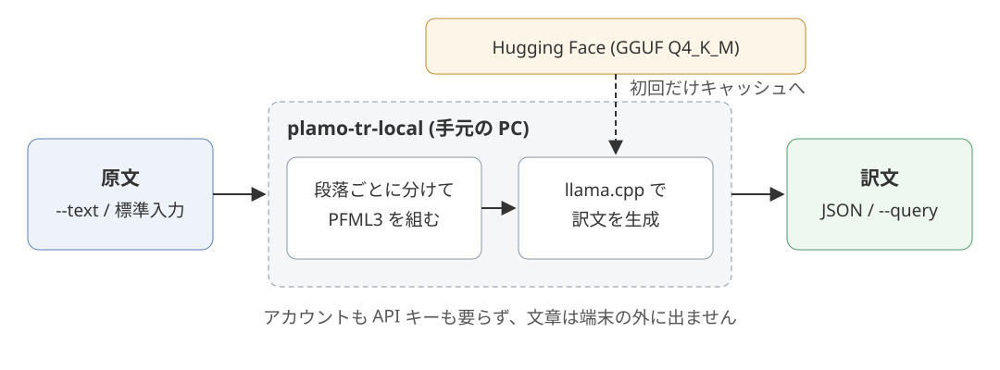
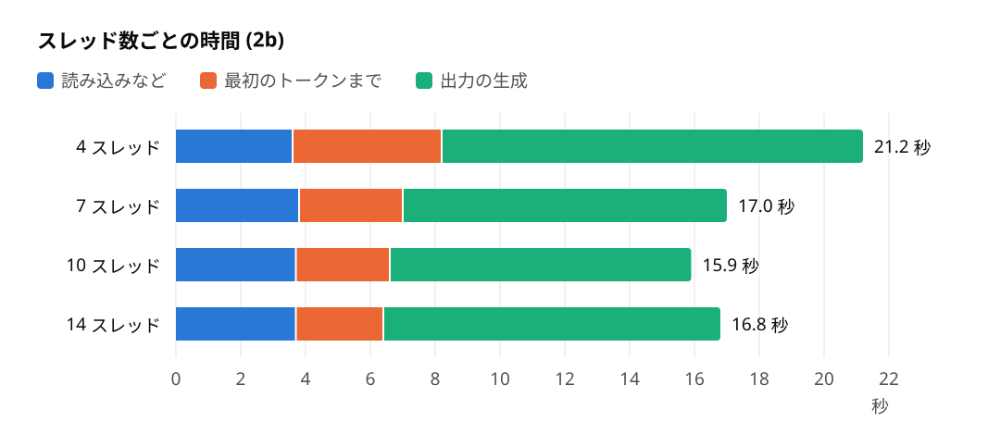
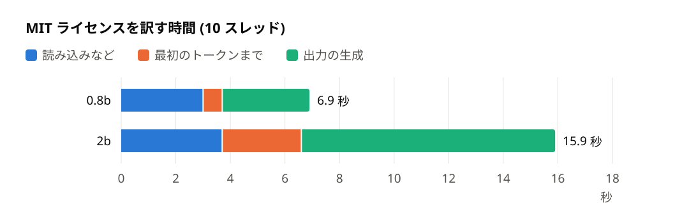

Title: plamo-tr-local: a CLI that runs PLaMo 3 Translate on your machine and translates text in a shell pipe
Date: 2026-11-27 18:30
Updated: 2026-11-27 18:30
Draft: true
Lang: en
Original: /blog/2026/33d2c2
Tags: rust cargo nix llm cli release rust-plamo-tr-local


Preferred Networks released the weights of PLaMo 3 Translate, its LLM for translation, on 2026-11-05, so I wrote `plamo-tr-local`, a CLI that runs the model locally on my PC and translates text in a shell pipe.
The repository is [conao3/rust-plamo-tr-local](https://github.com/conao3/rust-plamo-tr-local), under the Apache-2.0 license.

PLaMo 3 Translate produced every translation example in this post.



<div class="github-card" data-repo="conao3/rust-plamo-tr-local"><a href="https://github.com/conao3/rust-plamo-tr-local"><span class="github-card-name"><svg class="github-card-mark" viewBox="0 0 16 16" aria-hidden="true"><path d="M6.766 11.328c-2.063-.25-3.516-1.734-3.516-3.656 0-.781.281-1.625.75-2.188-.203-.515-.172-1.609.063-2.062.625-.078 1.468.25 1.968.703.594-.187 1.219-.281 1.985-.281.765 0 1.39.094 1.953.265.484-.437 1.344-.765 1.969-.687.218.422.25 1.515.046 2.047.5.593.766 1.39.766 2.203 0 1.922-1.453 3.375-3.547 3.64.531.344.89 1.094.89 1.954v1.625c0 .468.391.734.86.547C13.781 14.359 16 11.53 16 8.03 16 3.61 12.406 0 7.984 0 3.563 0 0 3.61 0 8.031a7.88 7.88 0 0 0 5.172 7.422c.422.156.828-.125.828-.547v-1.25c-.219.094-.5.156-.75.156-1.031 0-1.64-.562-2.078-1.609-.172-.422-.36-.672-.719-.719-.187-.015-.25-.093-.25-.187 0-.188.313-.328.625-.328.453 0 .844.281 1.25.86.313.452.64.655 1.031.655s.641-.14 1-.5c.266-.265.47-.5.657-.656"/></svg><span>conao3/<strong>rust-plamo-tr-local</strong></span></span><span class="github-card-description">Translate text from the command line with PLaMo 3 Translate running on your machine</span><span class="github-card-footer"><span class="github-card-language"><span class="github-card-language-color" style="background-color: #dea584"></span>Rust</span><span class="github-card-star"><svg viewBox="0 0 16 16" aria-hidden="true"><path d="M8 .25a.75.75 0 0 1 .673.418l1.882 3.815 4.21.612a.75.75 0 0 1 .416 1.279l-3.046 2.97.719 4.192a.751.751 0 0 1-1.088.791L8 12.347l-3.766 1.98a.75.75 0 0 1-1.088-.79l.72-4.194L.818 6.374a.75.75 0 0 1 .416-1.28l4.21-.611L7.327.668A.75.75 0 0 1 8 .25Z"/></svg><span>Star</span><span class="github-card-star-count" hidden></span></span></span></a></div>


# Why I wrote it

The [Preferred Networks tech blog](https://www.preferred.jp/ja/blog/tech/plamo-3-translate-weight-release) says PLaMo 3 Translate comes in four sizes, 0.8B, 2B, 8B, and 31B, with GGUF files for llama.cpp and quantized versions for MLX.
The weights alone don't translate anything, though, and even for a short passage you have to build a prompt in the PFML3 format and run the model with llama.cpp or a similar runtime.

I started on it after I saw a [post](https://x.com/kat0h/status/2118173128207851727) by kat0h.
kat0h didn't like the way Claude phrases Japanese, so they wrote a script that passes Claude's replies through PLaMo on their own machine before showing them.

With a local translation model as one stage of a pipe, you can try setups like that right away.


# Usage

With Nix, you can run it without installing it.

```console
$ nix run github:conao3/rust-plamo-tr-local -- text translate-text --text 今日はいい天気ですね。
```

You can also install it with Cargo.
The build compiles llama.cpp, so you need CMake, a C++ compiler, and libclang.

```console
$ cargo install --git https://github.com/conao3/rust-plamo-tr-local
```

On the first run, `plamo-tr-local` downloads the Q4\_K\_M GGUF from `pfnet/plamo-3-translate-<size>-GGUF` on Hugging Face into its cache (`~/.cache/plamo-tr-local` on Linux).
Q4\_K\_M quantizes each weight to about 4 bits, and the 2b model takes 1.81 GB.
You need no account or API key, and your text stays on your PC.

Without a target language, `plamo-tr-local` translates Japanese text into English and text in any other language into Japanese, and it prints JSON by default.

```console
$ plamo-tr-local text translate-text --text 今日はいい天気ですね。
{
  "TranslatedText": "The weather is nice today, isn't it?",
  "SourceLanguageCode": null,
  "TargetLanguageCode": "en"
}
```

To read standard input, leave out `--text`, and to get only the translation, pipe the JSON to `jq`.

```console
$ echo "Since it's raining today, I think I'll relax at home and read a book." \
    | plamo-tr-local text translate-text | jq -r .TranslatedText
今日は雨だから、家でゆっくり本を読んでいようと思う。
```

`--glossary` sets the translation of a term, and `--writing-style` picks the Japanese style: `plain` for the plain form or `polite` for the polite form.

```console
$ plamo-tr-local text translate-text --text "Filter tasks by owner." \
    --glossary Source=owner,Target=担当者 --writing-style polite | jq -r .TranslatedText
担当者でタスクを絞り込みます。
```

Two more options exist: `--context` describes the surrounding paragraphs or the kind of page, and `--model-size` picks the model size.
`--model-size` accepts `0.8b`, `2b`, `8b`, and `31b` (the default is `2b`). Smaller models run faster, and larger models translate more naturally.


# A command structure like the AWS CLI

The commands follow the layout of the AWS CLI: `<command> <subcommand>` followed by named arguments.


# Building the PFML3 prompt

PLaMo 3 Translate takes its prompt in the PFML3 format, a series of sections that each start with `<|plamo:tag|>` and give the dataset type, the reference context, the glossary, the source text, and the target language and style, in that order.
`plamo-tr-local` builds this prompt from its arguments in the same way as the [chat\_template.jinja](https://huggingface.co/pfnet/plamo-3-translate-2b-GGUF/blob/main/chat_template.jinja) in the GGUF repository.

Below is the prompt for translating "Filter by owner." into polite Japanese, with "A task list" as the reference context and owner → 担当者 in the glossary.
The real prompt is a single-line string, and I put each section on its own line here to make it easier to read.

    <|plamo:tag|>dataset<|plamo:msg|>translation
    <|plamo:tag|>context<|plamo:msg|>A task list
    <|plamo:tag|>glossary<|plamo:index|>owner<|plamo:item|>担当者
    <|plamo:tag|>input<|plamo:msg|>Filter by owner.
    <|plamo:tag|>output<|plamo:key|>lang<|plamo:val|>ja<|plamo:key|>form<|plamo:val|>polite<|plamo:msg|>

If you leave out `lang` for the source language in the `input` section, the model detects the language.
The model generates the translation after the last `<|plamo:msg|>`, and `plamo-tr-local` stops generating when a delimiter token such as `<|plamo:tag|>` comes out. It picks each token greedily, taking the most probable candidate every time.
If the source text contains a string with `<|plamo:`, the program can't tell it apart from the prompt delimiters, so `plamo-tr-local` exits with code 254.


# Translating long text paragraph by paragraph

The [model card](https://huggingface.co/pfnet/plamo-3-translate-2b) says the model handles up to 32,768 tokens of input and output combined, so `plamo-tr-local` splits long text into paragraphs at blank lines, groups them into chunks of 4,096 tokens or fewer, and translates one chunk at a time.
It splits a paragraph longer than 4,096 tokens by line, and it joins the translations back with the same blank lines and line breaks as the source.


# Problems I ran into


## Pinning the llama-cpp-2 revision

I call llama.cpp from Rust through the `llama-cpp-2` crate of [llama-cpp-rs](https://github.com/utilityai/llama-cpp-rs), but with the llama.cpp bundled in 0.1.161 on crates.io, loading the model failed with `unknown tokenizer: 'plamo3'`.
I pinned the dependency to the git revision of llama-cpp-rs that brings in llama.cpp v0.8.0.

```toml
[dependencies.llama-cpp-2]
git = "https://github.com/utilityai/llama-cpp-rs"
rev = "0364f5da1c6a6ee37f507031f116ce4a09b28594"
version = "0.1.162"
```

For the Nix build, I write the hash in `cargoLock.outputHashes` in `flake.nix` to fix the contents of the dependency that comes from git.

```nix
cargoLock = {
  lockFile = ./Cargo.lock;
  outputHashes."llama-cpp-2-0.1.162" = "sha256-7jI4+6tJ6s69ojMeqUbDHbbUfmlMbnecpvWrTM7iLEM=";
};
```


## Building with AVX2

llama-cpp-sys-2, the binding under `llama-cpp-2`, picks the CPU instruction set for llama.cpp from the Rust target features.
The Rust default for x86\_64 stops at SSE2, so a build with the defaults left llama.cpp without AVX2, and that build ran 3 to 4 times slower than one with AVX2.

To fix it, `.cargo/config.toml` sets the target CPU for x86\_64 Linux to `x86-64-v3`.
`x86-64-v3` is the level that includes AVX2, and it covers Intel CPUs from Haswell on and AMD CPUs from Excavator on.

```toml
[target.x86_64-unknown-linux-gnu]
rustflags = ["-C", "target-cpu=x86-64-v3"]
```


## The default thread count

My Intel Core Ultra 5 225U has 14 logical CPUs that mix performance P-cores with efficient E-cores, so I measured how long the 2b model took to translate the MIT License text into Japanese at different thread counts.
In the table, "To first token" is the time from the end of model loading until the model has read the prompt and produced the first token. I measured 4 threads once and took the median of three or more runs for the others.

<table border="2" cellspacing="0" cellpadding="6" rules="groups" frame="hsides">


<colgroup>
<col  class="org-right" />

<col  class="org-left" />

<col  class="org-left" />

<col  class="org-left" />
</colgroup>
<thead>
<tr>
<th scope="col" class="org-right">Threads</th>
<th scope="col" class="org-left">To first token</th>
<th scope="col" class="org-left">Output (214 tokens)</th>
<th scope="col" class="org-left">Total</th>
</tr>
</thead>
<tbody>
<tr>
<td class="org-right">4</td>
<td class="org-left">4.6 s</td>
<td class="org-left">13.0 s</td>
<td class="org-left">21.2 s</td>
</tr>

<tr>
<td class="org-right">7</td>
<td class="org-left">3.2 s</td>
<td class="org-left">10.0 s</td>
<td class="org-left">17.0 s</td>
</tr>

<tr>
<td class="org-right">10</td>
<td class="org-left">2.9 s</td>
<td class="org-left">9.3 s</td>
<td class="org-left">15.9 s</td>
</tr>

<tr>
<td class="org-right">14</td>
<td class="org-left">2.7 s</td>
<td class="org-left">10.4 s</td>
<td class="org-left">16.8 s</td>
</tr>
</tbody>
</table>



14 threads processed the prompt fastest, but 10 threads generated the output fastest, and 8, 9, 11, and 12 threads all came out slower than 10.
With 14 threads, output generation was even slower than with 7.
I set the default thread count to 3/4 of the logical CPUs (10 on my CPU), and the `PLAMO_TR_LOCAL_THREADS` environment variable changes it.


# Speed

I compared how long each model size took to translate the same MIT License text into Japanese.
The source was 169 English words and the prompt 252 tokens. I used only the CPU of the Intel Core Ultra 5 225U with the default 10 threads, and each value is the median of three or more runs.
The time of each step comes from the values that `--debug` prints.

```console
$ plamo-tr-local text translate-text --text file://LICENSE | jq -r .TranslatedText
```

<table border="2" cellspacing="0" cellpadding="6" rules="groups" frame="hsides">


<colgroup>
<col  class="org-left" />

<col  class="org-left" />

<col  class="org-left" />

<col  class="org-left" />

<col  class="org-left" />
</colgroup>
<thead>
<tr>
<th scope="col" class="org-left">Model</th>
<th scope="col" class="org-left">Load</th>
<th scope="col" class="org-left">To first token</th>
<th scope="col" class="org-left">Output speed</th>
<th scope="col" class="org-left">Total</th>
</tr>
</thead>
<tbody>
<tr>
<td class="org-left">0.8b</td>
<td class="org-left">2.8 s</td>
<td class="org-left">0.7 s</td>
<td class="org-left">71 tokens/s</td>
<td class="org-left">6.9 s</td>
</tr>

<tr>
<td class="org-left">2b</td>
<td class="org-left">3.4 s</td>
<td class="org-left">2.9 s</td>
<td class="org-left">23 tokens/s</td>
<td class="org-left">15.9 s</td>
</tr>
</tbody>
</table>



The 読み込みなど (loading and other) part of the chart is the total minus the time to the first token and the output generation time, and it includes loading the model.
The 0.8b translation was 229 tokens and the 2b translation 214 tokens. The 2b translation reads:

> MITライセンス
> 
> Copyright (c) &lt;year&gt; &lt;copyright holders&gt;
> 
> 本ソフトウェアおよび関連ドキュメントファイル（以下「本ソフトウェア」）の複製を取得したすべての者に対し、以下の条件に従い、本ソフトウェアを制限なく取り扱う（本ソフトウェアの使用、複製、改変、結合、公開、頒布、サブライセンス、および／または販売を行う権利、ならびに本ソフトウェアを提供された者が同様の行為を行うことを許可する権利を含むが、これらに限定されない）ことを、無償で許諾する。
> 
> 上記の著作権表示および本許諾表示は、本ソフトウェアのすべての複製物または実質的な部分に含まれなければならない。
> 
> 本ソフトウェアは「現状のまま」提供され、明示的か黙示的かを問わず、商品性、特定目的への適合性、および非侵害性に関する保証を含むがこれらに限定されない、いかなる種類の保証も伴わない。いかなる場合においても、著作者または著作権者は、契約上の行為、不法行為、またはその他の事由を問わず、本ソフトウェアに起因し、または本ソフトウェアの使用もしくはその他の取り扱いに関連して生じたいかなる請求、損害、またはその他の責任についても、一切の責任を負わないものとする。

The command loads the model on every run, and for 0.8b the load takes 40% of the total, so if you pipe Claude's replies in one paragraph at a time, you pay the load time once per paragraph.
To translate several texts in a row, use [text batch-translate-text](https://github.com/conao3/rust-plamo-tr-local#text-batch-translate-text), which loads the model once and translates one line at a time.


# Trying other writing styles

The `form` setting of PLaMo 3 Translate accepts two values, `plain` for the plain form and `polite` for the polite form, and I tried to get translations in ojousama speech (the refined speech of a well-bred young lady in Japanese fiction) and in the Kansai dialect.
I ran the 2B and 8B Q4\_K\_M GGUF files with `llama-server` from llama.cpp, set the temperature to 0, and tried these settings:

-   With `お嬢様言葉`, `関西弁`, or `Japanese (Kansai dialect)` as the target `lang`, the model returned the Japanese source unchanged.
-   With `お嬢様言葉`, `ojousama`, or `kansai` in `form`, the model translated in the plain form.
-   With 「お嬢様言葉で訳す」 (translate in ojousama speech) in the `context` reference context, the model translated in a neutral tone.
-   With two pairs of ojousama-speech translation examples placed before the source as history, the model translated in a neutral tone.

In the end, neither 2B nor 8B produced ojousama speech or the Kansai dialect.

Translating Japanese into Japanese with `form=polite`, on the other hand, the 2B model rewrote plain-form sentences in the polite form.
`plamo-tr-local` stops when the source and target languages are the same, so I tried this rewrite with `llama-server`.

    今日は雨だから家で本読むわ。
    → 今日は雨だから家で本を読みます。


# License

`plamo-tr-local` is under the Apache-2.0 license, but the models it downloads come under the [PLaMo Community License](https://huggingface.co/pfnet/plamo-3-translate-8b/raw/main/LICENSE/ja) from Preferred Networks. The main points are:

-   Personal and non-commercial use is free.
-   Commercial use is free after you register through the PLaMo commercial use registration form, as long as your revenue for the most recent fiscal year is 1 billion yen or less.
-   Article 5 of the license lets you publish the output of a model that only transforms text, such as translation, without saying so. It asks you to state that you used PLaMo for translation only when you publish the output as all or a substantial part of an independent long text such as a book or a paper.
-   Anyone who provides the model or a derived model to a third party displays "Built with PLaMo".

The `plamo-tr-local` README carries this notice too, and you should read the full license text before you use it.


# Closing

Use it when you want to translate text without sending it off your PC.

