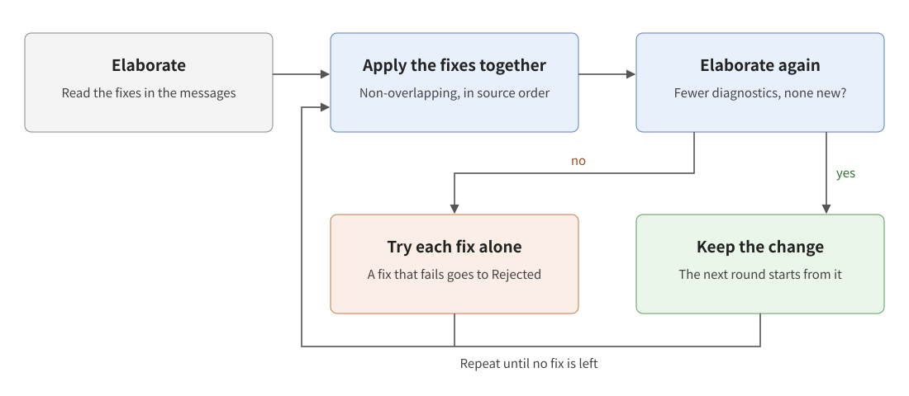

Title: Leankeel: a Lean 4 linter that applies the fixes in Lean's warnings and keeps only the ones that reduce them
Date: 2026-11-27 23:16
Updated: 2026-11-27 23:16
Draft: true
Lang: en
Original: /blog/2026/488048
Tags: lean rust linter formal-verification code-generation release rust-leankeel lean-leanfran lean-leanassay mathlib


I wrote Leankeel, a Lean 4 linter that applies the suggested fixes in Lean's warnings from the command line, all at once.
The warnings of Lean and its linters carry a fix, such as `_y` for an unused variable or the replacement name for a deprecated one.

Leankeel collects those fixes, applies them to the file, and elaborates the file again, and it keeps the change only when the warnings went down and no new warning showed up.

I measured all 8,624 files of Mathlib with an option that also reports unused variables inside tactic proofs, and Leankeel applied 2,152 of the 2,198 fixes for unused variables, 97.91%, and reverted the other 46.

The repository is [conao3/rust-leankeel](https://github.com/conao3/rust-leankeel), under the Apache-2.0 license.
I ran the results in this post with Lean 4.35.0 and Leankeel 0.1.0 at commit `b55c84a`.

<div class="github-card" data-repo="conao3/rust-leankeel"><a href="https://github.com/conao3/rust-leankeel"><span class="github-card-name"><svg class="github-card-mark" viewBox="0 0 16 16" aria-hidden="true"><path d="M6.766 11.328c-2.063-.25-3.516-1.734-3.516-3.656 0-.781.281-1.625.75-2.188-.203-.515-.172-1.609.063-2.062.625-.078 1.468.25 1.968.703.594-.187 1.219-.281 1.985-.281.765 0 1.39.094 1.953.265.484-.437 1.344-.765 1.969-.687.218.422.25 1.515.046 2.047.5.593.766 1.39.766 2.203 0 1.922-1.453 3.375-3.547 3.64.531.344.89 1.094.89 1.954v1.625c0 .468.391.734.86.547C13.781 14.359 16 11.53 16 8.03 16 3.61 12.406 0 7.984 0 3.563 0 0 3.61 0 8.031a7.88 7.88 0 0 0 5.172 7.422c.422.156.828-.125.828-.547v-1.25c-.219.094-.5.156-.75.156-1.031 0-1.64-.562-2.078-1.609-.172-.422-.36-.672-.719-.719-.187-.015-.25-.093-.25-.187 0-.188.313-.328.625-.328.453 0 .844.281 1.25.86.313.452.64.655 1.031.655s.641-.14 1-.5c.266-.265.47-.5.657-.656"/></svg><span>conao3/<strong>rust-leankeel</strong></span></span><span class="github-card-description">A Lean 4 linter that applies Lean's own suggested fixes and verifies every change</span><span class="github-card-footer"><span class="github-card-language"><span class="github-card-language-color" style="background-color: #dea584"></span>Rust</span><span class="github-card-star"><svg viewBox="0 0 16 16" aria-hidden="true"><path d="M8 .25a.75.75 0 0 1 .673.418l1.882 3.815 4.21.612a.75.75 0 0 1 .416 1.279l-3.046 2.97.719 4.192a.751.751 0 0 1-1.088.791L8 12.347l-3.766 1.98a.75.75 0 0 1-1.088-.79l.72-4.194L.818 6.374a.75.75 0 0 1 .416-1.28l4.21-.611L7.327.668A.75.75 0 0 1 8 .25Z"/></svg><span>Star</span><span class="github-card-star-count" hidden></span></span></span></a></div>


# Reporting warnings and fixing them

`tests/fixtures/Sample.lean` in the repository is a file with three warnings.

```lean
def unusedArg (x y : Nat) : Nat :=
  x + 1

@[deprecated Nat.add_comm (since := "2026-01-01")]
theorem oldAddComm (a b : Nat) : a + b = b + a := Nat.add_comm a b

example (a b : Nat) : a + b = b + a := oldAddComm a b

example (xs : List Nat) : xs ++ [] = xs := by
  simp [List.append_nil, Nat.add_comm]
```

Run `check-source` to list them.

```sh
nix run github:conao3/rust-leankeel -- --output text \
  source check-source --file Sample.lean
```

```text
Sample.lean:1:17: warn [linter.unusedVariables] Variable name `y` is not explicitly referenced.
Sample.lean:7:39: warn [Lean.Linter.deprecatedAttr] `oldAddComm` has been deprecated: Use `Nat.add_comm` instead
Sample.lean:10:25: warn [linter.unusedSimpArgs] This simp argument is unused: Nat.add_comm
```

From the top, the warnings are the unused argument `y`, a use of the deprecated `oldAddComm`, and `Nat.add_comm`, which the file passes to `simp` but `simp` doesn't use.
The name in square brackets is the kind that Lean attaches to the message, and Leankeel uses it as the rule name.

`fix-source` with `--write` applies the fixes and writes the file back.
The output is JSON, so I print only the counts with `jq` here.

```sh
nix run github:conao3/rust-leankeel -- \
  source fix-source --file Sample.lean --write | jq -c .Summary
```

```text
{"Applied":3,"Deny":0,"Fixable":0,"Rejected":0,"Warn":0}
```

Leankeel applied 3 fixes and left 0 warnings.
The diff of the file follows, and each change is the fix that Lean attached to the warning.

```diff
-def unusedArg (x y : Nat) : Nat :=
+def unusedArg (x _y : Nat) : Nat :=
   x + 1

 @[deprecated Nat.add_comm (since := "2026-01-01")]
 theorem oldAddComm (a b : Nat) : a + b = b + a := Nat.add_comm a b

-example (a b : Nat) : a + b = b + a := oldAddComm a b
+example (a b : Nat) : a + b = b + a := Nat.add_comm a b

 example (xs : List Nat) : xs ++ [] = xs := by
-  simp [List.append_nil, Nat.add_comm]
+  simp [List.append_nil]
```


# Elaborating again to check each change



Leankeel first elaborates the file and reads the fixes embedded in each message.
It applies the fixes of the selected rules whose ranges don't overlap, in source order, and elaborates the file again.

When the warnings went down and every warning left was there before, Leankeel keeps the change.
It compares the warnings before and after by rule, severity and message text, and leaves the text of the fix out of the comparison.

When the batch fails, Leankeel tries each fix alone, and it puts a fix that still fails into `Rejected` and never tries it again.

Leankeel repeats this until no fix is left, so it applies overlapping fixes, such as two unused arguments of one `simp`, one per round.

Here is a file where Leankeel reverts a fix.

```lean
def area (width height : Nat) : Nat :=
  width * width

example : area 3 (height := 4) = 9 := rfl

example (xs : List Nat) : (xs ++ []).length = xs.length := by
  simp?
```

The body of `area` doesn't use `height`, so Lean warns about it, but line 4 passes the argument by name as `(height :` 4)=.

A tactic such as `simp?` suggests a replacement for itself, and its fix belongs to the rule `lean.tryThis`.
Leankeel doesn't apply that rule by default, so select it with `--rules`.

```sh
nix run github:conao3/rust-leankeel -- --output text \
  source fix-source --file Named.lean \
  --rules linter.unusedVariables lean.tryThis
```

```text
def area (width height : Nat) : Nat :=
  width * width

example : area 3 (height := 4) = 9 := rfl

example (xs : List Nat) : (xs ++ []).length = xs.length := by
  simp only [List.append_nil]
Named.lean:1:16: warn [linter.unusedVariables] Variable name `height` is not explicitly referenced.
```

With `--output text`, Leankeel prints the fixed file and the warnings left.

The `simp only [List.append_nil]` that `simp?` suggested went in, and the warning on `height` stayed.
Renaming `height` to `_height` turns line 4 into the error `` Invalid argument name `height` for function `area` ``, so Leankeel reverted that fix.

The JSON output gives the reason under `Rejected`.

```sh
nix run github:conao3/rust-leankeel -- \
  source fix-source --file Named.lean \
  --rules linter.unusedVariables lean.tryThis \
  | jq -c '.Rejected[] | {Title, Reason}'
```

```text
{"Title":"Try this: _height","Reason":"the file gains a diagnostic or keeps as many as before when this fix is applied"}
```


# Rules and levels

A rule is the kind that Lean attaches to a message, so Leankeel handles the warnings of a library's linter or of a linter the project defines itself as rules without knowing about them.
Messages without a kind become `lean.error`, `lean.warning` and `lean.info`.

`rule list-rules` prints the rules that have a default level.

```sh
nix run github:conao3/rust-leankeel -- --output table \
  rule list-rules | cut -f1-4 | column -t -s $'\t'
```

```text
Rule                        DefaultLevel  Fix      LeanOption
linter.unusedVariables      warn          default  linter.unusedVariables
linter.unusedSimpArgs       warn          default  linter.unusedSimpArgs
linter.unnecessarySimpa     warn          default  linter.unnecessarySimpa
Lean.Linter.deprecatedAttr  warn          default  linter.deprecated
hasSorry                    warn          none     -
lean.tryThis                warn          opt-in   -
lean.error                  deny          none     -
lean.warning                warn          none     -
lean.info                   allow         none     -
```

`fix-source` fixes the rules whose `Fix` is `default` without `--rules`, and fixes an `opt-in` rule only when you select it with `--rules` or in the configuration.

Errors are always `deny`, and you set the level of the other rules in the nearest `leankeel.toml` above the file.
To stop on a theorem that still uses `sorry`, set `hasSorry` to `deny`.

```toml
[rules]
hasSorry = "deny"
```

```sh
nix run github:conao3/rust-leankeel -- --output text \
  source check-source --file Todo.lean
echo $?
```

```text
Todo.lean:1:8: deny [hasSorry] declaration uses `sorry`
254
```

A single `deny` warning makes the exit status 254, so a CI job stops there.

Inside a Lake project, Leankeel elaborates with the imports and `leanOptions` of that project.
`tests/fixtures/project` in the repository turns on `linter.missingDocs`, which warns about definitions without a docstring, in its `lakefile.toml`, so that warning shows up as a rule too.

```toml
[leanOptions]
weak.linter.missingDocs = true
```

```sh
cd tests/fixtures/project
nix run github:conao3/rust-leankeel -- --output text \
  source check-source --paths .
```

```text
./Keel/Basic.lean:7:4: warn [linter.missingDocs] missing doc string for public def depth
./Keel/Use.lean:4:15: warn [linter.unusedVariables] Variable name `m` is not explicitly referenced.
./Keel/Use.lean:4:33: warn [Lean.Linter.deprecatedAttr] `Keel.depth` has been deprecated: Use `Keel.draft` instead
```


# Measuring on Mathlib

`scripts/mathlib/` in the repository runs `fix-source` without `--write` on every `Mathlib/**/*.lean` of Mathlib v4.35.0 and counts the applied and reverted fixes.
Mathlib keeps its build free of warnings, so with the options of Mathlib's own build none of the 8,624 files had a warning.

So I turned on `linter.unusedVariables.analyzeTactics`, which also reports unused variables in tactic proofs.
With that option, 1,007 files had 2,198 fixes for `linter.unusedVariables`, and Leankeel applied 2,152 and reverted 46.

Each of the 46 reverted fixes either added a new warning or didn't reduce the count, so their warnings stay in 34 files.
The repository holds [the measurement](https://github.com/conao3/rust-leankeel/blob/b55c84a/results/mathlib/analyze-tactics/summary.md) and [the run with Mathlib's own options](https://github.com/conao3/rust-leankeel/blob/b55c84a/results/mathlib/default/summary.md).


# Decisions proved in Lean

The choice of which fixes to apply and which changes to keep, and the rule levels and exit status, are Lean definitions and theorems that I wrote inside `leanfran::lean!` in the Rust source.
At build time Lean checks the proofs and [leanfran](https://s.conao3.com/blog/2026/21ebbd) turns the definitions into Rust functions.

The `accept` below decides whether to keep a change, and I left out two other theorems here.

```lean
def noNew (before after : List String) : Bool :=
  after.all fun key => after.count key ≤ before.count key

def accept (before after : List String) : Bool :=
  after.length < before.length && noNew before after

theorem accept_shrinks (before after : List String) (h : accept before after = true) :
    after.length < before.length := by
  simp [accept] at h
  exact h.1

theorem accept_no_new (before after : List String) (h : accept before after = true) (key : String) :
    after.count key ≤ before.count key := by
  simp [accept, noNew] at h
  by_cases hk : key ∈ after
  · exact h.2 key hk
  · simp [List.count_eq_zero_of_not_mem hk]
```

`before` and `after` are the lists of warnings before and after the fix, and each warning is a string that joins the rule, the severity and the message text.

`accept_no_new` states that no warning occurs more often after a kept change than before it.
I also proved the following properties.

-   Every kept range of the source lies inside the file, and the ranges follow source order without overlap.
-   The kept bytes and the removed bytes add up to the bytes of the file.
-   The inserted edits are exactly the selected edits.
-   The range of a rejected fix moves by the size of the applied edits, and a rejected fix whose range an applied edit overlaps leaves the rejected list.
-   Errors are always `deny`, and Leankeel never fixes an `allow` rule.
-   The exit status is 0 only when no warning is `deny`.

There are 25 theorems in all, and I audit the seven functions that Rust calls with [leanassay](https://s.conao3.com/blog/2026/e3d3ca).
`make check` fails when a part has no theorem that covers it, when no theorem catches a rewrite that changes the output, or when a theorem has a hypothesis that nothing satisfies.

The adapter `native/Main.lean`, which runs the Lean frontend and extracts the messages, the Rust code that reads and writes files and turns warnings into strings, and the leanfran translation all sit outside the proofs.


# Outside the file being fixed

Leankeel checks only the file it fixes.
If only other files pass `(height :` 4)=, the fix that renames `height` to `_height` above goes in, so build the project after fixing.

Leankeel adds no checks of its own and handles only the messages that Lean emits during elaboration.
Environment linters such as Mathlib's `#lint`, style linters that read the text, and `lake shake` keep their own commands.

[lean-fmt](https://github.com/jcreinhold/lean-fmt) is a formatter and linter with its own rules.
Mathlib's `scripts/fix_deprecations.py` and `scripts/fix_unused_simp_args.py` rewrite the source from the warning text in a build log.

Leankeel supports Lean 4.35.0.

