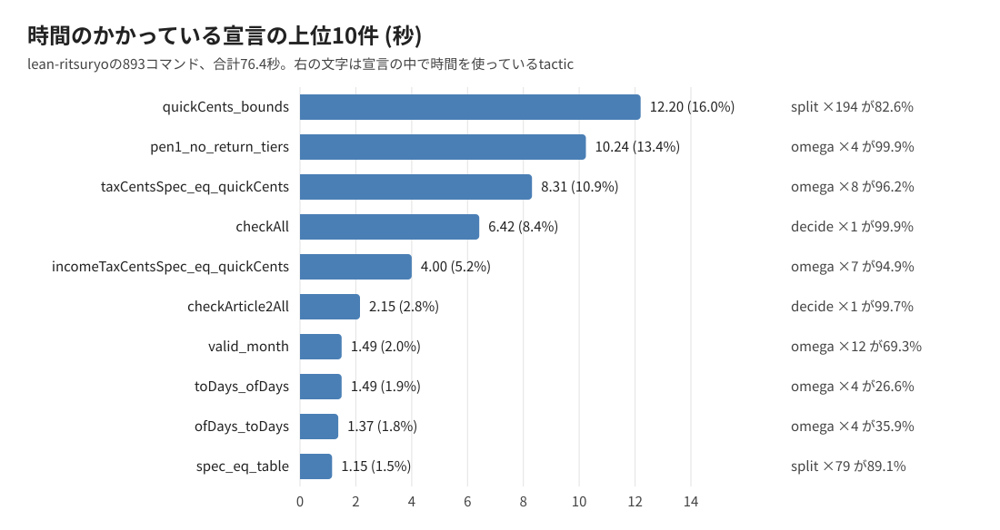
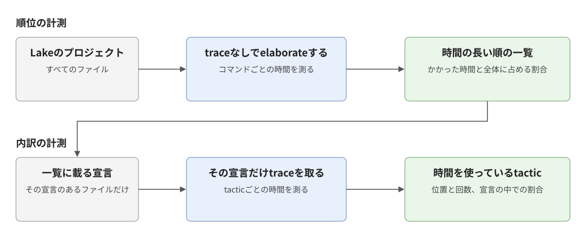
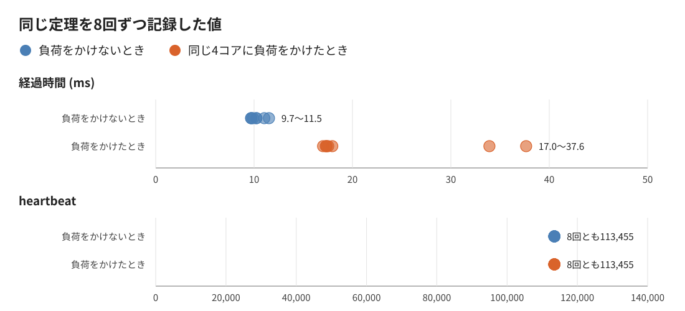

Title: Leanwake: a Lean 4 profiler that lists the slowest proofs and the tactics inside them in one command
Date: 2026-11-27 19:50
Updated: 2026-11-27 19:50
Lang: en
Original: /blog/2026/d8ac45
Tags: lean rust performance profiler formal-verification release rust-leanwake lean-leanfran lean-ritsuryo


I wrote Leanwake, a CLI that profiles a Lean 4 project and lists the slowest proofs from the top with one command.
For each proof it prints the time and its share of the total, and also the position of the tactic that takes the time inside that proof.

I tried it on [lean-ritsuryo](https://github.com/conao3/lean-ritsuryo), which proves calculations of statutory periods and tax amounts in Lean, and 10 declarations out of 893 commands took 64% of the elaboration time.
In one of those theorems, the `omega` on line 24 took 99.9% of the time.

Measuring the time of each tactic slows the proofs down, so Leanwake measures the ranking and the times without it, then measures only the listed declarations again to get the breakdown.

The repository is [conao3/rust-leanwake](https://github.com/conao3/rust-leanwake), under the Apache-2.0 license.
I ran the results in this post with Lean 4.35.0 and Leanwake 0.2.0.

<div class="github-card" data-repo="conao3/rust-leanwake"><a href="https://github.com/conao3/rust-leanwake"><span class="github-card-name"><svg class="github-card-mark" viewBox="0 0 16 16" aria-hidden="true"><path d="M6.766 11.328c-2.063-.25-3.516-1.734-3.516-3.656 0-.781.281-1.625.75-2.188-.203-.515-.172-1.609.063-2.062.625-.078 1.468.25 1.968.703.594-.187 1.219-.281 1.985-.281.765 0 1.39.094 1.953.265.484-.437 1.344-.765 1.969-.687.218.422.25 1.515.046 2.047.5.593.766 1.39.766 2.203 0 1.922-1.453 3.375-3.547 3.64.531.344.89 1.094.89 1.954v1.625c0 .468.391.734.86.547C13.781 14.359 16 11.53 16 8.03 16 3.61 12.406 0 7.984 0 3.563 0 0 3.61 0 8.031a7.88 7.88 0 0 0 5.172 7.422c.422.156.828-.125.828-.547v-1.25c-.219.094-.5.156-.75.156-1.031 0-1.64-.562-2.078-1.609-.172-.422-.36-.672-.719-.719-.187-.015-.25-.093-.25-.187 0-.188.313-.328.625-.328.453 0 .844.281 1.25.86.313.452.64.655 1.031.655s.641-.14 1-.5c.266-.265.47-.5.657-.656"/></svg><span>conao3/<strong>rust-leanwake</strong></span></span><span class="github-card-description">Find the slowest proofs in a Lean 4 Lake project and the tactics that take the time</span><span class="github-card-footer"><span class="github-card-language"><span class="github-card-language-color" style="background-color: #dea584"></span>Rust</span><span class="github-card-star"><svg viewBox="0 0 16 16" aria-hidden="true"><path d="M8 .25a.75.75 0 0 1 .673.418l1.882 3.815 4.21.612a.75.75 0 0 1 .416 1.279l-3.046 2.97.719 4.192a.751.751 0 0 1-1.088.791L8 12.347l-3.766 1.98a.75.75 0 0 1-1.088-.79l.72-4.194L.818 6.374a.75.75 0 0 1 .416-1.28l4.21-.611L7.327.668A.75.75 0 0 1 8 .25Z"/></svg><span>Star</span><span class="github-card-star-count" hidden></span></span></span></a></div>


# Listing the slowest proofs

Run `list-hotspots` in the directory of a Lake project.
Here I list the top 5 at commit `d79c7f5` of lean-ritsuryo.

```sh
git clone https://github.com/conao3/lean-ritsuryo
cd lean-ritsuryo
git checkout d79c7f5
nix run github:conao3/rust-leanwake -- profile list-hotspots \
  --project-dir . --jobs 4 --limit 5 --output table
```

```text
61.82 s in 893 commands and 54 files; the 5 listed take 52.7%
Seconds  Share  Location                             Declaration                                           Heartbeats  Inside
   8.84  14.3%  Ritsuryo/Tax/Proofs/Penalty.lean:14  Ritsuryo.Tax.Penalty.pen1_no_return_tiers              118149453  omega 24:59-24:64 x4 99.9%
   7.84  12.7%  Ritsuryo/Tax/Proofs/Income.lean:39   Ritsuryo.Tax.Income.quickCents_bounds                  110910269  split 42:52-42:57 x194 69.6%
   6.13   9.9%  Ritsuryo/Holiday/Check.lean:46       Ritsuryo.Holiday.checkAll                               28404434  decide 50:2-50:16 x1 99.9%
   5.57   9.0%  Ritsuryo/Tax/Inheritance.lean:79     Ritsuryo.Tax.Inheritance.taxCentsSpec_eq_quickCents     64381705  omega 86:12-86:17 x8 95.6%
   4.19   6.8%  Ritsuryo/Tax/Income.lean:68          Ritsuryo.Tax.Income.incomeTaxCentsSpec_eq_quickCents    35550693  omega 76:12-76:17 x7 94.6%
```

The first line gives the elaboration time of all the measured commands, and the declarations follow from the longest time down.
From left to right, each row has the time, the share of the total, the file and line, the declaration name, the heartbeats, and the tactic that takes the most time in the declaration.

Heartbeats count the small memory allocations Lean makes during elaboration, the same counter that the [maxHeartbeats](https://github.com/leanprover/lean4/blob/v4.35.0/src/Lean/CoreM.lean#L30-L33) limit uses.

On the built project this run took 70 seconds on 4 cores, and 102 seconds right after the clone, including the build of the dependencies.
`lake build` takes 48 seconds on the same project.



Without `--limit` you get the top 10.
The figure shows the top 10 from another run, where these 10 of the 893 commands took 64% of the total.


# Reading the breakdown

The first entry, `pen1_no_return_tiers`, is a theorem about the amount of the penalty for not filing a return, and its rightmost column reads `omega 24:59-24:64 x4 99.9%`.

```lean
theorem pen1_no_return_tiers (rate tax tax' prior : Nat) (hr : rate = 10 ∨ rate = 15) :
    (tax + prior ≤ 3000000 → noReturnCents rate tax prior = noReturnCentsArt2 rate tax prior) ∧
      (tax ≤ tax' → noReturnCents rate tax prior ≤ noReturnCents rate tax' prior) := by
  unfold noReturnCents noReturnCentsArt2 tieredCents
  rcases hr with rfl | rfl <;> constructor <;> intro h <;> omega
```

That points to the `omega` from column 59 to column 64 on line 24 of the file, which ran 4 times and took 99.9% of the time of this theorem.
It runs 4 times because `omega` runs once in each of the 4 goals that `<;>` splits off.

In the second entry, `quickCents_bounds`, the `split` of `repeat' split` ran 194 times and took 69.6%.

```lean
theorem quickCents_bounds (x y : Nat) (h : x ≤ y) :
    quickCents x + 5 * (y - x) ≤ quickCents y ∧ quickCents y ≤ quickCents x + 45 * (y - x) := by
  refine ⟨?_, ?_⟩ <;> unfold quickCents <;> repeat' split
  all_goals omega
```

In the third entry, `checkAll`, one run of `decide +kernel` takes 99.9%.
For definitions without tactics and for proofs written as terms, the column shows the names of Lean's internal steps, such as `addDecl` or `Meta.whnf`, in place of a tactic.

The default output is JSON, which holds every tactic that takes time in each declaration, so you can filter it with `jq`.


# Why Leanwake measures twice



Leanwake gets the time of each tactic from Lean's [trace.profiler](https://github.com/leanprover/lean4/blob/v4.35.0/src/Lean/Util/Trace.lean#L175-L199), but the trace slows the proofs down.
I measured only the file with `pen1_no_return_tiers`, alternating the two settings, and it took 8.3 to 9.3 seconds without the trace and 24.0 to 24.2 seconds with every trace on.

So Leanwake takes the ranking and the times from a run without the trace, and measures only the listed declarations again with the trace.
The breakdown uses only the shares from the second run, so the times in the table do not include the cost of the trace.

If you do not need the breakdown, `--detail none` skips the second run, and lean-ritsuryo finishes in 41 seconds.

The `lean` command and the language server elaborate on [multiple threads](https://github.com/leanprover/lean4/blob/v4.35.0/src/Lean/CoreM.lean#L35-L46) by default, while Leanwake sets `Elab.async` to `false` and measures the proofs elaborated synchronously inside their command.


# Time and heartbeats

Two runs in a row on the same commit gave totals of 65.7 seconds and 61.8 seconds, and the order of the top 4 changed while the same 5 declarations stayed at the top.
The time depends on the load of the machine, so Leanwake prints the share next to the time.

The order by heartbeats does not match the order by time.
In the table above, `checkAll` has 28.4 million heartbeats and took 6.13 seconds, longer than the 5.57 seconds of `taxCentsSpec_eq_quickCents` with 64.38 million heartbeats, so I chose time as the unit for the ranking.


# Comparing before and after a change

To see whether a proof got faster after you edit it, record the profile before and after the change with `record-profile` and compare the two with `compare-profiles`.
The comparison uses heartbeats.



The figure shows the values from recording one theorem 8 times under each of two conditions.
With a load on the same 4 cores, the mean elapsed time grew from 10 ms to 22 ms, while the heartbeats stayed at 113,455 in all 16 runs, so comparing one recording before and one after shows the change of each declaration.

For example, take `Demo.lean` with 4 declarations, and change the `simp` in this theorem to `simp only`.

```diff
 theorem length_append_swap (xs ys : List Nat) :
     (xs ++ ys).length = (ys ++ xs).length := by
-  simp [Nat.add_comm]
+  simp only [List.length_append, Nat.add_comm]
```

Record `base.json` before the change and `head.json` after it, then compare the two.

```sh
nix run github:conao3/rust-leanwake -- profile record-profile \
  --project-dir . --output-file base.json
nix run github:conao3/rust-leanwake -- profile record-profile \
  --project-dir . --output-file head.json
nix run github:conao3/rust-leanwake -- profile compare-profiles \
  --base-profile file://base.json --head-profile file://head.json \
  --output table
```

```text
Regressed: 0  Improved: 1  Unchanged: 3  Added: 0  Removed: 0
Heartbeats: 287947 -> 282588; thresholds: > 1000 heartbeats and > 1%
Status	BaseHeartbeats	HeadHeartbeats	DeltaHeartbeats	Path	Key
improved	39416	34153	-5263	Demo.lean	length_append_swap
```

The heartbeats of this theorem went down 13%, from 39,416 to 34,153.
`simp` also uses the lemmas tagged `@[simp]`, while `simp only` [uses only the lemmas you list](https://github.com/leanprover/lean4/blob/v4.35.0/src/Init/Tactics.lean#L718), which lowers the heartbeats.

Leanwake marks a command as faster or slower when the difference exceeds both 1,000 heartbeats and 1%.
In a real project, two recordings of the same commit can still differ by a few heartbeats in some commands.
In lean-ritsuryo, 19 of the 893 commands differed by up to 31, so I set the thresholds above that.

When a declaration gets slower, the exit code is 254, so you can put the comparison in CI, and the [README](https://github.com/conao3/rust-leanwake#ci-for-a-lean-project) has an example workflow.


# The comparison rules, proved in Lean

These Lean definitions decide whether a command got slower, and I left out `classify_regressed` and the other lemmas and theorems here.

```lean
def grows (base head absolute relative : Nat) : Bool :=
  decide (absolute < head - base ∧ base * relative < (head - base) * 100)

def classify (base head absolute relative : Nat) : Status :=
  if grows base head absolute relative then .regressed
  else if grows head base absolute relative then .improved
  else .unchanged

theorem equal_unchanged (b a r : Nat) : classify b b a r = .unchanged := by
  simp [classify, grows]

theorem regression_monotone {b h h' a r : Nat}
    (hyp : classify b h a r = .regressed) (increase : h ≤ h') :
    classify b h' a r = .regressed := by
  rw [classify_regressed] at hyp ⊢
  simp only [grows, decide_eq_true_eq] at hyp ⊢
  have mul := Nat.mul_le_mul_right 100 (Nat.sub_le_sub_right increase b)
  omega
```

`regression_monotone` states that if a pair is judged slower, it stays slower when the value after the change is larger still.
I also proved these properties:

-   Swapping the values before and after the change swaps slower and faster.
-   Raising the thresholds does not add pairs judged slower.
-   Each command from before and after the change appears exactly once in the matched result.
-   The comparison fails only when one or more commands got slower.

There are 22 theorems in total, and the code lives inside `leanfran::lean!` in the Rust source.
At build time Lean checks the proofs and [leanfran](https://s.conao3.com/blog/2026/21ebbd) turns the definitions into Rust functions, so the Rust side reads the JSON, passes it to these functions, and prints the result.


# What Leanwake cannot tell you

The shares in the breakdown move between runs, and the `split` in `quickCents_bounds` ranged from 69.6% to 82.6% over 4 runs.

Leanwake measures top-level commands, so a command that defines several declarations gets one value for all of them.
It supports Lean 4.35.0, and I have not measured Mathlib with it.

You can also measure the time of declarations and tactics with [lean-source-profiler](https://github.com/Vilin97/lean-source-profiler) and [leanprof](https://github.com/unbalancedparentheses/leanprof), and the time of each Lake build job with [lakeprof](https://github.com/Kha/lakeprof).
The Lean core and Mathlib track their performance per commit with [Radar](https://github.com/leanprover/radar).

