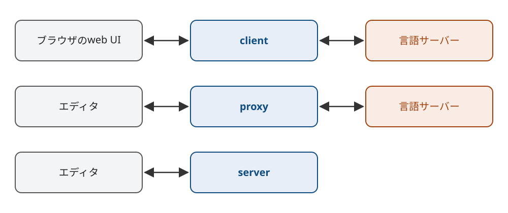
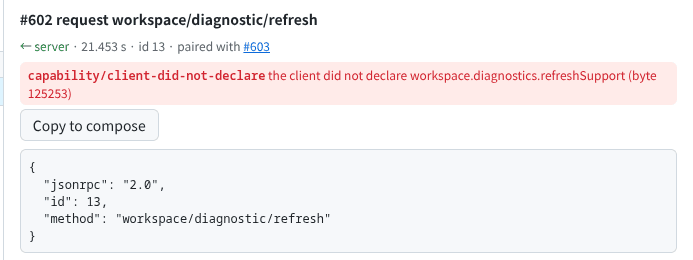

Title: Leanで仕様に厳格なLSPのクライアントとサーバーを作り、既存のOSSに仕様違反を見つけた
Date: 2026-11-09 17:30


エディタと言語サーバーはLanguage Server Protocol、略してLSPで通信します。
いろいろなエディタと言語サーバーを使う中で、どれも仕様と違う動きをしていると感じていました。
これを確かめる道具を探したところ、LSPには公式の適合テストがありませんでした。
サーバーの一部の機能を検査する道具はありましたが、クライアントを検査する道具は見つかりませんでした。

そこで、仕様に合わないメッセージを受け流さずに指摘するツールとしてlsp-touchstoneを作りました。
lsp-touchstoneはclient、proxy、serverの3つの動かし方を持ち、通信が仕様どおりかを判定します。
判定のうち計算を間違えやすい部分はLean 4で書いて正しさを証明し、[lean-rs](https://s.conao3.com/blog/2026/b43a06)でRustに変換しています。
lsp-touchstoneのserverとproxyを使って5つのエディタとrust-analyzerにつないだところ、思っていたとおり、どれにも仕様に反する動きがありました。
違反はどれもエディタを閉じる途中や画面に何も出ないやりとりの中に残っており、受け流さずに指摘する相手がいないと見つかりません。

リポジトリは[conao3/rust-lsp-touchstone](https://github.com/conao3/rust-lsp-touchstone)で、ライセンスはApache-2.0です。
この記事はlsp-touchstone 0.1.0で動かした結果をもとに書いています。

<div class="github-card" data-repo="conao3/rust-lsp-touchstone"><a href="https://github.com/conao3/rust-lsp-touchstone"><span class="github-card-name"><svg class="github-card-mark" viewBox="0 0 16 16" aria-hidden="true"><path d="M6.766 11.328c-2.063-.25-3.516-1.734-3.516-3.656 0-.781.281-1.625.75-2.188-.203-.515-.172-1.609.063-2.062.625-.078 1.468.25 1.968.703.594-.187 1.219-.281 1.985-.281.765 0 1.39.094 1.953.265.484-.437 1.344-.765 1.969-.687.218.422.25 1.515.046 2.047.5.593.766 1.39.766 2.203 0 1.922-1.453 3.375-3.547 3.64.531.344.89 1.094.89 1.954v1.625c0 .468.391.734.86.547C13.781 14.359 16 11.53 16 8.03 16 3.61 12.406 0 7.984 0 3.563 0 0 3.61 0 8.031a7.88 7.88 0 0 0 5.172 7.422c.422.156.828-.125.828-.547v-1.25c-.219.094-.5.156-.75.156-1.031 0-1.64-.562-2.078-1.609-.172-.422-.36-.672-.719-.719-.187-.015-.25-.093-.25-.187 0-.188.313-.328.625-.328.453 0 .844.281 1.25.86.313.452.64.655 1.031.655s.641-.14 1-.5c.266-.265.47-.5.657-.656"/></svg><span>conao3/<strong>rust-lsp-touchstone</strong></span></span><span class="github-card-description">A strict LSP client, server and checking proxy for testing Language Server Protocol implementations</span><span class="github-card-footer"><span class="github-card-language"><span class="github-card-language-color" style="background-color: #dea584"></span>Rust</span><span class="github-card-star"><svg viewBox="0 0 16 16" aria-hidden="true"><path d="M8 .25a.75.75 0 0 1 .673.418l1.882 3.815 4.21.612a.75.75 0 0 1 .416 1.279l-3.046 2.97.719 4.192a.751.751 0 0 1-1.088.791L8 12.347l-3.766 1.98a.75.75 0 0 1-1.088-.79l.72-4.194L.818 6.374a.75.75 0 0 1 .416-1.28l4.21-.611L7.327.668A.75.75 0 0 1 8 .25Z"/></svg><span>Star</span><span class="github-card-star-count" hidden></span></span></span></a></div>


# 作ったもの

lsp-touchstoneには3つの動かし方があります。



-   clientでは、使う人がブラウザのweb UIから言語サーバーを起動し、リクエストや通知を手で送ります。
-   proxyはエディタと言語サーバーのあいだに入り、すべてのメッセージを検査しながら中継します。
-   serverはエディタの言語サーバーとして動き、仕様にあるサーバーからのリクエストと通知をクライアントへ順に送ります。

3つとも同じ検査を使います。
検査に使う型と、各メソッドがクライアントやサーバーの宣言するどの機能（capability）に対応するかは、LSP 3.18の仕様を機械が読める形で定義したメタモデルの `metaModel.json` から読みます。
指摘は80種類あり、一覧は[docs/rules.md](https://github.com/conao3/rust-lsp-touchstone/blob/master/docs/rules.md)にまとめています。
仕様が禁じることはerrorにし、仕様が許していても実装によって読み方が分かれることはwarningにしています。


# Leanで証明した部分

判定する側が間違っていると、指摘も信用できません。
そこで、計算を間違えやすい3つの部分をLeanで書き、性質を証明しました。

-   LSPの位置は行と文字のオフセットで表し、クライアントとサーバーが初期化のときにUTF-8、UTF-16、UTF-32のどの単位で文字を数えるかを決めます。 `😀` はUTF-32では1、UTF-16では2、UTF-8では4と数えられます。この単位のあいだで位置を変換する計算について、往復すると元に戻ることと、文字の途中を指す位置を見分けられることを証明しています。
-   `didChange` で届いた変更を、proxyやserverが手元に持つ文書の写しに適用して範囲を置き換える計算です。置き換える範囲の前後の文字列が残ること、新しい文字列がその位置に入ること、置き換えたあとの長さが元の長さから範囲の長さを引いて新しい文字列の長さを足した値になることを証明しています。
-   サーバーは進捗を `begin` 、何回かの `report` 、 `end` の順に送ります。この進捗の状態がどう移るかについて、 `end` のあとはどの進捗も受け付けないことを証明しています。

進捗の部分は次のように書いています。
`TokenState` と `ProgressKind` の型の定義と、ほかの定理は省いています。
ビルドのときにLeanが `lean!` の中のコードの証明を検査し、lean-rsがそのコードをRustの関数に変換します。

```rust
lean_rust::lean! {
    pub mod proved;
    r#"
    def step : TokenState → ProgressKind → Option TokenState
      | .created, .begin => some .begun
      | .begun, .report => some .begun
      | .begun, .finish => some .ended
      | _, _ => none

    theorem ended_accepts_nothing (k : ProgressKind) : step .ended k = none := by
      cases k <;> rfl
    "#
}
```

`ended_accepts_nothing` は、 `end` のあとはどの進捗も受け付けないことを示しています。
proxyは進捗の通知を受けるたびにこの `step` を呼び、 `none` が返ったら違反として報告します。


# 見つかった仕様違反

`make check-editors` を実行すると、テスト用のスクリプトがeglot、lsp-mode、Neovim、Helix、VS Codeを人の操作なしに動かします。
eglotとlsp-modeはどちらもEmacsの上で動くLSPクライアントで、この記事はクライアントごとに1つのエディタとして数えています。
スクリプトはそれぞれのエディタを、lsp-touchstoneのserverにつなぐ構成と、proxyを通したrust-analyzerにつなぐ構成の2通りで別々に動かします。
そのうえで、hover、補完、定義へのジャンプ、1行の入力、コードアクションによる編集、保存、終了の順に操作します。
エディタとrust-analyzerはnixpkgsから入れました。
バージョンは次のとおりです。

-   Emacs 31.1、eglot 1.24.31、lsp-mode 20261020.1728
-   Neovim 0.12.6
-   Helix 25.07.1
-   VS Codeのクライアントのライブラリ `vscode-languageclient` 11.0.0。VS Codeをソースからビルドして配布しているVSCodium 1.143.17183で動かしました。
-   rust-analyzer 2026-11-02


## 終わり方

LSPでは、クライアントが `shutdown` を送り、応答を受けてから `exit` を送ってサーバーのプロセスを終わらせます。
`shutdown` を送ったあとのクライアントは、 `exit` のほかにリクエストも通知も送ってはいけません。
6つの実装は、それぞれ違う形でこの手順から外れていました。
以下で「回によって」と書いた動きは、何回か実行したうちの一部の回で起きたものです。

-   eglotは `exit` に `"params": {}` を付けて送ります。 `exit` はparamsを持たない通知なので、lsp-touchstoneはこれをwarningにしています。
-   lsp-modeは多くの回で `exit` を送らずにサーバーのプロセスを終わらせ、一部の回では `"params": null` を付けた `exit` を送ります。JSON-RPC 2.0のparamsはオブジェクトか配列で、 `null` は仕様に合いません。
-   Neovimはrust-analyzerとつないだとき、回によって `shutdown` のあとに `textDocument/semanticTokens` のリクエストを送ります。
-   VS Codeのクライアントは回によって `shutdown` のあとに `$/cancelRequest` を送ります。
-   Helixは回によって `exit` が届く前にサーバーのプロセスを終わらせます。
-   rust-analyzerはクライアントから受けたリクエストに答えないまま `shutdown` に応答し、終了します。


## 宣言していない機能

LSPでは、クライアントとサーバーが `initialize` で、自分が扱える機能をcapabilityとして宣言します。
相手が宣言していない機能のリクエストを送ると、扱えないリクエストを送ることになり仕様に反します。

clientのweb UIでrust-analyzerを起動し、初期化してからファイルを1つ開くと、次の指摘が出ます。



rust-analyzerが `workspace/diagnostic/refresh` のリクエストを送っています。
仕様はこのリクエストに対応するクライアントのcapabilityを `workspace.diagnostics.refreshSupport` と定めていて、lsp-touchstoneのclientはこれを宣言していません。

rust-analyzerは5つのエディタのどれとつないでもこのリクエストを送りました。
5つのエディタはどれも `refreshSupport` を宣言していません。
それでも、eglot、lsp-mode、Neovim、VS Codeは `"result": null` で成功を返しました。
Helixは「メソッドが見つからない」というエラーを返し、rust-analyzerはそのまま動き続けました。


## ほかの振る舞い

-   サーバーが進捗を送るときは、先に `window/workDoneProgress/create` のリクエストで進捗のtokenを作り、クライアントから応答を受けてからそのtokenで進捗を送り始める決まりです。しかし、rust-analyzerは `window/workDoneProgress/create` の応答を受ける前に、そのtokenで進捗を送り始めるという違反をすることがあります。
-   lsp-modeは、Emacsが最初の保存でファイルをバックアップの `main.rs~` に改名するとき、 `workspace/willRenameFiles` をサーバーに送り、エディタが内部で作るバックアップを人の操作によるファイルの改名として誤って知らせてしまいます。
-   lsp-touchstoneのserverは、位置を数える単位をクライアントが示した中から `utf-32` 、 `utf-8` 、 `utf-16` の優先順で選びます。eglot、lsp-mode、Neovim、Helixは `utf-32` を含めて示すのでserverが `utf-32` を選び、VS Codeのクライアントは仕様で必須の `utf-16` だけを示すので `utf-16` になります。


## 正しく動いたところ

serverはコードアクションから `workspace/applyEdit` でエディタに編集を送ります。
そのあとエディタが送る `didChange` から文書の中身を計算し、送った編集を適用した文書と一致するかを確かめます。
5つのエディタはすべて、編集を正しく適用しました。

編集の適用のように画面に結果が出る機能は、おかしければ使う人がすぐ気づきます。
一方、今回見つかった違反はどれもエディタを閉じる途中や、画面に何も出ないやりとりの中で起きていました。
実際のエディタや言語サーバーは仕様に合わないメッセージを受けても止まらずに受け流すので、違反をした側には違反を知らせる反応が返りません。
違反を見つけるには、受け流さずに指摘する相手が要ります。


# 使い方

使う人は、proxyを起動するコマンドを言語サーバーのコマンドとしてエディタの設定に書きます。
eglotなら次のように書きます。

```elisp
(add-to-list 'eglot-server-programs
             '(rust-ts-mode . ("lsp-touchstone" "proxy" "run-proxy"
                               "--web-ui-port" "4318"
                               "--server-command-args" "rust-analyzer")))
```

`--server-command-args` のあとには、本来の言語サーバーのコマンドを書きます。
`--web-ui-port` を付けると、lsp-touchstoneが通信をその場で表示するweb UIのURLを標準エラーに出します。
lsp-mode、Neovim、Helix、VS Codeの設定と、エディタごとの結果の詳細は[docs/editors.md](https://github.com/conao3/rust-lsp-touchstone/blob/master/docs/editors.md)にあります。

